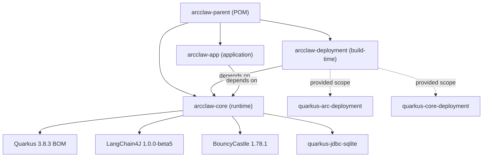

# ArcClaw v1.0 — Multi-Phase Implementation Plan

> **Source**: [ArcClaw-v1_0-CONSOLIDATED.md](file:///h:/ws/ArcClaw/ArcClaw-v1_0-CONSOLIDATED.md) (4,272 lines, 20 sections)
> **Target**: JDK 21+ baseline, Quarkus 3.8.3, LangChain4J 1.0.0-beta5, JDK 25 LTS–aligned
> **Maven Structure**: `arcclaw-parent` → `arcclaw-core` (runtime) / `arcclaw-deployment` (build-time) / `arcclaw-app` (application)

---

## User Review Required

> [!IMPORTANT]
> **JDK version choice**: The spec compiles against **Java 21** (current LTS) with documented migration paths for JDK 25 (ScopedValue JEP 506, pinning fix JEP 491). We target `maven.compiler.source=21`. Confirm this is acceptable, or should we move directly to JDK 25 EA?

> [!WARNING]
> **LangChain4J `@SupervisorAgent` API**: The spec uses `dev.langchain4j.experimental.agent.supervisor.SupervisorAgent`, which is experimental. If the LangChain4J version ships without this annotation, the `ArcClawSupervisor` will need to be hand-wired. The implementation will stub this boundary to decouple from the experimental API.

> [!IMPORTANT]
> **Quarkus extension separation**: The `arcclaw-deployment` module **must** stay build-time-only. Mixing runtime and deployment code in one module will cause native-image failures. This is a hard Quarkus requirement.

> [!CAUTION]
> **`SessionContext` not defined in spec**: The `WorkspaceContextProducer` injects a `SessionContext` bean that is not defined anywhere in the specification. We will need to either define this bean or refactor the producer during implementation.

---

## Proposed Changes

The implementation follows the spec's **Steel-Thread Build Order** (Section 20), organized into 6 logical phases. Each phase validates a critical integration boundary before the next one begins.

---

### Phase 1 — Project Scaffolding & Build Infrastructure

> Creates the 3-module Maven project, all POMs, build config, and `application.yaml`. Everything compiles but no business logic yet.

#### [NEW] [pom.xml](file:///h:/ws/ArcClaw/pom.xml)
- Parent POM with `<modules>` declaration for `arcclaw-core`, `arcclaw-deployment`, `arcclaw-app`
- `dependencyManagement`: Quarkus 3.8.3 BOM, LangChain4J 1.0.0-beta5 BOM, BouncyCastle 1.78.1
- `pluginManagement`: maven-compiler-plugin (Java 21, `--enable-preview`), maven-surefire-plugin

#### [NEW] [arcclaw-core/pom.xml](file:///h:/ws/ArcClaw/arcclaw-core/pom.xml)
- All runtime dependencies: quarkus-arc, quarkus-rest, quarkus-rest-jackson, quarkus-websockets-next, quarkus-vertx, quarkus-scheduler, quarkus-config-yaml, quarkus-jdbc-sqlite, quarkus-hibernate-orm-panache, hibernate-community-dialects, quarkus-narayana-jta, langchain4j, quarkus-langchain4j-core/agentic/ollama/openai, bcprov-jdk18on (with bc-fips/ext exclusions), quarkus-micrometer-registry-prometheus, quarkus-opentelemetry, quarkus-smallrye-context-propagation, quarkus-smallrye-health, quarkus-smallrye-openapi, quarkus-junit5 (test), rest-assured (test)

#### [NEW] [arcclaw-deployment/pom.xml](file:///h:/ws/ArcClaw/arcclaw-deployment/pom.xml)
- Depends on `arcclaw-core` (runtime)
- `quarkus-arc-deployment` + `quarkus-core-deployment` as `<scope>provided</scope>` — **build-time only**
- Resource filtering enabled for `quarkus-extension.properties`

#### [NEW] [arcclaw-deployment/src/main/resources/META-INF/quarkus-extension.properties](file:///h:/ws/ArcClaw/arcclaw-deployment/src/main/resources/META-INF/quarkus-extension.properties)
- `deployment-artifact=com.arcclaw:arcclaw-deployment:${project.version}`

#### [NEW] [arcclaw-app/pom.xml](file:///h:/ws/ArcClaw/arcclaw-app/pom.xml)
- Depends on `arcclaw-core` only (NOT deployment)
- Quarkus maven plugin with `build`, `generate-code`, `generate-code-tests` goals
- `native` profile: Mandrel 23.1-java21 builder, `-H:+InlineBeforeAnalysis`, `-J-Xmx8g`
- `jvm` profile: fast-jar (default)
- Failsafe plugin for integration tests

#### [NEW] [arcclaw-app/src/main/resources/application.yaml](file:///h:/ws/ArcClaw/arcclaw-app/src/main/resources/application.yaml)
- Full config from spec Section 16.5: HTTP, SQLite datasource, Hibernate ORM (SQLite dialect, `generation: update`), LangChain4J (Ollama + OpenAI), OTel, health, scheduler, virtual threads, logging with MDC `[sid=%X{sessionId}]`, context propagation, profiles (`%dev`, `%test`, `%staging`, `%prod`)

#### [NEW] [arcclaw-core/src/main/resources/META-INF/native-image/com.arcclaw/native-image.properties](file:///h:/ws/ArcClaw/arcclaw-core/src/main/resources/META-INF/native-image/com.arcclaw/native-image.properties)
- Fine-grained BouncyCastle flags: build-time for `asn1`, `engines`, `modes`, `params`, `generators`, `math`, `util`; run-time for `DRBG`, `SP800SecureRandom`, `EntropyUtility`, `SecureRandomInitializer`, `java.security.SecureRandom`

**Validation gate**: `mvnw clean compile` succeeds across all 3 modules.

---

### Phase 2 — Core CDI Scope + Security + State (Steel-Thread Steps 1–8)

> The foundation: custom CDI scope, crypto vault, state checkpointing. These are tightly coupled and must be validated together.

#### Core Scope (6 files)

| File | Module | Description |
|------|--------|-------------|
| [NEW] `WorkspaceScoped.java` | core | `@NormalScope(passivating = false)` annotation |
| [NEW] `WorkspaceScopeHolder.java` | core | ThreadLocal holder + JDK 25 ScopedValue (JEP 506) migration docs |
| [NEW] `WorkspaceScopeContext.java` | core | Arc `InjectableContext`, `ReentrantLock` per-session (G1), `ConcurrentHashMap` store |
| [NEW] `WorkspaceScopeExtension.java` | core | CDI Portable Extension + META-INF/services SPI registration |
| [NEW] `WorkspaceScopeProcessor.java` | deployment | `@BuildStep`: `CustomScopeBuildItem`, `ContextRegistrationPhase`, `AdditionalBeanBuildItem` |
| [NEW] `WorkspaceScopeRecorder.java` | deployment | `@Recorder` for native-image runtime init replay |

#### Security Layer (7 files)

| File | Module | Description |
|------|--------|-------------|
| [NEW] `VaultKey.java` | core | AutoCloseable 32-byte key container, wiped on close |
| [NEW] `Argon2idKeyDerivation.java` | core | 64 MB Argon2id, 3 iterations, salt+pepper combo |
| [NEW] `AesGcmSivCipher.java` | core | encrypt/decrypt/reEncrypt (RFC 8452), AAD binding |
| [NEW] `EncryptedSecret.java` | core | Panache entity, composite PK (sessionId, keyName) |
| [NEW] `EncryptedSecretId.java` | core | Serializable ID class for composite key |
| [NEW] `SecretVault.java` | core | Interface: init/get/store/keys/rotate/clear |
| [NEW] `SecretVaultImpl.java` | core | `@Dependent`, batch rotation via reEncrypt, no String leak |

#### Autonomy (1 file, 2 enums)

| File | Module | Description |
|------|--------|-------------|
| [NEW] `AutonomyPolicy.java` | core | Interface + `AutonomyLevel` + `ToolOperation` enums |

#### State Layer (4 files)

| File | Module | Description |
|------|--------|-------------|
| [NEW] `AgentCheckpoint.java` | core | Panache entity with `failedAt`/`failReason` fields |
| [NEW] `StatefulAgentStore.java` | core | Interface: checkpoint/load/complete/findInProgress/fail |
| [NEW] `StatefulAgentStoreImpl.java` | core | `@ApplicationScoped`, Jackson-serialized message history |
| [NEW] `SqliteWalConfigurer.java` | core | Startup WAL + `busy_timeout=10000` PRAGMAs |

#### Workspace Context (2 files)

| File | Module | Description |
|------|--------|-------------|
| [NEW] `WorkspaceContext.java` | core | `@WorkspaceScoped` non-record bean |
| [NEW] `WorkspaceContextProducer.java` | core | `@Produces @WorkspaceScoped`, vault init |

**Validation gate**: `@WorkspaceScoped` beans resolve in dev mode; `SecretVaultImplTest` passes (store/retrieve, rotation, tamper detection).

---

### Phase 3 — Sandbox + Tools + Agents (Steel-Thread Steps 7, 13)

> Process isolation, tool registry, and the multi-agent orchestration layer.

#### Sandbox (2 files)

| File | Module | Description |
|------|--------|-------------|
| [NEW] `RequiresSecret.java` | core | `@Repeatable` annotation + container `@RequiresSecrets` |
| [NEW] `ProcessIsolationExecutor.java` | core | Podman/Namespace/None strategies, resource caps, circuit breaker, OTel spans, `@PreDestroy` graceful shutdown (G2) |

#### Tool Layer (3 files)

| File | Module | Description |
|------|--------|-------------|
| [NEW] `AgentTool.java` | core | Marker interface: `name()`, `description()` |
| [NEW] `ToolRegistry.java` | core | CDI `Instance<AgentTool>`, autonomy check, secret collection |
| [NEW] `GithubTool.java` | core | Example tool with `@RequiresSecret` + `@Tool` |

#### Agent Layer (6 files)

| File | Module | Description |
|------|--------|-------------|
| [NEW] `Agent.java` | core | Marker interface |
| [NEW] `AgentRole.java` | core | `@Qualifier` annotation |
| [NEW] `ArcClawSupervisor.java` | core | `@SupervisorAgent` interface (LangChain4J experimental) |
| [NEW] `GrokAgent.java` | core | `@AgentRole("grok")`, OTel child span pattern |
| [NEW] `HarperAgent.java` | core | `@AgentRole("researcher")` |
| [NEW] `BenjaminAgent.java` + `LucasAgent.java` | core | `@AgentRole("coder")` + `@AgentRole("creative")` |

**Validation gate**: `ProcessIsolationExecutor` starts without error; `ToolRegistry` resolves `GithubTool`.

---

### Phase 4 — Lifecycle + Governance + Observability (Steel-Thread Steps 9–12, 14)

> Session lifecycle management, financial governance, and telemetry.

#### Lifecycle (2 files)

| File | Module | Description |
|------|--------|-------------|
| [NEW] `WorkspaceManager.java` | core | Startup zombie cleanup, heartbeat, scheduled GC |
| [NEW] `AgentLoop.java` | core | MDC + OTel + scope wire-up, checkpoint resume |

#### Governance (2 files)

| File | Module | Description |
|------|--------|-------------|
| [NEW] `GovernanceLayer.java` | core | Token bucket + USD cost tracking, budget enforcement |
| [NEW] `BudgetExceededException.java` | core | RuntimeException |

#### Observer (2 files)

| File | Module | Description |
|------|--------|-------------|
| [NEW] `AgentObserver.java` | core | Interface: session lifecycle callbacks |
| [NEW] `AgentOtelContext.java` | core | Static session root span manager + child span factory |

**Validation gate**: `AgentLoop.run()` completes a full cycle (MDC → OTel → scope → supervisor → cleanup).

---

### Phase 5 — REST API + Health + Deployment Artifacts (Steel-Thread Steps 15–17)

#### REST (1 file)

| File | Module | Description |
|------|--------|-------------|
| [NEW] `AgentResource.java` | core | 5 endpoints, `@RunOnVirtualThread`, bean validation |

#### Health (2 files)

| File | Module | Description |
|------|--------|-------------|
| [NEW] `PodmanHealthCheck.java` | core | `@Liveness` — Podman binary check |
| [NEW] `PodmanImageHealthCheck.java` | core | `@Readiness` — tool-runner image check |

#### Cross-Cutting (1 file)

| File | Module | Description |
|------|--------|-------------|
| [NEW] `ReflectionConfig.java` | core | Package-level `@RegisterForReflection` |

#### Deployment (5 files)

| File | Path | Description |
|------|------|-------------|
| [NEW] `docker-compose.yaml` | root | 4 services: arcclaw, ollama, otel-collector, jaeger (all 6 A-fixes) |
| [NEW] `otel-collector-config.yaml` | root | OTLP gRPC/HTTP → Jaeger + logging |
| [NEW] `Dockerfile.native` | `src/main/docker/` | UBI 9 minimal + embedded rootless Podman + fuse-overlayfs |
| [NEW] `containers.conf` | `src/main/docker/` | cgroupfs + file events logger |
| [NEW] `.env` | root | Template with `ARCCLAW_VAULT_PEPPER`, budget, model config |

**Validation gate**: `curl localhost:8080/q/health/live` returns UP in dev mode.

---

### Phase 6 — Integration Testing & JDK 25 Alignment

This phase validates the complete stack end-to-end.

- All inline JDK 25 JEP documentation is already included in Phase 2 source comments
- Structured Concurrency (JEP 505) explicitly avoided (still preview)
- ScopedValue (JEP 506) migration path documented but not activated until JDK 25 is the minimum target

---

## Verification Plan

### Automated Tests

```bash
# 1. Full Maven build (JVM mode)
./mvnw clean package -pl arcclaw-app

# 2. Unit tests
./mvnw test -pl arcclaw-core

# 3. Dev mode startup
./mvnw quarkus:dev -pl arcclaw-app
# Verify no startup errors in console output

# 4. Security unit tests (SecretVaultImplTest)
./mvnw test -pl arcclaw-core -Dtest=SecretVaultImplTest
```

### Manual Verification

1. **REST smoke test** — With dev mode running:
   ```bash
   # Create session
   curl -s -X POST http://localhost:8080/api/v1/sessions \
     -H "Content-Type: application/json" \
     -d '{"userId":"test-user"}' | jq .

   # Health check
   curl -s http://localhost:8080/q/health/live | jq .
   curl -s http://localhost:8080/q/health/ready | jq .
   ```

2. **Docker Compose stack** (optional, requires Docker/Podman):
   ```bash
   docker-compose up -d
   # Wait for services to start
   curl http://localhost:8080/q/health/live
   # Open Jaeger UI at http://localhost:16686
   ```

3. **Native image build** (optional, requires GraalVM or container builder):
   ```bash
   ./mvnw clean package -Pnative -pl arcclaw-app
   # Verify DRBG nonce uniqueness:
   ./arcclaw-app/target/arcclaw-app-*-runner -Darcclaw.probe.enabled=true 2>&1 | grep "nonce"
   # Run again — nonces MUST differ
   ```

---

## File Count Summary

| Module | New Files | Key Packages |
|--------|-----------|-------------|
| `arcclaw-core` | ~30 | `core.scope`, `security`, `tools`, `agents`, `state`, `lifecycle`, `governance`, `observer`, `health`, `channel` |
| `arcclaw-deployment` | 3 | `deployment` (Processor, Recorder, extension.properties) |
| `arcclaw-app` | 2 | `pom.xml`, `application.yaml` |
| Root | 6 | Parent POM, docker-compose, OTel config, Dockerfile, containers.conf, .env |
| **Total** | **~41 files** | |

---

## Dependency Graph



---

## Risk Mitigations

| Risk | Mitigation |
|------|-----------|
| Native-image BC DRBG seeding | Fine-grained `native-image.properties`; broad `org.bouncycastle` never used |
| Mixing deployment + runtime | Strict module separation enforced by Maven; deployment deps are `provided` |
| LangChain4J `@SupervisorAgent` API instability | Stubs only; hand-wire if API changes |
| `SessionContext` undefined in spec | Will define minimal `SessionContext` record/bean in Phase 2, or refactor producer |
| Podman not available on Windows dev | `arcclaw.sandbox.strategy=NONE` in `%dev` profile; circuit breaker fallback |
