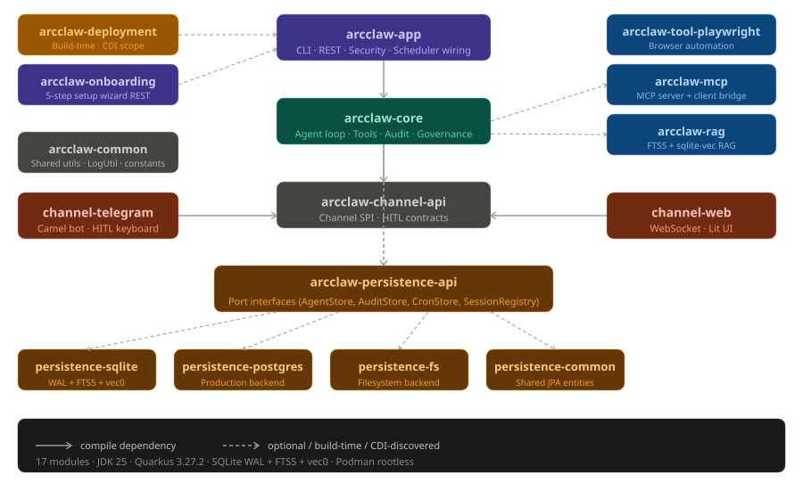
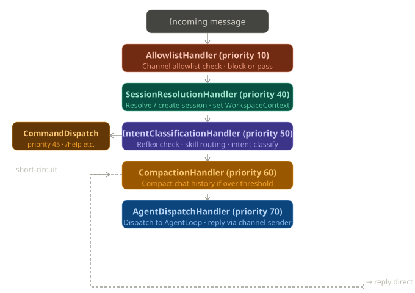
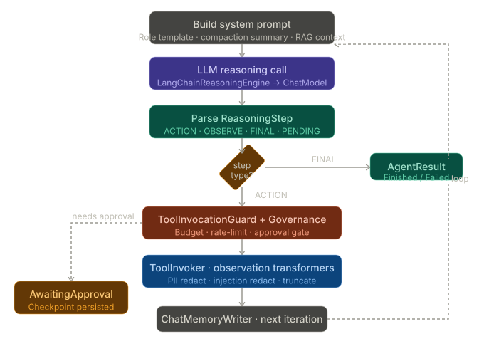

## Module Architecture



The codebase is organized into 7 Maven modules with clear separation of concerns:---

## Complete End-to-End Workflow

### Phase 1 — Application Startup & Bootstrap

When Quarkus boots, a sequence of startup events fires in order:

`StartupSecurityValidator` runs first, verifying that API key environment variables are present and meet minimum entropy requirements — it fails fast rather than running with insecure defaults. `DevSecretSeederStartup` (active only in `dev` profile) seeds mock API keys so developers can run without a `.env` file. `Vec0NativeLibraryInstaller` unpacks the `vec0` SQLite vector extension so the RAG subsystem can perform vector similarity searches. `AuditSchemaEnforcer` and `DataDirectoryInitializer` run next to create the SQLite schema and file workspace directories. `SkillRegistry` then loads skills from two tiers: `ClasspathSkillProvider` reads YAML-fronted markdown files from `/skills/index.txt` on the classpath (static, bundled skills), and `DatabaseSkillProvider` reads user-defined skills from the `agent_skill` table (dynamic, hot-reloadable). `AgentCronScheduler` restores any previously persisted cron jobs so scheduled tasks survive restarts.

The custom `@WorkspaceScoped` CDI scope is registered at Quarkus *build time* by `WorkspaceScopeProcessor` in `arcclaw-deployment` — it generates Arc client proxies for all beans annotated `@WorkspaceScoped`, making them live for exactly the lifetime of one agent session.

---

### Phase 2 — Entry Points (Message Ingestion)

There are four distinct entry points, all funneling into the same core pipeline:

**WebSocket (`/ws/chat`)** — `WebChatEndpoint.onOpen()` validates the API key (if `requireAuth=true`), assigns a `platformId` UUID to the connection, eagerly resolves an ArcClaw `sessionId` via `ChannelServices.resolveOrCreateSession()`, and sends back a `connected` JSON frame. On every `@OnTextMessage`, the raw JSON is parsed, a `ChannelMessage.WebSocketMessage` is constructed, and `ChannelServices.processAsync()` is called — non-blocking, returns immediately.

**Telegram** — `TelegramChannelRoute` registers itself on Quarkus startup via `StartupEvent`, spawns a long-poll loop through the Telegram Bot API, and routes every incoming update through `TelegramAgentHandler` → `ChannelServices.processAsync()`. The `TelegramAllowlistGuard` enforces a chatId allowlist before any message is processed.

**CLI** — `ArcClawCli` (Picocli root) dispatches to `ChatCommand` (interactive loop), `AskCommand` (single-shot), or `AttachCommand` (daemon mode). `ChatCommand` calls `AgentLoop.run()` directly after first passing the input through `ReflexRegistry`.

**REST API** — `AgentResource` offers `POST /agent/session` (create session), `POST /agent/{sessionId}/run` (fire-and-forget agent), and `GET /agent/{sessionId}/status`. `HitlResource` exposes `POST /hitl/{taskId}/approve` and `POST /hitl/{taskId}/reject` for Human-in-the-Loop resolution from any HTTP client.

---

### Phase 3 — The Message Pipeline

`ChannelServicesImpl.processAsync()` submits the message to a virtual-thread executor and runs it through `MessagePipeline` — a sorted list of `MessageHandler` implementations executed in ascending priority order:



**`AllowlistHandler` (priority 10)** — fetches the `ChannelPlugin` for the message's channel type and checks whether the sender is on the allowlist. Telegram uses a chatId list; the web channel trusts any authenticated WebSocket connection.

**`SessionResolutionHandler` (priority 20)** — looks up or creates a `SessionRegistry` entry keyed by `(channelType, channelId, userId)`. It activates the `WorkspaceContext` custom CDI scope for the session, making all `@WorkspaceScoped` beans like `CompactionSummaryCache` live for the duration.

**`IntentClassificationHandler` (priority 30)** — first runs `ReflexRegistry.processIfReflex()` to check for slash commands (see Phase 4). If no reflex matches, it calls `SkillAwareIntentDetector` to match the input against skill trigger patterns. If a skill matches, the session's role is overridden to the skill's persona. If nothing matches, the input falls through to the coordinator role.

**`CompactionHandler` (priority 60)** — if the session's token count or message count exceeds the configured compaction threshold, it calls `CompactionService.compact()`, which uses a separate, lighter LLM (`CompactionModelProducer` — default `llama-3.1-8b-instant` on Groq) to summarize the old conversation turns and write the summary to `CompactionSummaryEntity` in SQLite. `CompactionEventBridge` uses a `CountDownLatch` to prevent the subsequent agent loop from reading a stale null summary.

**`AgentDispatchHandler` (priority 70)** — calls `AgentLoop.run()`, renders the result using the channel's `ReplyRenderer`, and sends it back through `ChannelPlugin.sender()`.

---

### Phase 4 — Reflex Layer (Zero-LLM Fast Commands)

`ReflexRegistry` holds a list of `AgentReflex` implementations that short-circuit the LLM entirely for operational commands. The reflexes are checked in `IntentClassificationHandler` before any LLM call is made:

`ApproveReflex` and `DenyReflex` handle `/approve` and `/deny` by calling `CheckpointApprovalService`. `ResetReflex` wipes session state. `HistoryReflex` returns chat history. `StatusReflex` shows agent status. `HaltReflex` terminates a running session. `ListCronsReflex` and `DeleteCronReflex` manage scheduled jobs. `PromptInjectionReflex` scans for injection patterns (e.g. "ignore previous instructions") and rejects the message. `PiiScanReflex` runs a PII detection pass.

If a reflex fires, its `CommandResponse` is sent back through the channel sender without ever touching the agent loop.

---

### Phase 5 — The Agent Loop (Core ReAct Cycle)

`AgentLoop.run()` is the heart of the system. It implements a ReAct (Reason + Act) loop up to `maxIterations`:



**System prompt construction** (`SystemPromptBuilder`) — assembles a Qute template for the agent's role (coordinator, coder, analyst, etc.), injects the compaction summary from `CompactionSummaryCache` (`@WorkspaceScoped`), runs all `ContextEnricher` implementations (RAG context enricher lives in the optional `arcclaw-rag` module), and appends the current environment metadata from `SystemEnvironmentContextEnricher`.

**LLM call** (`LangChainReasoningEngine.nextStep()`) — retrieves the `ChatModel` produced by `ChatModelProducer` (which selects the active `AgentChatModelProvider` based on `arcclaw.llm.provider` config — Groq, OpenAI, Ollama, OpenRouter, or ClaudeCode). Assembles chat history from `ChatHistoryAssembler`, filters the tool list via `RoleRegistry.permittedTools()` (tools are gated by `AgentRoleEnum` → `ToolCapability`), then fires the `ChatRequest`. Rate-limit and schema validation errors are detected from the raw exception messages with fallback recovery logic (e.g., if the LLM returns truncated code, an `OBSERVE` retry step is injected).

**Step parsing** (`ReasoningStepParser`) — converts the `ChatResponse` into a `ReasoningStep` variant: `ACTION` (tool call with parameters), `OBSERVE` (observation to feed back), `FINAL` (the answer is ready), or `PENDING` (a retryable intermediate state).

**Governance check** (`GovernanceLayer` + `ToolInvocationGuard`) — validates that the requested tool is permitted for the current role. `RateLimitTracker` checks per-session token budgets. `BudgetExceededException` terminates the loop. If the session is in `SUPERVISED` autonomy mode, `ApprovalCheckpointManager` throws `RequiresApprovalException` for any destructive tool, pausing the loop and returning `AgentResult.AwaitingApproval`.

**Tool execution** — `ParallelToolStepExecutor` handles batch (parallel) tool calls. `ToolStepHandler` routes individual tool calls to `ToolInvoker`, which looks up the tool in `ToolRegistry` and invokes it. The raw observation passes through: `PiiRedactionTransformer` (strips PII patterns), `InjectionRedactionTransformer` (removes injected instructions from tool output), and `TruncationTransformer` (truncates oversized observations). `ChatMemoryWriter` persists the step to the SQLite-backed `MessageWindowChatMemory`.

---

### Phase 6 — Human-in-the-Loop (HITL)

When `RequiresApprovalException` is thrown, `ApprovalStateMachine` persists an `AgentCheckpoint` entity with status `AWAITING_APPROVAL`, tool name, and serialized parameter JSON. The agent loop suspends and returns `AgentResult.AwaitingApproval` to the channel layer.

The channel adapter then shows the approval request to the user. On Telegram, `BatchHitlKeyboardBuilder` generates an inline keyboard with Approve / Deny buttons. The web UI polls `GET /hitl` via SSE and presents buttons. On CLI, the user types `/approve` or `/deny`.

When the user responds, `CheckpointApprovalService.approveTool()` or `.denyTool()` updates the checkpoint status and fires an `ApprovalDecisionEvent`. `CheckpointResumeHandler` detects the resolved checkpoint and resumes the paused agent loop from the exact tool-call point. `ChannelApprovalTimeoutDispatcher` monitors stale checkpoints and auto-denies them after the configured timeout (observed via `TelegramStaleApprovalObserver`).

---

### Phase 7 — LLM Provider Routing

The `routing` package in `arcclaw-app` contains a sophisticated multi-provider abstraction. `LlmModelFactory` creates `ChatModel` instances for Groq, OpenAI, Ollama, OpenRouter, and ClaudeCode (`ClaudeCodeOAuthTokenExtractor` extracts the OAuth token from the local Claude Code CLI installation). `RoutingChatModelProvider` can route requests across providers based on intent or load. `LlmValidationService` exposes `LlmValidationGateway` so the onboarding wizard can test credentials before saving them.

The `compaction` LLM is produced by `CompactionModelProducer` — intentionally a separate, cheaper model (default `llama-3.1-8b-instant`) to minimize cost for summarization tasks.

---

### Phase 8 — Skills System

Skills are YAML-fronted markdown files defining a custom agent persona:

```
---
name: code-reviewer
description: Reviews code for bugs
trigger-patterns:
  - "review.*code"
  - "check.*pr"
tool-capabilities:
  - GITHUB
  - MEMORYSEARCH
max-iterations: 5
---
You are a meticulous code reviewer...
```

`SkillDefinitionParser` splits on `---` delimiters to extract the YAML frontmatter and the prompt body. `CompiledSkillEntry` pre-compiles the trigger regex patterns for fast matching at message routing time. `SkillRegistry` merges both tiers (classpath priority 100, database priority 10) so database skills can override classpath skills by name. `SkillAwareIntentDetector` also invokes the optional `IntentDetector` LLM call for semantic routing when regex patterns are ambiguous. `SkillResource` (REST) provides CRUD on database skills with live reload.

---

### Phase 9 — Cron Scheduling

`AgentCronScheduler` manages a registry of `CronJobRunner` entries backed by Quartz-compatible cron expressions. When a scheduled job fires, `CronJobRunner` spins up a dedicated agent session (sessionId prefixed `cron-`), sets the channel context to the origin channel type, and calls `AgentLoop.run()`. `CronResultHandler` takes the `AgentResult`, renders it via the channel's `ReplyRenderer`, and fires a CDI `AgentJobCompleted` event. `ChannelCronNotificationDispatcher` observes this event and calls the appropriate `ChannelJobNotifier` (Telegram, WebSocket, or CLI stdout).

---

### Phase 10 — Audit, Observability & Persistence

**Audit** — `AuditObserver` listens to agent lifecycle events and writes `AuditEvent` records to SQLite. Each record includes a SHA-256 hash of the previous record (`AuditHashUtil`), forming a WORM (Write Once, Read Many) chain. `AuditVerifier` can walk this chain to detect tampering. `ComplianceAuditService` raises `ComplianceViolationException` for policy breaches.

**OpenTelemetry** — `AgentOtelContext` manages a session-level root OTel span, creating child spans for each agent iteration (`agent.iteration`), tool call (`tool.call`), and reflex execution (`reflex.execute`). Token usage is accumulated on the root span as `llm.usage.prompt_tokens` / `llm.usage.completion_tokens`.

**Micrometer** — `MetricsAgentObserver` records per-loop metrics (token counts, iterations, result types) as Micrometer counters and histograms, exportable to Prometheus.

**Persistence** — `ArcClawSQLiteDialect` extends the Hibernate community SQLite dialect with a fix for an ORM 7 DDL regression. `AsyncPersistenceEngine` handles off-thread writes. `FtsConnectionInterceptor` enables full-text search. `SqliteRetryTemplate` handles SQLite lock contention with exponential backoff.

**Session lifecycle** — `SessionHeartbeatTracker` records the last-seen time per session. `SessionReaper` (scheduled) terminates sessions that have exceeded the idle timeout. `WorkspaceManager.terminateSession()` performs a 7-step teardown: wipes the workspace filesystem directory, clears in-memory `ChatMemory`, marks any in-flight `AgentCheckpoint` entities as `FAILED` (excluding terminal statuses to avoid a race condition with `CronResultHandler`), ends the OTel span, destroys the `WorkspaceScopeContext` (cleaning up all `@WorkspaceScoped` beans), and clears any batch-resume flags.

---

### Phase 11 — MCP (Model Context Protocol) Integration

`McpConnectResource` manages connections to external MCP servers over SSE or stdio. `McpAdminResource` provides an admin view of connected servers. Tools backed by MCP servers are registered in `ToolRegistry` and appear to the agent as normal tools — the LLM has no visibility into whether a tool is local or MCP-backed. The `arcclaw-deployment` `McpBuildStep` registers all `com.arcclaw.mcp.*` classes for GraalVM reflection in native image builds.

---

### Phase 12 — Frontend (Lit Web Components)

The `arcclaw-ui` module is a TypeScript/Lit application with custom web components communicating with the backend over WebSocket and REST:

`arc-chat` is the main chat component — it opens `ws://host/ws/chat` on connect, sends `{"type":"message","text":"..."}` frames, and renders `{"type":"message","role":"assistant","text":"..."}` responses. It subscribes to `GET /hitl/events` (SSE) to render approval request cards in-line. `arc-settings` provides a tabbed UI for switching LLM providers, updating API keys, and editing the system prompt. The onboarding wizard walks new users through provider selection, API key entry, MCP server configuration, and credential validation (calling `LlmValidationService` via REST). `AgentStatusResource` serves `GET /agents` for the live agent status panel and `GET /agents/events` (SSE) for real-time state change events.

---

### Summary Data Flow

```
User input
  ↓  (WebSocket / Telegram / CLI / REST)
AllowlistHandler → SessionResolutionHandler → IntentClassificationHandler
  ↓  (reflex? short-circuit reply)    ↓  (no reflex)
  ←─────── reply ─────────────        SkillAwareIntentDetector → role selection
                                        ↓
                                    CompactionHandler (if needed)
                                        ↓
                                    AgentLoop.run()
                                      ├─ SystemPromptBuilder (role + RAG + compaction)
                                      ├─ LangChainReasoningEngine → LLM
                                      ├─ Governance / HITL gate
                                      ├─ ToolInvoker (registered tools / MCP)
                                      ├─ Observation transformers (PII, injection, truncation)
                                      └─ ChatMemoryWriter → SQLite
                                        ↓
                                    AgentResult (Finished / AwaitingApproval / Failed)
                                        ↓
                                    ReplyRenderer → ChannelSender
                                        ↓
                                    User receives response
                                    AuditObserver · OTel spans · Micrometer metrics
```

The system's defining architectural properties are: the `@WorkspaceScoped` custom CDI scope that ties all session-local state to a single agent session lifetime; the declarative `SkillDefinition` system for hot-swappable agent personas; the multi-provider LLM abstraction with separate routing and compaction models; the WORM audit chain for compliance; and the pluggable `ChannelPlugin` SPI that lets Telegram, WebSocket, and future channels share the identical agent reasoning pipeline.