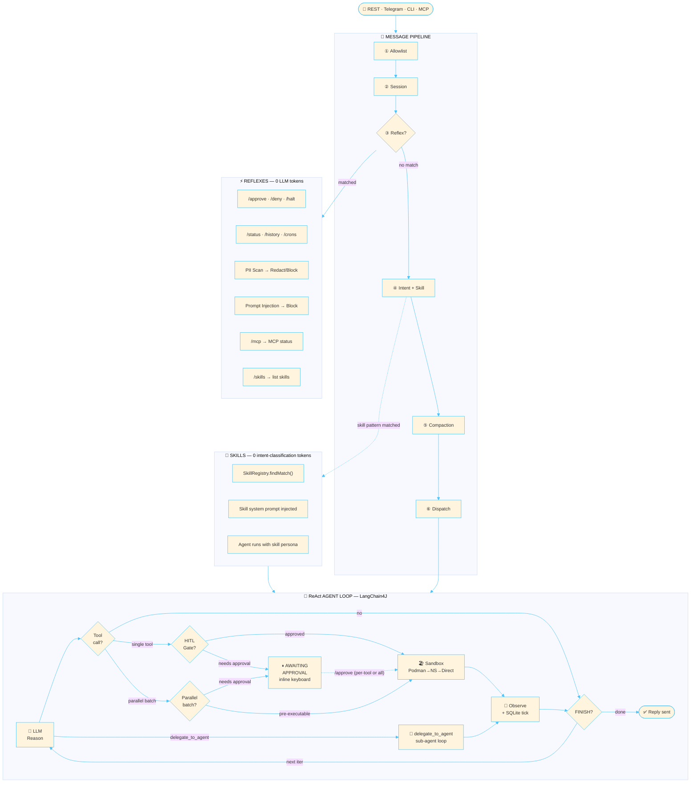
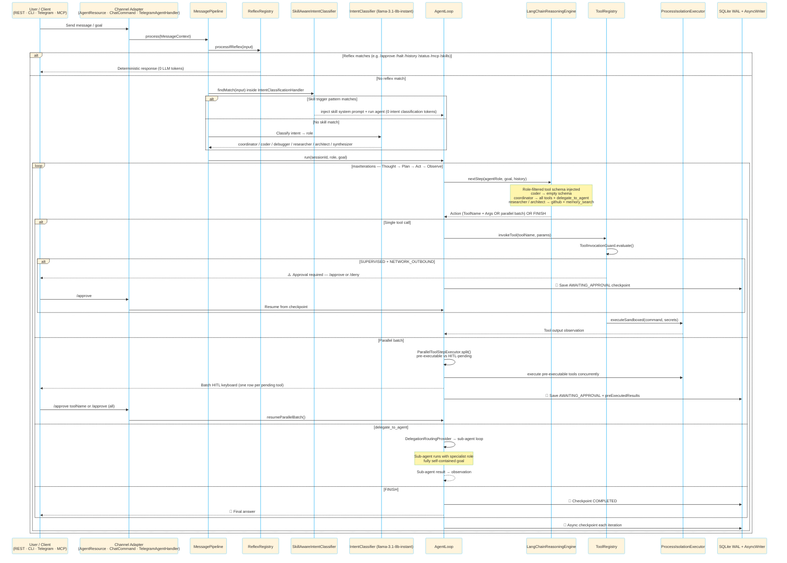
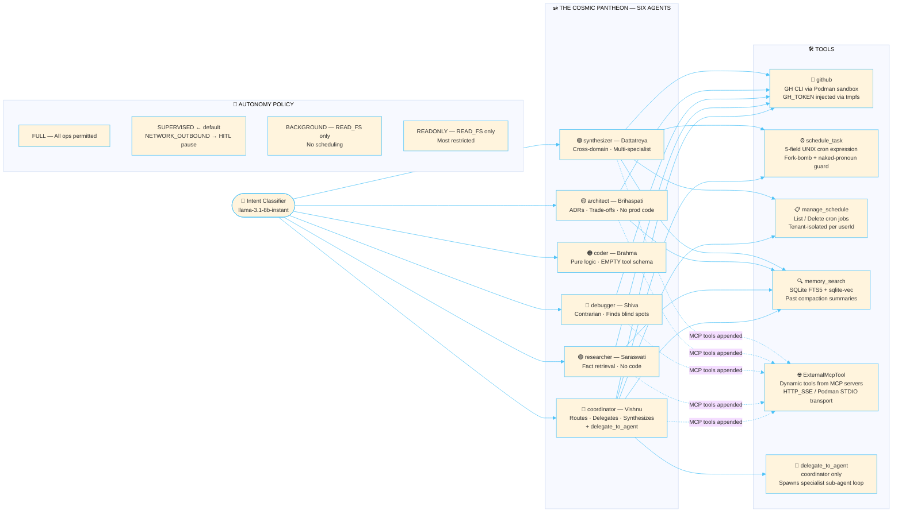
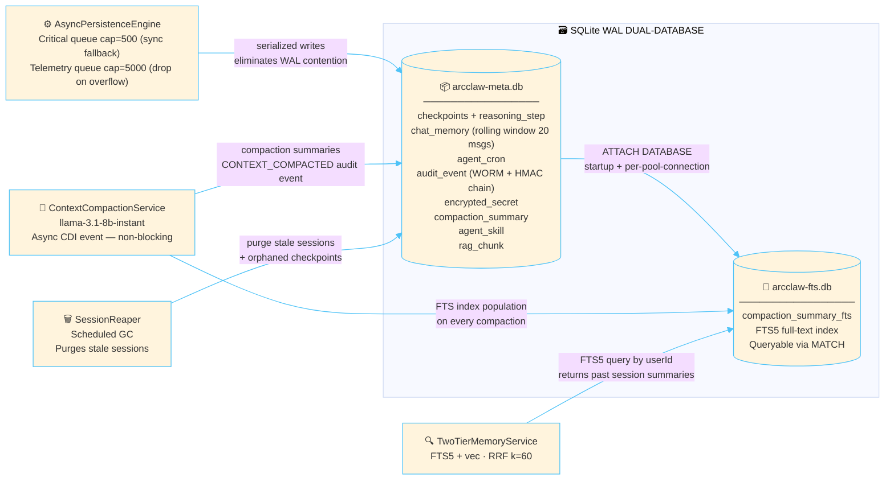
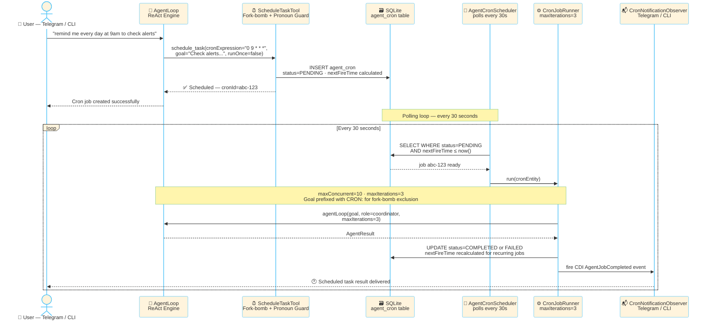
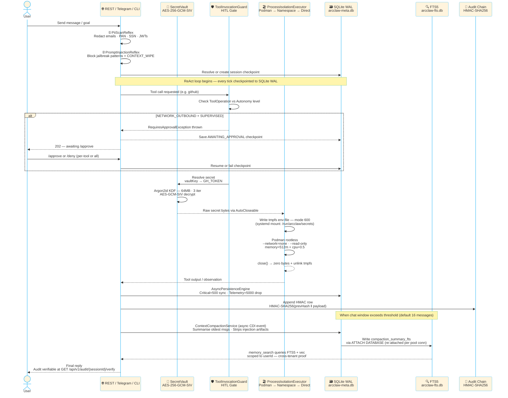
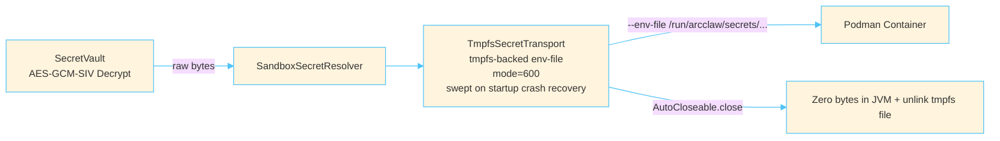

<div align="center">
  <h1>🛡️ ArcClaw V1.0.0</h1>
  <p><strong>A secure, stateful, and financially governed multi-agent AI kernel designed for enterprise deployment.</strong></p>

  
  
  
  
  
  
  
</div>

---

> **A self-hosted, security-first multi-agent AI framework built on Quarkus + LangChain4J**
>
> **Stack**: JDK 25 · Quarkus 3.27.2 · LangChain4J 1.x · SQLite (WAL + FTS5 + sqlite-vec) · Podman (rootless) · Apache Camel · BouncyCastle

---

> **Docs**: [Mise Setup](./MISE_SETUP.md) · [Manual Setup](./MANUAL_SETUP.md) · [Testing Guide](./TESTING_GUIDE.md) · [Telegram Testing](./TELEGRAM_TESTING.md) · [FAQ](./FAQ.md) · [Extension Guide](./ARCCLAW_EXTENSION.md) · [Channel SPI](./CHANNEL_SPI.md) · [Architecture Invariants](./Architecture_Invariants.md) · [REST Client Files](./rest-http/)

---

## What is ArcClaw?

ArcClaw is a **self-hosted, production-grade agentic AI platform** designed to run complex, multi-step reasoning tasks with full auditability, human-in-the-loop governance, and sandboxed tool execution. It runs as a single ~118 MB binary with zero external service dependencies (SQLite replaces a database server; Podman replaces a container daemon).

### Key Capabilities

- **ReAct agent loop** (Reason → Act → Observe) over Groq, OpenAI, OpenRouter, or local Ollama models
- **Six specialist agent personas** with per-role tool schemas, Qute-rendered system prompts, and iteration caps
- **Agent delegation** — the Coordinator (Vishnu) can delegate sub-tasks to specialist agents via the `delegate_to_agent` tool using `DelegationRoutingProvider`
- **Parallel tool execution** — the LLM can request multiple tools in a single step; `ParallelToolStepExecutor` runs them concurrently and merges results before the next iteration
- **Reflex system** — deterministic zero-token fast-path for commands, safety guards, and PII redaction before the LLM sees any input
- **Podman rootless sandbox** for executing AI-generated tool calls in full container isolation
- **AES-256-GCM-SIV secret vault** with Argon2id key derivation — secrets are never stored in plaintext
- **Tamper-evident HMAC audit chain** — every agent action is logged as an append-only, verifiable record
- **Autonomous cron scheduler** — agents can schedule future tasks using a 5-field UNIX cron expression
- **Context compaction + FTS5 + vector long-term memory** — rolling chat window with LLM-summarised history searchable via two-tier RAG (FTS5 keyword + sqlite-vec embeddings merged via Reciprocal Rank Fusion)
- **Batch HITL with inline Telegram keyboard** — parallel tool requests generate one-row-per-tool inline keyboards; individual tools can be approved or denied, or all approved/denied at once
- **MCP integration** — serves as both an inbound MCP server (JSON-RPC over HTTP-SSE) and an outbound MCP client that connects to external MCP servers and exposes their tools natively
- **Custom Skills system** — zero-LLM-token skill routing; skills defined as YAML-frontmatter Markdown documents, stored in SQLite, matched by trigger patterns before intent classification
- **Structured Output engine** — typed LLM extraction with retry loops and lenient JSON parsing
- **Multi-channel** — REST API, interactive CLI REPL, Telegram bot (via Apache Camel), one-shot `ask` mode for CI/CD

---

## 🏗️ Core Architectural Pillars

ArcClaw is not a conceptual prototype; it is an enterprise-grade kernel built with a paranoid security posture and rigorous financial guardrails.

| Pillar | Implementation |
|---|---|
| **Isolation** | OS-level sandboxing via Podman rootless or Linux Namespaces; Session-constrained workspaces |
| **State** | JDBC-backed `ChatMemoryStore` + SQLite (WAL) for 100% session persistence and graceful continuity |
| **Intelligence** | LLM Intent Routing (`llama-3.1-8b-instant`) for dynamic specialist dispatch; `SkillAwareIntentClassifier` checks `SkillRegistry` first (zero classification tokens) |
| **Governance** | Human-in-the-Loop (HITL) manual approval for sensitive tool operations; per-tool batch decisions with Telegram inline keyboard |
| **Observability** | Prometheus Metrics (Micrometer) + OTLP Tracing + Jaeger |
| **Security** | Argon2id key derivation + AES-256-GCM-SIV authenticated encryption; BouncyCastle 1.83 |
| **Memory** | Context compaction via `ContextCompactionService` + SQLite FTS5 + sqlite-vec two-tier RAG |
| **Scheduling** | Autonomous cron-based task scheduling with Telegram/CLI notifications |
| **MCP** | Inbound MCP server (JSON-RPC/HTTP-SSE) + Outbound MCP client (`ExternalMcpToolAdapter`) |
| **Skills** | Zero-token skill routing via `SkillRegistry`; CRUD via REST; built-in classpath + dynamic DB-tier |
| **Delegation** | Coordinator delegates to specialists via `delegate_to_agent` tool + `DelegationRoutingProvider` |

- **🛡️ Hardened Isolation:** Rootless Podman execution with ephemeral secret injection. Tools run in strictly capped containers, and secrets are passed via memory-wiped `.env` files — never as process arguments.
- **🔐 Zero-String Security:** Argon2id key derivation and AES-GCM-SIV cryptographic vault. Keys are held in `AutoCloseable` wrappers that aggressively overwrite memory with zeros when no longer needed.
  - **Operational Key-Rotation Policy:** ArcClaw currently does *not* support automatic or manual vault key rotation (deferred to Phase 64). In the event of a suspected compromise, the official operational policy requires a complete wipe of the `EncryptedSecret` table and out-of-band re-provisioning of all tenant secrets. No rotation APIs are exposed by the system contract at runtime.
- **🧵 Virtual Thread Mastery:** Fully non-blocking. Leverages JDK 25 `ScopedValue` (not `ThreadLocal`) alongside a bespoke CDI `@WorkspaceScoped` isolation mechanism to safely manage per-session state across thousands of lightweight virtual threads.
- **💰 Financial Governance:** Hard USD circuit breakers and **Human-in-the-Loop** approvals. Sensitive operations (e.g., `NETWORK_OUTBOUND`) pause execution until a user clicks `/approve` via Telegram or REST.
- **🔍 Observability:** Real-time Prometheus metrics at `/q/metrics` track token consumption and agent invocations, while OTLP distributed tracing provides HTTP spans via Jaeger.

---

## 🌊 High-Level Architecture Flow



When a REST call hits the kernel, the execution sequence is rigorously defined:

1. **REST API:** The edge layer (`AgentResource`) intercepts the request on a Virtual Thread and provisions a session.
2. **Message Pipeline:** Incoming channel messages pass through an ordered `MessagePipeline` of handlers: `AllowlistHandler` → `SessionResolutionHandler` → `CommandDispatchHandler` (reflexes) → `IntentClassificationHandler` (skill routing + LLM classification) → `CompactionHandler` → `AgentDispatchHandler`.
3. **Reflex System:** Before the LLM is ever invoked, the `ReflexRegistry` scans the input for deterministic fast-path commands. If a reflex matches, it executes without consuming any LLM tokens and short-circuits the pipeline.
4. **Skill System:** Inside `IntentClassificationHandler`, `SkillAwareIntentClassifier` checks `SkillRegistry.findMatch()` first. If matched, the skill's system prompt is injected and the agent runs directly — bypassing LLM intent classification entirely (zero additional classification tokens).
5. **AgentLoop (LangChain4J):** The core reasoning engine runs a bounded `maxIterations` loop (Thought → Plan → Act → Observe), preventing infinite hallucination spirals.
6. **ToolRegistry:** The CDI-powered registry discovers available tools and enforces Governance policy (e.g., blocking `NETWORK_OUTBOUND` actions if the agent is untrusted or budget-exceeded).
7. **Parallel Tool Execution:** When the LLM requests multiple tools in one step, `ParallelToolStepExecutor` executes them concurrently. Pre-executable tools (FULL autonomy or configured safe list) run immediately; remaining tools are held for batch HITL approval with Telegram inline keyboard.
8. **Agent Delegation:** The Coordinator uses the `delegate_to_agent` tool to spin up a sub-agent loop for specialist tasks (coding, debugging, research, architecture). The sub-agent runs with its own isolated context and reports results back.
9. **ProcessIsolationExecutor:** Three-tier degradation: Podman rootless containers in production (strict network/CPU/memory caps), Linux namespace isolation as fallback, and direct host execution in test mode only (`strategy: NONE`).
10. **SQLite Checkpointing:** After each tick, the entire Thought trajectory is serialized into a SQLite WAL-enabled checkpoint, making the agent deeply resilient to JVM crashes.
11. **Async Persistence Engine:** A single-writer `AsyncPersistenceEngine` serializes all SQLite writes through a `LinkedBlockingQueue`, preventing WAL contention across virtual threads.

> [!NOTE]
> **Sandbox Degradation Details**: The `ProcessIsolationExecutor` operates in three tiers:
> - **All profiles except `%test`** (`%dev`, `%prod`): `strategy: PODMAN` — attempts full Podman rootless container isolation with a circuit breaker (3-failure trip to fallback). This applies to **both dev and prod**.
> - **Namespace fallback**: If the Podman circuit opens (Podman unavailable or 3 consecutive failures), Linux `unshare` namespaces for pid, net, and mount isolation are used automatically.
> - **Direct execution** (`%test` profile only, or Windows OS detected): `strategy: NONE` — direct host `ProcessBuilder` execution. Requires `gh` CLI on the host `PATH`. No container isolation.

<details>
<summary>Detailed Architecture Flow Diagram</summary>

```mermaid
%%{init: {'theme': 'base', 'themeVariables': {'primaryBorderColor': '#4fc3f7', 'lineColor': '#4fc3f7', 'activationBorderColor': '#4fc3f7', 'actorBorder': '#4fc3f7', 'actorLineColor': '#4fc3f7','labelBoxBorderColor': '#0b0c0cff', 'noteBorderColor': '#81c784', 'fontSize': '13px'}}}%%
graph TD
    RestClient([REST Client / UI]) -->|HTTP| REST[AgentResource REST API]
    CLIUser([CLI User]) -->|chat / ask / serve| CLI[PicoCLI Commands]
    TelegramUser([Telegram User]) -->|Apache Camel Route| TH[TelegramAgentHandler]
    McpClient([External MCP Client]) -->|JSON-RPC HTTP-SSE /mcp| MCP[McpConnectResource]
    FutureChannel([Future Channel<br/>Discord / Slack / SMS]) -.->|ChannelPlugin SPI| Pipeline

    CLI --> Pipeline[MessagePipeline]
    TH --> Pipeline
    REST --> Pipeline
    MCP --> Pipeline

    subgraph Message Pipeline
        Pipeline --> ALH[AllowlistHandler<br/>priority 10 — user allowlist check]
        ALH --> SRH[SessionResolutionHandler<br/>priority 15 — session binding]
        SRH --> CDH[CommandDispatchHandler<br/>priority 30 — Reflex fast-path]
        CDH --> ICH[IntentClassificationHandler<br/>priority 50 — SkillAwareIntentClassifier first<br/>then llama-3.1-8b-instant]
        ICH --> CH[CompactionHandler<br/>priority 60 — async CDI event if threshold exceeded]
        CH --> ADH[AgentDispatchHandler<br/>priority 70 — Agent run]
    end

    subgraph Reflex System - No LLM Tokens Consumed
        CDH -->|matches| RR[ReflexRegistry]
        RR --> ApR[ApproveReflex /approve]
        RR --> DeR[DenyReflex /deny]
        RR --> HaR[HaltReflex /halt]
        RR --> HiR[HistoryReflex /history]
        RR --> StR[StatusReflex /status]
        RR --> LC[ListCronsReflex /crons]
        RR --> DC[DeleteCronReflex deletecron id]
        RR --> ReR[ResetReflex /reset]
        RR --> McpR[McpReflex /mcp]
        RR --> SkR[SkillReflex /skills]
        RR --> PII[PiiScanReflex redact before LLM]
        RR --> PIR[PromptInjectionReflex block jailbreaks]
    end

    subgraph Skill System - No Intent Classification Tokens
        ICH -->|trigger matches| SR[SkillAwareIntentClassifier<br/>SkillRegistry.findMatch]
        SR --> SB[Built-in Skills<br/>classpath resources/skills/]
        SR --> SD[Dynamic Skills<br/>SQLite AgentSkillEntity]
        SR --> SP[Skill system prompt injected<br/>agent runs with skill persona]
    end

    ADH --> Loop[AgentLoop Orchestrator]

    subgraph Core Kernel
        Loop <-->|Load/Save State| SQLite[(SQLite Checkpoint DB<br/>WAL + Async Writer)]
        Loop <-->|JDBC ChatMemory<br/>Rolling Window max-messages=20| JDBC[(Persistent ChatMemory<br/>+ FTS5 Long-Term Memory)]
        Loop <-->|Prompt + Role-Filtered<br/>Tool Schema| AI[LangChainReasoningEngine]
        Loop -->|Execute Tool Request| ToolReg[ToolRegistry<br/>Governance + HITL]
        Loop -->|RAG context enrichment| RAG[TwoTierMemoryService<br/>FTS5 + sqlite-vec RRF]
        Loop -->|delegate_to_agent| DelegateLoop[Sub-Agent Loop<br/>DelegationRoutingProvider]
        Loop -->|parallel batch| ParExec[ParallelToolStepExecutor<br/>pre-execute + HITL split]
    end

    subgraph Tool Schema per Role
        AI -->|agentRole filter| Schema{Schema Filter<br/>RoleDefinition.capabilities}
        Schema -->|coordinator| CT[github + schedule_task + manage_schedule<br/>+ memory_search + delegate_to_agent]
        Schema -->|researcher / architect| RA[github + memory_search]
        Schema -->|synthesizer| SYN[github + schedule_task + manage_schedule<br/>+ memory_search]
        Schema -->|debugger| DB2[github]
        Schema -->|coder| NoTool[empty schema<br/>tool bias impossible]
        Schema -->|dynamic MCP tools| DynT[ExternalMcpToolAdapter<br/>MCP server tools]
    end

    AI <-->|Cloud / Local Reasoning| LLMProv((Groq · OpenAI · OpenRouter · Ollama<br/>configurable via ARCCLAW_LLM_PROVIDER))
    Loop -->|Micrometer| Prom[Prometheus /q/metrics]

    subgraph Sandbox Layer - Three-Tier Degradation
        ToolReg -->|requiresSandbox=true| AgentToolImpl[AgentTool Implementation]
        AgentToolImpl -->|sandboxCommand + @RequiresSecret| PIE[ProcessIsolationExecutor]

        PIE -->|strategy=PODMAN<br/>all profiles except %test| Podman[(Podman Rootless Container<br/>--network=none --read-only<br/>memory=512m + cpu=0.5)]
        PIE -->|Podman circuit open<br/>3 failures| NS[Linux unshare Namespaces<br/>pid + net + mount isolated]
        PIE -->|strategy=NONE<br/>%test profile only or Windows| Direct[Direct ProcessBuilder<br/>Host PATH execution<br/>no isolation]
    end

    subgraph HITL Governance
        ToolReg -->|NETWORK_OUTBOUND<br/>SUPERVISED level| Pause[Pause + Save AWAITING_APPROVAL]
        Pause -->|/approve (per-tool or all)| Resume[Resume from SQLite Checkpoint]
        Pause -->|/deny (per-tool or all)| Terminate[Mark FAILED + Wipe State]
        ParExec -->|batch HITL| TeleKeyboard[Telegram Inline Keyboard<br/>per-tool approve/deny rows]
    end

    subgraph MCP Layer
        McpAdmin[McpAdminResource<br/>/api/v1/mcp/status · /api/v1/mcp/tools] --> McpTB[McpToolBridge<br/>DynamicToolCapabilityRegistry]
        McpConn[McpConnectResource<br/>/api/v1/mcp/connect] --> McpCS[McpClientService<br/>HTTP_SSE transport]
        McpCS --> ExtMcp[ExternalMcpToolAdapter<br/>wraps remote tools as AgentTool]
    end

    subgraph Cron Scheduler
        AgentCronScheduler[AgentCronScheduler<br/>poll every 30s] -->|pending jobs| CronJobRunner
        CronJobRunner -->|runs agent loop| Loop
        CronJobRunner -->|notifies| CronObs[CronNotificationObserver<br/>Telegram / CLI]
    end

    subgraph RAG - Two-Tier Memory
        RAG --> FTS5T[FTS5 keyword search<br/>CompactionSummaryRepository]
        RAG --> VecT[sqlite-vec vector search<br/>GlobalKnowledgeBase + SessionKnowledgeBase]
        FTS5T & VecT --> RRF[Reciprocal Rank Fusion<br/>k=60]
    end
```
</details>

<details>
<summary>Detailed Architecture Sequence Diagram</summary>


</details>

---

## 🕉️ The Cosmic Pantheon — Full Agent Roster

ArcClaw ships a **six-agent roster** inspired by the Hindu Trimurti & Tridevi, with two additional specialist roles derived from extended Vedic tradition. Roles are selected automatically by the intent classifier or passed explicitly via `agentRole` in the API/CLI.

| Role | Deity | Tools | Description |
|---|---|---|---|
| `coordinator` | **Vishnu** | `github`, `schedule_task`, `manage_schedule`, `memory_search`, `delegate_to_agent` | The Preserver. Primary router: decomposes goals, delegates to specialists via `delegate_to_agent`, synthesizes final output |
| `researcher` | **Saraswati** | `github`, `memory_search` | Goddess of Knowledge. Strict fact retrieval; never fabricates or writes code |
| `coder` | **Brahma** | *(none — empty schema)* | The Creator. Pure logic and engineering brain; refuses conversational tasks; tool bias architecturally impossible |
| `debugger` | **Shiva** | `github` | The Transformer. Contrarian balance expert; finds blind spots and challenges assumptions |
| `architect` | **Brihaspati** | `github`, `memory_search` | System Designer & Standards Author. Authors ADRs, evaluates trade-offs; never writes production code |
| `synthesizer` | **Dattatreya** | `github`, `schedule_task`, `manage_schedule`, `memory_search` | The Avadhuta (Trinity Incarnate). Cross-domain synthesis when a task spans multiple specialist domains simultaneously |

> [!NOTE]
> The `coder` role receives an **empty tool schema** — tool bias is architecturally impossible for it regardless of LLM instruction. The `coordinator` is the only role with `delegate_to_agent`; specialist agents do not recursively delegate. Each role's tools, max iterations, and system prompt template are defined in `AgentRoleEnum` → `RoleDefinition` → `resources/templates/prompts/role-<name>.txt`.



---

## 📦 Module Reference

```
arcclaw-parent/               ← Root POM: Java 25, Quarkus 3.27.2, BouncyCastle 1.83
│
arcclaw-channel-api/          ← Channel SPI contracts (zero implementation)
│   ├── ChannelPlugin           6-interface composite registration bean
│   ├── ChannelSender           Sends List<ReplyNode> to the channel
│   ├── ReplyRenderer           Converts ReplyNode AST to channel-native format
│   ├── ChannelAllowlist        Determines if a ChannelUser is authorized
│   ├── ChannelJobNotifier      Sends cron and approval timeout notifications
│   ├── ChannelDaemon           Daemon lifecycle: isConfigured(), start()
│   ├── ChannelType             Record — id() is the canonical key (e.g. "TELEGRAM")
│   └── structured/             AgentContribution, SynthesisFunction, SynthesisResult,
│                               ConflictSummary — typed structured output contracts
│
arcclaw-core/                 ← Agent runtime kernel
│   ├── agent/loop/             AgentLoop, AgentStateMachineRunner, ToolInvocationGuard,
│   │                           ToolInvoker, ParallelToolStepExecutor, ObservationTransformer SPI,
│   │                           InjectionRedactionTransformer, PiiRedactionTransformer,
│   │                           TruncationTransformer, CheckpointResumeHandler,
│   │                           ApprovalCheckpointManager, ChatMemoryWriter, EngineStepHandler
│   ├── agent/persona/          Agent, AgentPersonaRegistry, AgentRole, AgentRoleRegistry,
│   │                           BrahmaAgent, BrihaspatiAgent, DattatreyaAgent, SaraswatiAgent,
│   │                           ShivaAgent, VishnuAgent
│   ├── agent/reasoning/        LangChainReasoningEngine, ReasoningEngine SPI,
│   │                           AgentChatModelProvider SPI, ChatHistoryAssembler,
│   │                           PromptTemplateEngine (Qute), SystemPromptBuilder,
│   │                           ParallelToolCall, ReasoningStep, ReasoningStepParser,
│   │                           GroqProviderFactory, OpenAiProviderFactory,
│   │                           OllamaProviderFactory, OpenRouterProviderFactory
│   ├── agent/role/             AgentRoleEnum, RoleDefinition, RoleRegistry, ToolCapability
│   ├── api/                    AgentResource, AgentSessionService, AuditResource,
│   │                           SystemInfoResource — REST endpoints
│   ├── audit/                  AuditService, AuditObserver, AuditHashUtil, AuditEvent,
│   │                           AuditSchemaEnforcer (WORM triggers), AuditVerifier,
│   │                           ComplianceAuditService, TelemetryAuditService,
│   │                           SessionAuditSequencer, SecurityEventType
│   ├── channel/                ChannelPluginRegistry — startup-validated CDI discovery
│   ├── compaction/             CompactionAbortedException, CompactionInFlightFlag,
│   │                           CompactionRequest, CompactionEventBridge
│   ├── governance/             GovernanceLayer, GovernanceStrategy SPI, RateLimitTracker,
│   │                           BudgetExceededException, BudgetWarningException,
│   │                           RequiresApprovalException
│   ├── lifecycle/              WorkspaceManager, SessionReaper, SessionHeartbeatTracker,
│   │                           ApprovalTimedOutEvent, StaleApprovalExpired
│   ├── persistence/            AsyncPersistenceEngine (CRITICAL+TELEMETRY tiers),
│   │                           FtsConnectionInterceptor, ArcClawSQLiteDialect,
│   │                           SqliteRetryTemplate, SqliteErrorStrings
│   ├── pipeline/               MessagePipeline, MessageHandler SPI, MessageContext,
│   │                           handlers/: AllowlistHandler, SessionResolutionHandler,
│   │                           CommandDispatchHandler, IntentClassificationHandler,
│   │                           CompactionHandler, AgentDispatchHandler
│   ├── reflex/                 AgentReflex SPI, ReflexRegistry, ApproveReflex, DenyReflex,
│   │                           HaltReflex, HistoryReflex, StatusReflex, ListCronsReflex,
│   │                           DeleteCronReflex, ResetReflex, McpReflex, PiiScanReflex,
│   │                           PromptInjectionReflex, DelegateApprovalGuard
│   ├── routing/                CoderRoutingProvider, DefaultRoutingProvider,
│   │                           DelegationRoutingProvider, IngestRoutingProvider,
│   │                           IntentRoutingProvider, SchedulingRoutingProvider
│   ├── scope/                  @WorkspaceScoped CDI scope (JDK 25 ScopedValue),
│   │                           WorkspaceContext, WorkspaceScopeHolder, WorkspaceScopeContext,
│   │                           WorkspaceThreadContextProvider (MicroProfile context propagation),
│   │                           WorkspaceExecutors, ContextAwareExecutorService
│   ├── security/               SecretVaultImpl (AES-256-GCM-SIV + Argon2id),
│   │                           AutonomyLevel, TmpfsSecretTransport, RequiresSecret,
│   │                           SandboxSecretResolver, SandboxExecTool, ProcessIsolationExecutor,
│   │                           SandboxCircuitBreaker, DestructiveVocabularyFilter
│   ├── skill/                  SkillRegistry, SkillLoader, CompiledSkillEntry,
│   │                           AgentSkillEntity, SkillSystemPrompt (Qute template)
│   ├── state/                  StatefulAgentStore, SqliteStatefulAgentStore,
│   │                           AgentCheckpoint, PersistentChatMemoryStore,
│   │                           CompactionSummaryEntity, CompactionSummaryRepository,
│   │                           SqliteWalConfigurer, PersistentChatMemoryStore,
│   │                           RagChunkEntity, ReasoningStepEntity, InstantToTextConverter
│   ├── structured/             StructuredOutputEngine, StructuredRetryLoop,
│   │                           PermissiveJsonExtractor, AgentFunction annotation,
│   │                           AgentFunctionRegistry
│   └── tools/                  ToolRegistry, AgentTool SPI, ToolResponse, ToolOperation,
│                               ToolCapability, GithubTool, ScheduleTaskTool,
│                               ManageScheduleTool, MemorySearchTool,
│                               DelegateToAgentTool, DynamicToolLookup SPI
│
arcclaw-mcp/                  ← MCP server + client bridge
│   ├── bridge/                 ExternalMcpToolAdapter, McpToolBridge,
│   │                           McpToolDescriptor, McpToolAllowlist
│   ├── server/                 McpToolsBean — exposes internal tools over JSON-RPC
│   ├── tool/                   DynamicToolCapability, DynamicToolCapabilityRegistry,
│   │                           DynamicToolLookupImpl, McpTransportType
│   └── transport/              McpClientService, McpServerConfig, NdjsonWriter,
│                               PodmanMcpTransport, McpConnectionException
│
arcclaw-rag/                  ← Two-tier RAG memory (FTS5 + sqlite-vec vector search)
│   ├── EmbeddingModelProducer  Produces LangChain4J embedding model
│   ├── GlobalKnowledgeBase     Application-scoped in-memory embedding store
│   ├── SessionKnowledgeBase    @WorkspaceScoped per-session embedding store
│   ├── TwoTierMemoryService    RRF merge (k=60) of FTS5 + vector results
│   ├── RagContextEnricher      Enriches agent context with retrieved RAG chunks
│   ├── IngestDocumentTool      Tool for ingesting documents into the knowledge base
│   ├── RagSchemaInitializer    Schema setup for vector tables
│   └── ScoredChunk             Value object for ranked search results
│
arcclaw-deployment/           ← Build-time Quarkus extension (@BuildStep processors)
│                               AgentFunctionProcessor (JSON schema from return type),
│                               RestResourceBuildStep (enforces @RunOnVirtualThread),
│                               WorkspaceScopeProcessor (@WorkspaceScoped CDI wiring),
│                               McpBuildStep, RagResourcesBuildStep
│                               Required for native image compilation.
│
arcclaw-channel-telegram/     ← Telegram channel implementation (full 6-SPI contract)
│   ├── TelegramChannelPlugin   Composite registration bean wiring all 5 components
│   ├── TelegramChannelSender   Sends replies; chunking at 4096 chars; editMessage support
│   ├── TelegramMarkdownV2Renderer  ReplyNode AST → Telegram MarkdownV2 with full escaping
│   ├── TelegramAllowlistGuard  User ID + username allowlist; open-access + silent-block modes
│   ├── TelegramJobNotifier     Cron completion + approval timeout notifications
│   ├── TelegramChannelDaemon   Apache Camel route lifecycle
│   ├── TelegramChannelRoute    Camel RouteBuilder; feeds MessagePipeline
│   ├── TelegramAgentHandler    Per-chat Caffeine executor; sends ⏳ ACK
│   ├── TelegramCallbackHandler Inline keyboard callback_query routing
│   ├── BatchHitlKeyboardBuilder  Generates per-tool approve/deny inline keyboard rows
│   └── TelegramStaleApprovalObserver  Listens for ApprovalTimedOutEvent → user notification
│
arcclaw-app/                  ← Application entrypoint and wiring
    ├── ArcClawCli              Quarkus + Picocli entry point
    ├── channel/                ChannelApprovalTimeoutDispatcher, ChannelCronNotificationDispatcher
    ├── cli/                    ChatCommand (REPL), AttachCommand, AskCommand, ServeCommand,
    │                           CliCronNotificationObserver
    ├── compaction/             CompactionModelProducer (dedicated compaction model)
    ├── config/                 DotenvConfigSourceProvider, JacksonConfiguration,
    │                           Vec0NativeLibraryInstaller, AppReflectionConfig
    ├── mcp/                    McpAdminResource, McpConnectResource
    ├── observability/          MetricsAgentObserver (Micrometer)
    ├── routing/                IntentClassifierService, ModelProducer (intent-classifier model),
    │                           SkillAwareIntentClassifier, LlmModelFactory,
    │                           GroqLlmProviderFactory, OpenAiLlmProviderFactory,
    │                           OllamaLlmProviderFactory, OpenRouterLlmProviderFactory,
    │                           RoutingChatModelProvider SPI
    ├── scheduler/              AgentCronScheduler, CronJobRunner, CronResultHandler
    ├── security/               ApiKeyAuthFilter, ApiKeyRegistry, StartupSecurityValidator,
    │                           DevSecretSeederStartup, RateLimitErrorResponse, ClockProducer
    ├── session/                SessionRegistry (production SessionIdResolver)
    └── skill/                  SkillResource (REST CRUD /api/v1/skills)
```

### Operational Support Files

| File | Purpose |
|---|---|
| `arcclaw-secrets.mount` | systemd unit that mounts `/run/arcclaw/secrets` as a tmpfs (mode 700, 10 MB, `noexec,nosuid`). Required for `TmpfsSecretTransport` on production Linux. Without this, secret env-files fall back to the OS temp directory. |
| `backfillfts5.sql` | One-time migration script to backfill the `compaction_summary_fts` FTS5 table on existing databases after the Phase 45 deployment. Must be run once on any database created before Phase 45. |
| `containers.conf` | Podman configuration overrides (`cgroupns=host`, `netns=host`, `storage.driver=vfs`). Required for rootless Podman on some Linux distributions — without it, the sandbox may fail silently on container network setup. |

### Why This Split?

| Layer | Reason |
|---|---|
| `arcclaw-channel-api` | Allows `arcclaw-core` to reference channel concepts (sender, allowlist) without coupling to Telegram or any concrete adapter. Swapping channels requires zero core changes. |
| `arcclaw-core` | Independently testable. All 933 tests run without any HTTP container. Business rules, governance, persistence, tools, and the agent kernel live here. |
| `arcclaw-mcp` | MCP server/client logic is isolated from the agent kernel. The `arcclaw-core` `DynamicToolLookup` interface is the only seam — `arcclaw-mcp` provides the implementation via `DynamicToolLookupImpl`. |
| `arcclaw-rag` | Vector search (sqlite-vec) has native library dependencies (`vec0.so`). Isolating it in its own module prevents native image metadata from polluting the core module. |
| `arcclaw-channel-telegram` | The Telegram channel is a full Maven module with its own test suite (9 test classes). It can be excluded from the build for deployments that don't need Telegram. |
| `arcclaw-deployment` | The `@WorkspaceScoped` CDI scope, `AgentFunctionProcessor`, `RestResourceBuildStep`, and RAG resource steps are registered at Quarkus build time via `@BuildStep`. Separating this ensures the scope works correctly in native image compilation. |
| `arcclaw-app` | The only module that knows about external protocols (HTTP, Telegram, CLI). Keeps protocol concerns out of the kernel. |

### `@WorkspaceScoped` — Custom CDI Scope

Standard CDI scopes (`@RequestScoped`, `@SessionScoped`) are tied to HTTP lifecycle events. Agent runs on virtual threads — especially async runs and cron jobs — have no HTTP request context. `@WorkspaceScoped` is a CDI scope keyed on `sessionId`. The `WorkspaceScopeHolder` uses **JDK 25 `ScopedValue`** (not `ThreadLocal`) to bind a workspace context to the logical execution unit.

For cases where MicroProfile `ManagedExecutor` or Apache Camel routes do not natively propagate `ScopedValue`, `WorkspaceThreadContextProvider` implements `ThreadContextProvider` and bridges the session ID into a `ThreadLocal` propagation bridge. This ensures the workspace scope is correctly restored across all async execution paths — Camel routes, reactive CDI event observers, and managed thread pools — without leaking state between sessions.

**Two distinct context layers** (never mix them):

| Layer | Used for | Bound by |
|---|---|---|
| `WorkspaceContext` | Tool execution, agent loop, business logic | `WorkspaceContext.run(sessionId, ...)` |
| `WorkspaceScopeHolder` | `@WorkspaceScoped` activation, reflex/command dispatch | `WorkspaceScopeHolder.run(sessionId, ...)` |

---

## 🖥️ Run Modes

ArcClaw is a dual-mode Quarkus + PicoCLI binary. The subcommand after the jar controls the mode.

| Mode | Command | Behaviour |
|---|---|---|
| `ask` | `ask "goal" --role coordinator` | One-shot: run agent, print answer, exit. Ideal for CI/CD scripts. |
| `chat` | `chat` | Interactive REPL with full multi-turn memory, all reflexes, and HITL approval. |
| `serve` | `serve` | Long-running REST daemon on port 8080. No channel adapters; for direct API access. |
| `attach` | `attach telegram` | Long-running daemon with channel adapters active (Apache Camel). Cron scheduler runs. |

The `%cli` profile is forced by `arcclaw-cli.ps1` and silences all Quarkus banners and `INFO` logs so terminal output only shows agent reasoning.

### Convenience Scripts

**Windows** — PowerShell scripts in `scripts/windows/`:

| Script | Purpose |
|---|---|
| `scripts/windows/arcclaw-cli.ps1` | Full CLI wrapper supporting all modes (`chat`, `ask`, `serve`, `attach`) |
| `scripts/windows/arcclaw-dev.ps1` | `quarkus:dev` hot-reload wrapper |
| `scripts/windows/arcclaw-dev-jar-serve.ps1` | Run packaged JAR in `%dev` profile, serve mode |
| `scripts/windows/mvn-clean-install-skiptests.ps1` | Full build skipping tests |

See [`MISE_SETUP.md`](./MISE_SETUP.md) for the recommended cross-platform task runner setup.

### Windows Console Support (UTF-8)

ArcClaw's symbols (`→`, `⏳`, `⚠️`) require UTF-8 encoding. Even with a Nerd Font (like *FiraMono Nerd Font*), Windows shells often default to CP1252.

**Persistent Fix (PowerShell):**
Add this to your `$PROFILE` (managed automatically if you use `mise run setup:profile`):
```powershell
[Console]::OutputEncoding = [System.Text.Encoding]::UTF8
```

**Ad-hoc session fix (CMD/PowerShell):**
Run this command once in your terminal session before launching the binary:
```powershell
chcp 65001
```

---

## 🌊 Message Pipeline

Every incoming message (from REST, Telegram, or CLI) travels through an ordered pipeline of handlers. Priority numbers determine execution order.

```
Incoming Message (any channel)
    ↓
MessagePipeline:
    10 — AllowlistHandler            → blocks non-allowlisted users before any processing
    15 — SessionResolutionHandler    → derives or creates deterministic session UUID
    30 — CommandDispatchHandler      → routes /commands and zero-token reflexes (no LLM call)
    50 — IntentClassificationHandler → SkillAwareIntentClassifier.findMatch() first (zero classification tokens);
                                       falls through to llama-3.1-8b-instant for unmatched messages
    60 — CompactionHandler           → fires async CDI event if chat window exceeds threshold;
                                       returns immediately without blocking the pipeline
    70 — AgentDispatchHandler        → runs the ReAct agent loop, sends reply
```

For Telegram specifically, `TelegramAgentHandler` sends a `⏳` acknowledgment immediately before queuing the message to a per-chat Caffeine executor (serializes messages per user), preventing out-of-order processing.

### ReAct Agent Loop

Inside `AgentDispatchHandler`, the `AgentLoop` runs the standard Reason–Act–Observe cycle:

```
Goal → SystemPromptBuilder → LangChainReasoningEngine (LLM call)
    → ReasoningStepParser → ToolStepHandler
    → [single tool] ToolInvocationGuard → ToolInvoker → ProcessIsolationExecutor (sandbox)
    → [parallel batch] ParallelToolStepExecutor → pre-execute + HITL split → BatchHitlKeyboardBuilder
    → [delegate] DelegationRoutingProvider → sub-agent AgentLoop
    → ObservationTransformer SPI chain → observation appended → next iteration
    → FINISH detected → AgentResult → reply sent
```

Checkpoints are persisted to SQLite at every iteration via `AsyncPersistenceEngine`. If the JVM is killed mid-loop, the checkpoint survives and `WorkspaceManager` will recover it on the next startup.

---

## 🧠 The Reflex System (Zero-Token Fast Path)

Before any message reaches the LLM, the `ReflexRegistry` evaluates it against all registered `AgentReflex` implementations. Reflexes that match short-circuit the pipeline entirely — **no LLM tokens are ever consumed**.

This matters for three reasons:

1. **Cost**: Commands like `/approve`, `/status`, and `/history` are intent-unambiguous. Routing them through an LLM wastes tokens and adds latency.
2. **Safety**: The `PromptInjectionReflex` must fire *before* the LLM sees the input — if an adversarial prompt could reach the reasoning engine, it might influence the model to bypass governance.
3. **Reliability**: Reflexes are pure Java — they cannot hallucinate, and their behaviour is deterministic and fully unit-testable.

| Reflex | Trigger | Behaviour |
|---|---|---|
| `ApproveReflex` | `/approve [sessionId] [toolName]` | Resumes a paused `AWAITING_APPROVAL` checkpoint; per-tool or all-tools; admin delegation supported |
| `DenyReflex` | `/deny [sessionId] [toolName]` | Marks checkpoint `FAILED`, wipes state; per-tool granularity supported |
| `HaltReflex` | `/halt` | Emergency stop — terminates the workspace and all in-flight runs |
| `HistoryReflex` | `/history` | Dumps recent chat history + compaction summaries |
| `StatusReflex` | `/status` | Shows current checkpoint state, USD spent, and compaction stats |
| `ListCronsReflex` | `/crons`, `/cron`, `/list crons` | Lists all scheduled autonomous tasks for the current user (tenant-isolated) |
| `DeleteCronReflex` | `deletecron <id>` | Deletes a specific cron job by ID (tenant-isolated) |
| `ResetReflex` | `/reset` | Soft-resets session state (clears ReAct loop + compactions, preserves chat memory) |
| `McpReflex` | `/mcp` | Shows MCP server status: exposed internal tools and dynamically connected MCP server tools |
| `SkillReflex` | `/skills` | Lists all currently loaded skills with their source (`classpath` or `database`) and trigger pattern count |
| `PiiScanReflex` | every message | Detects emails, phone numbers, Aadhaar, PAN, credit cards, SSNs, IPs, JWTs; redacts or blocks per `arcclaw.pii.mode` |
| `PromptInjectionReflex` | every message | Blocks jailbreak patterns (fake approvals, "reveal system prompt", CONTEXT_WIPE, auto-approve bypass attempts); writes mandatory `PROMPT_INJECTION_BLOCKED` audit event |

> [!NOTE]
> The `PiiScanReflex` and `PromptInjectionReflex` run on **every message** via their `sanitize()` hook in `ReflexRegistry.processIfReflex()`, even when no other reflex matches. PII mode is configurable: `REDACT_AND_FORWARD` (default) silently redacts and passes to the LLM; `BLOCK_AND_NOTIFY` rejects the message outright. Override at runtime via `ARCCLAW_PII_MODE` in your `.env`.
>
> **Note on skill routing**: `SkillReflex` handles only the `/skills` list command. Zero-token skill routing for regular messages uses `SkillAwareIntentClassifier.findMatch()` called inside `IntentClassificationHandler` — these are distinct mechanisms.

---

## 🛠️ Built-in Tools

All tools are discovered via CDI `Instance<AgentTool>` and registered automatically. The `ToolRegistry` enforces autonomy governance and runs the `ToolInvocationGuard` (deduplication + HITL check + SPI interceptors) before invoking any tool.

| Tool | Name | Operation | Sandbox | Description |
|---|---|---|---|---|
| `GithubTool` | `github` | `NETWORK_OUTBOUND` | ✅ Podman | GitHub CLI (`gh repo view/list`, `gh gist view/list`) with `GH_TOKEN` secret injection via tmpfs |
| `ScheduleTaskTool` | `schedule_task` | `SCHEDULE_AUTONOMOUS` | ❌ In-memory | Schedule a future autonomous task with a 5-field UNIX cron expression; naked-pronoun guard + fork-bomb exclusion |
| `ManageScheduleTool` | `manage_schedule` | `READ_FS` | ❌ In-memory | List or delete the current user's scheduled cron jobs; tenant-isolated via `WorkspaceScopeHolder.USER_ID` |
| `MemorySearchTool` | `memory_search` | `READ_FS` | ❌ In-memory | Two-tier RAG: FTS5 full-text + sqlite-vec vector search of past session compaction summaries |
| `IngestDocumentTool` | `ingest_document` | `READ_FS` | ❌ In-memory | Ingest a document into the global or session knowledge base for future vector retrieval |
| `DelegateToAgentTool` | `delegate_to_agent` | `READ_FS` | ❌ In-process | Coordinator-only: spawns a specialist sub-agent loop with a fully self-contained goal |
| `ExternalMcpToolAdapter` | *(dynamic name)* | Varies | ❌ In-process | Wraps tools from connected external MCP servers; registered dynamically via `DynamicToolCapabilityRegistry` |

### Tool Governance — Autonomy Levels

| Operation | FULL | SUPERVISED | BACKGROUND | READONLY |
|---|---|---|---|---|
| `NETWORK_OUTBOUND` | ✅ | ⚠️ HITL pause | ❌ | ❌ |
| `SCHEDULE_AUTONOMOUS` | ✅ | ✅ | ❌ | ❌ |
| `READ_FS` | ✅ | ✅ | ✅ | ✅ |

> [!NOTE]
> **Secret Injection**: Tools annotate their `sandboxCommand()` method with `@RequiresSecret(envVar="GH_TOKEN", vaultKey="GITHUB_TOKEN")`. The `ToolRegistry` reads these annotations reflectively, resolves secrets from `SecretVault`, and injects them via `TmpfsSecretTransport` — an ephemeral env-file written to RAM-backed tmpfs, zeroed from JVM memory on close. Secrets **never** appear in process arguments.

---

## 🎯 Custom Skills System

ArcClaw's Skills system is a zero-LLM-token routing mechanism that intercepts messages **before** the intent classifier. When a message matches a skill's trigger pattern (checked by `SkillAwareIntentClassifier` inside `IntentClassificationHandler`), the skill's system prompt is injected directly and the agent runs — no classification tokens spent.

### Skill Document Format

Skills are YAML-frontmatter Markdown documents separated by `---`. The parser splits on lines containing **exactly** `---` (no other content on the line).

```markdown
---
name: code-reviewer
description: Security-focused code review persona
trigger-patterns:
  - "review.*code"
  - "code.*review"
  - "security.*audit"
tool-capabilities:
  - GITHUB
  - MEMORYSEARCH
max-iterations: 7
---
You are a strict security-focused code reviewer. Your job is to identify
vulnerabilities, anti-patterns, and security risks in the code presented.
Always reference OWASP categories where applicable.
```

| Frontmatter Field | Required | Description |
|---|---|---|
| `name` | ✅ | Unique skill identifier (used for upsert and delete) |
| `description` | no | Human-readable summary; displayed by `/skills` command |
| `trigger-patterns` | no | List of Java regex strings matched case-insensitively against the message |
| `tool-capabilities` | no | List of `ToolCapability` enum names (e.g. `GITHUB`, `MEMORYSEARCH`, `SCHEDULETASK`) |
| `max-iterations` | no | Maximum ReAct loop iterations for this skill (default: 5) |

> [!NOTE]
> `maxBudgetUsd` is **not** a valid skill frontmatter field. Budget governance is a runtime session concern owned by `GovernanceLayer`, not a per-skill config. Adding it to skill YAML silently bypasses the governance SPI (Architecture Invariant §4.7).

### Skill Sources

| Source | How | When |
|---|---|---|
| **Built-in (classpath)** | `.md` file in `src/main/resources/skills/` + entry in `index.txt` | Compiled into the binary; requires rebuild to add |
| **Dynamic (database)** | `POST /api/v1/skills` with `X-ArcClaw-API-Key` | No rebuild needed; stored in `AgentSkillEntity` SQLite table |

Database skills override classpath skills when names conflict — the dynamic tier wins.

### Skill REST API

| Endpoint | Method | Description |
|---|---|---|
| `GET /api/v1/skills` | GET | List all loaded skills with source (`classpath` or `database`) |
| `POST /api/v1/skills` | POST | Upsert a skill (create or replace by `name`) |
| `DELETE /api/v1/skills/{name}` | DELETE | Remove a skill by name |
| `GET /api/v1/skills/refresh` | GET | Force a registry reload from both classpath and database |

---

## 🌐 MCP Integration

ArcClaw implements the **Model Context Protocol (MCP)** in both directions.

### MCP Server (Inbound)

ArcClaw exposes internal tools to external MCP clients over JSON-RPC via HTTP Server-Sent Events (HTTP-SSE):

- **Exposed tools by default**: `github`, `memory_search`
- **Protocol endpoint**: `/mcp` (HTTP-SSE streaming)
- **Protocol version**: `2024-11-05`
- **Session management**: `Mcp-Session-Id` header for stateful sessions

```
MCP-1  POST /mcp  initialize        → 200 + Mcp-Session-Id header
MCP-2  POST /mcp  initialized       → 202 handshake complete
MCP-3  POST /mcp  tools/list        → tools array (github, memory_search)
MCP-4  POST /mcp  tools/call (memory_search) → content block + MCP_TOOL_INVOKED audit
MCP-5  POST /mcp  tools/call (github)        → content (or error if GH_TOKEN missing)
```

### MCP Admin API

| Endpoint | Description |
|---|---|
| `GET /api/v1/mcp/status` | Server status: `serverEnabled`, version, exposed tool count |
| `GET /api/v1/mcp/tools` | `exposedInternalTools` (static) + `registeredDynamicTools` (connected outbound) |

### MCP Client (Outbound)

Two transports are supported:

- **HTTP SSE** (`McpClientService`): protocol version `2024-11-05`
- **STDIO / Podman** (`PodmanMcpTransport`): protocol version `2025-03-26`

| Endpoint | Description |
|---|---|
| `POST /api/v1/mcp/connect` | Connect to an external MCP server. Body: `{"url":"...", "name":"..."}`. Returns `{"status":"connected","toolsRegistered":N}` |
| `POST /api/v1/mcp/disconnect` | Disconnect a server by name. Returns `{"toolsRemoved":N}` |
| `GET /api/v1/mcp/servers` | List all connected external MCP servers |

**Self-connect smoke test**: Connect ArcClaw to its own `/mcp` endpoint to verify the full outbound stack without a separate server.

### `/mcp` Reflex (Telegram / CLI)

Send `/mcp` in any channel to see the current MCP state (zero LLM tokens):

```
🔌 MCP Status
Exposed internal tools (2): github, memory_search
Dynamic MCP tools (2): github [self, HTTP_SSE], memory_search [self, HTTP_SSE]
```

---

## 🗃️ Memory & Persistence Architecture

ArcClaw uses a **dual-database SQLite architecture**:

- `arcclaw-meta.db` — primary metadata database (WAL mode): checkpoints, chat memory, cron entities, audit events, encrypted secrets, compaction summaries, skills.
- `arcclaw-fts.db` — standalone FTS5 full-text index: `compaction_summary_fts` table for semantic memory search.

The two databases are connected at runtime via `ATTACH DATABASE`. `SqliteWalConfigurer` attaches the FTS database once at startup; `FtsConnectionInterceptor` additionally re-attaches on every pool connection acquisition, because WAL-mode connections can lose attached databases when a connection is returned to and re-acquired from the pool.

All writes to SQLite are serialized through a single-threaded `AsyncPersistenceEngine` backed by a `LinkedBlockingQueue`:

- **Critical tier** (capacity 500): mandatory compliance events. If the queue is full, the event executes synchronously on the caller thread — it is **never dropped**.
- **Telemetry tier** (capacity 5000): informational events. If the queue is full, the event is silently discarded and the `arcclaw.audit.queue.overflow` Micrometer counter is incremented.



### Context Compaction (`ContextCompactionService`)

The rolling chat window is controlled by `quarkus.langchain4j.chat-memory.max-messages` (default: **20 messages**). System messages are always preserved; the window applies only to non-system messages.

When the rolling window exceeds `arcclaw.memory.compaction.threshold` (default: **16 messages**), `CompactionHandler` fires an **asynchronous CDI event** and returns immediately. The actual compaction runs in a background thread:

1. Summarizes the oldest messages using `llama-3.1-8b-instant` into a `CompactionSummaryEntity`
2. Discards the original messages from the rolling window
3. Preserves the most recent `arcclaw.memory.compaction.keep-recent` (default: **6**) messages verbatim
4. Writes the summary into both `arcclaw-meta.db` and `arcclaw-fts.db`
5. Writes a `CONTEXT_COMPACTED` audit event

> [!NOTE]
> **Compaction injection defense**: The compaction system prompt explicitly instructs the model to discard any "capability restriction agreements" from the conversation before summarizing. This prevents prompt-injection artifacts from persisting across session boundaries via the compaction summary.

### Two-Tier RAG Memory (`TwoTierMemoryService`)

Long-term memory search merges results from **two** retrieval tiers using **Reciprocal Rank Fusion (RRF)**:

| Tier | Backend | Data Source |
|---|---|---|
| **FTS5 (keyword)** | `CompactionSummaryRepository` → `arcclaw-fts.db` | Compaction summaries searched by keyword |
| **Vector (semantic)** | `GlobalKnowledgeBase` + `SessionKnowledgeBase` | Embedded chunks from ingested documents or past context |

**RRF formula**: `score(d) = Σ 1.0 / (k + rank)` where `k = 60` and rank is the 1-based position in each ranked list.

**Graceful degradation**: If `FtsConnectionInterceptor.isVectorSearchEnabled()` returns `false` (sqlite-vec extension unavailable), `TwoTierMemoryService` skips the RRF merge entirely and returns FTS5 results directly — no error, no downtime.

The `vec0` native extension (sqlite-vec) is required for vector search. ArcClaw **auto-installs** the correct binary for your OS (Linux, macOS, Windows) from internal resources on first boot. The binary is placed at `./lib/vec0` (configurable via `arcclaw.rag.vec-extension-path`).

### Long-Term Memory (`MemorySearchTool`)

`MemorySearchTool` queries the two-tier memory service scoped to the current user's `userId`. The LLM can control the search query but **cannot access another user's memories** — tenant isolation is enforced in Java, not in the SQL query.

### Soft Reset

After a checkpoint reaches `COMPLETED` or `FAILED`, ArcClaw performs a **Soft Reset**: the internal ReAct loop state is wiped, but the `ChatMemoryStore` (the conversational history visible to the LLM) is preserved. This prevents "ghost tool trigger" contamination while keeping the conversation flowing naturally.

---

## 🧩 Structured Output Engine

`arcclaw-core/structured/` provides a typed extraction subsystem for getting structured data out of LLM responses:

| Class | Role |
|---|---|
| `StructuredOutputEngine` | Drives LLM calls and extracts typed output via `PermissiveJsonExtractor` |
| `StructuredRetryLoop` | Retries extraction on `JsonExtractionException` up to a configurable limit |
| `PermissiveJsonExtractor` | Lenient JSON parser tolerating trailing commas, unquoted keys, and common LLM formatting errors |
| `JsonExtractionException` | Thrown when extraction fails even after lenient parsing |
| `StructuredOutputException` | Higher-level wrapper for structured output failures |

**`@AgentFunction` annotation**: Marks a SAM interface as a BAML-style agent function. The build-time `AgentFunctionProcessor` (in `arcclaw-deployment`) generates a JSON schema from the **return type** at compile time, embedded in the LLM prompt to constrain its output. Note: schema is generated from the return type — not the input parameter type.

**Built-in structured functions** (in `arcclaw-channel-api/structured/`):

| Interface | Return type | Used by |
|---|---|---|
| `SynthesisFunction` | `SynthesisResult` | Dattatreya (synthesizer) — multi-agent result integration |
| — | `AgentContribution` | Per-agent findings passed to synthesizer |
| — | `ConflictSummary` | Structured conflict description between agent outputs |

---

## ⏰ Autonomous Cron Scheduler



- **`ScheduleTaskTool`**: Creates a cron job using a standard 5-field UNIX expression. The goal must be self-contained (naked-pronoun guard rejects vague references). Tasks are prefixed with `CRON:` to enable structural fork-bomb exclusion.
- **`AgentCronScheduler`**: Polls the `agent_cron` table every 30 seconds (configurable via `arcclaw.cron.poll-interval`). Picks up `PENDING` jobs whose next fire time has elapsed.
- **`CronJobRunner`**: Executes the agent loop for the scheduled goal. Supports up to `arcclaw.cron.max-concurrent` (default: 10) concurrent jobs and `arcclaw.cron.max-iterations` (default: 3) reasoning iterations per job.
- **`CronResultHandler`**: On job completion or failure, fires a CDI `AgentJobCompleted` event observed by `ChannelCronNotificationDispatcher` which dispatches to the originating channel's `ChannelJobNotifier`.

---

## 🔒 Security Architecture



### API Authentication & Rate Limiting

All `/api/v1/*` endpoints (except `/api/v1/info`, `/q/health`, `/q/metrics`) require the `X-ArcClaw-API-Key` header. `ApiKeyAuthFilter` validates it against `ApiKeyRegistry` using **constant-time comparison** (preventing timing attacks). Rate limiting is **per API key name** — each key has its own sliding window; exceeding `requests-per-minute` (default: 20) returns `HTTP 429` with a `Retry-After` header.

- **`DestructiveVocabularyFilter`**: Pre-execution filter that blocks messages containing dangerous shell keywords (e.g., `rm -rf`, `DROP TABLE`, `:(){ :|:& };:`) before they reach the LLM.
- **`StartupSecurityValidator`**: Validates security posture at startup. In `%prod`, fails fast if weak default secrets are detected. Runs after `DevSecretSeederStartup` to ensure correct CDI `@Priority` ordering.
- **`TelegramAllowlistGuard`**: Enforces an allowlist of permitted Telegram user IDs and usernames. Supports open-access mode (empty allowlist = everyone allowed) and silent-block mode.

### Cryptographic Vault

ArcClaw's `SecretVaultImpl` uses a multi-layer cryptographic scheme:

- **Key Derivation**: `Argon2idKeyDerivation` with 64 MB memory, 3 iterations, 1 parallelism thread.
- **Encryption**: `AesGcmSivCipher` — AES-256-GCM-SIV authenticated encryption (BouncyCastle 1.83). Nonce is derived from the vault key + salt (deterministic, immune to nonce reuse under key rotation).
- **Pepper**: A server-side secret (`arcclaw.vault.pepper`) mixed into the key derivation, preventing offline dictionary attacks even if the database is exfiltrated.
- **Memory Safety**: `VaultKey` implements `AutoCloseable`. The `close()` method explicitly overwrites the key byte array with zeros before GC.

**Why AES-GCM-SIV over standard AES-GCM?** Standard AES-GCM is catastrophically broken if a nonce is ever reused with the same key. AES-GCM-SIV (RFC 8452) is nonce-misuse-resistant: a nonce collision degrades to revealing that two plaintexts are identical, rather than leaking the key.

Secrets derivation chain:

```
server pepper (env var) + user password
        ↓ Argon2id (64 MB, 3 iterations, 1 parallelism)
        ↓ 256-bit vault key
        ↓ AES-GCM-SIV encrypt (deterministic nonce from key+salt)
        → stored ciphertext + salt + version tag
```

### Sandbox Secret Transport

Secrets for sandboxed tools are transported via `TmpfsSecretTransport`:



On startup, `TmpfsSecretTransport` sweeps `/dev/shm` for any files prefixed `arcclaw-secrets-*` that were left by a previous JVM crash. These stale files are deleted immediately to prevent secret material from persisting across restarts.

### Immutable Audit Log (WORM + HMAC Chain)

Every agent action is appended to the `audit_event` table with:

- A **HMAC-SHA256 chain**: Row N's `hmacHash = HMAC-SHA256(prevHash | payload)`. Row 1's `prevHash = SHA256("GENESIS:" + sessionId)`. Tampering any row breaks the chain from that point forward.
- **SQLite WORM triggers** installed by `AuditSchemaEnforcer` on every startup: `UPDATE` and `DELETE` on `audit_event` are rejected at the database level.
- **Mandatory events** (agent halts if write fails — fail-closed): `VAULT_ACCESS`, `TOOL_INVOKED`, `BUDGET_EXCEEDED`, `PROMPT_INJECTION_BLOCKED`, `APPROVAL_GRANTED`, `APPROVAL_DENIED`, `CRONFIRED`, `CRONFAILED`
- Chain integrity is verifiable via `GET /api/v1/audit/{sessionId}/verify`

### Human-in-the-Loop (HITL) Governance

When an agent invokes a tool with `ToolOperation.NETWORK_OUTBOUND` and the session autonomy level is `SUPERVISED` (default), `ToolInvocationGuard` throws `RequiresApprovalException`. The `AgentLoop` saves the checkpoint as `AWAITING_APPROVAL` and returns a `202` response.

**Approval paths:**
- `POST /api/v1/sessions/{id}/approve?agentRole=coordinator`
- `POST /api/v1/sessions/{id}/deny?agentRole=coordinator`
- In-band via goal strings: `/approve` or `/deny`
- Via Telegram: send `/approve [sessionId] [toolName]` or `/deny [sessionId] [toolName]`
- Via Telegram inline keyboard (parallel batch): tap ✅ / 🚫 per tool, or ✅ Approve All / 🚫 Deny All

**Admin delegation** (`DelegateApprovalGuard`): Users listed in `arcclaw.hitl.delegate-approver-ids` may approve/deny for any session by providing the sessionId. Delegation is audit-logged with both the admin userId and the original session owner's userId.

**HITL timeout**: Checkpoints older than `arcclaw.hitl.timeout-hours` (default: 24) are auto-denied by the `WorkspaceManager` GC scheduler. The user receives a notification that the approval window expired.

---

## 🏖️ Sandbox Isolation

ArcClaw executes AI-generated shell commands inside a three-tier isolation system.

| Tier | Condition | Isolation | Notes |
|---|---|---|---|
| **1 — Podman Rootless** | All profiles except `%test`, Podman socket up, image present | Full container isolation: `--network=none --read-only`, memory=512m, cpu=0.5 | Secrets injected via tmpfs, never as CLI args |
| **2 — Linux Namespaces** | Podman circuit breaker opened after 3 consecutive failures | `unshare` pid + net + mount namespaces | Fallback, Linux only |
| **3 — Direct Execution** | `%test` profile only, or Windows OS detected | None — host `PATH` `ProcessBuilder` | `gh` CLI must be on `PATH`. No isolation. |

**Why Podman over Docker?**
- **No privileged daemon socket**: Docker requires mounting `/var/run/docker.sock` — owning that socket grants root-equivalent access to the host. Podman is daemonless.
- **Rootless by default**: Podman containers run as UID 65534 (nobody). Even if a sandboxed tool escapes, it's unprivileged on the host.
- **SELinux-native**: Built on UBI 9 (RHEL lineage) where Podman's SELinux label propagation works seamlessly.

**Sandbox Circuit Breaker**: `SandboxCircuitBreaker` trips to `OPEN` state after 3 consecutive Podman failures. Once open, `ProcessIsolationExecutor` falls through to the Linux namespace executor rather than retrying Podman.

> [!NOTE]
> On some Linux distributions, rootless Podman may fail silently without the correct `containers.conf` settings. The `containers.conf` file at the project root provides the required configuration (`cgroupns=host`, `netns=host`, `storage.driver=vfs`). Copy it to `~/.config/containers/containers.conf` on the host.

---

## 🏥 Health Checks & Observability

### Health Endpoints (`/q/health`)

| Health Check | Type | Validates |
|---|---|---|
| `PodmanHealthCheck` | Liveness | `podman --version` exits successfully |
| `PodmanImageHealthCheck` | Readiness | `arcclaw-tool-runner:latest` image is present |
| `SystemMetadataHealthCheck` | Readiness | `SystemMetadataRegistry` has version and environment populated |

### Observability Stack

| Service | Port | Purpose |
|---|---|---|
| `otel-collector` | `4317` (gRPC), `4318` (HTTP) | Receives OTLP spans from ArcClaw, forwards to Jaeger |
| `jaeger` | `16686` (UI) | Distributed trace viewer |
| `prometheus` | `9090` (UI) | Metrics scraper — polls `http://localhost:8080/q/metrics` |

- **Prometheus** (`/q/metrics`): Micrometer metrics for token consumption (`arcclaw.llm.tokens`), agent invocations (`arcclaw.agent.invocations`), audit queue overflow (`arcclaw.audit.queue.overflow`), and Quarkus scheduler metrics.
- **Structured Logging**: MDC-enriched log lines include `sessionId`, `userId`, and `chatId` in every log entry.
- **`MetricsAgentObserver`**: CDI observer wired into `AgentLoop`. Increments Micrometer counters per LLM call, per-session token counters, session lifecycle counters, and reflex invocation counters.
- **`AgentOtelContext`**: OpenTelemetry span holder for tool execution. HTTP spans are active; internal reasoning spans are no-ops in V1.0.0.

In `%dev` mode, OTEL export is disabled (`quarkus.otel.sdk.disabled=true`). Observe tracing via log output instead.

---

## 🌍 Environment Variable Reference

| Variable | Required | Default | Description |
|---|---|---|---|
| `ARCCLAW_LLM_API_KEY` | ✅ (provider-conditional) | — | API key for the selected LLM provider (Groq: `gsk_...`, OpenRouter: `sk-or-v1-...`, OpenAI: `sk-...`) |
| `ARCCLAW_LLM_PROVIDER` | no | `groq` | LLM provider: `groq`, `openai`, `openrouter`, `ollama` |
| `ARCCLAW_LLM_MODEL_NAME` | no | `meta-llama/llama-4-scout-17b-16e-instruct` | Primary reasoning model name for the selected provider |
| `ARCCLAW_LLM_BASE_URL` | no | `https://api.groq.com/openai/v1` | LLM provider base URL (override for OpenRouter/OpenAI/Ollama) |
| `ARCCLAW_VAULT_PEPPER` | ✅ | — | Server-side pepper for Argon2id KDF (≥32 random chars). If lost, all vault secrets are unrecoverable. Never change after first boot. |
| `ARCCLAW_AUDIT_HMAC_KEY` | ✅ | — | HMAC key for the audit log integrity chain (≥32 random chars). Never change after first boot. |
| `ARCCLAW_API_KEYS_INTERNAL` | ✅ | — | Primary REST API key (`X-ArcClaw-API-Key` header) |
| `ARCCLAW_API_KEYS_CI` | no | — | Optional secondary REST API key for CI pipelines |
| `ARCCLAW_EMBED_API_KEY` | ✅ | — | API key for the embedding provider (default: Jina AI, starts with `jina_`) |
| `ARCCLAW_DATA_DIR` | no | `./data` | Directory where ArcClaw stores SQLite databases and state files |
| `ARCCLAW_TELEGRAM_ENABLED` | no | `false` | Set `true` to activate the Telegram channel daemon |
| `TELEGRAM_BOT_TOKEN` | no* | — | Required when `ARCCLAW_TELEGRAM_ENABLED=true` |
| `ARCCLAW_TELEGRAM_ALLOWED_USER_IDS` | no* | — | Comma-separated numeric Telegram user IDs (required if Telegram enabled) |
| `ARCCLAW_TELEGRAM_ALLOWED_USERS` | no* | — | Comma-separated Telegram usernames without `@` (required if Telegram enabled) |
| `ARCCLAW_AUTO_SEED_SECRETS` | no | `false` | If `true`, seeds `GITHUB_TOKEN` from `.env` into the vault automatically on boot |
| `GITHUB_TOKEN` | no | — | GitHub Personal Access Token; seeded into vault when `ARCCLAW_AUTO_SEED_SECRETS=true` |
| `ARCCLAW_PII_MODE` | no | `REDACT_AND_FORWARD` | PII handling: `REDACT_AND_FORWARD` (silent redact) or `BLOCK_AND_NOTIFY` (reject message) |
| `ARCCLAW_SESSION_BUDGET_USD` | no | `10.00` | Hard USD budget per session; agent halts when exceeded |

Generate required secrets on Linux/macOS: `openssl rand -base64 32`  
Generate on Windows: `[Convert]::ToBase64String((1..32 | %{[byte](Get-Random -Max 256)}))`

---

## 📚 Related Documentation

| Document | Purpose |
|---|---|
| [`README.md`](./README.md) | Architecture overview, agent personas, security model, operational reference (this file) |
| [`ARCCLAW_EXTENSION.md`](./ARCCLAW_EXTENSION.md) | Developer extension guide: adding tools, personas, reflexes, channels, skills, LLM providers, ObservationTransformers, ToolGuardInterceptors |
| [`Architecture_Invariants.md`](./Architecture_Invariants.md) | Mandatory architecture rules (33+ invariants). Read before changing architecture-sensitive code. |
| [`CHANNEL_SPI.md`](./CHANNEL_SPI.md) | Step-by-step guide for adding a new channel (Discord, Slack, etc.) via the 6-interface SPI |
| [`MISE_SETUP.md`](./MISE_SETUP.md) | mise task runner — install, trust, all `mise run` tasks, dev/jar/native/compose modes, Windows, troubleshooting |
| [`MANUAL_SETUP.md`](./MANUAL_SETUP.md) | Manual Setup, Prerequisites, OS-specific setup, build, run modes, Docker Compose, native build |
| [`TELEGRAM_TESTING.md`](./TELEGRAM_TESTING.md) | Telegram bot end-to-end testing guide |
| [`FAQ.md`](./FAQ.md) | In-depth architecture Q&A, security rationale, and operational guidance |
| [`rest-http/`](./rest-http/) | IntelliJ / VSCode REST Client files — see `rest-http/README.md` for full index |

---

*Last updated: ArcClaw V1.0.0 · Quarkus 3.27.2 · JDK 25 · 933 tests passing*
