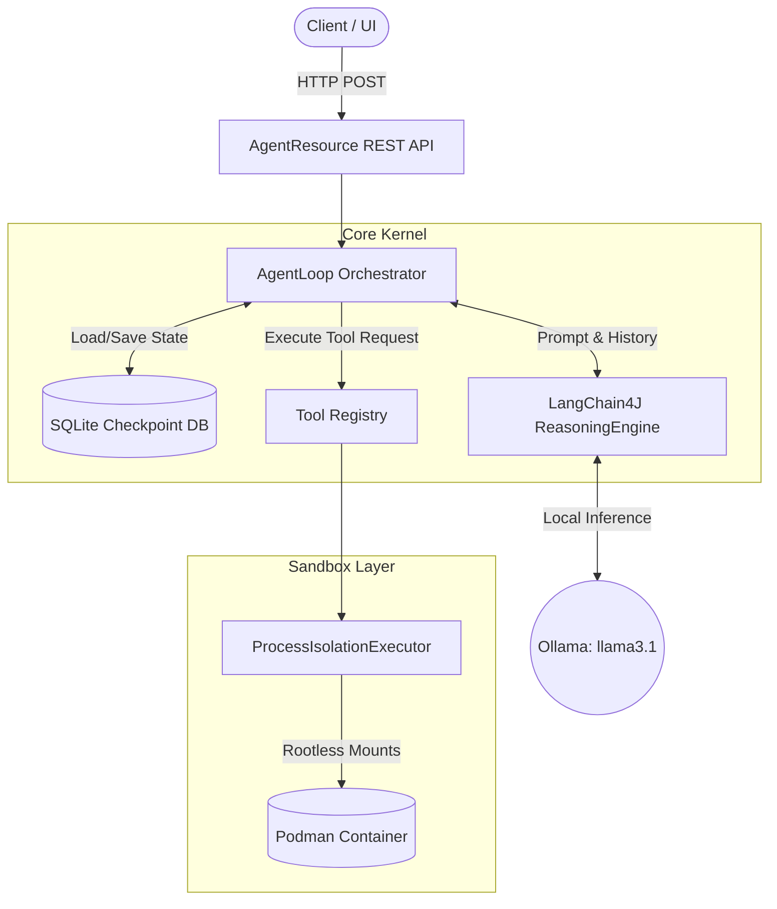
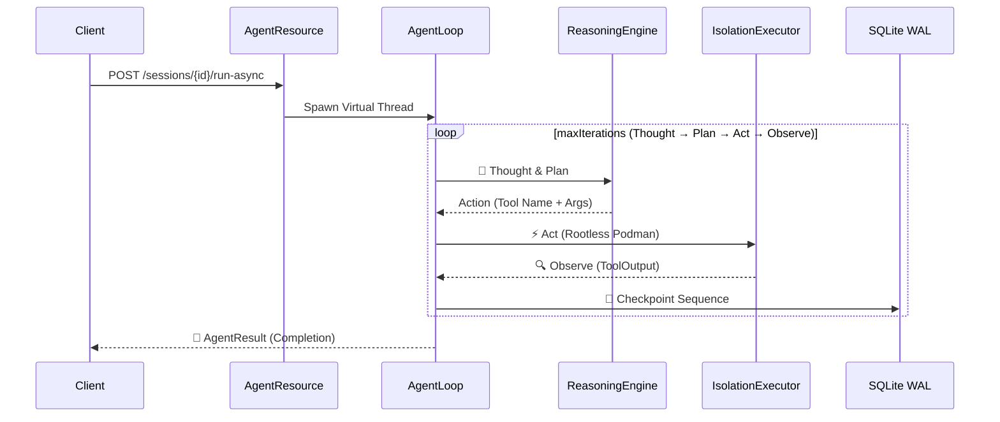

<div align="center">
  <h1>🛡️ ArcClaw v1.0</h1>
  <p><strong>A secure, stateful, and financially governed AI agent kernel designed for enterprise deployment.</strong></p>

  
  
  
  
  
</div>

---

## 🏗️ Core Architectural Pillars (The 'Why')

ArcClaw is not a conceptual prototype; it is an enterprise-grade kernel built with a paranoid security posture and rigorous financial guardrails.

*   **🛡️ Hardened Isolation:** Rootless Podman execution with ephemeral secret injection. Tools run in strictly capped containers, and secrets are passed via memory-wiped `.env` files—never as process arguments.
*   **🔐 Zero-String Security:** Argon2id key derivation and AES-GCM-SIV cryptographic vault. Keys are held in `AutoCloseable` wrappers that aggressively overwrite memory with zeros when no longer needed.
*   **🧵 Virtual Thread Mastery:** Fully non-blocking. Leverages JEP 491 optimized concurrent loops utilizing standard `synchronized` blocks alongside a bespoke CDI `@WorkspaceScoped` isolation mechanism to safely manage state maps across thousands of lightweight threads.
*   **💰 Financial Governance:** Hard USD circuit breakers. Analyzes input/output token costs per `ReasoningStep` via an interceptor observer. If budget is exceeded, rogue agents are immediately downgraded to `READ_ONLY` autonomy.
*   **🔍 Observability:** OTLP distributed tracing transparently connects the abstract LLM reasoning loop (`Thought-Plan-Act-Observe`) straight down to physical container execution via Jaeger.

---

## 🌊 High-Level Architecture Flow

When a REST call hits the kernel, the execution sequence is rigorously defined:

1.  **REST API:** The edge layer (`AgentResource`) intercepts the request on a Virtual Thread and provisions a session.
2.  **AgentLoop (LangChain4J):** The core reasoning engine runs a bounded `maxIterations` loop (Thought → Plan → Act → Observe), preventing infinite hallucination spirals.
3.  **ToolRegistry:** The CDI-powered registry discovers available tools and enforces Governance policy (e.g., blocking `NETWORK_OUTBOUND` actions if the agent is untrusted or bankrupt).
4.  **ProcessIsolationExecutor:** The Sandbox layer dynamically spins up a rootless Podman container, passing credentials securely and capping CPU/Memory.
5.  **SQLite Checkpointing:** After each tick, the entire Thought trajectory is serialized into a SQLite WAL-enabled checkpoint, making the agent deeply resilient to JVM crashes.



Sequece Flow:



---

### 📋 Prerequisites
Before compiling the kernel, ensure your environment meets these strict requirements:
* **JDK 25** (or JDK 21+ with `--add-opens` flags for Mockito/Virtual Thread compatibility).
* **Maven 3.9+**
* **Docker or Podman** (for the observability stack and embedded tool isolation).
* **GraalVM / Mandrel** (Only required if building the native binary yourself).

### 🪟 Windows Setup Note (WSL2)
Because ArcClaw leverages advanced rootless container isolation for its tools, **WSL2 (Windows Subsystem for Linux) is highly recommended** for Windows developers.
* Install **Podman Desktop** (which automatically configures the WSL2 backend and injects the `podman` CLI into your Windows PATH), or do your development entirely inside a WSL2 Ubuntu distro using VS Code Remote.
* `.env` files work identically across OS boundaries. If you need to set temporary variables directly in the terminal, use standard PowerShell syntax (e.g., `$env:SESSION_ID="<uuid>"`).

---

## ⚡ Quick Start (Zero to Agent in 60 seconds)

### Step 1: Clone & Configure
```bash
git clone https://github.com/rsrini7/ArcClaw.git
cd ArcClaw

# Copy the environment template
cp .env.example .env

# Configure your secrets
# E.g., GITHUB_TOKEN=ghp_...
# Note: The local stack provisions Ollama (llama3.2:1b)—test the framework 100% offline and free of charge!
# E.g., OLLAMA_BASE_URL=http://ollama:11434
```

| Variable | Default | Purpose |
| :--- | :--- | :--- |
| `OLLAMA_BASE_URL` | `http://localhost:11434` | Points to the local or remote Ollama LLM provider. |
| `GITHUB_TOKEN` | `(empty)` | Required if using the `HarperAgent` or GitHub tools. |
| `ARCCLAW_DATA_DIR` | `./data` | The host path where SQLite DBs and Workspaces are saved. |

### Step 2: Compile the Native Binary (CRITICAL)
Your `Dockerfile.native` expects the GraalVM native binary to already exist on your host machine. Docker will **not** compile your Java code; if you deploy without this step, the container will instantly fail with `failed to solve: lstat /arcclaw-app/target: no such file or directory` or cannot find `*-runner`.

*(Note: You must have GraalVM/Mandrel installed locally, or use Quarkus's built-in container builder if on Windows/Mac)*
```bash
# If you have GraalVM installed locally:
.\mvnw.cmd clean package -pl arcclaw-app -Pnative -DskipTests

# OR, if you want Docker to build the native Linux binary for you:
# (Note: Windows PowerShell users MUST quote the -D arguments, otherwise PS interprets them as malformed paths)
.\mvnw.cmd clean package -pl arcclaw-app -Pnative "-Dquarkus.native.container-build=true" "-Dquarkus.native.container-runtime=podman" -DskipTests
```

### Step 3: Boot the Stack
Once the `.env` is populated, the native binary is sitting in `target/`, and the compose file is updated with the `init-perms` block, you are ready for liftoff:
```bash
docker compose up -d --build
```
> [!CAUTION]
> **Windows Podman Desktop Users**: Standalone `docker compose` binary defaults to Docker Desktop's named pipe. If you receive an error `open //./pipe/dockerDesktopLinuxEngine`, you must either enable "Docker API compatibility" in Podman Settings, or set the following environment variable before running the compose command:
> `$env:DOCKER_HOST="npipe:////./pipe/podman-machine-default"`

> [!CAUTION]
> **Local Ollama Port Collisions**: If you already have Ollama installed naturally on your host machine (Mac/Windows), Docker Compose will likely crash with `bind: address already in use` for TCP port `11434`. You must either quit your local Ollama application entirely before booting `docker compose`, or remap the Ollama port inside `docker-compose.yaml` (e.g., `"11435:11434"`).
**What to expect next:**
* Docker will download the images (Ollama, Jaeger, UBI 9).
* `init-perms` will boot instantly, change the permissions of the data volume to UID 1000 (`arcclaw`), and exit.
* `arcclaw` will boot, safely initialize its SQLite DB, and bind to port 8080.

You can then run the `curl` commands from your `TESTING_GUIDE.md`!

### 🧪 Running the Test Suite
ArcClaw includes 40+ unit and integration tests covering the CDI scopes, LLM reasoning logic, and SQLite checkpoints. To run the full suite across all modules, use:
```bash
mvn clean verify -pl arcclaw-app -am
```
*(Note: Mockito requires JDK 21+ inline mock attachments. This is handled automatically by the `--add-opens` flags in the `arcclaw-app` pom.xml).*

### Step 4: Run the Kernel (JVM Mode)
If you prefer to run the kernel locally on the JVM using Quarkus dev mode instead of Docker:
```bash
# Ensure you are using JDK 21+ (Designed for JDK 25)
$env:MAVEN_OPTS="-Dnet.bytebuddy.experimental=true --add-opens=java.base/java.lang=ALL-UNNAMED"
./mvnw quarkus:dev -pl arcclaw-app

(or)

.\mvnw.cmd quarkus:dev -pl arcclaw-app -am
```

---

## 🤖 Interacting with the Kernel

Use our REST API to spawn and observe agents.

**1. Create a Workspace Session:**
```bash
curl -X POST http://localhost:8080/api/v1/sessions
# Response: {"sessionId": "abcd-1234-..."}
```

**2. Trigger an Agent (Asynchronous):**
Delegate a task to the `grok` (Coordinator) agent fully asynchronously:
```bash
curl -v -X POST http://localhost:8080/api/v1/sessions/abcd-1234-.../run-async \
  -H "Content-Type: application/json" \
  -d '{
        "goal": "Analyze the arcclaw repository statistics",
        "agentRole": "grok",
        "maxIterations": 3
      }'
```

**3. Observe the Trace:**
Open the [Jaeger UI](http://localhost:16686) in your browser to watch the agent think, execute tools in Podman, and persist its thoughts.

---

---

## 🧩 Extending ArcClaw

ArcClaw is designed as a modular kernel. Adding new capabilities requires minimal boilerplate:

**1. Create a New Tool:**
Implement the `AgentTool` interface, register it as an `@ApplicationScoped` bean, and ArcClaw handles the LangChain4J specification mapping and Sandbox isolation automatically.

**2. Define a New Persona:**
Create a new class implementing `Agent`. Define its `role()`, supply your custom `systemPrompt()`, and return a list of `allowedTools()`. Tag it with `@AgentRole("your_role")` to make it instantly available to the REST API.

---

## 📁 Project Structure (The Reactor)

ArcClaw enforces strict module boundaries to guarantee clean architectural separation:

*   **`arcclaw-parent/`**: BOM dependency definitions.
*   **`arcclaw-core/`**: The heart. Core logic, CDI API interfaces, Domain models, and SQLite persistence. No Quarkus bytecode enhancement here.
*   **`arcclaw-deployment/`**: The brain. Quarkus build-time processors (`@BuildStep`) that wire up our custom `@WorkspaceScoped` logic.
*   **`arcclaw-app/`**: The entrypoint. REST endpoints, `application.yaml` configuration, deployment integration tests, and application bootstrapping.

---

## 📚 Deep-Dive Documentation

Our codebase was engineered for Future AI and Human contributors. Don't guess—read the docs:

*   **[`TESTING_GUIDE.md`](./TESTING_GUIDE.md)** — Comprehensive E2E `curl` commands, REST flows, and distributed tracing setups.
*   **[`TROUBLESHOOTING.md`](./TROUBLESHOOTING.md)** — A mandatory read for new engineers. Covers JDK 25 ByteBuddy workarounds, Virtual Thread Context Propagation, Docker Permission traps, and specific `@InjectMock` nuances.
*   **[`DEVIATIONS.md`](./DEVIATIONS.md)** — The audit trail of every architectural pivot made during v1.0 implementation.
*   **[`PLAN.md`](./PLAN.md)** & **[`TASKS.md`](./TASKS.md)** — The original, granular specification and the milestone checklist.
*   **[`WALKTHROUGH.md`](./WALKTHROUGH.md)** — 14 phases of linear development history, capturing "why" we did things, not just "what" we did.
*  **[FAQ.md](./FAQ.md)** - Frequently Asked Questions - Answered
