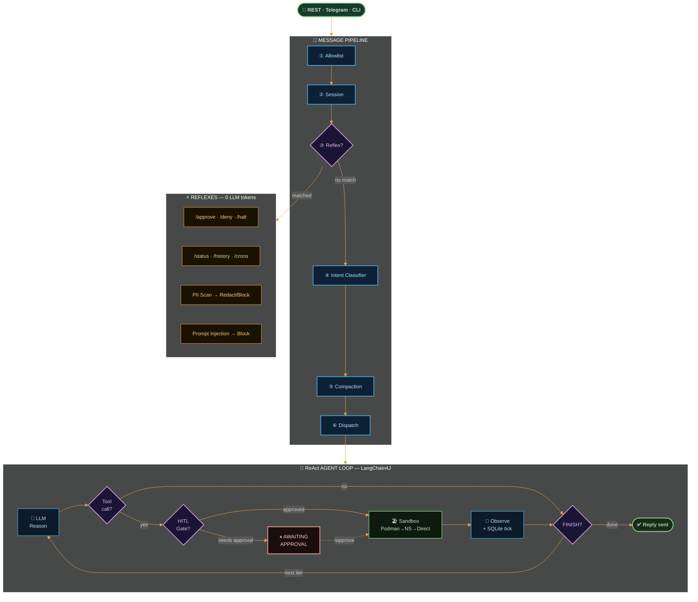
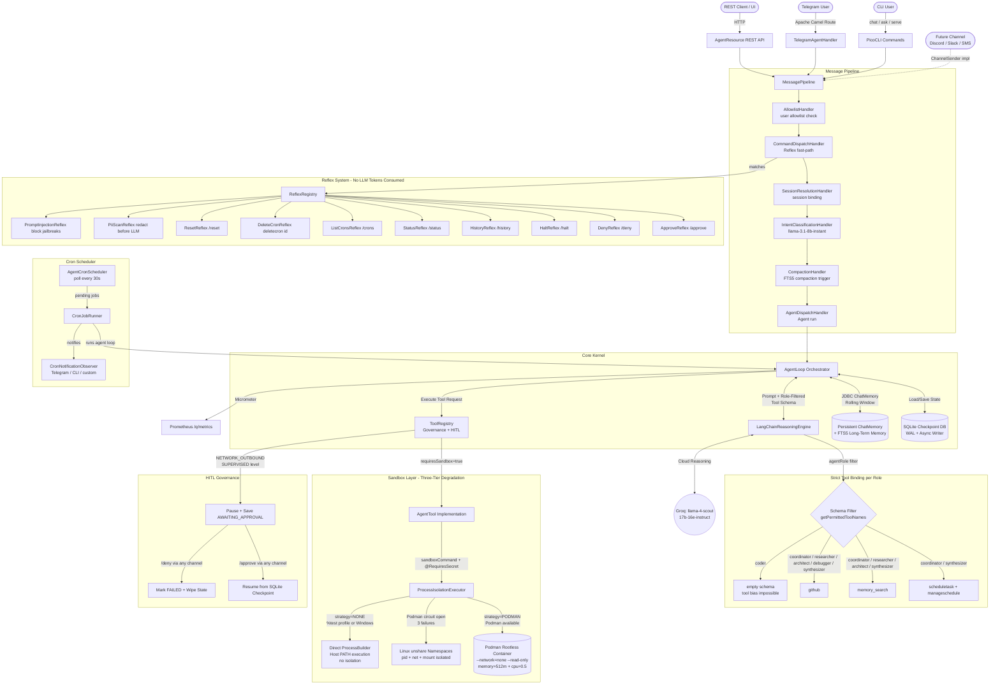
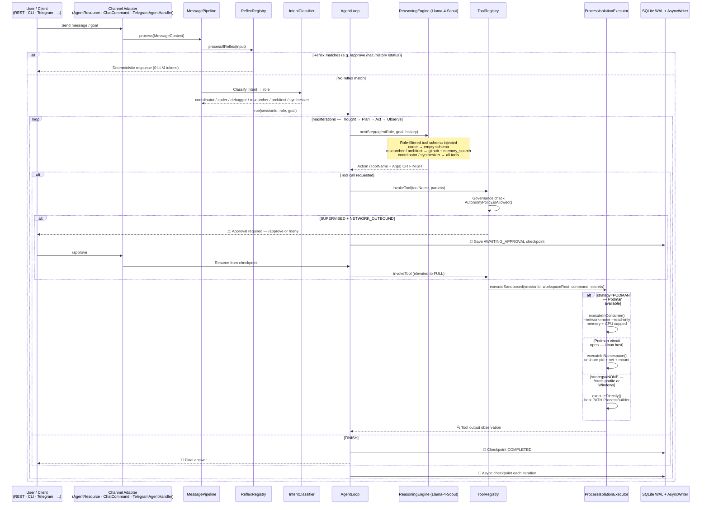
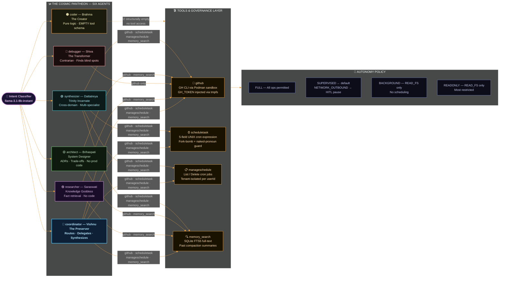
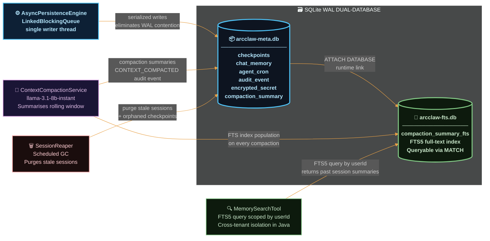
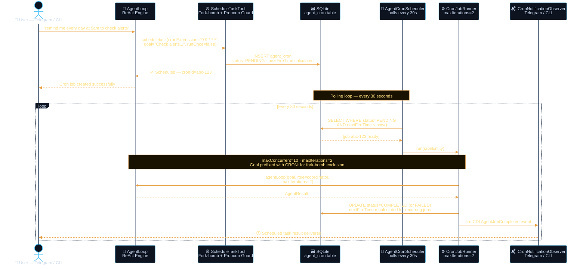
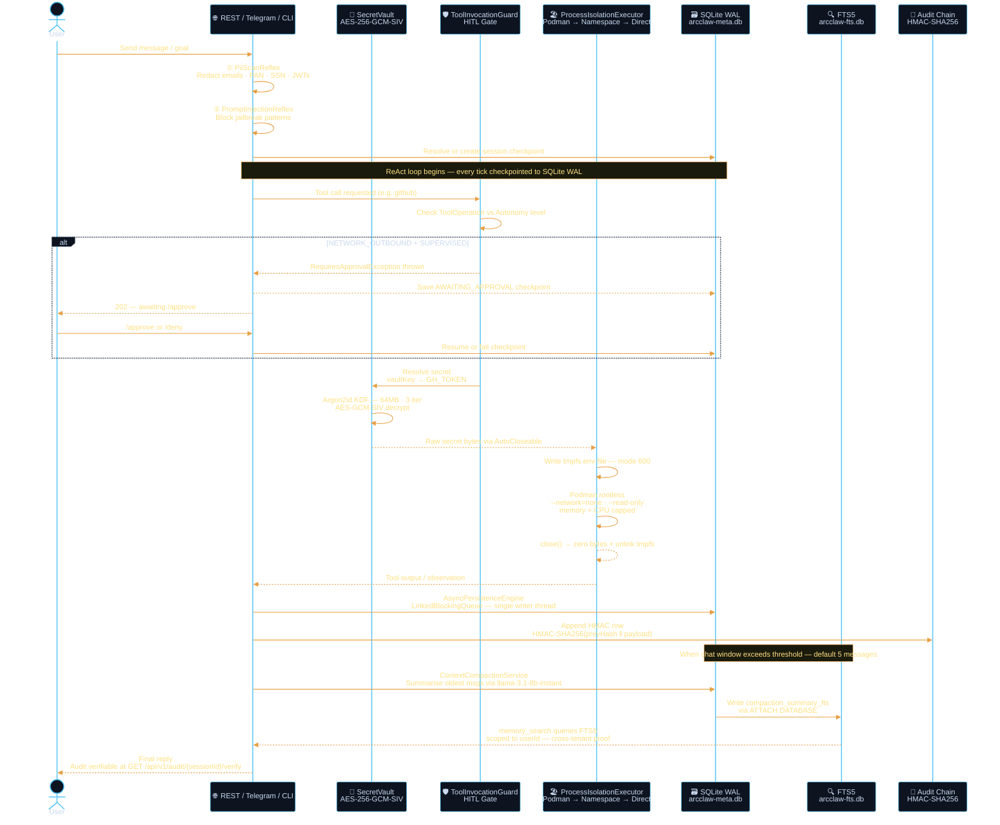
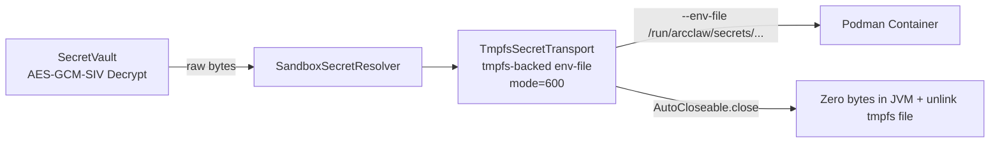

<div align="center">
  <h1>🛡️ ArcClaw V1.0.0</h1>
  <p><strong>A secure, stateful, and financially governed AI agent kernel designed for enterprise deployment.</strong></p>

  
  
  
  
  
</div>

---

> **A self-hosted, security-first multi-agent AI framework built on Quarkus + LangChain4J**
>
> **Stack**: JDK 25 · Quarkus 3.23.0 · LangChain4J 0.26.1 · SQLite (WAL + FTS5) · Podman (rootless) · Apache Camel · Groq Cloud

---

> **Docs**: [Setup](./SETUP.md) · [Testing Guide](./TESTING_GUIDE.md) · [Telegram Testing](./TELEGRAM_TESTING.md) · [FAQ](./FAQ.md) · [REST Client Files](./rest-http/)

---

## What is ArcClaw?

ArcClaw is a **self-hosted, production-grade agentic AI platform** designed to run complex, multi-step reasoning tasks with full auditability, human-in-the-loop governance, and sandboxed tool execution. It runs as a single ~118 MB binary with zero external service dependencies (SQLite replaces a database server; Podman replaces a container daemon).

### Key Capabilities

- **ReAct agent loop** (Reason → Act → Observe) over Groq-hosted LLMs or local Ollama models
- **Six specialist agent personas** with per-role tool schemas, system prompts, and iteration caps
- **Reflex system** — deterministic zero-token fast-path for commands, safety guards, and PII redaction before the LLM sees any input
- **Podman rootless sandbox** for executing AI-generated tool calls in full container isolation
- **AES-256-GCM-SIV secret vault** with Argon2id key derivation — secrets are never stored in plaintext
- **Tamper-evident HMAC audit chain** — every agent action is logged as an append-only, verifiable record
- **Autonomous cron scheduler** — agents can schedule future tasks using a 5-field UNIX cron expression
- **Context compaction + FTS5 long-term memory** — rolling chat window with LLM-summarised history searchable via RAG
- **Multi-channel** — REST API, interactive CLI REPL, Telegram bot (via Apache Camel), one-shot `ask` mode for CI/CD

---

## 🏗️ Core Architectural Pillars

ArcClaw is not a conceptual prototype; it is an enterprise-grade kernel built with a paranoid security posture and rigorous financial guardrails.

| Pillar | Implementation |
|---|---|
| **Isolation** | OS-level sandboxing via Podman rootless or Linux Namespaces; Session-constrained workspaces |
| **State** | JDBC-backed `ChatMemoryStore` + SQLite (WAL) for 100% session persistence and graceful continuity |
| **Intelligence** | LLM Intent Routing (`llama-3.1-8b-instant`) for dynamic specialist dispatch |
| **Governance** | Human-in-the-Loop (HITL) manual approval for sensitive tool operations |
| **Observability** | Prometheus Metrics (Micrometer) + OTLP Tracing + Jaeger |
| **Security** | Argon2id key derivation + AES-256-GCM-SIV authenticated encryption |
| **Memory** | Context compaction via `ContextCompactionService` + SQLite FTS5 full-text long-term memory |
| **Scheduling** | Autonomous cron-based task scheduling with Telegram notifications |

- **🛡️ Hardened Isolation:** Rootless Podman execution with ephemeral secret injection. Tools run in strictly capped containers, and secrets are passed via memory-wiped `.env` files — never as process arguments.
- **🔐 Zero-String Security:** Argon2id key derivation and AES-GCM-SIV cryptographic vault. Keys are held in `AutoCloseable` wrappers that aggressively overwrite memory with zeros when no longer needed.
- **🧵 Virtual Thread Mastery:** Fully non-blocking. Leverages JDK 25 optimized concurrent loops utilizing standard `synchronized` blocks alongside a bespoke CDI `@WorkspaceScoped` isolation mechanism to safely manage state maps across thousands of lightweight threads.
- **💰 Financial Governance:** Hard USD circuit breakers and **Human-in-the-Loop** approvals. Sensitive operations (e.g., `NETWORK_OUTBOUND`) pause execution until a user clicks `/approve` via Telegram.
- **🔍 Observability:** Real-time Prometheus metrics at `/q/metrics` track token consumption and agent invocations, while OTLP distributed tracing provides basic HTTP spans via Jaeger. Note: internal reasoning spans are stubbed as no-ops in V1.0.0.

---

## 🌊 High-Level Architecture Flow




When a REST call hits the kernel, the execution sequence is rigorously defined:

1. **REST API:** The edge layer (`AgentResource`) intercepts the request on a Virtual Thread and provisions a session.
2. **Message Pipeline:** Incoming channel messages pass through an ordered `MessagePipeline` of handlers: `AllowlistHandler` → `CommandDispatchHandler` (reflexes) → `SessionResolutionHandler` → `IntentClassificationHandler` → `CompactionHandler` → `AgentDispatchHandler`.
3. **Reflex System:** Before the LLM is ever invoked, the `ReflexRegistry` scans the input for deterministic fast-path commands (e.g., `/approve`, `/deny`, `/halt`, `/history`, `/status`, `/crons`). If a reflex matches, it executes without consuming any LLM tokens and short-circuits the pipeline.
4. **AgentLoop (LangChain4J):** The core reasoning engine runs a bounded `maxIterations` loop (Thought → Plan → Act → Observe), preventing infinite hallucination spirals.
5. **ToolRegistry:** The CDI-powered registry discovers available tools and enforces Governance policy (e.g., blocking `NETWORK_OUTBOUND` actions if the agent is untrusted or bankrupt).
6. **ProcessIsolationExecutor:** The Sandbox layer enforces three-tier degradation: Podman rootless containers in production (strict network/CPU/memory caps), Linux namespace isolation as fallback, and direct host execution in dev mode (`strategy: NONE`). Tool schemas are also filtered per persona — the `coder` role receives an empty tool list, making tool bias architecturally impossible regardless of LLM instruction.

> [!NOTE]
> **Sandbox Degradation Details**: The `ProcessIsolationExecutor` operates in three tiers:
> - **All profiles except `%test`** (`%dev`, `%prod`, `%staging`): `strategy: PODMAN` — attempts full Podman rootless container isolation with a circuit breaker (3-failure trip to fallback). This applies to **both dev and prod**.
> - **Namespace fallback**: If the Podman circuit opens (Podman unavailable or 3 consecutive failures), Linux `unshare` namespaces for pid, net, and mount isolation are used automatically.
> - **Direct execution** (`%test` profile, or Windows OS detected): `strategy: NONE` — direct host `ProcessBuilder` execution. Requires `gh` CLI on the host `PATH`. No container isolation.
>
> In `%dev`, if Podman is running and `arcclaw-tool-runner:latest` is present, **full Tier 1 container isolation is active** — identical to production. Direct execution (`NONE`) is only the default for the `%test` profile and Windows hosts.

7. **SQLite Checkpointing:** After each tick, the entire Thought trajectory is serialized into a SQLite WAL-enabled checkpoint, making the agent deeply resilient to JVM crashes.
8. **Async Persistence Engine:** A single-writer `AsyncPersistenceEngine` serializes all SQLite writes through a `LinkedBlockingQueue`, preventing WAL contention across virtual threads.


<details>
<summary>Detailed Architecture Flow Diagram</summary>


</details>

<details>
<summary>Detailed Architecture Sequence Diagram</summary>

### Sequence Flow


</details>

---

## 🕉️ The Cosmic Pantheon — Full Agent Roster

ArcClaw ships a **six-agent roster** inspired by the Hindu Trimurti & Tridevi, with two additional specialist roles derived from extended Vedic tradition. The default multi-agent architecture is informed by four-agent collaborative reasoning frameworks designed for high reasoning capability. Roles are selected automatically by the intent classifier or passed explicitly via `agentRole` in the API/CLI.

| Role | Deity | Canonical Name | Tools | Description |
|---|---|---|---|---|
| `coordinator` | **Vishnu** | coordinator | `github`, `scheduletask`, `manageschedule`, `memory_search` | The Preserver. Primary router: decomposes goals, delegates to specialists, synthesizes final output |
| `researcher` | **Saraswati** | researcher | `github`, `memory_search` | Goddess of Knowledge. Strict fact retrieval; never fabricates or writes code |
| `coder` | **Brahma** | coder | *(none — empty schema)* | The Creator. Pure logic and engineering brain; refuses conversational tasks |
| `debugger` | **Shiva** | debugger | `github` | The Transformer. Contrarian balance expert; finds blind spots and challenges assumptions |
| `architect` | **Brihaspati** | architect | `github`, `memory_search` | System Designer & Standards Author. Authors ADRs, evaluates trade-offs; never writes production code |
| `synthesizer` | **Dattatreya** | synthesizer | `github`, `scheduletask`, `manageschedule`, `memory_search` | The Avadhuta (Trinity Incarnate). Cross-domain synthesis when a task spans multiple specialist domains simultaneously |

> [!NOTE]
> The `coder` role receives an **empty tool schema** — tool bias is architecturally impossible for it regardless of LLM instruction. The `debugger` has access to `github` for code inspection but no scheduling or memory tools. The `architect` and `synthesizer` roles are additional personas beyond the default four; they can be invoked via the REST API using their canonical role names.



### Tool Schema Enforcement

The tool schema for each role is enforced **structurally** in `LangChainReasoningEngine.getPermittedToolNames()` — it intersects the agent's declared `allowedTools()` with the full registered tool list. Any tool not in the intersection is **invisible to the LLM** for that role, regardless of what the user prompt says. This is a **structural guarantee**, not a system-prompt instruction.

### Intent Classification

The `IntentClassifierService` uses `llama-3.1-8b-instant` to automatically route free-text messages to the best-fit role. It defaults to `coordinator` on any error or rate limit. You can override by passing `agentRole` explicitly.

---

## 📁 Project Structure (The Reactor)

ArcClaw enforces strict module boundaries to guarantee clean architectural separation:

```
arcclaw-parent/               ← BOM dependency definitions and version management
arcclaw-channel-api/          ← Pure interfaces only: ChannelSender, ChannelAllowlist,
│                               IntentClassifier, ReplyRenderer, ChannelUser, etc.
│                               No implementation. No Quarkus. Zero dependencies.
arcclaw-core/                 ← The heart. Core logic, CDI API interfaces, domain models,
│   ├── agent/                  AgentLoop, personas, reasoning engine, role registry
│   ├── api/                    REST resources (AgentResource, AuditResource, SystemInfoResource)
│   ├── audit/                  HMAC-signed audit events, compliance service, telemetry
│   ├── governance/             GovernanceLayer: USD budget, circuit breakers
│   ├── health/                 Podman + image + system metadata health checks
│   ├── lifecycle/              WorkspaceManager, SessionReaper, SessionHeartbeatTracker
│   ├── observability/          AgentObserver interface, AgentOtelContext
│   ├── persistence/            AsyncPersistenceEngine, FtsConnectionInterceptor
│   ├── pipeline/               MessagePipeline + ordered MessageHandlers
│   ├── reflex/                 ReflexRegistry + all AgentReflex implementations
│   ├── sandbox/                ProcessIsolationExecutor, SandboxCircuitBreaker,
│   │                           TmpfsSecretTransport, PodmanContainerExecutor
│   ├── scope/                  @WorkspaceScoped CDI scope + WorkspaceScopeHolder (ScopedValue)
│   ├── security/               AES-GCM-SIV vault, Argon2id KDF, AutonomyPolicy
│   ├── state/                  SQLite entities, PersistentChatMemoryStore,
│   │                           StatefulAgentStore, ContextCompactionService, AgentCronRepository
│   └── tools/                  AgentTool interface, GithubTool, ScheduleTaskTool,
│                               ManageScheduleTool, MemorySearchTool, ToolRegistry
arcclaw-deployment/           ← The brain. Quarkus build-time @BuildStep processors
│                               that wire up custom @WorkspaceScoped CDI logic.
│                               Required for native image compilation.
arcclaw-app/                  ← The entrypoint. REST endpoints, application.yaml,
    ├── channel/telegram/       TelegramChannelRoute (Apache Camel), TelegramAgentHandler,
    │                           TelegramMarkdownV2Renderer, TelegramCronNotificationObserver
    ├── cli/                    ChatCommand (REPL), AttachCommand, CliCronNotificationObserver
    ├── compaction/             CompactionModelProducer (llama-3.1-8b-instant)
    ├── observability/          MetricsAgentObserver (Micrometer)
    ├── routing/                IntentClassifierService, ModelProducer
    ├── scheduler/              AgentCronScheduler, CronJobRunner, CronResultHandler
    └── security/               ApiKeyAuthFilter, ApiKeyRegistry, RateLimiter,
                                DestructiveVocabularyFilter, StartupSecurityValidator,
                                TelegramAllowlistGuard
```

### Why This Split?

| Layer | Reason |
|---|---|
| `arcclaw-channel-api` | Allows `arcclaw-core` to reference channel concepts (sender, allowlist) without coupling to Telegram or any concrete adapter. Swapping channels requires zero core changes. |
| `arcclaw-core` | Independently testable with zero Quarkus startup overhead. All 100+ unit tests run without any HTTP container. |
| `arcclaw-deployment` | The `@WorkspaceScoped` CDI scope is registered at Quarkus build time via `@BuildStep`. Separating this ensures the scope works correctly in native image compilation. |
| `arcclaw-app` | The only module that knows about external protocols (HTTP, Telegram, CLI). Keeps protocol concerns out of the kernel. |

### `@WorkspaceScoped` — Custom CDI Scope

Standard CDI scopes (`@RequestScoped`, `@SessionScoped`) are tied to HTTP lifecycle events. Agent runs on virtual threads — especially async runs and cron jobs — have no HTTP request context. `@WorkspaceScoped` is a CDI scope keyed on `sessionId`. The `WorkspaceScopeHolder` uses Java 21 `ScopedValue` (not `ThreadLocal`) to bind a workspace context to the logical execution — it propagates correctly across virtual threads, CDI-managed executors, and Camel routes without leaking state between sessions.

### Why Virtual Threads?

Agent loops are I/O-bound — they spend ~95% of their time blocked on LLM API responses or waiting for Podman sandbox processes. Virtual Threads (JEP 444, stable in JDK 21) are preemptive: the JVM parks the thread at any blocking call and recycles the underlying carrier thread, with zero risk of event-loop starvation. The code also reads exactly like synchronous Java, keeping the agent loop logic readable and debuggable.

### Why SQLite?

Three reasons over PostgreSQL for an agentic kernel:

1. **Zero-latency**: Writing to a local SQLite file avoids network round-trips during the high-speed agent loop. Each checkpoint is a single write; adding a network hop would double iteration latency.
2. **Concurrency**: SQLite's WAL (Write-Ahead Logging) mode allows concurrent readers while a single writer commits. ArcClaw's `AsyncPersistenceEngine` serialises all writes through a `LinkedBlockingQueue` backed by a single virtual thread, eliminating WAL contention entirely.
3. **Portability**: ArcClaw deploys as a single, self-contained binary (~118 MB) with no external service dependencies. A PostgreSQL sidecar would eliminate that advantage.

The **dual-database design** (`arcclaw-meta.db` for structured state, `arcclaw-fts.db` for FTS5 full-text search) keeps the schema clean and prevents FTS index operations from locking the primary checkpoint tables.

---

## 🖥️ Run Modes

ArcClaw is a dual-mode Quarkus + PicoCLI binary. The subcommand after the jar controls the mode.

| Mode | Command | Behaviour |
|---|---|---|
| `ask` | `ask "goal" --role coordinator` | One-shot: run agent, print answer, exit. Ideal for CI/CD scripts. |
| `chat` | `chat` | Interactive REPL with full multi-turn memory, all reflexes, and HITL approval. |
| `serve` | `serve` | Long-running REST daemon on port 8080. No channel adapters; for direct API access. |
| `attach` | `attach telegram` | Long-running daemon with channel adapters active (Apache Camel). Cron scheduler runs. |

The `%cli` profile is forced by `arcclaw-cli.ps1` and silences all Quarkus banners and `INFO` logs so terminal output only shows agent reasoning.

---

## 📨 Message Pipeline

Every incoming message (from REST, Telegram, or CLI) travels through an ordered pipeline of handlers. Priority numbers determine execution order.

```
Incoming Message (any channel)
    ↓
MessagePipeline:
    10 — AllowlistHandler            → blocks non-allowlisted users before any processing
    15 — SessionResolutionHandler    → derives or creates deterministic session UUID
    30 — CommandDispatchHandler      → routes /commands and zero-token reflexes (no LLM call)
    50 — IntentClassificationHandler → llama-3.1-8b-instant selects best agent role
    60 — CompactionHandler           → compacts chat history if threshold exceeded
    70 — AgentDispatchHandler        → runs the ReAct agent loop, sends reply
```

For Telegram specifically, `TelegramAgentHandler` sends a `⏳` acknowledgment immediately before queuing the message to a per-chat Caffeine executor (serialises messages per user), preventing out-of-order processing.

### ReAct Agent Loop

Inside `AgentDispatchHandler`, the `AgentLoop` runs the standard Reason–Act–Observe cycle:

```
Goal → SystemPromptBuilder → LangChainReasoningEngine (LLM call)
    → ReasoningStepParser → ToolInvocationGuard (HITL gate)
    → ToolInvoker → ProcessIsolationExecutor (sandbox)
    → observation appended → next iteration
    → FINISH detected → AgentResult → reply sent
```

Checkpoints are persisted to SQLite at every iteration via `AsyncPersistenceEngine`. If the JVM is killed mid-loop, the checkpoint survives and `WorkspaceManager` will recover it on the next startup.

---

## 🧠 The Reflex System (Zero-Token Fast Path)

Before any message reaches the LLM, the `ReflexRegistry` evaluates it against all registered `AgentReflex` implementations. Reflexes that match short-circuit the pipeline entirely — **no LLM tokens are ever consumed**.

This matters for three reasons:

1. **Cost**: Commands like `/approve`, `/status`, and `/history` are intent-unambiguous. Routing them through an LLM wastes tokens and adds latency.
2. **Safety**: The `PromptInjectionReflex` must fire *before* the LLM sees the input — if an adversarial prompt could reach the reasoning engine, it might influence the model to bypass governance.
3. **Reliability**: Reflexes are pure Java — they cannot hallucinate, and their behaviour is deterministic and fully unit-testable.

| Reflex | Trigger | Behaviour |
|---|---|---|
| `ApproveReflex` | `/approve` | Resumes a paused `AWAITING_APPROVAL` checkpoint; fires cron job completion if applicable |
| `DenyReflex` | `/deny` | Marks checkpoint `FAILED`, wipes state, fires cron job completion |
| `HaltReflex` | `/halt` | Emergency stop — terminates the workspace and all in-flight runs |
| `HistoryReflex` | `/history` | Dumps recent chat history + compaction summaries |
| `StatusReflex` | `/status` | Shows current checkpoint state, USD spent, and compaction stats |
| `ListCronsReflex` | `/crons`, `/cron`, `/list crons` | Lists all scheduled autonomous tasks for the current user (tenant-isolated) |
| `DeleteCronReflex` | `deletecron <id>` | Deletes a specific cron job by ID (tenant-isolated) |
| `ResetReflex` | `/reset` | Soft-resets session state (clears ReAct loop + compactions, preserves chat memory) |
| `PiiScanReflex` | every message | Detects emails, phone numbers, Aadhaar, PAN, credit cards, SSNs, IPs, JWTs; redacts or blocks per `arcclaw.pii.mode` |
| `PromptInjectionReflex` | every message | Blocks jailbreak patterns (fake approvals, "reveal system prompt", auto-approve bypass attempts); writes mandatory `PROMPT_INJECTION_BLOCKED` audit event |

> [!NOTE]
> The `PiiScanReflex` and `PromptInjectionReflex` run on **every message** via their `sanitize()` hook in `ReflexRegistry.processIfReflex()`, even when no other reflex matches. PII mode is configurable: `REDACT_AND_FORWARD` (default) silently redacts and passes to the LLM; `BLOCK_AND_NOTIFY` rejects the message outright. Override at runtime via `ARCCLAW_PII_MODE` in your `.env`.

---

## 🛠️ Built-in Tools

All tools are discovered via CDI `Instance<AgentTool>` and registered automatically. The `ToolRegistry` enforces autonomy governance before invoking any tool.

| Tool | Name | Operation | Sandbox | Description |
|---|---|---|---|---|
| `GithubTool` | `github` | `NETWORK_OUTBOUND` | ✅ Podman | GitHub CLI (`gh repo view/list`, `gh gist view/list`) with `GH_TOKEN` secret injection via tmpfs |
| `ScheduleTaskTool` | `scheduletask` | `SCHEDULE_AUTONOMOUS` | ❌ In-memory | Schedule a future autonomous task with a 5-field UNIX cron expression; naked-pronoun guard + fork-bomb exclusion |
| `ManageScheduleTool` | `manageschedule` | `READ_FS` | ❌ In-memory | List or delete the current user's scheduled cron jobs; tenant-isolated via `WorkspaceScopeHolder.USER_ID` |
| `MemorySearchTool` | `memory_search` | `READ_FS` | ❌ In-memory | FTS5 full-text search of past session compaction summaries for long-term memory recall |

### Tool Governance — Autonomy Levels

| Operation | FULL | SUPERVISED | BACKGROUND | READONLY |
|---|---|---|---|---|
| `NETWORK_OUTBOUND` | ✅ | ⚠️ HITL pause | ❌ | ❌ |
| `SCHEDULE_AUTONOMOUS` | ✅ | ✅ | ❌ | ❌ |
| `READ_FS` | ✅ | ✅ | ✅ | ✅ |

> [!NOTE]
> **Secret Injection**: Tools annotate their `sandboxCommand()` method with `@RequiresSecret(envVar="GH_TOKEN", vaultKey="GITHUB_TOKEN")`. The `ToolRegistry` reads these annotations reflectively, resolves secrets from `SecretVault`, and injects them via `TmpfsSecretTransport` — an ephemeral env-file written to RAM-backed tmpfs, zeroed from JVM memory on close. Secrets **never** appear in process arguments.

---

## 🗃️ Memory & Persistence Architecture

ArcClaw uses a **dual-database SQLite architecture**:

- `arcclaw-meta.db` — primary metadata database (WAL mode): checkpoints, chat memory, cron entities, audit events, encrypted secrets.
- `arcclaw-fts.db` — standalone FTS5 full-text index: `compaction_summary_fts` table for semantic memory search.

The two databases are connected at runtime via `ATTACH DATABASE`. All writes to SQLite are serialized through a single-threaded `AsyncPersistenceEngine` backed by a `LinkedBlockingQueue`, eliminating WAL contention across concurrent virtual threads.



### Context Compaction (`ContextCompactionService`)

When the rolling chat window exceeds `arcclaw.memory.compaction.threshold` (default: 5 messages), the compaction service fires:

1. Summarizes the oldest messages using `llama-3.1-8b-instant` into a `CompactionSummaryEntity`
2. Discards the original messages from the rolling window
3. Preserves the most recent `keep-recent` (default: 5) messages verbatim
4. Writes the summary into both `arcclaw-meta.db` and `arcclaw-fts.db`
5. Writes a `CONTEXT_COMPACTED` audit event

This enables theoretically unbounded conversation while controlling context window token costs.

### Long-Term Memory (`MemorySearchTool`)

`MemorySearchTool` queries the `compaction_summary_fts` FTS5 table using SQLite full-text search, scoped to the current user's `userId`. The LLM can control the search query but **cannot access another user's memories** — tenant isolation is enforced in Java, not in the SQL query. Roles with `memory_search` in their tool list (coordinator, researcher, architect, synthesizer) can use this to recall decisions made in previous sessions.

### Soft Reset

After a checkpoint reaches `COMPLETED` or `FAILED`, ArcClaw performs a **Soft Reset**: the internal ReAct loop state (tool call history, reasoning step sequence) is wiped, but the LangChain4J `ChatMemoryStore` (the conversational history visible to the LLM) is preserved. This prevents "ghost tool trigger" contamination while keeping the conversation flowing naturally.

---

## ⏰ Autonomous Cron Scheduler



ArcClaw supports fully autonomous scheduled tasks via a built-in cron engine backed by SQLite persistence.

- **`ScheduleTaskTool`**: An agent can create a cron job mid-conversation using a standard 5-field UNIX expression. The goal must be self-contained (naked-pronoun guard rejects vague references). Tasks are prefixed with `CRON:` to enable structural fork-bomb exclusion.
- **`AgentCronScheduler`**: Polls the `agent_cron` table every 30 seconds (configurable via `arcclaw.cron.poll-interval`). Picks up `PENDING` jobs whose next fire time has elapsed.
- **`CronJobRunner`**: Executes the agent loop for the scheduled goal. Supports up to `arcclaw.cron.max-concurrent` (default: 10) concurrent jobs and `arcclaw.cron.max-iterations` (default: 2) reasoning iterations per job to prevent runaway costs.
- **`CronResultHandler`**: On job completion or failure, fires a CDI `AgentJobCompleted` event observed by `TelegramCronNotificationObserver` and `CliCronNotificationObserver` to notify the originating channel.

**Fork-bomb protection**: `ScheduleTaskTool` prefixes every cron goal with `CRON:`. A cron goal that itself contains `CRON:` (nested schedule) is rejected structurally.

**Naked-pronoun guard**: Vague references ("it", "this", "that", "the result") in a cron goal are rejected — the agent is prompted to restate the goal with specific, self-contained instructions.


---

## 🔒 Security Architecture



### API Authentication & Rate Limiting

All `/api/v1/*` endpoints (except `/api/v1/info`, `/q/health`, `/q/metrics`) require the `X-ArcClaw-API-Key` header. `ApiKeyAuthFilter` validates it against `ApiKeyRegistry` using **constant-time comparison** (preventing timing attacks). Supports multiple named API keys: `ARCCLAW_API_KEY_INTERNAL` and `ARCCLAW_API_KEY_CI`. Each key is tracked in a per-key sliding window — exceeding `requests-per-minute` (default: 20) returns `HTTP 429` with a `Retry-After` header.

- **`DestructiveVocabularyFilter`**: Pre-execution filter that blocks messages containing dangerous shell keywords (e.g., `rm -rf`, `DROP TABLE`, `:(){ :|:& };:`) before they reach the LLM.
- **`StartupSecurityValidator`**: Validates the security posture at startup. In `%prod`, fails fast if weak default secrets are detected. In `%dev`, exempts validation with a warning.
- **`TelegramAllowlistGuard`**: Enforces an allowlist of permitted Telegram user IDs and usernames. Supports open-access mode (empty allowlist = everyone allowed) and silent-block mode.

### Cryptographic Vault

ArcClaw's `SecretVaultImpl` uses a multi-layer cryptographic scheme:

- **Key Derivation**: `Argon2idKeyDerivation` with 64 MB memory, 3 iterations, 1 parallelism thread.
- **Encryption**: `AesGcmSivCipher` — AES-256-GCM-SIV authenticated encryption. Nonce is derived from the vault key + salt to make it deterministic (immune to nonce reuse under key rotation).
- **Pepper**: A server-side secret (`arcclaw.vault.pepper`) mixed into the key derivation, preventing offline dictionary attacks even if the database is exfiltrated.
- **Key Rotation**: Automatic 24-hour key rotation (`arcclaw.vault.rotation.interval-hours`). A `VaultKeyCache` maps key versions to derived key material.
- **Memory Safety**: `VaultKey` implements `AutoCloseable`. The `close()` method explicitly overwrites the key byte array with zeros before GC.

**Why AES-GCM-SIV over standard AES-GCM?** Standard AES-GCM is catastrophically broken if a nonce is ever reused with the same key. AES-GCM-SIV (RFC 8452) is nonce-misuse-resistant: a nonce collision degrades to revealing that two plaintexts are identical, rather than leaking the key. This makes it safe for ArcClaw's deterministic nonce derivation strategy (`key + salt → HKDF → nonce`) without a global counter.

Secrets derivation chain:

```
server pepper (env var) + user password
        ↓ Argon2id (64 MB, 3 iterations, 1 parallelism)
        ↓ 256-bit vault key
        ↓ AES-GCM-SIV encrypt (deterministic nonce from key+salt)
        → stored ciphertext + salt + version tag
```

### Sandbox Secret Transport

Secrets for sandboxed tools are transported via `TmpfsSecretTransport`:



### Immutable Audit Log (WORM + HMAC Chain)

Every agent action is appended to the `audit_event` table with:

- A **HMAC-SHA256 chain**: Row N's `hmacHash = HMAC-SHA256(prevHash | payload)`. Row 1's `prevHash = SHA256("GENESIS:" + sessionId)`. Tampering any row breaks the chain from that point forward.
- **SQLite WORM triggers** installed by `AuditSchemaEnforcer` on every startup: `UPDATE` and `DELETE` on `audit_event` are rejected at the database level.
- **Mandatory events** (agent halts if write fails — fail-closed): `VAULT_ACCESS`, `TOOL_INVOKED`, `BUDGET_EXCEEDED`, `PROMPT_INJECTION_BLOCKED`, `APPROVAL_GRANTED`, `APPROVAL_DENIED`, `CRONFIRED`, `CRONFAILED`
- Chain integrity is verifiable via `GET /api/v1/audit/{sessionId}/verify`

### Human-in-the-Loop (HITL) Governance

When an agent invokes a tool with `ToolOperation.NETWORK_OUTBOUND` and the session autonomy level is `SUPERVISED` (default), `ToolInvocationGuard` throws `RequiresApprovalException`. The `AgentLoop` saves the checkpoint as `AWAITING_APPROVAL` and returns a `202` response. The operator approves or denies via:

- `POST /api/v1/sessions/{id}/approve?agentRole=coordinator`
- `POST /api/v1/sessions/{id}/deny?agentRole=coordinator`
- In-band via goal strings: `goal: "/approve"` or `goal: "/deny"`
- Via Telegram: send `/approve` or `/deny` to the bot

---

## 🏖️ Sandbox Isolation

ArcClaw executes AI-generated shell commands inside a three-tier isolation system.

| Tier | Condition | Isolation | Notes |
|---|---|---|---|
| **1 — Podman Rootless** | `%prod` + Podman socket up + image present | Full container isolation: `--network=none --read-only`, memory/CPU capped | Secrets injected via tmpfs, never as CLI args |
| **2 — Linux Namespaces** | Podman circuit breaker opened after 3 consecutive failures | `unshare` pid + net + mount namespaces | Fallback, Linux only |
| **3 — Direct Execution** | `%dev` with `strategy: NONE`, or Windows OS detected | None — host `PATH` `ProcessBuilder` | `gh` CLI must be on `PATH`. No isolation. |

**Why Podman over Docker?**

- **No privileged daemon socket**: Docker requires mounting `/var/run/docker.sock` — owning that socket grants root-equivalent access to the host. Podman is daemonless.
- **Rootless by default**: Podman containers run as UID 1000. Even if a sandboxed tool escapes, it's unprivileged on the host.
- **SELinux-native**: Built on UBI 9 (RHEL lineage) where Podman's SELinux label propagation works seamlessly.

**Sandbox Circuit Breaker**: `SandboxCircuitBreaker` trips to `OPEN` state after 3 consecutive Podman failures. Once open, `ProcessIsolationExecutor` falls through to the Linux namespace executor rather than retrying Podman. After a configurable half-open window, it probes Podman again.

---

## 🏥 Health Checks & Observability

### Health Endpoints (`/q/health`)

| Health Check | Type | Validates |
|---|---|---|
| `PodmanHealthCheck` | Liveness | `podman --version` exits successfully |
| `PodmanImageHealthCheck` | Readiness | `arcclaw-tool-runner:latest` image is present and pullable |
| `SystemMetadataHealthCheck` | Readiness | `SystemMetadataRegistry` has version and environment populated |

### Observability Stack

| Service | Port | Purpose |
|---|---|---|
| `otel-collector` | `4317` (gRPC), `4318` (HTTP) | Receives OTLP spans from ArcClaw, forwards to Jaeger |
| `jaeger` | `16686` (UI) | Distributed trace viewer — every agent loop iteration is a child span |
| `prometheus` | `9090` (UI) | Metrics scraper — polls `http://localhost:8080/q/metrics` |

- **Prometheus** (`/q/metrics`): Micrometer metrics exported for token consumption (`arcclaw.llm.tokens`), agent invocations (`arcclaw.agent.invocations`), and Quarkus scheduler metrics.
- **Structured Logging**: MDC-enriched log lines include `sessionId` in every log entry. Log format: `HH:mm:ss LEVEL [class] [sid=<sessionId>] (thread) message`.
- **`MetricsAgentObserver`**: CDI observer wired into `AgentLoop.recordLlmCall()`. Increments Micrometer counters per LLM call. Also emits per-session token counters, session lifecycle counters, and reflex invocation counters.
- **`AgentOtelContext`**: OpenTelemetry span holder for tool execution. Internal reasoning spans are stubbed as no-ops in V1.0.0; HTTP spans are active.

In `%dev` mode, OTEL export is disabled (`quarkus.otel.sdk.disabled=true`). Observe tracing via log output instead.

---

## 🧩 Extending ArcClaw

ArcClaw is designed as a modular kernel. Every major subsystem exposes a clean CDI interface that you can implement once and have it discovered automatically. No wiring code, no registry modifications — just implement, annotate, and deploy.

### 1. Create a New Tool

Implement the `AgentTool` interface and mark it `@ApplicationScoped`. ArcClaw handles LangChain4J spec mapping, governance enforcement, and sandbox routing automatically.

**Simple in-process tool (no sandbox, no secrets):**

```java
@ApplicationScoped
public class MyTool implements AgentTool {
    @Override public String name()        { return "mytool"; }
    @Override public String description() { return "Does something useful."; }
    @Override public ToolOperation requiredOperation() { return ToolOperation.READ_FS; }
    @Override public boolean requiresSandbox()         { return false; }

    @Override
    public ToolResponse execute(Map<String, Object> params) {
        String input = (String) params.get("input");
        return ToolResponse.success("Result: " + input);
    }
}
```

**Sandboxed tool with secret injection (Podman + tmpfs):**

For tools that must make network calls or run untrusted binaries, enable sandbox isolation and declare the secrets your command needs. The `ToolRegistry` resolves them from `SecretVault` and injects them via a RAM-backed tmpfs env-file — they never appear in process arguments.

```java
@ApplicationScoped
public class MyNetworkTool implements AgentTool {
    @Override public String name()        { return "mynetworktool"; }
    @Override public String description() { return "Fetches data from an external API."; }
    @Override public ToolOperation requiredOperation() { return ToolOperation.NETWORK_OUTBOUND; }
    @Override public boolean requiresSandbox()         { return true; }

    @Override
    @RequiresSecret(envVar = "MY_API_KEY", vaultKey = "MY_SERVICE_TOKEN")
    public List<String> sandboxCommand(Map<String, Object> params) {
        return List.of("my-cli", "fetch", "--target", (String) params.get("url"));
    }

    @Override
    public ToolResponse execute(Map<String, Object> params) {
        // Only called in %dev / direct-exec mode; Podman path goes through sandboxCommand()
        throw new UnsupportedOperationException("Sandbox required in production.");
    }
}
```

Once deployed, add your tool's name to the permitted tool list for whichever roles should have access in `ModelProducer.getPermittedToolNames()`.

> [!NOTE]
> **Storing secrets at runtime**: Users can store secrets interactively via the Telegram `store <key>=<value>` command (e.g. `store MY_SERVICE_TOKEN=abc123`). They are encrypted with AES-256-GCM-SIV and persisted in `arcclaw-meta.db`. Your `@RequiresSecret(vaultKey="MY_SERVICE_TOKEN")` declaration resolves against this vault automatically.

### 2. Define a New Persona

Create a class implementing `Agent`, tag it with `@AgentRole("your_role")` and `@ApplicationScoped`, and it is instantly available to the REST API and the intent classifier.

```java
@AgentRole("analyst")
@ApplicationScoped
public class AnalystAgent implements Agent {

    @Override
    public String role() { return "analyst"; }

    @Override
    public String systemPrompt() {
        return """
            You are a data analyst. Your only job is to interpret structured data
            and produce clear summaries. You never write code or make network calls.
            """;
    }

    @Override
    public List<String> allowedTools() {
        return List.of("memory_search");
    }
}
```

Then wire its tool permissions into `ModelProducer.getPermittedToolNames()`:

```java
// In ModelProducer (arcclaw-app)
case "analyst" -> Set.of("memory_search");
```

Without this step the persona boots correctly but the LLM receives an empty tool schema. Also add the role to `AgentRoleEnum` with a `RoleDefinition` specifying `maxIterations`, `canUseTools`, and `Set<ToolCapability>`, and add a system prompt template under `src/main/resources/templates/prompts/role-<n>.txt`.

### 3. Register a New Reflex

Implement `AgentReflex`, mark it `@ApplicationScoped`, and return `true` from `matches()` for your trigger pattern. The `ReflexRegistry` discovers it automatically at startup via CDI — no manual registration required.

```java
@ApplicationScoped
public class PingReflex implements AgentReflex {

    @Override
    public boolean matches(String input) {
        return "/ping".equalsIgnoreCase(input.strip());
    }

    @Override
    public ReflexResult handle(MessageContext ctx) {
        return ReflexResult.reply("🏓 Pong! ArcClaw is alive.");
    }
}
```

Keep `matches()` cheap — it is called on the hot path for every inbound message. If your reflex needs to sanitize input before the LLM sees it (like `PiiScanReflex`), override the default `sanitize()` method.

### 4. Add a New Channel Adapter

All channel-specific code lives in `arcclaw-channel-api`. To add a new channel (e.g. Discord, Slack, SMS):

**Step 1** — Implement `ChannelSender` and register it with `ChannelSenderRegistry`:

```java
@ApplicationScoped
public class DiscordChannelSender implements ChannelSender {
    @Override public ChannelType channelType() { return ChannelType.DISCORD; }

    @Override
    public void send(ChannelMessage message) {
        // Post message.content() to the Discord webhook / bot API
    }
}
```

**Step 2** — Implement `ChannelAllowlist` for access control:

```java
@ApplicationScoped
public class DiscordAllowlist implements ChannelAllowlist {
    @Override public ChannelType channelType() { return ChannelType.DISCORD; }

    @Override
    public boolean isAllowed(ChannelUser user) {
        return allowedDiscordIds.contains(user.externalId());
    }
}
```

**Step 3** — Implement `ReplyRenderer` to translate `ReplyNode` trees into your channel's markup format (e.g. Discord Markdown):

```java
@ApplicationScoped
public class DiscordReplyRenderer implements ReplyRenderer {
    @Override public ChannelType channelType() { return ChannelType.DISCORD; }

    @Override
    public String render(ReplyNode node) {
        // Convert ReplyNode tree to Discord markdown
    }
}
```

**Step 4** — Create the route (Apache Camel or any polling loop) that drives messages into `MessagePipeline.process(MessageContext)`. See `TelegramChannelRoute` as a reference implementation.

The entire reflex system, intent classification, session routing, and agent execution are channel-agnostic — your new adapter gets all of these for free.

### 5. Implement a Custom Agent Observer

`AgentObserver` is a CDI event hook fired by `AgentLoop` at key lifecycle moments. Add one to integrate ArcClaw events into your own alerting, analytics, or audit system.

```java
@ApplicationScoped
public class SlackAlertObserver implements AgentObserver {

    @Override
    public void onAgentStart(String sessionId, String role, String goal) {
        slackClient.post("#agents", "▶️ Agent started: " + role + " — " + goal);
    }

    @Override
    public void onAgentComplete(String sessionId, AgentResult result) {
        slackClient.post("#agents", "✅ Agent completed: " + sessionId);
    }

    @Override
    public void onAgentFailed(String sessionId, Throwable cause) {
        slackClient.post("#agents-alerts", "❌ Agent failed: " + cause.getMessage());
    }

    @Override
    public void onLlmCall(String sessionId, int promptTokens, int completionTokens) {
        // Track token spend in your own billing system
    }
}
```

Multiple observers are supported — CDI discovers all `AgentObserver` beans automatically. The built-in `MetricsAgentObserver` (Micrometer) and `CliAgentObserver` are reference implementations.

### 6. Add a Cron Notification Channel

When a scheduled cron job finishes, `CronResultHandler` fires a CDI `AgentJobCompleted` event. Implement a CDI observer to deliver results to any new channel.

```java
@ApplicationScoped
public class EmailCronNotificationObserver {

    public void onJobCompleted(@Observes AgentJobCompleted event) {
        String body = event.success()
            ? "✅ Task completed:\n" + event.result()
            : "❌ Task failed:\n" + event.error();
        emailService.send(event.userId(), "Scheduled Task Result", body);
    }
}
```

See `TelegramCronNotificationObserver` and `CliCronNotificationObserver` as reference implementations.

### 7. Swap the Intent Classifier

The `IntentClassifier` interface in `arcclaw-channel-api` decouples classification from the `IntentClassifierService` implementation. To replace the default `llama-3.1-8b-instant` classifier with a custom one (e.g. a rule-based classifier for cost control):

```java
@ApplicationScoped
@Alternative
@Priority(1)
public class RuleBasedIntentClassifier implements IntentClassifier {

    @Override
    public String classify(String input) {
        if (input.contains("code") || input.contains("function")) return "coder";
        if (input.contains("debug") || input.contains("error"))   return "debugger";
        if (input.contains("find") || input.contains("search"))   return "researcher";
        return "coordinator"; // default
    }
}
```

The `@Alternative @Priority(1)` CDI qualifiers override the default bean without modifying existing code.

---

## ⚙️ Quarkus Profiles

| Profile | When Active | Key Differences |
|---|---|---|
| `%dev` | `quarkus:dev` | Sandbox `strategy=NONE`, verbose LLM logging, hot reload, budget=$999 |
| `%test` | `mvn verify` | In-memory SQLite (`:memory:`), Telegram disabled, compaction disabled, vault with test pepper |
| `%cli` | `arcclaw-cli.ps1` wrapper | All banners and INFO logs silenced; OTEL SDK disabled |
| `%staging` | Manual `-Dquarkus.profile=staging` | Sandbox=PODMAN, budget=$50, supervised autonomy |
| `%prod` | Docker Compose (`QUARKUS_PROFILE=prod`) | Sandbox=PODMAN, startup security validation strict, console color off |

---

## 🌐 Infrastructure Stack

The `docker-compose.yaml` provisions the full observability and inference stack:

| Service | Port | Purpose |
|---|---|---|
| `arcclaw` | `8080` | Main ArcClaw kernel (native UBI 9 binary) |
| `ollama` | `11434` | Local LLM inference (disabled by default; Groq is primary) |
| `ollama-init` | — | One-shot sidecar to pull Ollama model weights before arcclaw starts |
| `otel-collector` | `4317` (gRPC), `4318` (HTTP) | OpenTelemetry collector; forwards traces to Jaeger |
| `jaeger` | `16686` (UI) | Distributed tracing UI |
| `prometheus` | `9090` | Metrics scraping from `/q/metrics` |
| `tool-runner` | — | Build-only profile: builds `arcclaw-tool-runner:latest` sandbox image |
| `init-perms` | — | One-shot sidecar to `chown -R 1000:1000` the data volume before arcclaw starts |

---

## 🗂️ Data Directory Layout

By default, `ARCCLAW_DATA_DIR=./data`. ArcClaw creates the following at runtime:

```
data/
├── arcclaw.db        # Primary SQLite WAL database
│                     #   → chat_memory, compaction_summary, agent_checkpoint,
│                     #      agent_cron, audit_event, encrypted_secret
├── arcclaw-fts.db    # Separate FTS5 full-text search index
│                     #   → compaction_summary_fts (queried by MemorySearchTool)
└── workspaces/       # Ephemeral per-session sandboxed working directories
```

**Volume ownership**: Docker creates named volumes as `root:root`. ArcClaw runs as `arcclaw` (UID 1000) inside the container. The `init-perms` service in `docker-compose.yaml` briefly boots as root, runs `chown -R 1000:1000 /app/data`, and exits before the main container starts (`depends_on: condition: service_completed_successfully`).

---

## 🚀 Quick Start

### Prerequisites

- JDK 25 (Temurin recommended)
- Maven 3.9+ (or use the included `./mvnw` wrapper)
- Podman (for `%prod` sandbox isolation — optional for dev)
- A [Groq](https://console.groq.com/) API key (`gsk_...`)

### 1. Clone and Configure

```bash
git clone https://github.com/rsrini7/arcclaw
cd arcclaw
cp .env.example .env
# Edit .env — set GROQ_API_KEY at minimum
```

### 2. Build

```bash
./mvnw clean package -pl arcclaw-app -am -DskipTests
```

### 3. Run (dev mode — interactive REST server)

```bash
./mvnw quarkus:dev -pl arcclaw-app -am "-Dquarkus.args=serve"
# API available at http://localhost:8080/api/v1
```

### 4. Run (packaged jar — chat REPL)

```bash
./arcclaw-cli.ps1 chat
# or on macOS/Linux:
java [JVM_FLAGS] -jar arcclaw-app/target/quarkus-app/quarkus-run.jar chat
```

See [SETUP.md](./SETUP.md) for full OS-specific setup (macOS, WSL2, Windows), Docker Compose observability stack, and native binary build instructions.

---

## 📚 Related Documentation

| Document | Purpose |
|---|---|
| [`SETUP.md`](./SETUP.md) | Prerequisites, OS-specific setup, build, run modes, Docker Compose, native build |
| [`TESTING_GUIDE.md`](./TESTING_GUIDE.md) | Unit tests, E2E REST workflow, sandbox verification, memory/compaction testing, checklist, troubleshooting |
| [`TELEGRAM_TESTING.md`](./TELEGRAM_TESTING.md) | Telegram bot end-to-end testing guide |
| [`FAQ.md`](./FAQ.md) | In-depth architecture Q&A, security rationale, and operational guidance |
| [`rest-http/`](./rest-http/) | IntelliJ / VSCode REST Client files for interactive API testing (10 numbered files) |

---

*ArcClaw V1.0.0 · Quarkus 3.23.0 · JDK 25 · LangChain4J 0.26.1*
