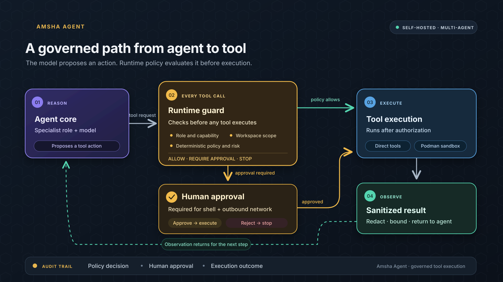
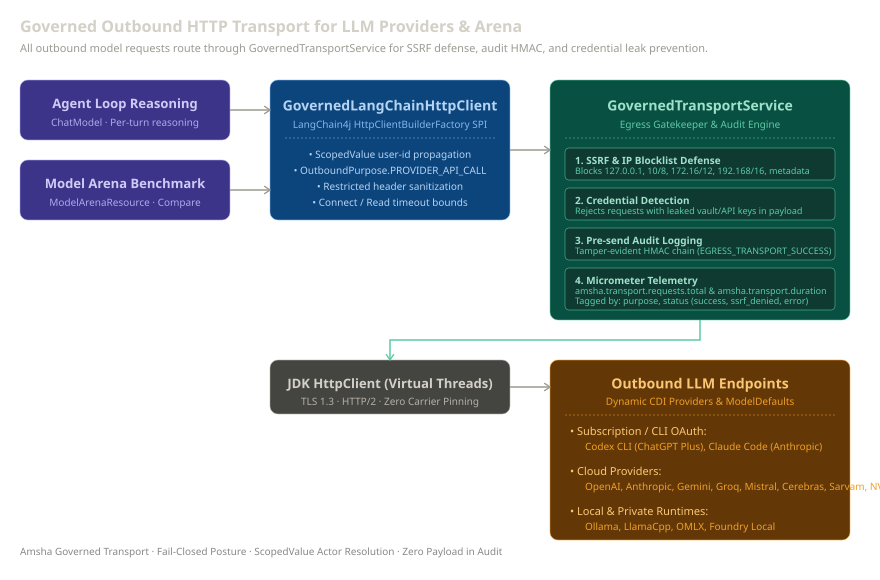

<div align="center">
  
  <h1>Amsha Agent</h1>
  <p><em>The crowned queen bee honours Bhramari Devi, the Hindu bee goddess.</em></p>
  <p><strong>Self-hosted multi-agent AI platform built with Java 25 and Quarkus, featuring governed tool execution, session-isolated CDI state, optional rootless Podman sandboxing, and SQLite, PostgreSQL, and filesystem persistence.</strong></p>

  
  
  
  
  
  
  [](https://github.com/rsrini7/AmshaAgent/actions/workflows/ci.yml)
  
  
  
  
  [](https://www.jetify.com/devbox/)
  [](https://jdx.dev)
</div>

> **Development status:** Amsha Agent is in active development. Contributions are
> welcome, including bug reports, documentation, tests, and implementation work;
> see [CONTRIBUTING.md](./CONTRIBUTING.md).
>
> **Native platform status:** macOS arm64 SQLite native build and 10/10 runtime smoke passed on 2026-10-29. Linux arm64 SQLite build and CLI execution passed, but HTTP readiness and the ONNX release matrix remain pending; Linux x86_64 and Windows native checks remain pending.
>
> **JVM platform evidence:** SQLite JAR packaging and CLI help passed on macOS arm64; CLI help passed on Linux arm64. HTTP readiness on both targets and Windows JVM runtime checks remain pending.

---

> **A self-hosted multi-agent AI platform** — ReAct agent loop, 12 specialist personas, HITL governance, optional rootless Podman code sandbox, and hexagonal persistence (SQLite / PostgreSQL / filesystem). Runs as a single ~400 MB binary.

**Stack**: JDK 25 · Quarkus 3.40.1.1 · LangChain4J 1.19.3 · SQLite (WAL + FTS5 + sqlite-vec) · Podman · Apache Camel · BouncyCastle

## Quick Start

Requirements: JDK 25, Git, and internet access for the first build. The Maven wrapper is included; Podman is optional for sandboxed code execution.

```bash
git clone https://github.com/rsrini7/AmshaAgent.git
cd AmshaAgent

```

Start on macOS or Linux:

```bash
./scripts/run-jar.sh

```

Start on Windows PowerShell:

```powershell
.\scripts\run-jar.ps1
```

The launcher builds the packaged application with the included Maven wrapper and starts it in a regular terminal. On a fresh run, Amsha creates `.env` in the repository folder and opens setup. Choose one provider and configure the credentials it needs. For a fresh data directory, press Enter at security-key prompts that offer to generate values. When reusing existing data, keep its original `.env` and especially `AMSHA_VAULT_PEPPER`; changing it can make stored encrypted secrets unreadable. Optional integrations can be skipped. Keep `.env` private. If you already ran Quarkus dev mode and only `app/.env` exists, the launcher reuses that config and runtime folder.

When startup completes, open [http://localhost:8080](http://localhost:8080) for the web interface. To run the server command instead, pass it to the launcher: `./scripts/run-jar.sh serve` or `./scripts/run-jar.ps1 serve`.

See [docs/CONFIGURATION.md](./docs/CONFIGURATION.md) for provider options and the full configuration reference, and [docs/QUICK_START.md](./docs/QUICK_START.md) for detailed setup.

### Contributor workflows

Install and initialize mise as described in [docs/MISE_SETUP.md](./docs/MISE_SETUP.md). If `.env` selects `onnx` for embeddings, install the verified MPNet bundle once from the source checkout:

```bash
mise run models:install-mpnet
```

This downloads about 436 MB to `data/models/` and verifies the bundle. For a developer JAR, run `mise run jar:run-dev-dep -- models install mpnet`; the model-only task above performs the same download and verification without rebuilding the JAR. Native builds are backend-specific, so use the binary you built from the repository root:

| Runtime | Install MPNet | Verify MPNet |
| --- | --- | --- |
| Developer JAR | `mise run jar:run-dev-dep -- models install mpnet` | `mise run jar:run-dev-dep -- models verify mpnet` |
| SQLite native | `./dist/amsha-sqlite models install mpnet` | `./dist/amsha-sqlite models verify mpnet` |
| PostgreSQL native | `./dist/amsha-pg models install mpnet` | `./dist/amsha-pg models verify mpnet` |
| Filesystem native | `./dist/amsha-fs models install mpnet` | `./dist/amsha-fs models verify mpnet` |

See the [ONNX local ML guide](./docs/ONNX_LOCAL_ML_GUIDE.md) for Whisper, reranker, model-root, and fallback details.

For regular multi-module development, use the packaged JAR task; it clean-builds all modules (tests skipped) before starting the application with the Quarkus `dev` profile:

```bash
mise run jar:run-dev-dep -- serve
```

This starts the web interface at [http://localhost:8080](http://localhost:8080). To work in the interactive CLI, use `mise run jar:run-dev-dep -- chat`. Rerun the task after code changes. It skips tests; run `mise run build:test` when you need the full test suite. This is more reliable for this multi-module project because Quarkus dev mode cannot reload several Amsha module dependencies.

To validate the local GraalVM native-image path, run `mise run build:native-local`, then `mise run native:serve`. Native-image builds take longer and use substantial memory; full native HTTP/ONNX smoke is verified on macOS arm64. Linux arm64 has a successful SQLite ELF build and CLI launch, but HTTP readiness and the release matrix remain pending; Linux x86_64 and Windows native runtime checks remain pending. JVM HTTP readiness is not claimed.

Quarkus hot reload remains available through `mise run dev` for code that is reloadable in the application module. Changes in non-reloadable Amsha dependencies still require a rebuild or restart. The dev-mode terminal also uses `:` for Quarkus console commands; when Amsha prompts for a value or offers to auto-generate a key, press Enter directly rather than typing `:`.

---

## Key Capabilities

- **ReAct agent loop** across 22 LLM providers, with per-persona model routing and resilient multi-provider fallback
- **12 specialist personas** with per-role tool schemas and Qute-rendered system prompts
- **Realm-based grouped agents** — personas organized into 4 Lokas (Kailasa, Brahmaloka, Vaikunta, Loka-Bahir) with group leads that consult family members
- **Agent delegation** — any role can delegate via `garuda`; capability-subset enforcement prevents privilege escalation
- **Group consultation** — `mode='group_consult'` triggers parallel family huddle with virtual threads; dynamic group formation for cross-realm tasks
- **Persona escalation** — auto-routes tasks when a persona hits its capability boundary; group-aware fallback prefers intra-realm routing
- **Parallel tool execution** — N tool calls in one LLM turn, concurrent with Virtual Threads
- **20 deterministic reflexes** — zero-token fast-path for commands, PII redaction, injection blocking, vault ops
- **Human-in-the-loop and budget governance** — approval checkpoints, autonomy controls, durable resume/recovery, and per-session spend limits
- **Durable scheduling** — cron-backed agent tasks with execution history and bounded concurrent dispatch
- **Identity and workspace access** — first-owner bootstrap, API credentials, OIDC/GitHub providers, web sessions with CSRF, invitations, role-based membership, ownership transfer, and last-owner protection
- **Hexagonal persistence** — SQLite (default), PostgreSQL, or filesystem with aligned identity, memory, audit, MCP, and self-evolution stores; backend switching requires explicit data migration
- **Podman rootless sandbox** for code execution (Python, Java, Go, Node, Bash)
- **Multimodal media ingestion** — channel attachments (`image/document/audio`) via `MediaAttachment` → governed `MediaDownloadPort` with streaming size limits, MIME allowlist, SSRF/redirect revalidation, and temp-file `DownloadedMedia` cleanup (`amsha.media.*`); Telegram emits opaque `telegram://file/<file_id>` references resolved through the governed `GovernedTelegramMediaResolver` boundary
- **Opt-in cloud speech** — Gnani STT as a priority-40 transcription fallback and Gnani Timbre v3.0 TTS selected through `AMSHA_TTS_PROVIDER=gnani`, both behind the existing governed speech ports. STT measures duration locally and both enforce byte caps; TTS emits WAV only and every failure preserves the text response. Adapters are disabled by default pending retention and key-scope confirmation; see the [Gnani ADR](./docs/adr/providers/ADR-Gnani-AI-Provider.md)
- **Browser and web tools** — optional Playwright automation, lightweight web fetch, and Brave/Serper real-time search
- **AES-256-GCM-SIV vault** with Argon2id key derivation — secrets never stored in plaintext
- **Secret-safe application logging** — console and file filters redact credential-shaped URLs, bearer values, assignments, formatted parameters, and throwable cause/suppressed chains before rendering
- **Tamper-evident HMAC audit chain** — every action logged as append-only, verifiable record
- **MemGPT-style three-tier memory** — prompt-injected Core context, exact-turn Recall history, and semantic Archival knowledge; retrieval combines FTS5 and sqlite-vec with Reciprocal Rank Fusion and an optional local cross-encoder reranker
- **Opt-in in-process local ML inference** — ONNX Runtime (`1.27.0`) and DJL Tokenizers (`0.33.0`) embedding + optional cross-encoder reranking (`bge-reranker-v1`, BGE Reranker) runs verified local bundles without Python containers, downloads, or external inference sidecars; full GraalVM native runtime smoke passed on macOS arm64; Linux arm64 native build and CLI launch passed while HTTP/ONNX release validation is pending; Linux x86_64 and Windows checks remain pending
- **Vector index descriptor fingerprinting & non-destructive safety** — 15-field `EmbeddingIndexDescriptor` validates model, tokenizer, pooling, and dimension compatibility across SQLite (`sqlite-vec`), PostgreSQL (`pgvector`), and Lucene Filesystem backends; mismatched indices degrade non-destructively to BM25/FTS5 keyword search without auto-deleting vectors
- **Non-authoritative classifier shadow path** — disabled-by-default intent, tool-risk, and answer-quality adapters emit bounded payload-free comparisons without changing routing, authorization, retry, or answer behavior; reproducible review/training/export tooling is present, while human-approved datasets and promoted models remain pending
- **classifier safety gate** — core now provides ordered post-policy tool-risk and answer-quality SPIs with monotonic risk upgrades, existing HITL preservation, and one pre-tool retry budget; no active ONNX implementation is wired, so model evidence remains required before behavioral activation
- **Non-activating classifier controls** — internal-only, mandatory-audited per-classifier runtime switches distinguish requested from effective state, reject enablement without a ready active implementation, and drain accepted work after disable; no ONNX classifier is behaviorally active
- **Deferred typed decision plane** — one typed judgment seam (`DecisionEngine` → `Choice`/`Score`/`Noul` plus confidence, or `NoOpinion`) with in-process, self-hosted, and remote provider boundaries behind a placement validator. No production engine is registered: enabled shadow classifiers return `NoOpinion(MISSING_MODEL)`, while the intent router remains disabled and returns a `DISABLED` fallback. If an engine is later registered, direct routing still requires the evidence, cost, and owner approvals. `DecisionPlaneReadiness` announces enabled-but-inert switches once at startup (see [ADR-jev-decision-plane](./docs/adr/architecture/ADR-jev-decision-plane.md)). An explicit evaluation path — opt-in (`amsha.decision.evaluation.enabled`, default `false`), internal-only, and non-routing, registering no engine bean — has landed behind that switch to gather the evidence that gate requires (see [ADR-jev-decision-plane-evaluation-path](./docs/adr/architecture/ADR-jev-decision-plane-evaluation-path.md); status Accepted, 2026-10-07). The versioned corpus runner exposes payload-free M1–M5 evidence through an internal endpoint. The OMLX evaluation schedule contains the author-approved zero-rate entry, and its evaluation config sets a separate zero-per-1,000 ceiling; a post-change evidence run is pending, while production cost approval and the other activation gates remain open. The parent production decision-plane ADR remains Deferred, and `Instance<DecisionEngine>` remains unsatisfied.
- **Reusable local ML verification** — one secret-safe mise workflow checks authenticated OMLX through `generic-openai`, bundle digests, ONNX health/index descriptors, real inference metric movement, and isolated native startup/shutdown without selecting Ollama
- **Document ingestion** — add knowledge to the RAG store for retrieval in future agent turns via `IngestDocumentTool` (guard/PII/audit-gated); native two-tier hybrid RAG (FTS5 + vector + RRF + optional rerank) retained after safety-gated LangChain4j Easy RAG evaluation (P6 `P6-EASYRAG-01` — 6× Amsha superior on retrieval/governance/native/tenancy/descriptor/rerank, 1× Easy RAG superior on onboarding simplicity, see `rag/README.md` matrix)
- **Extensible Skills system** — YAML/Markdown custom roles from database, classpath, or SkillsJars with hot reload and optional adaptive execution
- **Behavioral self-evolution** — opt-in trace capture, pattern extraction, and reviewed directives that improve future interactions
- **MCP integration** — both inbound MCP server and outbound MCP client for dynamic tool loading; discovered tools default to the network bulkhead and can be categorized at registration; native bridge retained after safety-gated LangChain4j `1.17.2` protocol-adapter evaluation (P4 `P4-MCP-01` — transports at parity, 5× Amsha superior on isolation/HITL/credentials/`FINISH`/native, see `mcp/README.md` matrix)
- **Multi-channel** — REST API, CLI REPL, Telegram bot, WebSocket web UI, one-shot `ask` mode
- **Governed HTTP transport for LLMs** — `GovernedLangChainHttpClient` routes all outbound LLM provider traffic through `GovernedTransportService` with SSRF defense, TLS validation, actor propagation via `ScopedValue`, credential leak prevention, and tamper-evident audit logging (`EGRESS_TRANSPORT_SUCCESS`/`EGRESS_TRANSPORT_BLOCKED`)
- **Visual Cockpit & System Health Dashboard (`#/health`)** — real-time operator diagnostics (`/api/v1/admin/cockpit/health`) with bounded categorical checks (database connectivity/latency, JVM memory, disk storage, provider reachability with `codex` / `claude-code` OAuth/CLI aliasing), status filtering, and live search
- **Read-Only Database Console (`#/db-console`)** — operator SQL console with AST parser validation (JSqlParser), read-only transaction guarantees (`PRAGMA query_only = ON;`), schema allowlisting, column truncation tooltips, and Micrometer telemetry
- **Model Arena (`#/arena`)** — multi-model comparative benchmarking with dynamic CDI provider discovery, categorical slot grouping (`Subscription / CLI OAuth`, `Cloud API`, `Local Runtime`), fail-closed credential detection (400 Bad Request), token bounding, and script-aware truncation
- **Guided setup and observability** — onboarding wizard, encrypted provider settings, OpenTelemetry tracing (LangChain4j `ChatModelListener` pilot: `off`/`shadow`/`active` with zero payload, `amsha.observability.chat-listener.mode`), SSE status updates, and web management panels
- **Backend-aware deployment** — backend selection is a build-time/Quarkus-augmentation choice for packaged JVM and native artifacts; PostgreSQL and filesystem variants are built separately from SQLite

---

MCP management is available from the `#/mcp` panel, channel-neutral `/mcp ...` commands, and REST.
See the [MCP management guide](./docs/MCP_MANAGEMENT.md) for lifecycle, approvals, user scope, setup
links, reconfiguration, import, and testing. Module/API details are in [`mcp/README.md`](./mcp/README.md).

### GitHub documentation connector

Connect GitHub documentation for owner-scoped retrieval in the Amsha workspace. The connector is disabled by default; set `AMSHA_GITHUB_DOCS_CONNECTOR_ENABLED=true` and restart Amsha to enable it. See the [connector guide](./docs/GITHUB_DOCUMENTATION_CONNECTOR.md) for setup and source limits.

## Optional local ONNX model bundles

Local ONNX bundles are downloaded only when explicitly installed; inference does not fetch models automatically. These optional bundles provide dense embeddings, cross-encoder reranking, and in-process speech-to-text:

| Bundle | Use | Install task |
|---|---|---|
| MPNet bundle (`all-mpnet-base-v2-e8c3b32`) | Dense embeddings from `sentence-transformers/all-mpnet-base-v2` | `mise run models:install-mpnet` |
| BGE reranker | Optional RAG cross-encoder reranking | `mise run models:install-bge-reranker` |
| Whisper tiny.en | Optional in-process speech-to-text | `mise run models:provision-local-whisper` |

Packaged binaries also support `models install <mpnet|bge-reranker|whisper|all>`. See the [ONNX Local ML guide](./docs/ONNX_LOCAL_ML_GUIDE.md) for bundle verification, configuration, fallback behavior, and model-specific requirements. The local ML module also has a [module README](./local-ml-onnx/README.md). For opt-in cloud transcription or synthesis, the Gnani adapters sit behind the same speech ports and remain disabled by default; see the [Gnani speech documentation](./llm-providers/README.md#gnani-speech-adapters--opt-in).

## Project Map

| Directory | Purpose |
|-----------|---------|
| `docs/` | All documentation — architecture, setup, config, security, testing, extension guides |
| `docs/assets/` | Architecture diagrams (SVG) — referenced from README + ARCHITECTURE.md |
| `app/` | Main deployable: CLI, REST, security, wiring |
| `core/` | Agent loop, state machine, audit, governance, reflexes |
| `*-api/` | Pure contract jars: channel, llm-provider, security, tool, classifier, persistence |
| `security/` | Vault, Argon2id/AES-GCM-SIV crypto, governed HTTP |
| `memory/` | Tiered core/recall/archival memory services (zero-core impl) |
| `skills/` | Skill loading machinery: providers, admission, file watcher |
| `persistence-*/` | Hexagonal persistence: API ports + SQLite / PostgreSQL / FS adapters |
| `channel-*/` | Channel adapters: Telegram, WebSocket |
| `ui/` | Lit 3.x + TypeScript web frontend |
| `mcp/`, `rag/`, `local-ml-onnx/`, `self-evolve/` | Optional runtime modules for MCP, retrieval, verified local ML, and self-evolution |
| `onboarding/` | Guided provider, credential, prompt, and MCP setup wizard |

---

## Agent Roster

| Role | Persona | Tools | Max Iter |
|---|---|---|---|
| `coordinator` | Vishnu | github, schedule, memory, garuda | 7 |
| `coder` | Brahma | sandbox_exec, manage_checklist, MCP, garuda | 15 |
| `debugger` | Shiva | github, sandbox_exec, manage_checklist, memory, garuda | 15 |
| `researcher` | Saraswati | github, memory, brave_web_search, serper_web_search, garuda | 10 |
| `architect` | Brihaspati | github, memory, garuda | 7 |
| `synthesizer` | Dattatreya | github, schedule, memory, web_search, garuda | 10 |
| `optimizer` | Ganesha | github, sandbox_exec, garuda | 10 |
| `sentinel` | Kartikeya | github, sandbox_exec, garuda | 10 |
| `healer` | Lakshmi | github, memory, garuda | 10 |
| `protector` | Durga | github, memory, garuda | 10 |
| `purifier` | Kali | github, memory, garuda | 10 |
| `nurturer` | Parvati | github, memory, garuda | 10 |

All roles have `garuda` for delegation. Tool schemas assembled dynamically at runtime via `@ToolMetadata(defaultRoles=...)`.

---

## Module Reference

```
amsha-parent/               ← Root POM: Java 25, Quarkus 3.40.1.1
│
app/                  ← Main deployable: CLI, REST, scheduler, security wiring
core/                 ← Agent loop, state machine, reflexes, routing, governance
common/               ← Shared utilities (LogUtil, TemporalUtils, constants)
│
channel-api/          ← Channel SPI: sealed interfaces and plugin contracts
llm-provider-api/     ← LLM SPIs: ChatModelCreationPort, exception taxonomy
security-api/         ← Security vocabulary: SecretVault, ToolOperation/RiskLevel
tool-api/             ← AgentTool contract surface (ToolResponse, execution context)
classifier-api/       ← Shadow-classifier contracts + typed decision-plane seam
persistence-api/      ← Hexagonal port interfaces (stores, tiered memory ports)
│
security/             ← Vault, Argon2id + AES-GCM-SIV crypto, governed HTTP
memory/               ← Tiered memory services (strict zero-core impl)
skills/               ← Skill loading: providers, admission, file watcher
│
channel-telegram/     ← Apache Camel Telegram bot + HITL inline keyboards
channel-web/          ← WebSocket channel + Lit TypeScript frontend
persistence-common/   ← Shared JDBI records/DTOs
persistence-sqlite/   ← SQLite adapter (WAL + FTS5 + vec0)
persistence-postgres/ ← PostgreSQL adapter
persistence-fs/       ← Filesystem adapter (JSON store)
llm-providers/        ← 21 concrete provider factories + SDKs
sandbox/              ← Process & Podman isolation
tools-builtin/        ← Built-in AgentTool implementations + Lucene tool search + Playwright CLI automation
rag/                  ← Two-tier vector (vec0) + FTS5 RAG memory + deterministic reranking
local-ml-onnx/        ← Verified local ONNX embeddings, shadow classifiers, and cross-encoder reranking
mcp/                  ← MCP server bridge + dynamic client tool loading
onboarding/           ← Durable draft/saga onboarding REST API
self-evolve/          ← Trace capture and self-evolution learning loop
deployment/           ← Build-time: custom CDI scope, MCP reflection
│
ui/                   ← Lit 3.x + TypeScript web frontend
```

Set `AMSHA_UI_SKIP_ONBOARDING=true` if you want the web UI to skip the setup wizard when the backend is already configured.

---

## Architecture at a Glance

### Module Architecture


### Message Pipeline


### Agent Loop


### Tiered Memory & RAG


### Governed Tool Execution


See the [Tool Governance Decision Tree](./docs/ARCHITECTURE.md#tool-governance-decision-tree) for the full governance path.

### Governed Outbound Transport for LLMs & Arena


> Detailed flows (HITL approval, memory caching, tool governance, delegation, security layers, data flow) with Mermaid diagrams in [ARCHITECTURE.md](./docs/ARCHITECTURE.md).

---

## Native binary size

The native binary includes the optional ONNX Runtime and DJL tokenizer libraries so a
verified local model can run without Python or a sidecar. The macOS arm64 executable measured **453.3 MiB**; the Linux arm64 executable measured **461.6 MiB** on 2026-10-29; size varies by target OS/architecture and
GraalVM reachability analysis.

| Contribution | Measured size | Notes |
| --- | ---: | --- |
| ONNX Runtime 1.27.0 JAR | 41.4 MiB compressed / 147.6 MiB contents | Contains native libraries for Linux arm64/x64, macOS arm64, and Windows x64. |
| DJL Tokenizers 0.33.0 JAR | 17.8 MiB compressed / 51.9 MiB contents | Contains Rust tokenizer bindings for the same supported families. |
| Native-image executable | 453.3 MiB (macOS arm64, 2026-10-29); 461.6 MiB (Linux arm64, 2026-10-29) | Includes only resources/code retained by GraalVM; it cannot be accurately split into a fixed “base”, JNI metadata, and dependency total from file size alone. |
| MPNet model bundle | 415.6 MiB external | Installed under gitignored `data/models/`; never embedded in the binary. |

The JAR-content values are supply-chain inventory figures, not additive executable
size. For the exact binary on a target, build locally and use `ls -lh dist/amsha-sqlite`.
See [Local ONNX ML](./docs/ONNX_LOCAL_ML_GUIDE.md) for installation and verification.
After configuring the required `AMSHA_OMLX_*` values in the ignored `.env`, run
`mise run smoke:local-runtime -- native --binary dist/amsha-sqlite` for the reusable
authenticated OMLX plus isolated native ONNX smoke lifecycle. The workflow forces
Amsha to use `generic-openai`, never Ollama, and does not print credentials or model
responses.

---

## Documentation Index

### 🚀 Getting Started

| Doc | What it covers |
|-----|---------------|
| [CONTRIBUTING.md](./CONTRIBUTING.md) | How to set up, change, verify, and submit contributions |
| [QUICK_START.md](./docs/QUICK_START.md) | Dev mode, packaged JAR, native image, Docker Compose |
| [ONBOARDING.md](./docs/ONBOARDING.md) | End-to-end CLI/native and web UI onboarding, configuration layers, credentials, recovery |
| [SETUP.md](./docs/SETUP.md) | Manual setup, prerequisites, OS-specific, troubleshooting |
| [MANUAL_SETUP.md](./docs/MANUAL_SETUP.md) | Detailed configuration and optional dependency setup |
| [MISE_SETUP.md](./docs/MISE_SETUP.md) | Mise-based development environment and task automation |
| [CONFIGURATION.md](./docs/CONFIGURATION.md) | All environment variables reference |
| [MCP_MANAGEMENT.md](./docs/MCP_MANAGEMENT.md) | MCP management UI, chat commands, REST lifecycle, approvals, scope, setup links, reconfiguration, import, and testing |

### 🏗️ Architecture

| Doc | What it covers |
|-----|---------------|
| [ARCHITECTURE.md](./docs/ARCHITECTURE.md) | Full architecture: module map, agent loop, HITL, delegation, security, persistence, Mermaid diagrams |
| [Architecture_Invariants.md](./docs/Architecture_Invariants.md) | Mandatory architecture rules (40+ invariants) |

### 🛠️ Extending & Integrating

| Doc | What it covers |
|-----|---------------|
| [AMSHA_EXTENSION.md](./docs/AMSHA_EXTENSION.md) | Adding tools, personas, reflexes, channels, skills, LLM providers, guards |
| [SKILLSJAR_ADMISSION.md](./docs/SKILLSJAR_ADMISSION.md) | SkillsJar compatibility checks, quarantine, packaging contracts, and validation |
| [ONNX_LOCAL_ML_GUIDE.md](./docs/ONNX_LOCAL_ML_GUIDE.md) | Local ONNX integration, release evidence, and reusable OMLX/native smoke runner |
| [CHANNEL_SPI.md](./docs/CHANNEL_SPI.md) | Adding a new channel (Discord, Slack, etc.) via the 6-interface SPI |

### 🔒 Security

| Doc | What it covers |
|-----|---------------|
| [Security policy](./SECURITY.md) | How to report a security vulnerability privately |
| [Security overview](./docs/SECURITY.md) | Vault, sandbox isolation, audit chain, HITL governance, and guard layers |

### 🧪 Testing

| Doc | What it covers |
|-----|---------------|
| [TESTING_GUIDE.md](./docs/TESTING_GUIDE.md) | REST API testing, regression checklists |
| [TELEGRAM_TESTING.md](./docs/TELEGRAM_TESTING.md) | Telegram bot end-to-end testing |
| [rest-http/](./rest-http/) | IntelliJ / VSCode REST Client files |

After `mise run build:test` or `mise run test:ui`, run `mise run test:summary` to view total test counts
and coverage across both Java and UI suites. For detailed breakdowns:
- **Java**: `mise run quality:coverage` (reactor summary + per-module line/branch totals), `mise run quality:coverage-gaps`
  (largest gaps with the missed line numbers), and `mise run quality:coverage-gate` (the coverage gate alone, against
  reports already on disk — seconds instead of a full reactor build). These wrap
  `python3 ./scripts/analyze_jacoco_coverage.py --target 0.80` (`--module <mod>`, `--modules`, `--top 10`, `--badge`, `--json`)
  and `python3 ./scripts/verify_jacoco_coverage.py`; pass flags through after `--`, e.g. `mise run quality:coverage -- --json`.
  The default target tracks the goal in [`docs/TEST_COVERAGE_ANALYSIS.md`](./docs/TEST_COVERAGE_ANALYSIS.md) §8; the build gate itself is
  `jacoco.minimum.line.coverage` in the root `pom.xml`. Use `--modules` for per-module line and branch totals — the view that shows
  whether one module is subsidising another inside the reactor-wide number.
- **UI**: `mise run test:ui` (runs Vitest with V8 coverage) and `python3 ./scripts/analyze_ui_coverage.py --target 0.50` (`--top 10`, `--badge`, `--badge-tests`, `--json`).

### ❓ Reference

| Doc | What it covers |
|-----|---------------|
| [FAQ.md](./docs/FAQ.md) | Architecture Q&A, rationale, operational guidance |
| [AGENTS.md](./AGENTS.md) | Developer guide for AI coding agents — invariants, patterns, rules |
| [LICENSE.md](./LICENSE.md) | MIT License |
| [THIRD_PARTY_NOTICES.md](./THIRD_PARTY_NOTICES.md) | Vendored and runtime third-party notices |

---

> **Version:** Amsha Agent V0.1.0 · Quarkus 3.40.1.1 · JDK 25.
>
> The README badges show the maintained Java and UI headline test and coverage figures. [TESTING_GUIDE.md](./docs/TESTING_GUIDE.md) records dated run snapshots and the commands to reproduce them.
