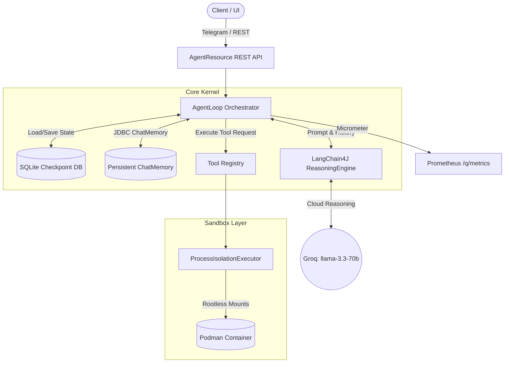
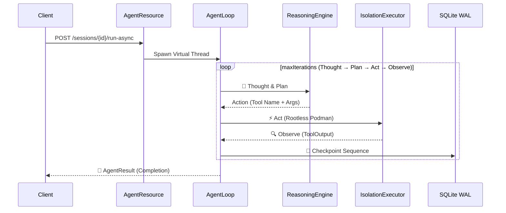

<div align="center">
  <h1>🛡️ ArcClaw v1.0</h1>
  <p><strong>A secure, stateful, and financially governed AI agent kernel designed for enterprise deployment.</strong></p>

  
  
  
  
  
</div>

---

## 🏗️ Core Architectural Pillars (The 'Why')

ArcClaw is not a conceptual prototype; it is an enterprise-grade kernel built with a paranoid security posture and rigorous financial guardrails.

### Core Technical Pillars

| Pillar | Implementation |
|---|---|
| **Isolation** | OS-level sandboxing via Podman rootless or Linux Namespaces |
| **State** | JDBC-backed `ChatMemoryStore` + SQLite (WAL) for 100% session persistence |
| **Intelligence** | LLM Intent Routing (`llama-3.1-8b-instant`) for dynamic specialist dispatch |
| **Governance** | Human-in-the-Loop (HITL) manual approval for sensitive tool operations |
| **Observability** | Prometheus Metrics (Micrometer) + OTLP Tracing + Jaeger |
| **Security** | Argon2id key derivation + AES-256-GCM-SIV authenticated encryption |

### 🕉️ The Cosmic Pantheon (Grok 4.20 Inspiration)

ArcClaw's default multi-agent roster is heavily inspired by the architecture of the **Grok 4.20** release, which famously utilized a 4-agent collaborative design to achieve unprecedented reasoning capabilities. To give this architecture a distinct flavor, ArcClaw maps these 4 foundational roles to the Hindu Cosmic Pantheon:

*   **Vishnu (`coordinator`):** The Preserver. Acts as the primary router, decomposing the user's objective, delegating tasks to specialists, and synthesizing the final output.
*   **Saraswati (`researcher`):** The Goddess of Knowledge. Operates strictly on facts and external data retrieval (e.g., GitHub). Hard-prompted to never fabricate information or write code.
*   **Brahma (`coder`):** The Creator. A pure logic and engineering brain focused exclusively on writing code, math, and system design. Refuses conversational tasks.
*   **Shiva (`debugger`):** The Transformer. Acts as the contrarian balance expert. Identifies blind spots, challenges assumptions, and provides creative alternatives to break the team out of local minima.

> [!NOTE]
> ArcClaw v1.2 utilizes a high-speed LLM Intent Classifier (`llama-3.1-8b-instant`) to dynamically route incoming requests to the most qualified specialist among the roles above.

*   **🛡️ Hardened Isolation:** Rootless Podman execution with ephemeral secret injection. Tools run in strictly capped containers, and secrets are passed via memory-wiped `.env` files—never as process arguments.
*   **🔐 Zero-String Security:** Argon2id key derivation and AES-GCM-SIV cryptographic vault. Keys are held in `AutoCloseable` wrappers that aggressively overwrite memory with zeros when no longer needed.
*   **🧵 Virtual Thread Mastery:** Fully non-blocking. Leverages JDK 25 optimized concurrent loops utilizing standard `synchronized` blocks alongside a bespoke CDI `@WorkspaceScoped` isolation mechanism to safely manage state maps across thousands of lightweight threads.
*   **💰 Financial Governance:** Hard USD circuit breakers and **Human-in-the-Loop** approvals. Sensitive operations (e.g., `NETWORK_OUTBOUND`) pause execution until a user clicks `/approve` via Telegram.
*   **🔍 Observability:** Real-time Prometheus metrics at `/q/metrics` track token consumption and agent invocations, while OTLP distributed tracing connects the abstract LLM reasoning loop to physical container execution via Jaeger.

---

## 🌊 High-Level Architecture Flow

When a REST call hits the kernel, the execution sequence is rigorously defined:

1.  **REST API:** The edge layer (`AgentResource`) intercepts the request on a Virtual Thread and provisions a session.
2.  **AgentLoop (LangChain4J):** The core reasoning engine runs a bounded `maxIterations` loop (Thought → Plan → Act → Observe), preventing infinite hallucination spirals.
3.  **ToolRegistry:** The CDI-powered registry discovers available tools and enforces Governance policy (e.g., blocking `NETWORK_OUTBOUND` actions if the agent is untrusted or bankrupt).
4.  **ProcessIsolationExecutor:** The Sandbox layer dynamically spins up a rootless Podman container, passing credentials securely and capping CPU/Memory.
5.  **SQLite Checkpointing:** After each tick, the entire Thought trajectory is serialized into a SQLite WAL-enabled checkpoint, making the agent deeply resilient to JVM crashes.



Sequece Flow:



---

### 📋 Prerequisites
Before compiling the kernel, ensure your environment meets these strict requirements:
* **JDK 25** (or JDK 21+ with `--add-opens` flags for Mockito/Virtual Thread compatibility).
* **Maven 3.9+**
* **Docker or Podman** (for the observability stack and embedded tool isolation).
* **GraalVM / Mandrel** (Only required if building the native binary yourself).

### 🪟 Windows Setup Note (WSL2)
Because ArcClaw leverages advanced rootless container isolation for its tools, **WSL2 (Windows Subsystem for Linux) is highly recommended** for Windows developers.
* Install **Podman Desktop** (which automatically configures the WSL2 backend and injects the `podman` CLI into your Windows PATH), or do your development entirely inside a WSL2 Ubuntu distro using VS Code Remote.
* `.env` files work identically across OS boundaries. If you need to set temporary variables directly in the terminal, use standard PowerShell syntax (e.g., `$env:SESSION_ID="<uuid>"`).

---

## ⚡ Quick Start (Zero to Agent in 60 seconds)

### Step 1: Clone & Configure
```bash
git clone https://github.com/rsrini7/ArcClaw.git
cd ArcClaw

# Copy the environment template
cp .env.example .env

# Configure your secrets
# E.g., GITHUB_TOKEN=ghp_...
# Note: The local stack provisions Ollama (llama3.2:1b)—test the framework 100% offline and free of charge!
# E.g., OLLAMA_BASE_URL=http://ollama:11434
```

| Variable | Default | Purpose |
| :--- | :--- | :--- |
| `OLLAMA_BASE_URL` | `http://localhost:11434` | Points to the local or remote Ollama LLM provider. |
| `GITHUB_TOKEN` | `(empty)` | Required if using the `SaraswatiAgent` or GitHub tools. |
| `ARCCLAW_DATA_DIR` | `./data` | The host path where SQLite DBs and Workspaces are saved. |

### Step 2: Compile the Native Binary (CRITICAL)
Your `Dockerfile.native` expects the GraalVM native binary to already exist on your host machine. Docker will **not** compile your Java code; if you deploy without this step, the container will instantly fail with `failed to solve: lstat /arcclaw-app/target: no such file or directory` or cannot find `*-runner`.

> [!NOTE]
> The final native executable will be approximately **118MB**, containing the entire statically-linked Quarkus runtime and ArcClaw kernel logic.

*(Note: You must have GraalVM/Mandrel installed locally, or use Quarkus's built-in container builder if on Windows/Mac)*
```bash
# Build the native Linux binary (uses Podman container-build automatically):
# The -am flag is CRITICAL — it rebuilds arcclaw-core before packaging arcclaw-app.
.\mvnw.cmd clean package -pl arcclaw-app -am -Pnative -DskipTests
```

### Step 3: Boot the Stack
Once the `.env` is populated, the native binary is sitting in `target/`, and the compose file is updated with the `init-perms` block, you are ready for liftoff:
```bash
docker compose up -d --build
```
> [!TIP]
> **Zero-Touch Initialization**: The Docker compose stack includes an `ollama-init` sidecar that will automatically download the LLM weights (e.g. `llama3.2:1b`) for you prior to the main ArcClaw server booting. Just wait a few seconds for the download!

(or)

```bash
docker compose build --no-cache
docker compose up -d
```

> [!CAUTION]
> **Windows Podman Desktop Users**: Standalone `docker compose` binary defaults to Docker Desktop's named pipe. If you receive an error `open //./pipe/dockerDesktopLinuxEngine`, you must either enable "Docker API compatibility" in Podman Settings, or set the following environment variable before running the compose command:
> `$env:DOCKER_HOST="npipe:////./pipe/podman-machine-default"`

> [!CAUTION]
> **Local Ollama Port Collisions**: If you already have Ollama installed naturally on your host machine (Mac/Windows), Docker Compose will likely crash with `bind: address already in use` for TCP port `11434`. You must either quit your local Ollama application entirely before booting `docker compose`, or remap the Ollama port inside `docker-compose.yaml` (e.g., `"11435:11434"`).
**What to expect next:**
* Docker will download the images (Ollama, Jaeger, UBI 9).
* `init-perms` will boot instantly, change the permissions of the data volume to UID 1000 (`arcclaw`), and exit.
* `arcclaw` will boot, safely initialize its SQLite DB, and bind to port 8080.

You can then run the `curl` commands from your `TESTING_GUIDE.md`!

### 🧪 Running the Test Suite
ArcClaw includes 40+ unit and integration tests covering the CDI scopes, LLM reasoning logic, and SQLite checkpoints. To run the full suite across all modules, use:
```bash
mvn clean verify -pl arcclaw-app -am
```
*(Note: Mockito requires JDK 21+ inline mock attachments. This is handled automatically by the `--add-opens` flags in the `arcclaw-app` pom.xml).*

### Step 4: Run the Kernel (Dual-Mode)
ArcClaw v1.0 functions as a dual-mode binary. You can run it as a long-lived REST daemon or execute a single task directly from the CLI.

**Option A: Daemon Mode (REST API)**
If you prefer to run the kernel locally on the JVM using Quarkus dev mode instead of Docker:
```bash
# Ensure you are using JDK 21+ (Designed for JDK 25)
.\mvnw.cmd quarkus:dev -pl arcclaw-app -am "-Dquarkus.args=serve"
```
*(Note: Or using the built JAR: `java -jar arcclaw-app/target/quarkus-app/quarkus-run.jar serve`)*
> [!NOTE]
> If Quarkus dev mode fails with a console `NullPointerException`, disable the dev console by setting `quarkus.console.enabled=false` in the `%dev` profile. See `TROUBLESHOOTING.md` for details.

**Option B: CLI One-Shot Mode (Verbose)**
Run a single agentic task and exit immediately. Agent loop output and token costs are streamed directly to your terminal.
```bash
# Using the built JAR
java -jar arcclaw-app/target/quarkus-app/quarkus-run.jar ask "Analyze the codebase..." --role coordinator
```

**Option C: Silent PowerShell CLI (Recommended for Windows)**
For a cleaner experience, use the provided silent wrapper. It forces the `%cli` profile, disabling banners and verbose logging, leaving only the agent's reasoning.
```powershell
.\arcclaw-cli.ps1 ask "Your goal here" --role coordinator
```
*(Note: If running purely natively, execute the compiled binary with `-Dquarkus.profile=cli`: `./arcclaw-app-1.0.0-SNAPSHOT-runner -Dquarkus.profile=cli ask "your goal"`)*

---

## 🤖 Interacting with the Kernel

Use our REST API to spawn and observe agents.

**1. Create a Workspace Session:**
```bash
curl -X POST http://localhost:8080/api/v1/sessions
# Response: {"sessionId": "abcd-1234-..."}
```

**2. Trigger an Agent (Asynchronous):**
Delegate a task to the `coordinator` (Vishnu) agent fully asynchronously:
```bash
curl -v -X POST http://localhost:8080/api/v1/sessions/abcd-1234-.../run-async \
  -H "Content-Type: application/json" \
  -d '{
        "goal": "Analyze the arcclaw repository statistics",
        "agentRole": "coordinator",
        "maxIterations": 3
      }'
```

> [!TIP]
> **Pro Tip: Use `api.http` instead!**
> If you are using **IntelliJ IDEA** or **VSCode** (with the REST Client extension), you can skip manual `curl` commands and just use the provided [`api.http`](./api.http) file.
> 1. Run the first request to create the session.
> 2. The script will automatically capture the `SESSION_ID`.
> 3. Run the subsequent "Async" or "Sync" requests immediately without copying IDs!

**3. Observe the Trace:**
Open the [Jaeger UI](http://localhost:16686) in your browser to watch the agent think, execute tools in Podman, and persist its thoughts.

**4. End-to-End Verification (Reading the Logs):**
When the asynchronous agent executes successfully, you will see a precise sequence of events in your Quarkus terminal that perfectly matches our architecture diagram:

1. **Virtual Thread Initialization:** `Spawning virtual thread for async agent run, session: e8d8...`
   *ArcClaw receives the REST payload and instantly offloads the workload to a lightweight JDK 25 Virtual Thread so the HTTP worker isn't blocked.*
2. **Context Hydration:** `AgentLoop starting for goal... (maxIterations=5)`
   *The `@ActivateRequestContext` binds a fresh CDI lifecycle to the unmanaged thread, and the `WorkspaceScopeHolder` activates the isolated workspace session.*
3. **LLM Delegation:** `HTTP request: - url: http://localhost:11434/api/chat`
   *LangChain4j serializes the tools and your prompt, then executes a synchronous REST payload to your local Ollama `llama3.2:1b` container.*
4. **Tool/Reasoning Execution:** `Agent reached FINISH at iteration 1`
   *The LLM decides it has satisfied your goal (or emitted a final hallucinated JSON string) and commands the parser to halt the Thought-Action-Observation loop.*
5. **State Checkpointing:** `Created checkpoint for session=e8d8... role=coordinator` followed immediately by `Checkpoint id=2 marked COMPLETED`
   *Hibernate ORM commits the final reasoning step history as a JSON CLOB into the SQLite database, marking the virtual thread's lifecycle complete.*

---

---

## 📱 Telegram Bot Integration (Live Test)

ArcClaw features an enterprise-grade, Virtual-Thread-backed Telegram network adapter. By explicitly handling the Vert.x to ManagedExecutor handoff, ArcClaw can handle thousands of concurrent Telegram users without dropping connections.

Here is the exact step-by-step guide to perform the Live Integration Test.

### Step 1: Create a Telegram Bot
1. Open Telegram and search for **@BotFather**.
2. Send the command `/newbot`.
3. Give it a name (e.g., `ArcClaw Dev Bot`) and a username (e.g., `arcclaw_dev_bot`).
4. BotFather will give you an HTTP API Token (e.g., `123456789:ABCdefGHIjklmNOPQrsTUVwxyz`). Copy this.

### Step 2: Configure Your Environment
You need to provide the token to ArcClaw and ensure your LLM is running.
Open your `.env` file and add the token:
```env
TELEGRAM_BOT_TOKEN=123456789:ABCdefGHIjklmNOPQrsTUVwxyz
```
Make sure your local Ollama container is running so the agent has a brain:
```bash
docker compose up -d ollama
```
*(Or open the Ollama GUI to start the local process).*

### Step 3: Boot ArcClaw in Daemon Mode
Because we are using the quarkus-picocli Dual-Mode binary, we must explicitly tell it to run the `serve` command.
```bash
.\mvnw.cmd quarkus:dev -pl arcclaw-app -am "-Dquarkus.args=serve"
```
*(You should see Quarkus boot up, connect to SQLite, and log: `ArcClaw daemon mode starting on port 8080...`)*

### Step 4: The Live Verification Test
This test will prove both the network layer and the Session Continuity.

**Test 1: The Cold Start**
1. Open Telegram and search for your bot's username.
2. Click **Start** (or send a message like: "Hello, I need you to research the ArcClaw repository.")
3. **Watch your terminal**: You should immediately see the Camel route pick it up, hand it off to the Virtual Thread, and the AgentLoop start logging its thoughts.
4. **Watch Telegram**: A few seconds later, the bot should reply with Vishnu's final synthesized answer!

**Test 2: Conversation Memory (Session Continuity)**
1. Reply to the bot in Telegram with a follow-up: *"Can you summarize what you just told me in exactly 3 bullet points?"*
2. **The Verification**: If the bot successfully references the previous message, it proves that your `UUID.nameUUIDFromBytes` mapping worked perfectly and the session stayed `IN_PROGRESS` as designed.

### 🚨 Troubleshooting: The "Nuclear Option" (Token Revocation)
If you have ghost container connections polling your bot, you can sever them by revoking the token in BotFather.

1. In Telegram, click your bot's username in the BotFather chat.
2. Send the `/revoke` (or `/token`) command.
3. BotFather will immediately revoke the old token and give you a new one (e.g., `123456789:NEWtokenStringXYZ123...`).
4. Replace the old token in your `.env` file with the new one.
5. Restart the Quarkus daemon (`Ctrl+C`, then `.\mvnw.cmd quarkus:dev ...`) to pick up the new token.

---

## 🧩 Extending ArcClaw

ArcClaw is designed as a modular kernel. Adding new capabilities requires minimal boilerplate:

**1. Create a New Tool:**
Implement the `AgentTool` interface, register it as an `@ApplicationScoped` bean, and ArcClaw handles the LangChain4J specification mapping and Sandbox isolation automatically.

**2. Define a New Persona:**
Create a new class implementing `Agent`. Define its `role()`, supply your custom `systemPrompt()`, and return a list of `allowedTools()`. Tag it with `@AgentRole("your_role")` to make it instantly available to the REST API.

---

## 📁 Project Structure (The Reactor)

ArcClaw enforces strict module boundaries to guarantee clean architectural separation:

*   **`arcclaw-parent/`**: BOM dependency definitions.
*   **`arcclaw-core/`**: The heart. Core logic, CDI API interfaces, Domain models, and SQLite persistence. No Quarkus bytecode enhancement here.
*   **`arcclaw-deployment/`**: The brain. Quarkus build-time processors (`@BuildStep`) that wire up our custom `@WorkspaceScoped` logic.
*   **`arcclaw-app/`**: The entrypoint. REST endpoints, `application.yaml` configuration, deployment integration tests, and application bootstrapping.

---

## 📚 Deep-Dive Documentation

Our codebase was engineered for Future AI and Human contributors. Don't guess—read the docs:

*   **[`TESTING_GUIDE.md`](./TESTING_GUIDE.md)** — Comprehensive E2E `curl` commands, REST flows, and distributed tracing setups.
*   **[`TROUBLESHOOTING.md`](./TROUBLESHOOTING.md)** — A mandatory read for new engineers. Covers JDK 25 ByteBuddy workarounds, Virtual Thread Context Propagation, Docker Permission traps, and specific `@InjectMock` nuances.
*   **[`DEVIATIONS.md`](./DEVIATIONS.md)** — The audit trail of every architectural pivot made during v1.0 implementation.
*   **[`PLAN.md`](./PLAN.md)** & **[`TASKS.md`](./TASKS.md)** — The original, granular specification and the milestone checklist.
*   **[`WALKTHROUGH.md`](./WALKTHROUGH.md)** — 14 phases of linear development history, capturing "why" we did things, not just "what" we did.
*  **[FAQ.md](./FAQ.md)** - Frequently Asked Questions - Answered
