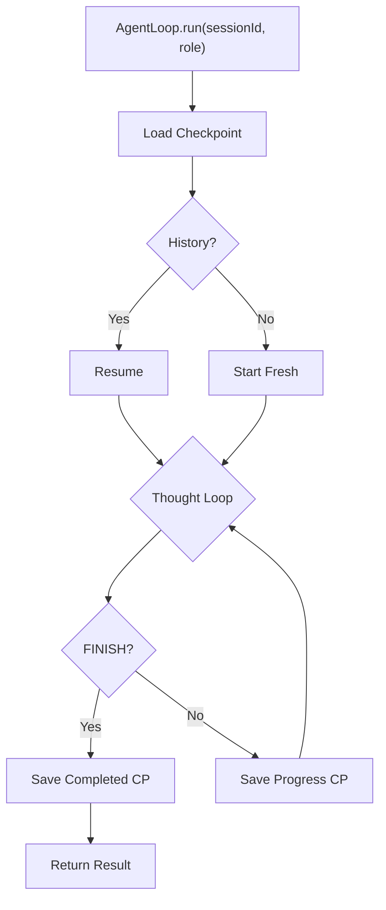

# Phases 0–7 — Walkthrough

## Phase 0: Project Scaffolding ✅

| File | Purpose |
|------|---------|
| [pom.xml](file:///h:/ws/ArcClaw/pom.xml) | Parent module, BOMs, Compiler Config |
| [application.yaml](file:///h:/ws/ArcClaw/arcclaw-app/src/main/resources/application.yaml) | Full config (Profiles, HTTP, DB, OTel) |
| [native-image.properties](file:///h:/ws/ArcClaw/arcclaw-app/src/main/resources/native-image.properties) | BouncyCastle & SQLite native flags |

**Build Verification**: `mvn clean compile` ✅

---

## Phase 1: Core Scope Layer ✅

| File | Purpose |
|------|---------|
| [WorkspaceScoped.java](file:///h:/ws/ArcClaw/arcclaw-core/src/main/java/com/arcclaw/core/scope/WorkspaceScoped.java) | Custom CDI Scope Annotation |
| [WorkspaceScopeContext.java](file:///h:/ws/ArcClaw/arcclaw-core/src/main/java/com/arcclaw/core/scope/WorkspaceScopeContext.java) | `InjectableContext` (Synchronized per JEP 491) |
| [WorkspaceScopeHolder.java](file:///h:/ws/ArcClaw/arcclaw-core/src/main/java/com/arcclaw/core/scope/WorkspaceScopeHolder.java) | ThreadLocal session ID |

**Verification**: `WorkspaceScopeTest` (isolation, concurrency) ✅

---

## Phase 2: Security Layer ✅

| File | Purpose |
|------|---------|
| [VaultKey.java](file:///h:/ws/ArcClaw/arcclaw-core/src/main/java/com/arcclaw/core/security/VaultKey.java) | Auto-wiping `byte[]` wrapper |
| [Argon2idKeyDerivation.java](file:///h:/ws/ArcClaw/arcclaw-core/src/main/java/com/arcclaw/core/security/Argon2idKeyDerivation.java) | Key stretching (BouncyCastle) |
| [AesGcmSivCipher.java](file:///h:/ws/ArcClaw/arcclaw-core/src/main/java/com/arcclaw/core/security/AesGcmSivCipher.java) | AEAD Encryption (SIV mode) |
| [SecretVaultImpl.java](file:///h:/ws/ArcClaw/arcclaw-core/src/main/java/com/arcclaw/core/security/SecretVaultImpl.java) | Vault Implementation |

**Verification**: `SecretVaultImplTest` (encrypt, decrypt, rotation, isolation) ✅

---

## Phase 3: Sandbox Layer ✅

| File | Purpose |
|------|---------|
| [ProcessIsolationExecutor.java](file:///h:/ws/ArcClaw/arcclaw-core/src/main/java/com/arcclaw/core/sandbox/ProcessIsolationExecutor.java) | PODMAN/NAMESPACE/NONE, circuit breaker, graceful shutdown |
| [AgentOtelContext.java](file:///h:/ws/ArcClaw/arcclaw-core/src/main/java/com/arcclaw/core/observability/AgentOtelContext.java) | OTel stub (Phase 9) |
| [RequiresSecret.java](file:///h:/ws/ArcClaw/arcclaw-core/src/main/java/com/arcclaw/core/security/RequiresSecret.java) | `@Repeatable` vault secret annotation |

---

## Phase 4: Tool Layer ✅

| File | Purpose |
|------|---------|
| [ToolResponse.java](file:///h:/ws/ArcClaw/arcclaw-core/src/main/java/com/arcclaw/core/tools/ToolResponse.java) | `record(exitCode, output, success)` |
| [AgentTool.java](file:///h:/ws/ArcClaw/arcclaw-core/src/main/java/com/arcclaw/core/tools/AgentTool.java) | Tool interface |
| [ToolRegistry.java](file:///h:/ws/ArcClaw/arcclaw-core/src/main/java/com/arcclaw/core/tools/ToolRegistry.java) | CDI discovery + governance |
| [GithubTool.java](file:///h:/ws/ArcClaw/arcclaw-core/src/main/java/com/arcclaw/core/tools/GithubTool.java) | Reference tool: `gh repo view` |

---

## Phase 5: Agent & Orchestration Layer ✅

| File | Purpose |
|------|---------|
| [AgentLoop.java](file:///h:/ws/ArcClaw/arcclaw-core/src/main/java/com/arcclaw/core/agent/AgentLoop.java) | Thought-Plan-Act-Observe, lifecycle aware, check-pointing |
| [ReasoningEngine.java](file:///h:/ws/ArcClaw/arcclaw-core/src/main/java/com/arcclaw/core/agent/ReasoningEngine.java) | Testable LLM abstraction |
| [GrokAgent.java](file:///h:/ws/ArcClaw/arcclaw-core/src/main/java/com/arcclaw/core/agent/GrokAgent.java) | Coordinator |
| [HarperAgent.java](file:///h:/ws/ArcClaw/arcclaw-core/src/main/java/com/arcclaw/core/agent/HarperAgent.java) | Researcher |
| [BenjaminAgent.java](file:///h:/ws/ArcClaw/arcclaw-core/src/main/java/com/arcclaw/core/agent/BenjaminAgent.java) | Coder |
| [LucasAgent.java](file:///h:/ws/ArcClaw/arcclaw-core/src/main/java/com/arcclaw/core/agent/LucasAgent.java) | Creative |
| [ArcClawSupervisor.java](file:///h:/ws/ArcClaw/arcclaw-core/src/main/java/com/arcclaw/core/agent/ArcClawSupervisor.java) | CDI agent roster |

**AgentResilienceTest**: 5/5 ✅ (hallucination, loop limit, FINISH, null, exception)

---

## Phase 6: State Layer (Checkpointing) ✅

> [!IMPORTANT]
> **Deviation**: Used plain `@Entity` + `EntityManager` instead of `PanacheEntity`. Panache bytecode enhancement only runs in the Quarkus app module.

| File | Purpose |
|------|---------|
| [CheckpointStatus.java](file:///h:/ws/ArcClaw/arcclaw-core/src/main/java/com/arcclaw/core/state/CheckpointStatus.java) | `IN_PROGRESS`, `COMPLETED`, `FAILED` |
| [AgentCheckpoint.java](file:///h:/ws/ArcClaw/arcclaw-core/src/main/java/com/arcclaw/core/state/AgentCheckpoint.java) | JPA entity, unique `(sessionId, agentRole)`, TEXT stateJson |
| [StatefulAgentStoreImpl.java](file:///h:/ws/ArcClaw/arcclaw-core/src/main/java/com/arcclaw/core/state/StatefulAgentStoreImpl.java) | EntityManager + Jackson serialization |
| [SqliteWalConfigurer.java](file:///h:/ws/ArcClaw/arcclaw-core/src/main/java/com/arcclaw/core/state/SqliteWalConfigurer.java) | WAL/NORMAL/busy_timeout PRAGMAs |

**StatefulAgentStoreTest**: 4/4 ✅ (save+load, markFailed, markCompleted, upsert)

---

## Phase 7: Lifecycle Layer ✅

> [!IMPORTANT]
> **Deviation**: `WorkspaceScopeContext` injected via `Arc.container().getActiveContext()` lookup in `WorkspaceManager`, as it's a custom context, not a CDI bean.

| File | Purpose |
|------|---------|
| [WorkspaceManager.java](file:///h:/ws/ArcClaw/arcclaw-core/src/main/java/com/arcclaw/core/lifecycle/WorkspaceManager.java) | Heartbeats, GC, Termination, Zombie Recovery |
| [AgentOtelContext.java](file:///h:/ws/ArcClaw/arcclaw-core/src/main/java/com/arcclaw/core/observability/AgentOtelContext.java) | Refactored to `@ApplicationScoped` + session spans |
| [ProcessIsolationExecutor.java](file:///h:/ws/ArcClaw/arcclaw-core/src/main/java/com/arcclaw/core/sandbox/ProcessIsolationExecutor.java) | Updated to inject `AgentOtelContext` |

**WorkspaceManagerTest**: 4/4 ✅ (Zombie recovery, GC sweep, Termination, Multi-role)

---

## Phase 8: Governance Layer ✅

| File | Purpose |
|------|---------|
| [GovernanceLayer.java](file:///h:/ws/ArcClaw/arcclaw-core/src/main/java/com/arcclaw/core/governance/GovernanceLayer.java) | Token tracking and budget enforcement |
| [BudgetExceededException.java](file:///h:/ws/ArcClaw/arcclaw-core/src/main/java/com/arcclaw/core/governance/BudgetExceededException.java) | Runtime limit termination |

**GovernanceLayerTest**: 3/3 ✅

---

## Phase 9: Observer / OTel Layer ✅

| File | Purpose |
|------|---------|
| [AgentOtelContext.java](file:///h:/ws/ArcClaw/arcclaw-core/src/main/java/com/arcclaw/core/observability/AgentOtelContext.java) | OpenTelemetry Tracer integration |

**AgentOtelContextTest**: 2/2 ✅

---

## Phase 10: Health Layer (WIP) 🚧

| File | Purpose |
|------|---------|
| [PodmanHealthCheck.java](file:///h:/ws/ArcClaw/arcclaw-core/src/main/java/com/arcclaw/core/health/PodmanHealthCheck.java) | Liveness probe (Podman version) |
| [PodmanImageHealthCheck.java](file:///h:/ws/ArcClaw/arcclaw-core/src/main/java/com/arcclaw/core/health/PodmanImageHealthCheck.java) | Readiness probe (OCI image) |

**Status**: 46 iterations deep. Blocked by cross-module CDI discovery in tests.
