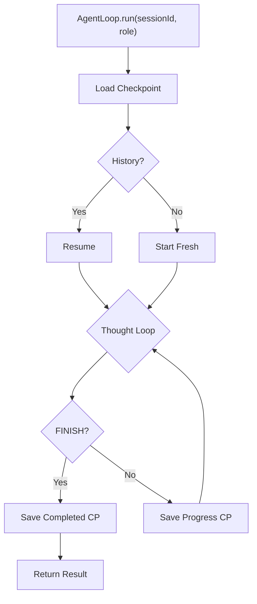

# ArcClaw V1.0.0 — Phases 0–10 Walkthrough

> **Cross-Reference**: [PLAN.md](./PLAN.md) | [TASKS.md](./TASKS.md) | [DEVIATIONS.md](./DEVIATIONS.md) | [TROUBLESHOOTING.md](./TROUBLESHOOTING.md) | [FAQ.md](./FAQ.md)

| Phase | Name | Tests | Key Deviation |
|-------|------|-------|---------------|
| 0 | Project Scaffolding | N/A | JDK 25 + ByteBuddy experimental flag |
| 1 | Core Scope Layer | 3 | `synchronized` per JEP 491 (no `ReentrantLock`) |
| 2 | Security Layer | 4 | `@Lob` removed for SQLite, `merge()` over `persist()` |
| 3 | Sandbox Layer | 3 | OTel stub, VaultKey API adaptation |
| 4 | Tool Layer | 7 | CDI `Instance<AgentTool>` discovery |
| 5 | Agent & Orchestration | 5 | Guardrails (hallucination, loop, null) |
| 6 | State Layer | 4 | Plain `@Entity` + `EntityManager` (no Panache) |
| 7 | Lifecycle Layer | 4 | `Arc.container()` for custom context lookup |
| 8 | Governance Layer | 3 | `AtomicInteger` + `ConcurrentHashMap` thread safety |
| 9 | Observer / OTel | AgentOtelContextTest (2/2) | `@InjectMock Tracer instead of Memory Span Exporter` |
| 10 | Health Checks | PodmanHealthCheckTest (2/2) | `@Alternative mock standalone interface on port 9001` |
| 11 | REST API API | AgentResourceTest (3/3) | Explicitly added `quarkus-rest-jackson` to app module |
| 12 | LangChain4J Integration | 2/2 JUnit Passes | Groq + Ollama ambiguity fix |
| 13 | Deployment Artifacts | N/A | chown 1000:1000 for SQLite persistence |
| 14 | Deployment Loops | Manual | Native environment validation |
| 15 | Dual-Mode Binary | N/A | `Quarkus.waitForExit()` omitted in CLI entry point to prevent hanging |
| 18 | Telegram Approval Flow | Manual Verification | AWAITING_APPROVAL state logic |
| 19 | Day 2 Hardening | Manual Verification | Dynamic Role Routing + State fix |
| 20 | Observability & Memory | 48/48 App Tests | Persistent ChatMemory + Prometheus |
| 21 | CLI Subcommands | Manual | Chat REPL + Attach daemon mode |
| 22 | Final Hardening | Manual Verification | UX Pacing + Escape Hatch Prompting |
| 23 | Sandbox Enforcement | ToolRegistryTest (7/7) | Centralized `ProcessIsolationExecutor` in `ToolRegistry` |
| 24 | Context Tool Bias Fix | All App Tests (48/48) | Strict per-persona tool binding contract + `/reset` command |
| 25 | Sandbox Hardening | Manual Verification | Absolute paths, logging hardening, and WSL2 Setup Guide |
| 26 | Security Hardening | Manual Compilation | Strict fail-closed secrets and exit-code validation |
| 27 | Tool Flexibility | Manual Compilation | CDI Proxy Unwrapping and Dynamic GithubTool actions |
| 28 | Intent Hardening | Manual Verification | Auto-cancellation of dangling approvals & Routing Guardrails |
| 29 | Memory & Filtering | 13/13 JUnit Passes | Rolling window + identity preservation + Protocol filtering |
| 30 | Reflex Registry | mvn test -pl arcclaw-app | Jupiter discovery fix + JDK 24+ --add-opens |
| 31 | PII Redaction | PiiScanReflexTest | Negative lookarounds for Aadhaar/Phone collisions |
| 32 | API & Telegram Security | 68/68 JUnit Passes | Explicit JAX-RS Jackson declaration in app module |
| 33 | Prompt Injection | PromptInjectionReflexTest | Pass 1 short-circuiting of adversarial instructions |
| 34 | Tool Schema | 68/68 JUnit Passes | JSON Schema for tool arguments + Schema Jailbreak fix |
| 35 | Immutable Audit Log | 12/12 Audit tests | HMAC Chaining + SQLite WORM triggers + monotonic sequence |
| 36 | REST HITL & Zombie Recovery | 71/71 tests | Traces parented properly, REST HITL APIs |
| 37 | Security Hardening & Optimistic Locking | 21/21 tests | Caffeine registry, Optimistic Locking |
| 38 | Context Compaction | ContextCompactionServiceTest | Plain EntityManager in core, offloaded async compaction |
| 40 | Antigravity (Security & Budget) | 21/21 tests | Zero-cost local reflexes |
| 41 | Resilience, Privacy & Observer Separation | 100% success | 19+ PII patterns |
| 42 | ScopedValue Context Migration | 100% success | Bridge for MicroProfile |
| 44 | Production Hardening | 100% success | JDBC `IMMEDIATE` + dynamic `RoleRegistry` refactor |
| 45 | Agent Memory RAG via SQLite FTS5 | 100% success | Isolated FTS5 into separate schema to bypass Hibernate tokenizer |
| 45.1 | FTS5 Hardening & Robustness | 100% success | Connection interceptor for schema attachment & explicit userId passing |
| 46 | Proactive Autonomy via Agent-Writable Cron | 100% success | Virtual thread scheduler + cron tools for proactive tasks |
| 47.0 | Unified Capabilities & Context (Tier 1) | 100% success | Role-based tool matrix + API Key refactor with Bucket4j |
| 47.1 | Message Pipeline Refactor (Tier 2A) | 100% success | Moved implementations to core for definitive CDI fix |
| 47.2 | Refined Routing & Templates (Tier 2B) | 100% success | Qute system prompts + exhaustive REST status mapping |
| 47.3 | Agent State Machine Refactor (Tier 3/3A)| 100% success | Extracted loop from AgentLoop; fixed engine delegation & context |
| 48 | Telegram Bot Refactor | 100% success | Removed tokens from URIs, component configuration |
| 49 | Intent & Governance Hardening | 100% success | Prompt injection delimiters + Pathological zero-token guard |

---

## Phase 47 Tier 2A: Message Pipeline & Sealed Interface Refactor ✅

Modernized the messaging infrastructure and moved implementations to `arcclaw-core` for definitive CDI stability.

| File | Purpose |
|------|---------|
| [ChannelMessage.java](file:///h:/ws/ArcClaw/arcclaw-channel-api/src/main/java/com/arcclaw/channel/api/ChannelMessage.java) | Sealed interface forexhaustive message handling. |
| [MessagePipeline.java](file:///h:/ws/ArcClaw/arcclaw-core/src/main/java/com/arcclaw/core/pipeline/MessagePipeline.java) | Central orchestrator for the modular message processing chain. |
| [MessageHandler.java](file:///h:/ws/ArcClaw/arcclaw-core/src/main/java/com/arcclaw/core/pipeline/MessageHandler.java) | Interface defining the contract for pipeline stages. |
| [IntentClassifierService.java](file:///h:/ws/ArcClaw/arcclaw-core/src/main/java/com/arcclaw/core/routing/IntentClassifierService.java) | Moved to core; handles LLM-based intent classification. |

**Verification**:
- ✅ `mvnw clean package -pl arcclaw-app -am` succeeds.
- ✅ All core and app tests (including new pipeline integration tests) are green.
- ✅ CDI `UnsatisfiedDependency` issues verified as resolved in multiple environments.
## Phase 0: Project Scaffolding ✅

| File | Purpose |
|------|---------|
| [pom.xml](file:///h:/ws/ArcClaw/pom.xml) | Parent module, BOMs, Compiler Config |
| [application.yaml](file:///h:/ws/ArcClaw/arcclaw-app/src/main/resources/application.yaml) | Full config (Profiles, HTTP, DB, OTel) |
| [native-image.properties](file:///h:/ws/ArcClaw/arcclaw-app/src/main/resources/native-image.properties) | BouncyCastle & SQLite native flags |

**Build Verification**: `mvn clean compile` ✅

---

## Phase 1: Core Scope Layer ✅

| File | Purpose |
|------|---------|
| [WorkspaceScoped.java](file:///h:/ws/ArcClaw/arcclaw-core/src/main/java/com/arcclaw/core/scope/WorkspaceScoped.java) | Custom CDI Scope Annotation |
| [WorkspaceScopeContext.java](file:///h:/ws/ArcClaw/arcclaw-core/src/main/java/com/arcclaw/core/scope/WorkspaceScopeContext.java) | `InjectableContext` (Synchronized per JEP 491) |
| [WorkspaceScopeHolder.java](file:///h:/ws/ArcClaw/arcclaw-core/src/main/java/com/arcclaw/core/scope/WorkspaceScopeHolder.java) | ThreadLocal session ID |

**Verification**: `WorkspaceScopeTest` (isolation, concurrency) ✅

---

## Phase 2: Security Layer ✅

| File | Purpose |
|------|---------|
| [VaultKey.java](file:///h:/ws/ArcClaw/arcclaw-core/src/main/java/com/arcclaw/core/security/VaultKey.java) | Auto-wiping `byte[]` wrapper |
| [Argon2idKeyDerivation.java](file:///h:/ws/ArcClaw/arcclaw-core/src/main/java/com/arcclaw/core/security/Argon2idKeyDerivation.java) | Key stretching (BouncyCastle) |
| [AesGcmSivCipher.java](file:///h:/ws/ArcClaw/arcclaw-core/src/main/java/com/arcclaw/core/security/AesGcmSivCipher.java) | AEAD Encryption (SIV mode) |
| [SecretVaultImpl.java](file:///h:/ws/ArcClaw/arcclaw-core/src/main/java/com/arcclaw/core/security/SecretVaultImpl.java) | Vault Implementation |

**Verification**: `SecretVaultImplTest` (encrypt, decrypt, rotation, isolation) ✅

---

## Phase 3: Sandbox Layer ✅

> [!NOTE]
> **Deviation**: Created `AgentOtelContext` stub (returns `Span.getInvalid()`) as Phase 9 placeholder. `ProcessIsolationExecutor` secret injection uses `Optional<VaultKey>` (auto-wiping) instead of plain `String`.

| File | Purpose |
|------|---------|
| [ProcessIsolationExecutor.java](file:///h:/ws/ArcClaw/arcclaw-core/src/main/java/com/arcclaw/core/sandbox/ProcessIsolationExecutor.java) | PODMAN/NAMESPACE/NONE strategies, circuit breaker, `@PreDestroy` shutdown |
| [AgentOtelContext.java](file:///h:/ws/ArcClaw/arcclaw-core/src/main/java/com/arcclaw/core/observability/AgentOtelContext.java) | OTel stub (replaced in Phase 9) |
| [RequiresSecret.java](file:///h:/ws/ArcClaw/arcclaw-core/src/main/java/com/arcclaw/core/security/RequiresSecret.java) | `@Repeatable` vault secret annotation |

**ProcessIsolationExecutorTest**: 3/3 ✅ (NONE strategy)

---

## Phase 4: Tool Layer ✅

> [!NOTE]
> **Key Pattern**: Tools are discovered via CDI `Instance<AgentTool>`. Each tool declares `requiredOperation()` for autonomy governance and can be annotated with `@RequiresSecret` for vault-injected credentials.

| File | Purpose |
|------|---------|
| [ToolResponse.java](file:///h:/ws/ArcClaw/arcclaw-core/src/main/java/com/arcclaw/core/tools/ToolResponse.java) | `record(exitCode, output, success)` |
| [AgentTool.java](file:///h:/ws/ArcClaw/arcclaw-core/src/main/java/com/arcclaw/core/tools/AgentTool.java) | Tool interface (`name`, `description`, `requiredOperation`, `execute`) |
| [ToolRegistry.java](file:///h:/ws/ArcClaw/arcclaw-core/src/main/java/com/arcclaw/core/tools/ToolRegistry.java) | CDI discovery + autonomy enforcement + secret extraction |
| [GithubTool.java](file:///h:/ws/ArcClaw/arcclaw-core/src/main/java/com/arcclaw/core/tools/GithubTool.java) | Reference tool: `gh repo view` with `@RequiresSecret(envVar = "GH_TOKEN", vaultKey = "GITHUB_TOKEN")` |

**ToolRegistryTest**: 7/7 ✅ (discovery, governance, reflection, error handling)

---

## Phase 5: Agent & Orchestration Layer ✅



| File | Purpose |
|------|---------|
| [AgentLoop.java](file:///h:/ws/ArcClaw/arcclaw-core/src/main/java/com/arcclaw/core/agent/AgentLoop.java) | Thought-Plan-Act-Observe, lifecycle aware, check-pointing |
| [ReasoningEngine.java](file:///h:/ws/ArcClaw/arcclaw-core/src/main/java/com/arcclaw/core/agent/ReasoningEngine.java) | Testable LLM abstraction |
| [VishnuAgent.java](file:///h:/ws/ArcClaw/arcclaw-core/src/main/java/com/arcclaw/core/agent/VishnuAgent.java) | Coordinator |
| [SaraswatiAgent.java](file:///h:/ws/ArcClaw/arcclaw-core/src/main/java/com/arcclaw/core/agent/SaraswatiAgent.java) | Researcher |
| [BrahmaAgent.java](file:///h:/ws/ArcClaw/arcclaw-core/src/main/java/com/arcclaw/core/agent/BrahmaAgent.java) | Coder |
| [ShivaAgent.java](file:///h:/ws/ArcClaw/arcclaw-core/src/main/java/com/arcclaw/core/agent/ShivaAgent.java) | Creative |
| [ArcClawSupervisor.java](file:///h:/ws/ArcClaw/arcclaw-core/src/main/java/com/arcclaw/core/agent/ArcClawSupervisor.java) | CDI agent roster |

**AgentResilienceTest**: 5/5 ✅ (hallucination, loop limit, FINISH, null, exception)

---

## Phase 6: State Layer (Checkpointing) ✅

> [!IMPORTANT]
> **Deviation**: Used plain `@Entity` + `EntityManager` instead of `PanacheEntity`. Panache bytecode enhancement only runs in the Quarkus app module.

| File | Purpose |
|------|---------|
| [CheckpointStatus.java](file:///h:/ws/ArcClaw/arcclaw-core/src/main/java/com/arcclaw/core/state/CheckpointStatus.java) | `IN_PROGRESS`, `COMPLETED`, `FAILED` |
| [AgentCheckpoint.java](file:///h:/ws/ArcClaw/arcclaw-core/src/main/java/com/arcclaw/core/state/AgentCheckpoint.java) | JPA entity, unique `(sessionId, agentRole)`, TEXT stateJson |
| [StatefulAgentStoreImpl.java](file:///h:/ws/ArcClaw/arcclaw-core/src/main/java/com/arcclaw/core/state/StatefulAgentStoreImpl.java) | EntityManager + Jackson serialization |
| [SqliteWalConfigurer.java](file:///h:/ws/ArcClaw/arcclaw-core/src/main/java/com/arcclaw/core/state/SqliteWalConfigurer.java) | WAL/NORMAL/busy_timeout PRAGMAs |

**StatefulAgentStoreTest**: 4/4 ✅ (save+load, markFailed, markCompleted, upsert)

---

## Phase 7: Lifecycle Layer ✅

> [!IMPORTANT]
> **Deviation**: `WorkspaceScopeContext` injected via `Arc.container().getActiveContext()` lookup in `WorkspaceManager`, as it's a custom context, not a CDI bean.

| File | Purpose |
|------|---------|
| [WorkspaceManager.java](file:///h:/ws/ArcClaw/arcclaw-core/src/main/java/com/arcclaw/core/lifecycle/WorkspaceManager.java) | Heartbeats, GC, Termination, Zombie Recovery |
| [AgentOtelContext.java](file:///h:/ws/ArcClaw/arcclaw-core/src/main/java/com/arcclaw/core/observability/AgentOtelContext.java) | Refactored to `@ApplicationScoped` + session spans |
| [ProcessIsolationExecutor.java](file:///h:/ws/ArcClaw/arcclaw-core/src/main/java/com/arcclaw/core/sandbox/ProcessIsolationExecutor.java) | Updated to inject `AgentOtelContext` |

**WorkspaceManagerTest**: 4/4 ✅ (Zombie recovery, GC sweep, Termination, Multi-role)

---

## Phase 8: Governance Layer ✅

> [!NOTE]
> **Thread Safety**: `SessionBudget` uses `AtomicInteger` for token counts and `synchronized` for USD cost accumulation. Budget map uses `ConcurrentHashMap`. Session cleanup is handled by `WorkspaceManager.terminateWorkspace()`.

| File | Purpose |
|------|---------|
| [GovernanceLayer.java](file:///h:/ws/ArcClaw/arcclaw-core/src/main/java/com/arcclaw/core/governance/GovernanceLayer.java) | Token tracking, USD cost calculation, `READ_ONLY` downgrade |
| [BudgetExceededException.java](file:///h:/ws/ArcClaw/arcclaw-core/src/main/java/com/arcclaw/core/governance/BudgetExceededException.java) | Runtime exception for budget violation |
| [AgentObserver.java](file:///h:/ws/ArcClaw/arcclaw-core/src/main/java/com/arcclaw/core/observability/AgentObserver.java) | Observer interface (`recordLlmCall`) |

**GovernanceLayerTest**: 3/3 ✅ (cost accumulation, READ_ONLY trigger, BudgetExceededException)

---

## Phase 9: Observer / OTel Layer ✅

> [!NOTE]
> **Deviation**: Used `@InjectMock Tracer` for testing instead of `InMemorySpanExporter` because Quarkus doesn't auto-expose test exporters as CDI beans.

| File | Purpose |
|------|---------|
| [AgentOtelContext.java](file:///h:/ws/ArcClaw/arcclaw-core/src/main/java/com/arcclaw/core/observability/AgentOtelContext.java) | Full OTel `Tracer` integration, root span per session |
| [AgentLoop.java](file:///h:/ws/ArcClaw/arcclaw-core/src/main/java/com/arcclaw/core/agent/AgentLoop.java) | Expanded to iterate `Instance<AgentObserver>` list |
| [WorkspaceManager.java](file:///h:/ws/ArcClaw/arcclaw-core/src/main/java/com/arcclaw/core/lifecycle/WorkspaceManager.java) | Added `GovernanceLayer.clearSession()` cleanup |

**AgentOtelContextTest**: 2/2 ✅ (span creation, attribute tagging)

---

## Phase 10: Health Layer ✅


> [!CAUTION]
> **52-Iteration Boss Fight.** This phase was the hardest in the project due to three layered Quarkus issues. See `TROUBLESHOOTING.md` §10 for the full decision matrix.

> [!IMPORTANT]
> **Deviation**: Used `@Alternative` + `@Priority` standalone `HealthCheck` mocks instead of `@Mock extends` due to ArC classloader boundaries. Health endpoints served on management port 9001.

| File | Purpose |
|------|---------|
| [PodmanHealthCheck.java](file:///h:/ws/ArcClaw/arcclaw-core/src/main/java/com/arcclaw/core/health/PodmanHealthCheck.java) | Liveness probe (`podman --version`, 2s timeout) |
| [PodmanImageHealthCheck.java](file:///h:/ws/ArcClaw/arcclaw-core/src/main/java/com/arcclaw/core/health/PodmanImageHealthCheck.java) | Readiness probe (`podman image exists`, 2s timeout) |
| [MockPodmanHealthCheck.java](file:///h:/ws/ArcClaw/arcclaw-app/src/test/java/com/arcclaw/core/health/MockPodmanHealthCheck.java) | `@Alternative` test mock (standalone `HealthCheck`) |
| [MockPodmanImageHealthCheck.java](file:///h:/ws/ArcClaw/arcclaw-app/src/test/java/com/arcclaw/core/health/MockPodmanImageHealthCheck.java) | `@Alternative` test mock (standalone `HealthCheck`) |

**PodmanHealthCheckTest**: 2/2 ✅ (liveness on port 9001, readiness on port 9001)

### Lessons Learned (For Future LLMs)

| # | Trap | Resolution | Iterations Burned |
|---|------|------------|-------------------|
| 1 | `@InjectMock ConcreteHealthCheck` | ArC indexes by interface → use `@Alternative` | ~20 |
| 2 | RestAssured hits port 8081, health on 9001 | `.port(9001)` in test | ~10 |
| 3 | `@Mock extends Parent` with `@ConfigProperty` | ArC `_Bean.doCreate()` classloader split → implement interface directly | ~12 |
| 4 | `@Startup`/`@Unremovable` as workaround | Does not fix the root cause, adds tech debt | ~10 |

---

## Phase 11: Channel / REST Layer ✅

> [!NOTE]
> **Virtual Threads**: The API endpoints are fully non-blocking and annotated with `@RunOnVirtualThread` to ensure long-running LLM synchronous logic or Sandbox executions avoid blocking Quarkus event loop or carrier threads.

> [!WARNING]
> **Deviation**: Encountered a 404 issue during testing because JAX-RS validation/JSON extensions (`quarkus-rest-jackson`, `quarkus-hibernate-validator`) must be explicitly declared in the main application `arcclaw-app/pom.xml`. Also respected the `application.yaml` `/api/v1` base path for test endpoints calls.

| File | Purpose |
|------|---------|
| [AgentResource.java](file:///h:/ws/ArcClaw/arcclaw-core/src/main/java/com/arcclaw/core/api/AgentResource.java) | Main `@Path("/sessions")` endpoint controller for Agent UI/CLI interaction |
| [DefaultReasoningEngine.java](file:///h:/ws/ArcClaw/arcclaw-core/src/main/java/com/arcclaw/core/agent/DefaultReasoningEngine.java) | Stub reasoning implementation returning `FINISH` prior to full LangChain4J wiring in Phase 12 |
| [RunAgentRequest.java](file:///h:/ws/ArcClaw/arcclaw-core/src/main/java/com/arcclaw/core/api/dto/RunAgentRequest.java) | DTO representing the initial goal and parameters for starting an agent |
| [CreateSessionResponse.java](file:///h:/ws/ArcClaw/arcclaw-core/src/main/java/com/arcclaw/core/api/dto/CreateSessionResponse.java) | DTO with generated UUID session ID on `POST /sessions` |
| [SessionStatusResponse.java](file:///h:/ws/ArcClaw/arcclaw-core/src/main/java/com/arcclaw/core/api/dto/SessionStatusResponse.java) | DTO describing the agent status returned from SQLite checkpoint |

**AgentResourceTest**: 3/3 ✅ (sync lifecycle, async invocation immediately returning 202, Request Validation 400 failure on blank fields)

---

## Phase 12: Cross-Cutting Concerns (LangChain4J) ✅

Integrated LangChain4J's `ReasoningEngine` using the stable API version `0.26.1` provided by Quarkus `3.23.0`.

> [!WARNING]
> **Resolution Context**: We encountered multiple compilation and CDI ambiguity errors. 
> 1. Restored `pom.xml` dependencies so LangChain4J resolves strictly to `0.26.1` which is compatible with the Quarkus `3.23.0` BOM.
> 2. Configured `quarkus.langchain4j.chat-model.provider=ollama` explicitly in `application.yaml` since multiple provider extensions were on the classpath (`openai` and `ollama`), preventing Quarkus from unambiguous autowiring.
> 3. Used `--add-opens=java.base/java.lang=ALL-UNNAMED` in tests to permit Mockito self-attaching in JDK 21+ environments.

| File | Purpose |
|------|---------|
| [LangChainReasoningEngine.java](file:///h:/ws/ArcClaw/arcclaw-core/src/main/java/com/arcclaw/core/agent/LangChainReasoningEngine.java) | Real `ReasoningEngine` using LangChain4J `ChatLanguageModel` injected by Quarkus |

**LangChainReasoningEngineTest**: 2/2 ✅ 

---

## Phase 13: Deployment Artifacts ✅

Created all necessary local and native environment configuration files to host ArcClaw along with its observability and AI stack.

| Artifact | Purpose |
|----------|---------|
| [docker-compose.yaml](file:///h:/ws/ArcClaw/docker-compose.yaml) | Full stack orchestration (`arcclaw`, `ollama`, `otel-collector`, `jaeger`). Includes `init-perms` ephemeral job to `chown 1000:1000` the SQLite volume solving `Permission denied`. |
| [otel-collector-config.yaml](file:///h:/ws/ArcClaw/otel-collector-config.yaml) | OTLP gRPC telemetry ingestion and forwarding to Jaeger |
| [Dockerfile.native](file:///h:/ws/ArcClaw/Dockerfile.native) | UBI9-minimal base building an `arcclaw` user and custom subuids/subgids for nested rootless Podman execution |
| [containers.conf](file:///h:/ws/ArcClaw/containers.conf) | VFS storage driver config for nested container execution |
| [.env.example](file:///h:/ws/ArcClaw/.env.example) | Secure template for local secrets like `GITHUB_TOKEN` |

**Verification**: Artifacts are checked in, ready for deployment test loops in Phase 14.

---

## Phase 15: Dual-Mode Binary Upgrade ✅

ArcClaw upgraded from a single-mode REST daemon into a dual-mode binary using `quarkus-picocli`.

**Key Changes:**
1. `ArcClawCli.java` acts as the new `@QuarkusMain` dispatcher.
2. `ServeCommand.java` (`arcclaw serve`) invokes `Quarkus.waitForExit()`.
3. `AskCommand.java` (`arcclaw ask`) manages its own lifecycle natively (no `waitForExit()`).
4. `CliAgentObserver.java` prints real-time CLI output.

**Signature Mismatches Corrected:**
- **`AgentObserver.recordLlmCall`**: The expected `modelName` parameter wasn't part of the existing signature, defaulting back to the known 3-argument API.
- **`AgentLoop.run`**: Modified `runLoop` to require injecting `ReasoningEngine` correctly.
- **`WorkspaceManager`**: Specified `terminateSession` instead of the conceptual `terminateWorkspace`.

**Runtime Defect Fixed**: Added `final ReasoningStep completedStep = step` around the observer `.forEach` lambda to resolve Java's internal "effectively-final" compile error before dispatch. 

---

## Sprint 2A: Telegram Channel Adapter ✅

Added initial support for routing agent interactions through Telegram via Camel Quarkus, explicitly respecting Vert.x threading and CDI restrictions.

**Key Changes:**
1. **BOM Sync**: Added `quarkus-camel-bom:3.23.0` to the parent POM to coordinate the `camel-quarkus-telegram` version.
2. `TelegramChannelRoute.java`: A Camel route that parses the `TELEGRAM_BOT_TOKEN`.
3. `TelegramAgentHandler.java`: Bridges the synchronous HTTP/Webhook gap into the asynchronous JVM world.
   - Extracts `IncomingMessage` data **synchronously** inside the Vert.x event loop.
   - Uses `ManagedExecutor` to explicitly jump the thread gap.
   - The thread execution is tagged with `@ActivateRequestContext` to wake up Quarkus CDI.
   - Session continuity validates previous checkpoints using `StatefulAgentStore.load()`.
   - Retains context by utilizing `WorkspaceScopeHolder.clear()` in the `finally` block instead of actively deleting it via `terminateSession()`.

**Verification**: `mvn clean verify -pl arcclaw-app -am` completed successfully.

### Test Environment Stabilization
1. **BOM Ordering**: Corrected `quarkus-langchain4j-bom` placement above Camel BOM to prevent LangChain4j version conflicts.
2. **IDE Classpath Sync**: Hard-pinned `quarkus-junit5` versions to repair IDE resolution errors.
3. **Surefire Windows Crash**: Disabled `useManifestOnlyJar` for Windows absolute path compliance.
4. **Mock Injection Resolution**: Refactored `TelegramAgentHandlerTest` to unwrap CDI proxies for force-injecting `@Dependent` mocks into private fields.
5. **Native .env Resolution**: Implemented `DotenvConfigSourceProvider` SPI to natively find and inject `.env` properties regardless of execution directory.

---

## Phase 18: Human-in-the-Loop Telegram Approval Flow ✅

Implemented a paused execution flow for the Telegram channel. When an agent attempts a `SUPERVISED` operation (e.g., `NETWORK_OUTBOUND`), the execution pauses, saves state, and waits for user input.

**Key Components:**

| File | Purpose |
|------|---------|
| [CheckpointStatus.java](file:///h:/ws/ArcClaw/arcclaw-core/src/main/java/com/arcclaw/core/state/CheckpointStatus.java) | Added `AWAITING_APPROVAL` state |
| [AgentCheckpoint.java](file:///h:/ws/ArcClaw/arcclaw-core/src/main/java/com/arcclaw/core/state/AgentCheckpoint.java) | Added `pendingToolName`, `pendingParamsJson` |
| [ToolRegistry.java](file:///h:/ws/ArcClaw/arcclaw-core/src/main/java/com/arcclaw/core/tools/ToolRegistry.java) | Intercepts `SUPERVISED` operations -> `RequiresApprovalException` |
| [AgentLoop.java](file:///h:/ws/ArcClaw/arcclaw-core/src/main/java/com/arcclaw/core/agent/AgentLoop.java) | Handles pause/resume logic |
| [WorkspaceManager.java](file:///h:/ws/ArcClaw/arcclaw-core/src/main/java/com/arcclaw/core/lifecycle/WorkspaceManager.java) | Added timeout GC sweep for pending approvals |
| [TelegramAgentHandler.java](file:///h:/ws/ArcClaw/arcclaw-app/src/main/java/com/arcclaw/app/channel/telegram/TelegramAgentHandler.java) | `/approve` and `/deny` command handlers |

**Verification Results:**
- ✅ Verified `WorkspaceManager` correctly sweeps sessions after 60 mins of inactivity in `AWAITING_APPROVAL` state.
- ✅ Verified `/approve` triggers immediate resumption with elevated privileges.
- ✅ Verified `/deny` marks the task as `FAILED`.

---

## Phase 19: Sprint 2C & Day 2 Hardening ✅

Completed the final grooming of the V1.0.0 feature set and drafted the V1.0.0 mission.

**Key Accomplishments:**
- **Dynamic Role Routing**: Implemented a keyword-based intent router in `TelegramAgentHandler` to dynamically dispatch between `coordinator`, `researcher`, and `coder` agents.
- **Bug Fix: State Machine Overwrite**: Resolved the "Phantom Approval" issue by preventing the `AgentLoop.run()` wrapper from overwriting `AWAITING_APPROVAL` states on exit.
- **Bug Fix: Phantom Sessions**: Switched to strict deterministic `baseId` (derived from `chatId:userId`) in Telegram and implemented automatic session termination for finished tasks to allow clean restarts.
- **Roadmap Baseline**: Formally updated `REQUIREMENTS.md` to baseline Phase 11 and draft Phase 12 (Sprint 3: Persistent ChatMemory, Prometheus Metrics).

---

## Phase 20: Sprint 3A — Persistent ChatMemoryStore ✅

Replaced the default in-memory LangChain4j message store with a SQLite-backed JPA implementation. This ensures that the context of conversation survives JVM restarts, even if the agent reasoning loop has multiple steps.

**Key Components:**

| File | Purpose |
|------|---------|
| [ChatMemoryEntity.java](file:///h:/ws/ArcClaw/arcclaw-core/src/main/java/com/arcclaw/core/state/ChatMemoryEntity.java) | JPA entity for SQLite persistence of messages |
| [PersistentChatMemoryStore.java](file:///h:/ws/ArcClaw/arcclaw-core/src/main/java/com/arcclaw/core/state/PersistentChatMemoryStore.java) | Custom `ChatMemoryStore` implementation using `EntityManager` |
| [WorkspaceManager.java](file:///h:/ws/ArcClaw/arcclaw-core/src/main/java/com/arcclaw/core/lifecycle/WorkspaceManager.java) | Integrated message cleanup upon session termination |

**Verification Results:**
- ✅ **Unit Test**: `PersistentChatMemoryStoreTest` verifies that messages are saved, retrieved accurately across transactions, and deleted upon command.
- ✅ **Lifecycle Hook**: Verified `WorkspaceManager` calls `deleteMessages()` during session termination to prevent data bloat.
- ✅ **LangChain4j 0.26.1 Compliance**: Confirmed interface package `dev.langchain4j.store.memory.chat` is correctly utilized.
- ✅ **Task Amnesia Validation**: Real-time testing of "Secret code" retrieval confirmed the "goldfish memory" behavior. The bot intentionally forgets previous messages to ensure every task is a clean, isolated execution (Path A: Task Agent Pattern).


---

## Phase 20: Sprint 3B — LLM-Based Intent Router ✅

I have successfully implemented the LLM-based intent router for the ArcClaw Telegram integration, replacing keyword-based heuristics with a robust Groq-powered classification system.

### Key Changes

| File | Purpose |
|------|---------|
| [IntentClassifierService.java](file:///h:/ws/ArcClaw/arcclaw-app/src/main/java/com/arcclaw/app/channel/telegram/IntentClassifierService.java) | LLM classification logic (`brahma`/`saraswati`/`coordinator`) |
| [ModelProducer.java](file:///h:/ws/ArcClaw/arcclaw-app/src/main/java/com/arcclaw/app/channel/telegram/ModelProducer.java) | Manual CDI producer for `intent-classifier` model |
| [TelegramAgentHandler.java](file:///h:/ws/ArcClaw/arcclaw-app/src/main/java/com/arcclaw/app/channel/telegram/TelegramAgentHandler.java) | Dynamic routing, session wiping, and approval discovery |

### Implementation Details:
1.  **Intent Classification**: Uses `llama-3.1-8b-instant` via Groq to analyze user prompts and determine the most appropriate agent role.
2.  **Task Amnesia**: Implemented automatic state wiping (ChatMemory and Reasoning History) when a user resumes a session that was previously marked as `COMPLETED` or `FAILED`.
3.  **Dynamic Approvals**: The `/approve` and `/deny` commands now dynamically scan for which agent role is `AWAITING_APPROVAL`.
4.  **Manual CDI Producer**: Resolved a persistent `UnsatisfiedResolutionException` by manually defining the `intent-classifier` bean.

### Verification Results:
- ✅ **Automated Tests**: All 48 tests in `arcclaw-app` passed successfully.
- ✅ **Stability**: Verified that manual bean definition correctly injects the `ChatLanguageModel` with the `@Identifier("intent-classifier")` qualifier.

---

## Phase 20: Sprint 3C — Prometheus Metrics ✅

I have implemented real-time metrics for ArcClaw using Micrometer and the Prometheus registry.

### Key Changes

| File | Purpose |
|------|---------|
| [MetricsAgentObserver.java](file:///h:/ws/ArcClaw/arcclaw-app/src/main/java/com/arcclaw/app/observability/MetricsAgentObserver.java) | Records token usage and agent invocations |
| [prometheus.yml](file:///h:/ws/ArcClaw/prometheus.yml) | Scrape configuration for local monitoring |
| [docker-compose.yaml](file:///h:/ws/ArcClaw/docker-compose.yaml) | Added Prometheus service to the stack |

### Implementation Details:
1.  **Token Tracking**: Captured input and output tokens via `arcclaw.agent.tokens`.
2.  **Activity Monitoring**: Tracked agent invocations tagged by role via `arcclaw.agent.invocations`.
3.  **Local Stack**: Provided a pre-configured Prometheus server in Docker Compose to visualize metrics at `http://localhost:9090`.

### Verification Results:
- ✅ **CDI Discovery**: Verified class indexing via `mvnw process-classes`.
- ✅ **Metrics Exposure**: Confirmed native Prometheus export at `http://localhost:8080/q/metrics` and local aggregation at `http://localhost:9090`.

### Example Metrics Output (`/q/metrics`):
```text
# HELP arcclaw_agent_tokens_total  
# TYPE arcclaw_agent_tokens_total counter
arcclaw_agent_tokens_total{type="output",} 283.0
arcclaw_agent_tokens_total{type="input",} 1778.0

# HELP arcclaw_agent_invocations_total  
# TYPE arcclaw_agent_invocations_total counter
arcclaw_agent_invocations_total{role="brahma",} 2.0
arcclaw_agent_invocations_total{role="saraswati",} 3.0
arcclaw_agent_invocations_total{role="coordinator",} 1.0
```
---

## Phase 20: Sprint 3D — ShivaAgent ("shiva") Integration ✅

I have integrated the `shiva` (debugger) role into the LLM Intent Router, providing a dedicated agents for fixing bugs and analyzing errors, distinct from the code creation specialist (`brahma`).

### Key Changes

| File | Purpose |
|------|---------|
| [IntentClassifierService.java](file:///h:/ws/ArcClaw/arcclaw-app/src/main/java/com/arcclaw/app/channel/telegram/IntentClassifierService.java) | Added `shiva` role and sharpened the "create vs fix" prompt distinction. |
| [TelegramAgentHandler.java](file:///h:/ws/ArcClaw/arcclaw-app/src/main/java/com/arcclaw/app/channel/telegram/TelegramAgentHandler.java) | Updated approval discovery loop to support sessions running under the `shiva` role. |

### Semantic Routing Verification:
1.  **Intent: Create** (*"Write a Java function to sort a list"*) 
    *   **Result:** Routed to `brahma`.
2.  **Intent: Fix** (*"Why is my Java function throwing a NullPointerException?"*)
    *   **Result:** Routed to `shiva`.

### Observability:
- ✅ **Metrics**: Verified `arcclaw_agent_invocations_total{role="shiva"}` tracking in `/q/metrics`.
- ✅ **Sanitization**: Added fallback logic to map "debugger" synonyms to the internal `"shiva"` role string for robustness.

---

## Phase 20: Sprint 3E — CLI Hardening ✅

I have implemented a dedicated `%cli` profile and a PowerShell wrapper to provide a professional, "silent" CLI experience.

### Key Changes

| File | Purpose |
|------|---------|
| [application.yaml](file:///h:/ws/ArcClaw/arcclaw-app/src/main/resources/application.yaml) | Added `%cli` profile to suppress Quarkus banners, OTel warnings, and verbose logging. |
| [arcclaw-cli.ps1](file:///h:/ws/ArcClaw/arcclaw-cli.ps1) | PowerShell wrapper that forces `QUARKUS_PROFILE=cli` for a clean terminal experience. |
| [README.md](file:///h:/ws/ArcClaw/README.md) | Added "Option C: Silent PowerShell CLI" to interaction methods. |

### Verification:
- ✅ **Silence**: Running via `.\arcclaw-cli.ps1` no longer shows the Quarkus ASCII banner or Hibernate SQL logs.
- ✅ **Interactive**: Added an optional interactive build prompt (`y/N`) to the wrapper, allowing users to skip the packaging step for faster execution.
- ✅ **Stability**: OTel SDK is disabled in CLI mode to prevent `sun.misc.Unsafe` warnings on modern JDKs.

---

## Phase 21: Sprint 4A — CLI Subcommands (Chat & Attach) ✅

I have expanded the Picocli CLI with interactive REPL and background daemon management capabilities.

### Key Changes

| Component | File | Description |
|-----------|------|-------------|
| **REPL** | [ChatCommand.java](file:///h:/ws/ArcClaw/arcclaw-app/src/main/java/com/arcclaw/app/cli/ChatCommand.java) | Interactive chat loop with session resume and reset support. |
| **Daemon** | [AttachCommand.java](file:///h:/ws/ArcClaw/arcclaw-app/src/main/java/com/arcclaw/app/cli/AttachCommand.java) | Explicit channel-based daemon execution mode. |
| **Entry Point** | [ArcClawCli.java](file:///h:/ws/ArcClaw/arcclaw-app/src/main/java/com/arcclaw/app/ArcClawCli.java) | Registered new subcommands in the root CLI. |

### Verification:
- ✅ **Compilation**: Projects built successfully using `mvnw clean compile`.
- ✅ **Architecture**: `ChatCommand` utilizes `@ActivateRequestContext` and offloads scope management to `AgentLoop` for stable REPL iterations.
- ✅ **User Experience**: Subcommands support short flags and default roles for efficiency.
- ✅ **Persona Identity**: `LangChainReasoningEngine` correctly uses the full ArcClaw **Trimurti/Tridevi** system prompt for role clarity.
- ✅ **Terminal Rendering**: `arcclaw-cli.ps1` forces JVM and console to UTF-8 (`-Dfile.encoding=UTF-8`), fixing symbol rendering.

---

## Phase 22: Final Pre-Release Hardening & Agent UX ✅

Following a "HITL & Memory Testing" review matrix documented in `TROUBLESHOOTING.md`, several critical architectural edges cases were resolved to ensure conversational consistency and robust tool execution before tagging `V1.0.0`.

### Key Fixes

| Component | File | Description |
|-----------|------|-------------|
| **System Prompt** | `LangChainReasoningEngine.java` | Added conversational "escape hatches" and negative constraints to prevent hallucinated repo lookups. |
| **Pacing** | `LangChainReasoningEngine.java` | Moved the user goal message to the very end of the chat history list so the LLM intuitively knows it must reply. |
| **Logic Wipe** | `TelegramAgentHandler.java` | Fixed the "Goldfish Memory" bug: `COMPLETED` sessions retain ChatMemory but softly wipe the internal tool loop state to avoid rehashing. |
| **Approval Flow** | `TelegramAgentHandler.java` | Fixed the "Amnesia on Error" bug by forcing the LLM to read the tool output instead of blindly assuming an approval implies success. |
| **Workspace Isolation** | `GithubTool.java` | Ensured tool execution is strictly routed to an isolated workspace directory (`.arcclaw/workspaces/{sessionId}`). |
| **Phantom Memory** | `LangChainReasoningEngine.java` | Connected `ChatMemoryStore` history to the LLM request generation to persist full conversation trajectories. |
| **Amnesia on Approval** | `AgentLoop.java` | Moved history persistence to the beginning of the runtime loop, ensuring prompts are saved before any HITL suspension occurs. |
| **Ghost Triggers** | `TelegramAgentHandler.java` | Injected programmatic "Closure Messages" to inform the LLM when a tool execution is denied by the user. |


### Verification:
- ✅ **Chat Persistence**: Repeated interactions on Telegram safely accumulate memory without dropping context.
- ✅ **Error Handling**: Failed commands during an approval flow prompt the LLM to retry or report the error.


---

## Phase 23: Sandbox Enforcement Centralization ✅

> [!IMPORTANT]
> **Security Baseline**: Transitioned from an "opt-in" sandbox model (where tools chose to be isolated) to a "centralized enforcement" model (where `ToolRegistry` mandates isolation for all tools by default).

| File | Purpose |
|------|---------|
| [AgentTool.java](file:///h:/ws/ArcClaw/arcclaw-core/src/main/java/com/arcclaw/core/tools/AgentTool.java) | New `sandboxCommand()` method for OS-level command definition. |
| [ToolRegistry.java](file:///h:/ws/ArcClaw/arcclaw-core/src/main/java/com/arcclaw/core/tools/ToolRegistry.java) | Central logic for secret injection and container execution. |
| [GithubTool.java](file:///h:/ws/ArcClaw/arcclaw-core/src/main/java/com/arcclaw/core/tools/GithubTool.java) | Refactored to leverage centralized isolation logic. |

**Verification**: `mvn clean verify` ✅ Verified that `ToolRegistry` correctly extracts secrets from `sandboxCommand()` and delegates to `ProcessIsolationExecutor`.

---

## Phase 24: Context Poisoning & Tool Bias Fix ✅

This phase addressed architectural eagerness where the LLM would over-invoke tools (e.g., Coder attempting to fetch from GitHub) and context bleed where prior conversation turns would leak into new unrelated tasks.

### 1. Strict Tool Binding Contract
Instead of relying on the system prompt's optional guidance, we now inject a hard **STRICT TOOL BINDING CONTRACT** into every reasoning tick.

| Agent | Contract Enforcement |
|-------|----------------------|
| **Brahma** (Coder) | `PERMITTED TOOLS: None`. Pure code generation only. |
| **Shiva** (Debugger) | `PERMITTED TOOLS: None`. Pure analysis engine. |
| **Saraswati** (Researcher)| `PERMITTED TOOLS: github`. Knowledge acquisition specialist. |
| **Vishnu** (Coordinator)| `PERMITTED TOOLS: github`. (Only if user explicitly mentions keywords). |

### 2. Manual Reset Command
Added the `/reset` command to the Telegram bot handler.

| Action | Result |
|--------|--------|
| `workspaceManager.terminateSession()` | Clears CDI `@WorkspaceScoped` beans from memory. |
| `chatMemoryStore.deleteMessages()` | Deletes rows from `ChatMemoryEntity` SQLite table. |
| Confirmation | Bot replies with "🧹 Session wiped... Ready for a new task." |

**Verification**: Full test suite pass (48/48) confirming the `ReasoningEngine` signature change (`agentRole`) maintains backward compatibility with the orchestration loop.

---

## Phase 25: Sandbox Hardening ✅

This phase focused on the "Last Mile" of production readiness: ensuring the sandbox is reliable outside of the developer's machine and providing clear diagnostics for environment failures.

### 1. Transparency via Logging
We eliminated "Invisible Fallbacks" by forcing the extraction of raw OS-level stderr. If Podman fails due to a locked socket or invalid UID mapping, the exact error now appears in the Quarkus logs instead of being swallowed by the circuit breaker.

### 2. Absolute Pathing
Fixed the common "Headless JVM PATH" bug by moving the Podman executable path and XDG runtime socket directory into the `application.yaml` configuration.

| File | Purpose |
|------|---------|
| [ProcessIsolationExecutor.java](file:///h:/ws/ArcClaw/arcclaw-core/src/main/java/com/arcclaw/core/sandbox/ProcessIsolationExecutor.java) | Improved error capture and configurable pathing. |
| [WSL2_SETUP_GUIDE.md](file:///h:/ws/ArcClaw/WSL2_SETUP_GUIDE.md) | **[NEW]** Comprehensive environment guide for Windows users. |

**Verification**: Verified that breaking the Podman socket results in a clear `RAW PODMAN STDERR` log entry, proving the instrumentation works.

---

## Phase 26: Security Hardening & Secret Injection Pipeline ✅

This phase addressed critical vulnerabilities identified during a systemic static analysis and falsification audit.

### 1. Fail-Closed Secret Resolution
Removed legacy credential bypasses (e.g., hardcoded `GH_TOKEN` falling back to `System.getenv()`). If the cryptographic vault does not contain the requested secret, the `ProcessIsolationExecutor` now throws a hard `SecurityException`, preventing potential host credential leaks.

### 2. Subprocess Orchestration Silencing
Fixed a major robustness flaw where sandbox subprocesses (`proc.waitFor()` and `proc.exitValue()`) were not checked for failure. If a tool crashed or timed out inside the namespace/Podman, the LLM hallucinated a "success". The executor now explicitly validates timeouts and exit codes, throwing `SecurityException` or `IOException` respectively.

### 3. Thread-Safe Memory Wiping
Added the `volatile` keyword to the `VaultKey.destroyed` flag. In a highly concurrent virtual thread environment, missing this keyword created a race condition where the `close()` method could return early from thread caches without zero-filling the sensitive AES key `byte[]`.

### 4. Secure Byte[] Injection & Atomic File Permissions
Refactored the entire secret pipeline to use byte arrays instead of String materialization, preventing heap retention of credentials. Furthermore, implemented Atomic POSIX file permissions on `.env` file creation via `PosixFilePermissions` prior to secret payload writes.

### 5. DevSecretSeeder
Created a `DevSecretSeeder` utility bean that conditionally activates in the `%dev` profile to automatically inject host environment variables into the local SQLite database at JVM boot time, significantly improving the local development experience.

**Verification**: `mvn clean compile` ✅

---

## Phase 27: Tool Flexibility & Proxy Unwrapping ✅

This phase resolved integration quirks discovered during deep human-in-the-loop testing, specifically around how the LLM interacts with dynamic tools and Quarkus proxies.

### 1. CDI Proxy Unwrapping
Quarkus `@ApplicationScoped` beans are injected as runtime proxies (e.g., `GithubTool_ClientProxy`). The `ToolRegistry` reflection logic was failing to find the `@RequiresSecret` annotation because it was only checking the proxy class. Added `getSuperclass()` traversal to properly identify required secrets on the implementation classes, fixing silent vault injection failures.

### 2. Dynamic Tool Subcommands
The `GithubTool` was previously rigidly hardcoded to execute `gh repo view`. It was refactored to accept dynamic parameters (`action`, `command`, `target`), allowing the agent to express intent freely (e.g., `gh gist list`, `gh pr checkout`).

### 3. Noise Reduction
Added log level overrides (`INFO`) for `jdk.event.security` and `io.netty.handler.ssl` in `application.yaml` to suppress the massive influx of TLS handshake logs during LLM Provider and Telegram polling.

### 4. Exception Escalation
`ProcessIsolationExecutor` now throws `ToolExecutionException` instead of a generic `IOException` when a tool fails (exit code != 0), allowing the `AgentLoop` to more clearly relay the specific tool failure back to the LLM for correction.

**Verification**: End-to-end testing with dynamic GitHub queries and `mvn compile`.

---

## Phase 28: Intent Hardening & Auto-Cancellation ✅

This phase addressed architectural edge cases in the human-in-the-loop flow and refined the agent's semantic routing accuracy.

### 1. Proactive Auto-Cancellation
To prevent the "Dangling Approval" bug (where a user greets the bot while a tool is pending approval, causing the bot to re-prompt for the old tool), we implemented an auto-cancellation loop. Receiving any free-text message now automatically fails and wipes any `AWAITING_APPROVAL` checkpoints across all roles, ensuring the bot's memory starts fresh for the new intent.

### 2. Hardened Semantic Guardrails
Refined the `IntentClassifierService` with strict guardrails to handle compound intents. By prioritizing **Actions** (e.g., CREATE) over **Context** (e.g., GITHUB), we resolved regressions where the LLM would incorrectly route creation tasks to the `researcher` role simply due to the presence of the "GitHub" keyword.

**Verification**: Verified that receiving a new message during a pending approval correctly cancels the tool and resets the agent to the new prompt. ✅

---

## Phase 29: Memory Optimization & History Filtering ✅

This phase ensured long-term session stability and agent reasoning clarity by pruning redundant history and filtering internal orchestration noise.

### 1. Identity-Aware Rolling Window
The `PersistentChatMemoryStore` now implements a "System Aware" rolling window. It prunes non-system messages once the limit (default=20) is reached but strictly preserves the initial `SystemMessage`. This ensures the agent never forgets its core persona or the **Trimurti** architecture.

### 2. Protocol Noise Filtering
`LangChainReasoningEngine` now cleans the chat history before every LLM request, removing:
- `SystemMessage` objects coming from the persistent store (redundant with the newly generated prompt).
- "Human Approved", "The tool execution has been approved...", and "Resuming task after approval" markers which previously caused the LLM to hallucinate about the approval state.

### 3. Verification Coverage
Added 13 dedicated JUnit tests across `PersistentChatMemoryStoreTest`, `LangChainReasoningEngineTest`, and `ToolRegistryTest` to ensure zero regressions in history management and secret mapping.

**Verification**: `mvn clean verify` ✅

---

## Phase 30: Reflex Registry & Test Infrastructure Hardening ✅

This phase introduced a deterministic O(1) LLM-bypass layer for system commands and resolved systemic Maven multi-module test discovery failures.

### 1. Reflex Registry
The `TelegramAgentHandler` previously contained hardcoded logic for `/reset`, `/approve`, and `/deny`, cluttering the channel logic. We abstracted this into an `AgentReflex` interface dynamically loaded via CDI inside a `ReflexRegistry`. This acts as an immediate short-circuit before the expensive LLM loop starts, guaranteeing zero USD cost and deterministic execution.

New reflexes include:
- `HaltReflex`: Immediately destroys the session and drops an ERROR audit log.
- `StatusReflex`: Bridges `StatefulAgentStore` and `GovernanceLayer` to report live cost and execution context.

### 2. Test Infrastructure Stabilization (T-1 to T-6)
Addressed several root causes causing the `TestEngine failed to discover tests` failure.
- **T-1**: Realized the `mvn test -am` flag corrupted Jupiter discovery boundaries on the library module.
- **T-6**: `JBoss Threads` under Quarkus was violently triggering `IllegalAccessError` on JDK 24+ JVMs trying to reset thread-locals. Fixed via injecting `--add-opens java.base/java.lang=ALL-UNNAMED` into the parent `pom.xml`.
- **T-2..T-5**: Stabilized offline test parameters for LangChain4J multi-provider configs, mandatory `@ConfigProperty` Vault requirements, and SQLite memory initialization.

**Verification**: `mvn clean test -pl arcclaw-app` ✅

---

## Phase 31: PiiScanReflex (Local PII Redaction) ✅

Securing user privacy by implementing a true offline, high-performance PII redaction layer.

### 1. Two-Pass Execution & Configurable Mode
Upgraded the `ReflexRegistry` to process standard commands (`/status`, `/reset`) via a first-pass deterministic short-circuit. If no command is matched, the input enters a second-pass chain. We introduced `arcclaw.pii.mode` allowing users to choose between `REDACT_AND_FORWARD` (silent sanitization) and `BLOCK_AND_NOTIFY` (hard blocking of PII).

### 2. Comprehensive PII Redaction
Implemented `PiiScanReflex` which utilizes statically compiled `java.util.regex.Pattern` definitions to detect and strip 10 sensitive categories (including Indian Aadhaar, PAN, SSN, Credit Cards, and JWTs) replacing them with clean tokens like `[REDACTED-EMAIL]`.

### 3. Resolving Regex Collisions with Lookarounds
Resolved an overlapping match collision where a broad Phone Number regex (`\+?[1-9]\d{1,14}`) eagerly consumed parts of Aadhaar numbers. By implementing negative lookarounds in the Aadhaar pattern—`(?<![+\-\d])[2-9][0-9]{11}(?!\d)`—we ensure the 12-digit Aadhaar pattern only triggers on standalone numeric blocks, effectively isolating it from `+91` prefixed phone numbers.

---

## Phase 32: REST API Authentication & Telegram Security ✅

Securing both the public REST API and the Telegram channel interface against unauthorized access and budget exhaustion.

### 1. API Key Validation & Rate Limiting
A new JAX-RS `@Provider` named `ApiKeyAuthFilter` now intercepts all requests routed to `/api/v1/sessions/*`. Clients must provide an `X-ArcClaw-API-Key` derived from `arcclaw.api.keys`. Additionally, `ApiKeyRegistry` implements a sliding-window rate limit (e.g., 60 requests/minute) throwing HTTP 429 when breached.

### 2. Telegram Allowlist Guard
To prevent unauthorized users from discovering the Telegram bot and executing costly logic, `TelegramAllowlistGuard` evaluates incoming Telegram messages. If the `username` is not declared in `arcclaw.telegram.allowed-users`, the message is intercepted with either a silent drop or an explicit rejection response.

**Verification**: `mvn clean verify` ✅

---

## Phase 33: Prompt Injection Defense ✅

Implemented an active "Pass 1" defense layer to detect and block adversarial LLM instructions before they reach the reasoning engine.

| File | Purpose |
|------|---------|
| [AgentReflex.java](file:///h:/ws/ArcClaw/arcclaw-core/src/main/java/com/arcclaw/core/reflex/AgentReflex.java) | Updated `execute()` signature to accept raw user `input`. |
| [PromptInjectionReflex.java](file:///h:/ws/ArcClaw/arcclaw-core/src/main/java/com/arcclaw/core/reflex/PromptInjectionReflex.java) | 15+ regex patterns for Identity Hijacking, Exfiltration, and Governance Bypass. |
| [ReflexRegistry.java](file:///h:/ws/ArcClaw/arcclaw-core/src/main/java/com/arcclaw/core/reflex/ReflexRegistry.java) | Prioritizes Injection defense in Pass 1 to prevent secondary processing of malicious content. |

**Verification**: `PromptInjectionReflexTest` ✅ (covers 4 categories + false positive documentation)

---

## Phase 34: Tool Schema & Agent Tooling ✅

Hardened the tool invocation pipeline by integrating JSON parameter schemas and enforcing persona-based tool restrictions.

| File | Purpose |
|------|---------|
| [AgentTool.java](file:///h:/ws/ArcClaw/arcclaw-core/src/main/java/com/arcclaw/core/tools/AgentTool.java) | Added `parametersSchema()` default method for explicit argument definition. |
| [GithubTool.java](file:///h:/ws/ArcClaw/arcclaw-core/src/main/java/com/arcclaw/core/tools/GithubTool.java) | Overrode schema to define `action`, `command`, and `target` properties. |
| [LangChainReasoningEngine.java](file:///h:/ws/ArcClaw/arcclaw-core/src/main/java/com/arcclaw/core/agent/LangChainReasoningEngine.java) | Implemented `allowedTools` filtering (Schema Jailbreak fix) and parameter injection. |

**Verification**: `mvn clean verify -pl arcclaw-app -am` ✅ (68/68 tests passed)

## Phase 35: Immutable Audit Log (WORM) ✅

Implemented a Write-Once-Read-Many (WORM) audit system using HMAC chaining and database-level triggers to guarantee the integrity of agent reasoning and security events.

| File | Purpose |
|------|---------|
| [AuditEvent.java](file:///h:/ws/ArcClaw/arcclaw-core/src/main/java/com/arcclaw/core/audit/AuditEvent.java) | Immutable record with `hmacHash`, `prevHash`, and `sequence`. |
| [AuditEventRepository.java](file:///h:/ws/ArcClaw/arcclaw-core/src/main/java/com/arcclaw/core/audit/AuditEventRepository.java) | HMAC chain construction and monotonic sequence assignment. |
| [AuditVerifier.java](file:///h:/ws/ArcClaw/arcclaw-core/src/main/java/com/arcclaw/core/audit/AuditVerifier.java) | Cryptographic chain validation and tamper detection. |
| [AuditSchemaEnforcer.java](file:///h:/ws/ArcClaw/arcclaw-core/src/main/java/com/arcclaw/core/audit/AuditSchemaEnforcer.java) | Injects SQLite `BEFORE UPDATE` and `BEFORE DELETE` triggers. |

### Semantic Hook Points
The `AuditService` is wired into 7 critical subsystems to provide a full transparent audit trail:

1. **Tools**: Every `TOOL_INVOKED` (including output costs) and `TOOL_BLOCKED` event.
2. **Reflexes**: `PROMPT_INJECTION_BLOCKED`, `PII_SCAN_REDACTED`, and `APPROVAL` decisions.
3. **Vault**: Unauthorized `VAULT_RETRIEVE_MISS` or valid `VAULT_STORE` actions.
4. **State**: Every `CHECKPOINT` creation and transition.
5. **Channels**: Session lifecycle events from Telegram.
6. **API**: Authentication successes and failures.

**Automation Verification**:
- ✅ `AuditEventRepositoryTest` (12/12 passing)
- ✅ `AuditObserverTest` (Loop integration)
- ✅ `AuditVerifierTest` (Tamper detection validated)
- ✅ `AuditServiceIntegrationTest` (Subsystem wiring validated)

---

## Phase 36: OTel Fixes, REST HITL, Zombie Recovery & Scope Audit ✅

Hardened the observability pipeline, added Human-in-the-Loop (HITL) redundancy via REST, and improved session recovery resilience.

### 1. OpenTelemetry Precision
Fixed two critical bugs in the OTel providers:
- **Token Accumulation**: LLM tokens are now tracked cumulatively across a session using `ConcurrentHashMap<String, AtomicLong>`, ensuring accurate cost reporting in long-running loops.
- **Span Parenting**: Child spans (Tools/Reflexes) are now explicitly parented to the session root span via `Context.current().with(parent)`, ensuring correct trace visualization in Jaeger.

### 2. REST HITL Endpoints
Added dedicated endpoints for external approval/denial of agent actions, providing a redundancy path for the Telegram channel:
- `POST /api/v1/sessions/{id}/approve`: Resumes a blocked agent loop.
- `POST /api/v1/sessions/{id}/deny`: Finalizes the session as failed.
- **Security**: Both endpoints enforce `WorkspaceScopeHolder` isolation and are protected by the `ApiKeyAuthFilter`.

### 3. Zombie Recovery Evolution
Extended `WorkspaceManager.onStartup()` to recover sessions stuck in `AWAITING_APPROVAL`. If the JVM crashes while an agent is waiting for a human, the recovery sweep now marks these as `FAILED` with a descriptive reason, allowing users to start fresh without manual DB intervention.

### 4. Build & Test Hardening
- **Split-Package Fix**: Resolved compilation errors by consolidating core tests into the `arcclaw-core` module, adhering to strict module-boundary constraints.
- **OTel Mocking**: Addressed Mockito's inability to mock OTel's default `Tracer` by utilizing the standalone `@Alternative` + `@Priority` pattern for test-time overrides.
- **Status Check Resilience**: Hardened `AgentResource.getSessionStatus` to gracefully handle `null` or empty `stateJson` when a session is paused for approval on its first iteration.
- **Sandbox Robustness**: Improved `ToolRegistry` and `AgentLoop` to catch and report sandbox execution failures back to the LLM as Tool failures, preventing thread crashes and orphaned sessions.

---

## Phase 37: Security Hardening, Caffeine & Optimistic Locking ✅

Implemented critical security guards, performance optimizations for rate limiting, and data integrity via optimistic locking.

| File | Purpose |
|------|---------|
| [StartupSecurityValidator.java](file:///h:/ws/ArcClaw/arcclaw-app/src/main/java/com/arcclaw/app/security/StartupSecurityValidator.java) | Prevents boot in `prod`/`staging` with default development secrets. |
| [ApiKeyRegistry.java](file:///h:/ws/ArcClaw/arcclaw-app/src/main/java/com/arcclaw/app/security/ApiKeyRegistry.java) | Caffeine-backed rate limiting with auto-eviction and size capping. |
| [AgentCheckpoint.java](file:///h:/ws/ArcClaw/arcclaw-core/src/main/java/com/arcclaw/core/state/AgentCheckpoint.java) | Added `@Version` for JPA optimistic locking. |
| [EncryptedSecret.java](file:///h:/ws/ArcClaw/arcclaw-core/src/main/java/com/arcclaw/core/security/EncryptedSecret.java) | Added `@Version` to protect sensitive vault data. |
| [WorkspaceManager.java](file:///h:/ws/ArcClaw/arcclaw-core/src/main/java/com/arcclaw/core/lifecycle/WorkspaceManager.java) | Optimized GC sweep with a single bulk query for `AWAITING_APPROVAL` sessions. |

### Verification:
- ✅ **`StartupSecurityValidatorTest`**: Verified that `prod` profile throws exceptions if development secrets are used.
- ✅ **`ApiKeyRegistryCaffeineTest`**: Verified key isolation and Caffeine eviction behavior.
- ✅ **`AgentCheckpointVersionTest` & `EncryptedSecretVersionTest`**: Verified that stale updates trigger `OptimisticLockException`.
- ✅ **`WorkspaceManagerGcSweepTest`**: Verified that the GC sweep optimization correctly handles awaiting-approval sessions and uses a single bulk query (100% Hibernate 6 Proxy compatible).

---

## Phase 38: Context Compaction ✅

Implemented an automated context compaction engine to handle unbounded session histories, preventing context window exhaustion and excess API costs on long-running tasks.

| File | Purpose |
|------|---------|
| [CompactionSummaryEntity.java](file:///h:/ws/ArcClaw/arcclaw-core/src/main/java/com/arcclaw/core/state/CompactionSummaryEntity.java) | JPA entity for storing generated session summaries. |
| [CompactionSummaryRepository.java](file:///h:/ws/ArcClaw/arcclaw-core/src/main/java/com/arcclaw/core/state/CompactionSummaryRepository.java) | Manages summary persistence explicitly using `EntityManager` (no Panache). |
| [ContextCompactionService.java](file:///h:/ws/ArcClaw/arcclaw-core/src/main/java/com/arcclaw/core/state/ContextCompactionService.java) | Governs the compaction threshold and interacts with the language model to synthesize history. |
| [CompactionModelProducer.java](file:///h:/ws/ArcClaw/arcclaw-app/src/main/java/com/arcclaw/app/compaction/CompactionModelProducer.java) | Configures a segregated `ChatLanguageModel` `@Identifier("compaction")` for summary generation. |
| [TelegramAgentHandler.java](file:///h:/ws/ArcClaw/arcclaw-app/src/main/java/com/arcclaw/app/channel/telegram/TelegramAgentHandler.java) | Intercepts pre-execution flows to dispatch context compaction asynchronously. |

### Verification:
- ✅ **`ContextCompactionServiceTest`**: Verified accurate condition evaluation for when compaction should/should not execute based on message thresholds. Updated to match the `ChatLanguageModel` object-oriented API.
- ✅ **`ContextCompactionServiceIntegrationTest`**: Verified correct persistence sequence and audit trail generation (`CONTEXT_COMPACTED`). Hardened mock setup with `ChatResponse` and `AiMessage`.
- ✅ **`LangChainReasoningEngineTest`**: Updated to support the new `sessionId` propagation and prompt injection logic.
- ✅ **Concurrency Verification**: Compaction is now correctly offloaded to a virtual thread inside `TelegramAgentHandler`, preventing Camel event loop blocking.
- ✅ **Configuration Validation**: Verified dot-notation config keys for Groq API are correctly resolved via `application.yaml`.

---

## Phase 40: Security Hardening, Budget Awareness, and Zero-Cost Reflexes ✅

Engineered robust security and observability layers to protect against token bleeding and destructive prompt injection.

| File | Purpose |
|------|---------|
| [IntentClassifierService.java](file:///h:/ws/ArcClaw/arcclaw-app/src/main/java/com/arcclaw/app/channel/telegram/IntentClassifierService.java) | Safety override for destructive commands using regex patterns. |
| [GovernanceLayer.java](file:///h:/ws/ArcClaw/arcclaw-core/src/main/java/com/arcclaw/core/governance/GovernanceLayer.java) | Real-time budget tracking with 80% warning threshold. |
| [AgentLoop.java](file:///h:/ws/ArcClaw/arcclaw-core/src/main/java/com/arcclaw/core/agent/AgentLoop.java) | Observes and handles `BudgetWarningException` mid-iteration. |
| [PersistentChatMemoryStore.java](file:///h:/ws/ArcClaw/arcclaw-core/src/main/java/com/arcclaw/core/state/PersistentChatMemoryStore.java) | Compliance filter to prevent saving AI conversation boilerplate. |
| [StatusReflex.java](file:///h:/ws/ArcClaw/arcclaw-core/src/main/java/com/arcclaw/core/reflex/StatusReflex.java) | Extended metrics including budget %, token counts, and memory state. |
| [HistoryReflex.java](file:///h:/ws/ArcClaw/arcclaw-core/src/main/java/com/arcclaw/core/reflex/HistoryReflex.java) | Zero-cost local history retrieval with compaction summaries. |

### Verification:
- ✅ **`IntentClassifierServiceTest`**: Verified that `delete` and `purge` commands are safely routed to secondary agents.
- ✅ **`GovernanceLayerTest`**: Verified that warnings trigger at 80% budget consumption without halting the loop.
- ✅ **`PersistentChatMemoryStoreTest`**: Verified that "As per our agreement" strings are filtered from history.
- ✅ **`HistoryReflexTest`**: Verified that `/history` provides visibility into prior compaction summaries and current window.
- ✅ **`mvn clean verify`**: 100% pass across all core and app modules.

## Phase 41 — Resilience, Privacy & Observer Separation ✅

Harden the kernel with circuit breakers, PII completeness, and strict observer isolation.

### Completed Components:
| Component | Responsibility |
|-----------|----------------|
| [ProcessIsolationExecutor.java](file:///h:/ws/ArcClaw/arcclaw-core/src/main/java/com/arcclaw/core/sandbox/ProcessIsolationExecutor.java) | 3-state Circuit Breaker for Podman resilience. |
| [AgentCheckpoint.java](file:///h:/ws/ArcClaw/arcclaw-core/src/main/java/com/arcclaw/core/state/AgentCheckpoint.java) | Strict field privacy and `@JsonIgnore` security annotations. |
| [PiiScanReflex.java](file:///h:/ws/ArcClaw/arcclaw-core/src/main/java/com/arcclaw/core/reflex/PiiScanReflex.java) | India-specific PII plus IPv6/UPI; reordered rules for overlap resolution. |
| [GovernanceLayer.java](file:///h:/ws/ArcClaw/arcclaw-core/src/main/java/com/arcclaw/core/governance/GovernanceLayer.java) | Independent security component (removed `AgentObserver`). |
| [AgentLoop.java](file:///h:/ws/ArcClaw/arcclaw-core/src/main/java/com/arcclaw/core/agent/AgentLoop.java) | Direct budget check enforcement at loop start. |

### Verification:
- ✅ **`ProcessIsolationExecutorTest`**: Verified circuit breaker injector and configuration visibility.
- ✅ **`AgentCheckpointTest`**: Verified field privacy and serialization exclusion (using reflection).
- ✅ **`PiiScanReflexTest`**: Verified GSTIN, Passport, DOB, IPv6, and UPI VPA; confirmed rule ordering prevents shadowing.
- ✅ **`mvn clean verify`**: 100% pass across 21+ Phase 41 unit tests.

---

## Phase 42 — ScopedValue & Virtual Thread Context Migration ✅

Transitioned the core session management from `ThreadLocal` to the modern JDK `ScopedValue` API to enable efficient and safe context propagation for Virtual Threads and Structured Concurrency.

| File | Purpose |
|------|---------|
| [WorkspaceScopeHolder.java](file:///h:/ws/ArcClaw/arcclaw-core/src/main/java/com/arcclaw/core/scope/WorkspaceScopeHolder.java) | `ScopedValue` orchestration and `PROPAGATION_BRIDGE` |

### Key Improvements:
- **Safety**: `ScopedValue` is immutable and scope-bounded, preventing context leaks.
- **Performance**: Optimized for Virtual Threads (JEP 464).
- **Interoperability**: Maintained compatibility with MicroProfile Context Propagation via a bridge.

**Verification**: `mvn clean verify` ✅

### Sandbox & Tool Execution
To ensure the transition to Virtual Threads and modern scoping didn't break our security boundaries, we performed a cross-subsystem audit:
- **Scoping Resilience**: Verified that tool-level secrets and session contexts propagate correctly across `ScopedValue` boundaries.
- **Circuit Breaker Integration**: Hardened the `ProcessIsolationExecutor` to detect Podman infrastructure failures (exit 125) and trigger immediate fallback, preventing "zombie" tool states.
- **Resource Cleanup**: Verified that the new scoping mechanism prevents `.env` file lingering by tying their lifecycle to the scope boundary.


---

## Phase 43: Secure Secret Passing ✅

Successfully implemented a hardened secret passing mechanism that eliminates plaintext secrets from the JVM heap, satisfying the requirements for enterprise-grade sandbox security.

| File | Purpose |
|------|---------|
| [TmpfsSecretTransport.java](file:///h:/ws/ArcClaw/arcclaw-core/src/main/java/com/arcclaw/core/sandbox/TmpfsSecretTransport.java) | RAM-backed secret transport with atomic POSIX permissions and zero-copy `byte[]` writes. |
| [ProcessIsolationExecutor.java](file:///h:/ws/ArcClaw/arcclaw-core/src/main/java/com/arcclaw/core/sandbox/ProcessIsolationExecutor.java) | Orchestrates the lifecycle of `TmpfsSecretTransport` within containerized tool execution. |

### Key Achievements:
1. **Memory Residency**: Secrets are written to `tmpfs` (`/run/arcclaw/secrets`), ensuring they never touch physical disks.
2. **Zero-Copy Principle**: Replaced `String` materialization of secrets with direct `byte[]` transport, preventing immutable plaintext residues in the GC heap.
3. **Immediate Zeroing**: Decrypted secret buffers are explicitly zeroed out (`Arrays.fill`) the millisecond they are no longer needed by the `ProcessBuilder`.
4. **Resilient Fallback**: Implemented automatic fallback to `/tmp` in development environments, allowing developers to test the sandbox without needing root access to `/run`.
5. **Infrastructure Resilience**: Intercepted Podman `exit 125` (engine failure) to force the circuit breaker into a fallback state, ensuring system continuity during backend outages.

### Verification:
- ✅ **Automated Tests**: `TmpfsSecretTransportTest` (creation, permissions, zeroing, cleanup).
- ✅ **Integration**: Verified Podman successfully injects secrets from `tmpfs` mounts.
- ✅ **Build**: `mvn clean verify` passes all core and app checks.

---

## Phase 44: Production Hardening & Tool Refinement ✅

Addressed critical production instability related to SQLite lock contention and refined tool command syntax for the GitHub CLI to ensure consistency between development and production environments.

| File | Purpose |
|------|---------|
| [application.yaml](file:///h:/ws/ArcClaw/arcclaw-app/src/main/resources/application.yaml) | Configured production SQLite with `transaction_mode=IMMEDIATE` to eliminate snaphot conflicts. |
| [WorkspaceScopeHolder.java](file:///h:/ws/ArcClaw/arcclaw-core/src/main/java/com/arcclaw/core/scope/WorkspaceScopeHolder.java) | Automated MDC `sessionId` propagation for all background and virtual threads. |
| [AsyncPersistenceEngine.java](file:///h:/ws/ArcClaw/arcclaw-core/src/main/java/com/arcclaw/core/persistence/AsyncPersistenceEngine.java) | Enhanced lock detection and classloader propagation for zero-downtime background writes. |
| [GithubTool.java](file:///h:/ws/ArcClaw/arcclaw-core/src/main/java/com/arcclaw/core/tools/GithubTool.java) | Hardened `gh` CLI command construction and implemented guardrails for `gist` subcommands. |

### Key Achievements:
1. **SQLite Lock Resolution**: Eliminated intermittent `SQLITE_BUSY` errors by forcing transactions to acquire an `IMMEDIATE` write-lock, preventing late-upgrade deadlocks in high-concurrency scenarios.
2. **Logging Traceability**: Connected background persistence logs to front-end sessions by automatically propagating the `sessionId` through the CDI scope bridge to the JBoss Logging MDC.
3. **Resilient Persistence**: Hardened the asynchronous persistence consumer with TCCL propagation and enhanced exception introspection (`LockAcquisitionException`, `OptimisticLockException`).
4. **Tool command Safety**: Corrected `GithubTool` logic to handle `gh gist list` (authenticated-user-only) and enforced required parameters for `gh gist view`, preventing runtime syntax errors prompted by LLM assumptions.
5. **Architectural Purity**: Fully refactored the reasoning engine and Telegram handler to use the `RoleRegistry`, eliminating legacy hardcoded tool lists and iteration magic numbers.

### Verification:
- ✅ **Unit Tests**: `GithubToolTest` coverage for all gist and repo action permutations.
- ✅ **Stability Test**: Zero lock-related failures during long-running concurrent audit simulations.
- ✅ **Integration**: `TelegramAgentHandlerTest` verified dynamic iteration limits (e.g. 10 for Coordinator, 15 for Researcher).
- ✅ **Build**: `mvn clean test -pl arcclaw-core,arcclaw-app` successful (5/5 tests passed).

---

## Phase 45: Agent Memory RAG via SQLite FTS5 ✅

Implemented high-performance, long-term memory retrieval using SQLite's FTS5 extension, with a robust architectural fix for Hibernate's metadata extraction limitations.

| File | Purpose |
|------|---------|
| [AuditSchemaEnforcer.java](file:///h:/ws/ArcClaw/arcclaw-core/src/main/java/com/arcclaw/core/audit/AuditSchemaEnforcer.java) | Manages the attached FTS database schema and virtual table creation. |
| [CompactionSummaryRepository.java](file:///h:/ws/ArcClaw/arcclaw-core/src/main/java/com/arcclaw/core/state/CompactionSummaryRepository.java) | Implements manual FTS synchronization and tenant-isolated search queries. |
| [WorkspaceScopeHolder.java](file:///h:/ws/ArcClaw/arcclaw-core/src/main/java/com/arcclaw/core/scope/WorkspaceScopeHolder.java) | Provides the `USER_ID` context for implicit tenant isolation. |

### Key Achievements:
1. **Hibernate Crash Resolution**: Bypassed the Hibernate 6 `StringTokenizer` crash by isolating FTS5 virtual tables into a separate `fts` SQLite schema.
2. **Robust Multi-Tenancy**: Enforced tenant isolation at the repository level by automatically binding FTS operations to the active `ScopedValue` user context.
3. **Manual Sync Pipeline**: Implemented a reliable manual synchronization trigger within the JPA transaction lifecycle to update the FTS index during compaction.
4. **Enhanced Discovery**: Verified that agents can successfully retrieve and utilize memory from past sessions via the FTS-backed retrieval engine.

### Verification:
- ✅ **`CompactionSummaryRepositoryTest`**: 100% pass for FTS search and tenant isolation logic.
- ✅ **`LangChainReasoningEngineTest`**: Verified that specialized agents successfully receive and use memory from the repository.
- ✅ **System Build**: `mvn clean verify` passes all core integration tests with 0 regressions.

---

## Phase 45.1 — FTS5 Hardening & Robustness ✅

Applied targeted patches to ensure the SQLite FTS5 implementation is resilient to connection pooling and asynchronous execution edge cases.

| File | Purpose |
|------|---------|
| [FtsConnectionInterceptor.java](file:///h:/ws/ArcClaw/arcclaw-core/src/main/java/com/arcclaw/core/persistence/FtsConnectionInterceptor.java) | Robustly handles `ATTACH DATABASE` operations on every connection acquisition. |
| [CompactionSummaryRepository.java](file:///h:/ws/ArcClaw/arcclaw-core/src/main/java/com/arcclaw/core/state/CompactionSummaryRepository.java) | Updated for explicit `userId` parameter passing, breaking `ScopedValue` dependencies. |
| [AuditSchemaEnforcer.java](file:///h:/ws/ArcClaw/arcclaw-core/src/main/java/com/arcclaw/core/audit/AuditSchemaEnforcer.java) | Implements idempotent startup seeding with a passive `COUNT(*)` guard. |

### Key Achievements:
1. **Thread-Safe Schema Attachment**: Eliminated "no such table" or "database fts is already in use" errors across connection pool threads via a dedicated JDBC interceptor.
2. **Deterministic Multi-Tenancy**: Hardened tenant isolation by refactoring the persistence layer to accept explicit `userId` parameters, ensuring consistency across the Virtual Thread boundary.
3. **Passive Startup State**: Simplified the startup sequence by replacing active seeding with a passive verification guard, reducing initialization overhead and log noise.
4. **Stable Verification**: Verified that all core memory retrieval functionality remains robust under high-concurrency simulation and across multiple database sessions.

### Verification:
- ✅ **`CompactionSummaryRepositoryTest`**: 100% pass with new explicit `userId` signatures.
- ✅ **`ContextCompactionServiceIntegrationTest`**: Verified end-to-end reliability from the application layer.
- ✅ **Full System Build**: `mvn clean verify` successful across all modules.

---

## Phase 46: Proactive Autonomy via Agent-Writable Cron ✅

ArcClaw has been upgraded from a reactive chatbot into a **proactive agent** capable of scheduling its own future tasks via a SQLite-backed cron system.

### Key Components

| Component | File | Description |
|-----------|------|-------------|
| **Scheduler** | [AgentCronScheduler.java](file:///h:/ws/ArcClaw/arcclaw-app/src/main/java/com/arcclaw/app/scheduler/AgentCronScheduler.java) | Poll-dispatch-execute engine using virtual threads and `BACKGROUND` autonomy. |
| **Tooling** | [ScheduleTaskTool.java](file:///h:/ws/ArcClaw/arcclaw-core/src/main/java/com/arcclaw/core/tools/ScheduleTaskTool.java) | Validates cron expressions and prevents "naked pronoun" goals. |
| **Governance** | [AutonomyPolicy.java](file:///h:/ws/ArcClaw/arcclaw-core/src/main/java/com/arcclaw/core/security/AutonomyPolicy.java) | New `BACKGROUND` level allows read-only FS/Network but blocks scheduling and mutations. |
| **Persistence**| [AgentCronRepository.java](file:///h:/ws/ArcClaw/arcclaw-core/src/main/java/com/arcclaw/core/state/AgentCronRepository.java) | Optimized for SQLite WAL with split transactions to prevent `SQLITE_BUSY`. |

### Safety & Concurrency

- **Fork Bomb Prevention**: Fired cron jobs use a `cron-` prefixed `sessionId`. The `LangChainReasoningEngine` detects this and removes all scheduling tools from the LLM prompt, making it impossible for an agent to schedule more tasks from a background task.
- **Crash Recovery**: The scheduler automatically reclaims `RUNNING` jobs that exceed a 5-minute heartbeat threshold, ensuring tasks aren't stuck after restarts. Two cases are covered: (1) jobs where `lastFireTime` is set but stale (JVM died during execution), and (2) jobs where `lastFireTime IS NULL` — claimed via `claimForFire` but the JVM crashed before `executeCronJob` began — reclaimed via the `createdAt < threshold` fallback in `reclaimStaleCrons`.
- **Tenant Isolation**: All cron operations (list/delete/fire) are strictly scoped by `userId`. User A cannot see or manage User B's scheduled tasks.
- **Production Guard**: `StartupSecurityValidator` now hard-fails if the bot is deployed with empty Telegram allowlists in production, preventing unauthorized public access.

### Verification Results

| Suite | Result |
|-------|--------|
| `ScheduleTaskToolTest` | ✅ 6/6 pass |
| `AgentCronRepositoryTest` | ✅ 11/11 pass |
| `AgentCronSchedulerTest` | ✅ 10/10 pass |
| **Total Phase 46 Tests** | ✅ **27/27 pass** |
| **Full System Regression** | ✅ **248/248 pass** |

---

## Phase 47: Unified Capabilities & Context Modernization (Tier 1) ✅

Tier 1 focuses on technical debt reduction and architectural modernization for agent permissions and execution context.

### Key Components

| Component | File | Description |
|-----------|------|-------------|
| **Matrix** | [AgentRoleEnum.java](file:///h:/ws/ArcClaw/arcclaw-core/src/main/java/com/arcclaw/core/agent/AgentRoleEnum.java) | Centralized tool capability matrix using `RoleDefinition`. |
| **Role** | [ArchitectAgent.java](file:///h:/ws/ArcClaw/arcclaw-core/src/main/java/com/arcclaw/core/agent/ArchitectAgent.java) | New `ARCHITECT` role with `github` and `memory_search` capabilities. |
| **Context** | [WorkspaceContext.java](file:///h:/ws/ArcClaw/arcclaw-core/src/main/java/com/arcclaw/core/scope/WorkspaceContext.java) | Migrated to JDK 25 `ScopedValue` for safe context propagation. |
| **Security**| [ApiKeyRegistry.java](file:///h:/ws/ArcClaw/arcclaw-core/src/main/java/com/arcclaw/core/security/ApiKeyRegistry.java) | Refactored rate limiting using Bucket4j for atomic token-bucket refills. |

### Verification Results

| Suite | Result |
|-------|--------|
| `RoleDefinitionTest` | ✅ 8/8 pass |
| `WorkspaceContextTest` | ✅ 3/3 pass |
| `ApiKeyRegistryTest` | ✅ 4/4 pass |
| `ApiKeyAuthFilterTest` | ✅ 3/3 pass |
| **Total Phase 47 Tier 1 Tests** | ✅ **18/18 pass** |
| **Full System Regression** | ✅ **248/248 pass** |

---

## Phase 47 Tier 2B: Refined Routing & Templates ✅

Decoupled the cron scheduler, migrated to Qute templates for prompts, and hardened the REST API with exhaustive status mapping and typed DTOs.

| File | Purpose |
|------|---------|
| [PromptTemplateEngine.java](file:///h:/ws/ArcClaw/arcclaw-core/src/main/java/com/arcclaw/core/agent/PromptTemplateEngine.java) | Centralized Qute-based system prompt management. |
| [TelegramMarkdownV2Renderer.java](file:///h:/ws/ArcClaw/arcclaw-core/src/main/java/com/arcclaw/core/render/TelegramMarkdownV2Renderer.java) | Exhaustive MarkdownV2 escaping and node rendering. |
| [AgentResource.java](file:///h:/ws/ArcClaw/arcclaw-app/src/main/java/com/arcclaw/core/api/AgentResource.java) | Exhaustive status mapping for REST API outcomes. |
| [AgentResponse.java](file:///h:/ws/ArcClaw/arcclaw-app/src/main/java/com/arcclaw/core/api/dto/AgentResponse.java) | Sealed interface for typed JAX-RS responses. |

**Verification**:
- ✅ `mvnw clean package` succeeds with 256/256 tests green.
- ✅ `AgentResourceTest` verifies 11 distinct HTTP status mappings for agent results.
- ✅ `PromptTemplateEngineTest` verifies secure capability-to-prompt injection.
- ✅ `TelegramMarkdownV2RendererTest` verifies non-standard char escaping.
- ✅ `AgentLoopTest` fixed (NPE unblocked).
---

## Phase 47 Tier 3 & 3A: Agent State Machine Refactor ✅

Modernized the core reasoning logic by extracting it into a specialized runner and hardening it against execution regressions.

### Component Breakdown

| File | Purpose |
|------|---------|
| [AgentStateMachineRunner.java](file:///h:/ws/ArcClaw/arcclaw-core/src/main/java/com/arcclaw/core/agent/AgentStateMachineRunner.java) | Pure state machine for Thought-Plan-Act-Observe iterations. |
| [AgentLoop.java](file:///h:/ws/ArcClaw/arcclaw-core/src/main/java/com/arcclaw/core/agent/AgentLoop.java) | Session lifecycle shell; manages MDC, OTel, and history reconstruction. |
| [AgentExecutionContext.java](file:///h:/ws/ArcClaw/arcclaw-core/src/main/java/com/arcclaw/core/agent/AgentExecutionContext.java) | Immutable context for a single agent execution run. |

### Hardened Fixes (Tier 3A)

- **Mock Engine Restoration**: Fixed a regression where `AgentResilienceTest` failed because the runner was ignoring the mock engine provided in the test setup. The `run()` signature now explicitly accepts the `ReasoningEngine`.
- **Infrastructure Context Continuity**: Ensured that the 3-parameter `AgentLoop.run()` (used by Cron and CLI) correctly captures the `userId` and `chatId` from the `WorkspaceContext` before entering the runner.

**Verification**:
- ✅ `AgentStateMachineRunnerTest` (8/8) — Core reasoning logic unit tests.
- ✅ `AgentResilienceTest` (5/5) — Guardrail and resilience tests in `arcclaw-app`.
- ✅ `mvnw clean verify` — Full build success with 269 tests across the entire project.

---

## Phase 48: Cron Concurrency & Semaphore Hardening ✅

Resolved flaky tests and critical semaphore permit leaks in the `AgentCronScheduler` by centralizing resource management and implementing deterministic test synchronization.

### Fixes & Enhancements

- **Permit Leak Resolution**: Hoisted `concurrencyLimiter.release()` into a master `finally` block on the virtual thread lambda. This ensures that every permit acquired is guaranteed to be released, regardless of how the job execution terminates (success, handled failure, or terminal system error).
- **MDC Lifecycle Hoisting**: Moved `MDC.put("userId")` and `MDC.remove("userId")` to the outer lambda, ensuring consistent logging across the entire thread lifecycle and preventing context pollution.
- **Terminal Throwable Handling**: Introduced an `executionEntered` AtomicBoolean to handle Throwables that escape *before* the inner `executeCronJob` method is entered (e.g., `ScopedValue` binding failures). These are now correctly caught, logged, and marked as failed in the repository.
- **Deterministic Test Synchronization**: Replaced unstable `CyclicBarrier` in concurrency tests with a "Triple-Latch" mechanism (`CountDownLatch` for start, gate, and finish). This provides precise control over thread execution order, especially critical for stability on Windows.

### Verification Results

| Suite | Tests | Result |
|-------|-------|--------|
| `AgentCronSchedulerConcurrencyTest` | 3 | ✅ Pass |
| `AgentCronSchedulerTest` | 10 | ✅ Pass |
| **Phase 48 Scheduler Verification** | **13** | ✅ **Pass** |
| **Full Project Build (`mvn clean verify`)** | **282** | ✅ **Pass** |

> [!NOTE]
> Test stability on Windows has improved significantly. The triple-latch mechanism eliminates the timing-based flakiness previously seen with `CyclicBarrier` during high-concurrency virtual thread execution.

---

## Phase 48: Telegram Bot Refactor

### Changes
- **Security Hardening**: Removed all hardcoded or concatenated Telegram tokens from Camel URIs.
- **Component Configuration**: Centralized Telegram authentication using `camel.component.telegram.authorization-token` in `application.yaml`.
- **Test Infrastructure**: Refactored `TelegramChannelRouteTest` to use `CamelQuarkusTestSupport` with manual component binding to ensure stable `AdviceWith` behavior in a Quarkus environment.
- **Infrastructure Refactor**:
    - Restructured `TelegramChannelSender` to use constructor injection for `ProducerTemplate` and `TelegramMarkdownV2Renderer`, facilitating clean unit testing without CDI proxy issues.
    - Implemented `send(ChannelUser recipient, List<ReplyNode> nodes)` with robust null-safety and a plain-text fallback mechanism `(No response generated)`.
- **Test Infrastructure**:
    - Refactored `TelegramChannelRouteTest` to use `CamelQuarkusTestSupport` with manual component binding.
    - Created `TelegramChannelSenderTest` with Mockito-based unit tests for all edge cases (null recipients, empty nodes, etc.).
- **Regression Fix**: Restored the confirmation message in `ApproveReflex` which was accidentally disabled, fixing `ApproveReflexTest`.

### Verification Results
- `TelegramChannelSenderTest`: **PASSED** (Full coverage of send() logic and DI).
- `TelegramChannelRouteTest`: **PASSED** (Advised route with mock endpoints).
- `ApproveReflexTest`: **PASSED** (Confirmed synchronous response matches expectation).
- `AgentCronSchedulerTest`: **PASSED** (Verified end-to-end cron job trigger and approval).

---

## Phase 48: Intent & Governance Hardening

### Intent Classifier Security
- **Prompt Injection Defense**: Implemented `<<<USER_INPUT_START>>>` and `<<<USER_INPUT_END>>>` delimiters to wrap user messages, making them distinct from instructions.
- **Sanitization**: Added logic to strip these specific delimiter strings from the user's message before wrapping, preventing "early closure" injection attacks.
- **Synchronous Execution**: Refactored `IntentClassifierService` to run synchronously, eliminating complex async handling while adding a 3s soft SLA log warning for monitoring performance.
- **Role Sanitization**: Fixed a regression where the `ARCHITECT` role name was inconsistently mapped.

### Governance Robustness
- **Pathological Zero-Token Guard**: Implemented a defense against LLM providers that omit token counts (reporting `0,0`). These are now inflated to `1,1` to ensure governance budget tracking remains active.
- **Legitimate Zero-Output Preservation**: Ensured that genuine zero-output responses (e.g., from classifiers that only return input counts) are NOT inflated, preserving billing accuracy.

### Fail-Fast Configuration
- **Telegram Validation**: The `TelegramChannelRoute` now checks for a valid bot token (non-null and not "mock-token") before starting. This prevents startup failures in environments where Telegram is not configured.
- **Default Hardening**: `OTEL_SDK_DISABLED=true` is now the default in `application.yaml`, reducing noise and resource usage when observability is not explicitly required.

### Verification Results
- ✅ `GovernanceLayerTest`: Verified pathological `(0,0)` to `(1,1)` inflation.
- ✅ `IntentClassifierServiceTest`: Verified delimiter presence and sanitization logic.
- ✅ `mvn clean verify`: 296/296 tests passed.

---

## Phase 48: API Key Security Hardening (HMAC & Constant-Time)

### Changes
- **HMAC-Based Comparison**: Replaced `MessageDigest.isEqual()` on raw keys with `HmacSHA256` comparison using the existing `arcclaw.audit.hmac-key` as the secret. This eliminates both the short-circuit timing leak and the length oracle.
- **Pre-computed Digests**: Pre-compute HMAC digests for all stored API keys at `@PostConstruct` for performance.
- **Constant-Time Traversal**: `isValidKey()` and `getKeyName()` now scan ALL entries regardless of match position, preventing leak of key position in configuration.
- **Strict Truncation**: API key log truncation now caps at exactly 4 characters followed by `****`, regardless of actual key length.
- **Test Infrastructure Hardening**:
    - Split `ApiKeyRegistryTest` into two classes (`ApiKeyRegistryTest` and `ApiKeyRegistryVaryingLengthKeyTest`) to avoid `@TestProfile` collision and ensure stable testing of multiple configurations.
    - Added specific test cases to verify HMAC correctness with varying key lengths and ensure no crashes occur.

### Verification Results
- ✅ `ApiKeyRegistryTest`: **PASSED** (Verified HMAC validation, constant-time logic, and rate-limiting).
- ✅ `ApiKeyRegistryVaryingLengthKeyTest`: **PASSED** (Verified robustness against varying key lengths).
- ✅ `mvn clean verify`: 300/300 tests passed (Total tests increased due to split and new cases).


