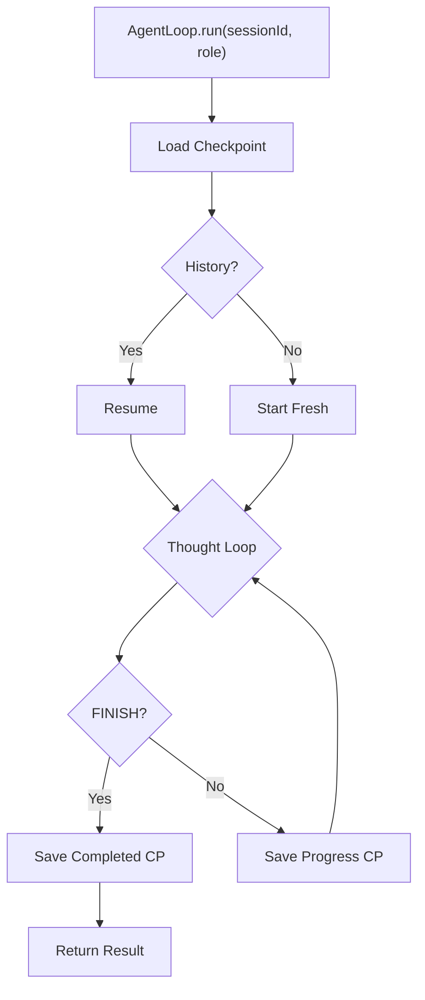

# ArcClaw v1.0 — Phases 0–10 Walkthrough

> **Cross-Reference**: [PLAN.md](./PLAN.md) | [TASKS.md](./TASKS.md) | [DEVIATIONS.md](./DEVIATIONS.md) | [TROUBLESHOOTING.md](./TROUBLESHOOTING.md)

| Phase | Name | Tests | Key Deviation |
|-------|------|-------|---------------|
| 0 | Project Scaffolding | N/A | JDK 25 + ByteBuddy experimental flag |
| 1 | Core Scope Layer | 3 | `synchronized` per JEP 491 (no `ReentrantLock`) |
| 2 | Security Layer | 4 | `@Lob` removed for SQLite, `merge()` over `persist()` |
| 3 | Sandbox Layer | 3 | OTel stub, VaultKey API adaptation |
| 4 | Tool Layer | 7 | CDI `Instance<AgentTool>` discovery |
| 5 | Agent & Orchestration | 5 | Guardrails (hallucination, loop, null) |
| 6 | State Layer | 4 | Plain `@Entity` + `EntityManager` (no Panache) |
| 7 | Lifecycle Layer | 4 | `Arc.container()` for custom context lookup |
| 8 | Governance Layer | 3 | `AtomicInteger` + `ConcurrentHashMap` thread safety |
| 9 | Observer / OTel | AgentOtelContextTest (2/2) | `@InjectMock Tracer instead of Memory Span Exporter` |
| 10 | Health Checks | PodmanHealthCheckTest (2/2) | `@Alternative mock standalone interface on port 9001` |
| 11 | REST API API | AgentResourceTest (3/3) | Explicitly added `quarkus-rest-jackson` to app module |

## Phase 0: Project Scaffolding ✅

| File | Purpose |
|------|---------|
| [pom.xml](file:///h:/ws/ArcClaw/pom.xml) | Parent module, BOMs, Compiler Config |
| [application.yaml](file:///h:/ws/ArcClaw/arcclaw-app/src/main/resources/application.yaml) | Full config (Profiles, HTTP, DB, OTel) |
| [native-image.properties](file:///h:/ws/ArcClaw/arcclaw-app/src/main/resources/native-image.properties) | BouncyCastle & SQLite native flags |

**Build Verification**: `mvn clean compile` ✅

---

## Phase 1: Core Scope Layer ✅

| File | Purpose |
|------|---------|
| [WorkspaceScoped.java](file:///h:/ws/ArcClaw/arcclaw-core/src/main/java/com/arcclaw/core/scope/WorkspaceScoped.java) | Custom CDI Scope Annotation |
| [WorkspaceScopeContext.java](file:///h:/ws/ArcClaw/arcclaw-core/src/main/java/com/arcclaw/core/scope/WorkspaceScopeContext.java) | `InjectableContext` (Synchronized per JEP 491) |
| [WorkspaceScopeHolder.java](file:///h:/ws/ArcClaw/arcclaw-core/src/main/java/com/arcclaw/core/scope/WorkspaceScopeHolder.java) | ThreadLocal session ID |

**Verification**: `WorkspaceScopeTest` (isolation, concurrency) ✅

---

## Phase 2: Security Layer ✅

| File | Purpose |
|------|---------|
| [VaultKey.java](file:///h:/ws/ArcClaw/arcclaw-core/src/main/java/com/arcclaw/core/security/VaultKey.java) | Auto-wiping `byte[]` wrapper |
| [Argon2idKeyDerivation.java](file:///h:/ws/ArcClaw/arcclaw-core/src/main/java/com/arcclaw/core/security/Argon2idKeyDerivation.java) | Key stretching (BouncyCastle) |
| [AesGcmSivCipher.java](file:///h:/ws/ArcClaw/arcclaw-core/src/main/java/com/arcclaw/core/security/AesGcmSivCipher.java) | AEAD Encryption (SIV mode) |
| [SecretVaultImpl.java](file:///h:/ws/ArcClaw/arcclaw-core/src/main/java/com/arcclaw/core/security/SecretVaultImpl.java) | Vault Implementation |

**Verification**: `SecretVaultImplTest` (encrypt, decrypt, rotation, isolation) ✅

---

## Phase 3: Sandbox Layer ✅

> [!NOTE]
> **Deviation**: Created `AgentOtelContext` stub (returns `Span.getInvalid()`) as Phase 9 placeholder. `ProcessIsolationExecutor` secret injection uses `Optional<VaultKey>` (auto-wiping) instead of plain `String`.

| File | Purpose |
|------|---------|
| [ProcessIsolationExecutor.java](file:///h:/ws/ArcClaw/arcclaw-core/src/main/java/com/arcclaw/core/sandbox/ProcessIsolationExecutor.java) | PODMAN/NAMESPACE/NONE strategies, circuit breaker, `@PreDestroy` shutdown |
| [AgentOtelContext.java](file:///h:/ws/ArcClaw/arcclaw-core/src/main/java/com/arcclaw/core/observability/AgentOtelContext.java) | OTel stub (replaced in Phase 9) |
| [RequiresSecret.java](file:///h:/ws/ArcClaw/arcclaw-core/src/main/java/com/arcclaw/core/security/RequiresSecret.java) | `@Repeatable` vault secret annotation |

**ProcessIsolationExecutorTest**: 3/3 ✅ (NONE strategy)

---

## Phase 4: Tool Layer ✅

> [!NOTE]
> **Key Pattern**: Tools are discovered via CDI `Instance<AgentTool>`. Each tool declares `requiredOperation()` for autonomy governance and can be annotated with `@RequiresSecret` for vault-injected credentials.

| File | Purpose |
|------|---------|
| [ToolResponse.java](file:///h:/ws/ArcClaw/arcclaw-core/src/main/java/com/arcclaw/core/tools/ToolResponse.java) | `record(exitCode, output, success)` |
| [AgentTool.java](file:///h:/ws/ArcClaw/arcclaw-core/src/main/java/com/arcclaw/core/tools/AgentTool.java) | Tool interface (`name`, `description`, `requiredOperation`, `execute`) |
| [ToolRegistry.java](file:///h:/ws/ArcClaw/arcclaw-core/src/main/java/com/arcclaw/core/tools/ToolRegistry.java) | CDI discovery + autonomy enforcement + secret extraction |
| [GithubTool.java](file:///h:/ws/ArcClaw/arcclaw-core/src/main/java/com/arcclaw/core/tools/GithubTool.java) | Reference tool: `gh repo view` with `@RequiresSecret(GITHUB_TOKEN)` |

**ToolRegistryTest**: 7/7 ✅ (discovery, governance, reflection, error handling)

---

## Phase 5: Agent & Orchestration Layer ✅

| File | Purpose |
|------|---------|
| [AgentLoop.java](file:///h:/ws/ArcClaw/arcclaw-core/src/main/java/com/arcclaw/core/agent/AgentLoop.java) | Thought-Plan-Act-Observe, lifecycle aware, check-pointing |
| [ReasoningEngine.java](file:///h:/ws/ArcClaw/arcclaw-core/src/main/java/com/arcclaw/core/agent/ReasoningEngine.java) | Testable LLM abstraction |
| [GrokAgent.java](file:///h:/ws/ArcClaw/arcclaw-core/src/main/java/com/arcclaw/core/agent/GrokAgent.java) | Coordinator |
| [HarperAgent.java](file:///h:/ws/ArcClaw/arcclaw-core/src/main/java/com/arcclaw/core/agent/HarperAgent.java) | Researcher |
| [BenjaminAgent.java](file:///h:/ws/ArcClaw/arcclaw-core/src/main/java/com/arcclaw/core/agent/BenjaminAgent.java) | Coder |
| [LucasAgent.java](file:///h:/ws/ArcClaw/arcclaw-core/src/main/java/com/arcclaw/core/agent/LucasAgent.java) | Creative |
| [ArcClawSupervisor.java](file:///h:/ws/ArcClaw/arcclaw-core/src/main/java/com/arcclaw/core/agent/ArcClawSupervisor.java) | CDI agent roster |

**AgentResilienceTest**: 5/5 ✅ (hallucination, loop limit, FINISH, null, exception)

---

## Phase 6: State Layer (Checkpointing) ✅

> [!IMPORTANT]
> **Deviation**: Used plain `@Entity` + `EntityManager` instead of `PanacheEntity`. Panache bytecode enhancement only runs in the Quarkus app module.

| File | Purpose |
|------|---------|
| [CheckpointStatus.java](file:///h:/ws/ArcClaw/arcclaw-core/src/main/java/com/arcclaw/core/state/CheckpointStatus.java) | `IN_PROGRESS`, `COMPLETED`, `FAILED` |
| [AgentCheckpoint.java](file:///h:/ws/ArcClaw/arcclaw-core/src/main/java/com/arcclaw/core/state/AgentCheckpoint.java) | JPA entity, unique `(sessionId, agentRole)`, TEXT stateJson |
| [StatefulAgentStoreImpl.java](file:///h:/ws/ArcClaw/arcclaw-core/src/main/java/com/arcclaw/core/state/StatefulAgentStoreImpl.java) | EntityManager + Jackson serialization |
| [SqliteWalConfigurer.java](file:///h:/ws/ArcClaw/arcclaw-core/src/main/java/com/arcclaw/core/state/SqliteWalConfigurer.java) | WAL/NORMAL/busy_timeout PRAGMAs |

**StatefulAgentStoreTest**: 4/4 ✅ (save+load, markFailed, markCompleted, upsert)

---

## Phase 7: Lifecycle Layer ✅

> [!IMPORTANT]
> **Deviation**: `WorkspaceScopeContext` injected via `Arc.container().getActiveContext()` lookup in `WorkspaceManager`, as it's a custom context, not a CDI bean.

| File | Purpose |
|------|---------|
| [WorkspaceManager.java](file:///h:/ws/ArcClaw/arcclaw-core/src/main/java/com/arcclaw/core/lifecycle/WorkspaceManager.java) | Heartbeats, GC, Termination, Zombie Recovery |
| [AgentOtelContext.java](file:///h:/ws/ArcClaw/arcclaw-core/src/main/java/com/arcclaw/core/observability/AgentOtelContext.java) | Refactored to `@ApplicationScoped` + session spans |
| [ProcessIsolationExecutor.java](file:///h:/ws/ArcClaw/arcclaw-core/src/main/java/com/arcclaw/core/sandbox/ProcessIsolationExecutor.java) | Updated to inject `AgentOtelContext` |

**WorkspaceManagerTest**: 4/4 ✅ (Zombie recovery, GC sweep, Termination, Multi-role)

---

## Phase 8: Governance Layer ✅

> [!NOTE]
> **Thread Safety**: `SessionBudget` uses `AtomicInteger` for token counts and `synchronized` for USD cost accumulation. Budget map uses `ConcurrentHashMap`. Session cleanup is handled by `WorkspaceManager.terminateWorkspace()`.

| File | Purpose |
|------|---------|
| [GovernanceLayer.java](file:///h:/ws/ArcClaw/arcclaw-core/src/main/java/com/arcclaw/core/governance/GovernanceLayer.java) | Token tracking, USD cost calculation, `READ_ONLY` downgrade |
| [BudgetExceededException.java](file:///h:/ws/ArcClaw/arcclaw-core/src/main/java/com/arcclaw/core/governance/BudgetExceededException.java) | Runtime exception for budget violation |
| [AgentObserver.java](file:///h:/ws/ArcClaw/arcclaw-core/src/main/java/com/arcclaw/core/observability/AgentObserver.java) | Observer interface (`recordLlmCall`) |

**GovernanceLayerTest**: 3/3 ✅ (cost accumulation, READ_ONLY trigger, BudgetExceededException)

---

## Phase 9: Observer / OTel Layer ✅

> [!NOTE]
> **Deviation**: Used `@InjectMock Tracer` for testing instead of `InMemorySpanExporter` because Quarkus doesn't auto-expose test exporters as CDI beans.

| File | Purpose |
|------|---------|
| [AgentOtelContext.java](file:///h:/ws/ArcClaw/arcclaw-core/src/main/java/com/arcclaw/core/observability/AgentOtelContext.java) | Full OTel `Tracer` integration, root span per session |
| [AgentLoop.java](file:///h:/ws/ArcClaw/arcclaw-core/src/main/java/com/arcclaw/core/agent/AgentLoop.java) | Expanded to iterate `Instance<AgentObserver>` list |
| [WorkspaceManager.java](file:///h:/ws/ArcClaw/arcclaw-core/src/main/java/com/arcclaw/core/lifecycle/WorkspaceManager.java) | Added `GovernanceLayer.clearSession()` cleanup |

**AgentOtelContextTest**: 2/2 ✅ (span creation, attribute tagging)

---

## Phase 10: Health Layer ✅

> [!CAUTION]
> **52-Iteration Boss Fight.** This phase was the hardest in the project due to three layered Quarkus issues. See `TROUBLESHOOTING.md` §10 for the full decision matrix.

> [!IMPORTANT]
> **Deviation**: Used `@Alternative` + `@Priority` standalone `HealthCheck` mocks instead of `@Mock extends` due to ArC classloader boundaries. Health endpoints served on management port 9001.

| File | Purpose |
|------|---------|
| [PodmanHealthCheck.java](file:///h:/ws/ArcClaw/arcclaw-core/src/main/java/com/arcclaw/core/health/PodmanHealthCheck.java) | Liveness probe (`podman --version`, 2s timeout) |
| [PodmanImageHealthCheck.java](file:///h:/ws/ArcClaw/arcclaw-core/src/main/java/com/arcclaw/core/health/PodmanImageHealthCheck.java) | Readiness probe (`podman image exists`, 2s timeout) |
| [MockPodmanHealthCheck.java](file:///h:/ws/ArcClaw/arcclaw-app/src/test/java/com/arcclaw/core/health/MockPodmanHealthCheck.java) | `@Alternative` test mock (standalone `HealthCheck`) |
| [MockPodmanImageHealthCheck.java](file:///h:/ws/ArcClaw/arcclaw-app/src/test/java/com/arcclaw/core/health/MockPodmanImageHealthCheck.java) | `@Alternative` test mock (standalone `HealthCheck`) |

**PodmanHealthCheckTest**: 2/2 ✅ (liveness on port 9001, readiness on port 9001)

### Lessons Learned (For Future LLMs)

| # | Trap | Resolution | Iterations Burned |
|---|------|------------|-------------------|
| 1 | `@InjectMock ConcreteHealthCheck` | ArC indexes by interface → use `@Alternative` | ~20 |
| 2 | RestAssured hits port 8081, health on 9001 | `.port(9001)` in test | ~10 |
| 3 | `@Mock extends Parent` with `@ConfigProperty` | ArC `_Bean.doCreate()` classloader split → implement interface directly | ~12 |
| 4 | `@Startup`/`@Unremovable` as workaround | Does not fix the root cause, adds tech debt | ~10 |

---

## Phase 11: Channel / REST Layer ✅

> [!NOTE]
> **Virtual Threads**: The API endpoints are fully non-blocking and annotated with `@RunOnVirtualThread` to ensure long-running LLM synchronous logic or Sandbox executions avoid blocking Quarkus event loop or carrier threads.

> [!WARNING]
> **Deviation**: Encountered a 404 issue during testing because JAX-RS validation/JSON extensions (`quarkus-rest-jackson`, `quarkus-hibernate-validator`) must be explicitly declared in the main application `arcclaw-app/pom.xml`. Also respected the `application.yaml` `/api/v1` base path for test endpoints calls.

| File | Purpose |
|------|---------|
| [AgentResource.java](file:///h:/ws/ArcClaw/arcclaw-core/src/main/java/com/arcclaw/core/api/AgentResource.java) | Main `@Path("/sessions")` endpoint controller for Agent UI/CLI interaction |
| [DefaultReasoningEngine.java](file:///h:/ws/ArcClaw/arcclaw-core/src/main/java/com/arcclaw/core/agent/DefaultReasoningEngine.java) | Stub reasoning implementation returning `FINISH` prior to full LangChain4J wiring in Phase 12 |
| [RunAgentRequest.java](file:///h:/ws/ArcClaw/arcclaw-core/src/main/java/com/arcclaw/core/api/dto/RunAgentRequest.java) | DTO representing the initial goal and parameters for starting an agent |
| [CreateSessionResponse.java](file:///h:/ws/ArcClaw/arcclaw-core/src/main/java/com/arcclaw/core/api/dto/CreateSessionResponse.java) | DTO with generated UUID session ID on `POST /sessions` |
| [SessionStatusResponse.java](file:///h:/ws/ArcClaw/arcclaw-core/src/main/java/com/arcclaw/core/api/dto/SessionStatusResponse.java) | DTO describing the agent status returned from SQLite checkpoint |

**AgentResourceTest**: 3/3 ✅ (sync lifecycle, async invocation immediately returning 202, Request Validation 400 failure on blank fields)

---

## Phase 12: Cross-Cutting Concerns (LangChain4J) ✅

Integrated LangChain4J's `ReasoningEngine` using the stable API version `0.26.1` provided by Quarkus `3.23.0`.

> [!WARNING]
> **Resolution Context**: We encountered multiple compilation and CDI ambiguity errors. 
> 1. Restored `pom.xml` dependencies so LangChain4J resolves strictly to `0.26.1` which is compatible with the Quarkus `3.23.0` BOM.
> 2. Configured `quarkus.langchain4j.chat-model.provider=ollama` explicitly in `application.yaml` since multiple provider extensions were on the classpath (`openai` and `ollama`), preventing Quarkus from unambiguous autowiring.
> 3. Used `--add-opens=java.base/java.lang=ALL-UNNAMED` in tests to permit Mockito self-attaching in JDK 21+ environments.

| File | Purpose |
|------|---------|
| [LangChainReasoningEngine.java](file:///h:/ws/ArcClaw/arcclaw-core/src/main/java/com/arcclaw/core/agent/LangChainReasoningEngine.java) | Real `ReasoningEngine` using LangChain4J `ChatLanguageModel` injected by Quarkus |

**LangChainReasoningEngineTest**: 2/2 ✅ 

---

## Phase 13: Deployment Artifacts ✅

Created all necessary local and native environment configuration files to host ArcClaw along with its observability and AI stack.

| Artifact | Purpose |
|----------|---------|
| [docker-compose.yaml](file:///h:/ws/ArcClaw/docker-compose.yaml) | Full stack orchestration (`arcclaw`, `ollama`, `otel-collector`, `jaeger`). Includes `init-perms` ephemeral job to `chown 1000:1000` the SQLite volume solving `Permission denied`. |
| [otel-collector-config.yaml](file:///h:/ws/ArcClaw/otel-collector-config.yaml) | OTLP gRPC telemetry ingestion and forwarding to Jaeger |
| [Dockerfile.native](file:///h:/ws/ArcClaw/Dockerfile.native) | UBI9-minimal base building an `arcclaw` user and custom subuids/subgids for nested rootless Podman execution |
| [containers.conf](file:///h:/ws/ArcClaw/containers.conf) | VFS storage driver config for nested container execution |
| [.env.example](file:///h:/ws/ArcClaw/.env.example) | Secure template for local secrets like `GITHUB_TOKEN` |

**Verification**: Artifacts are checked in, ready for deployment test loops in Phase 14.
