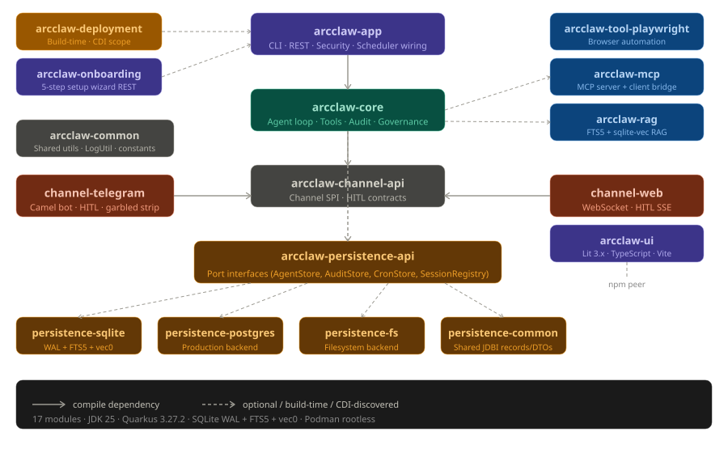
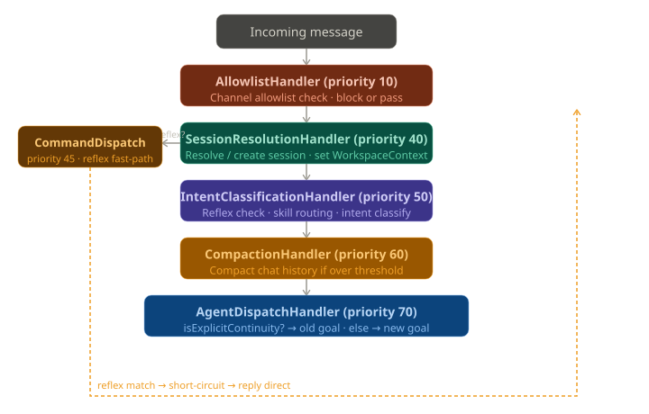
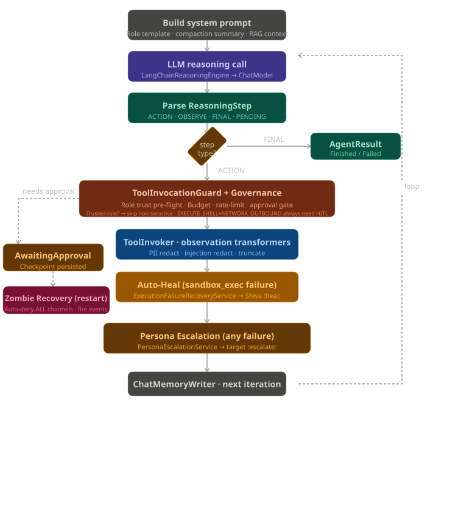
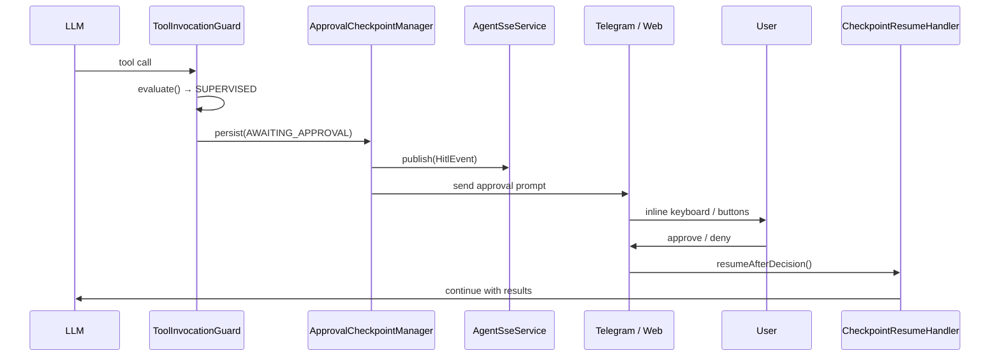
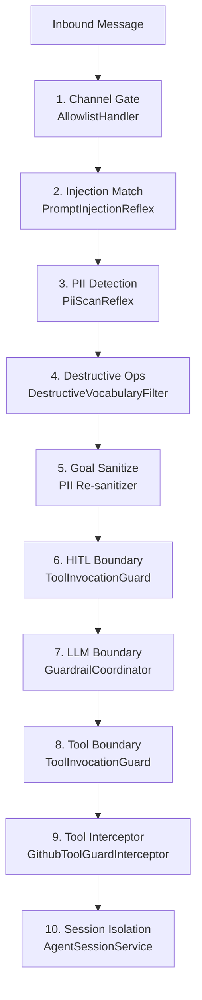
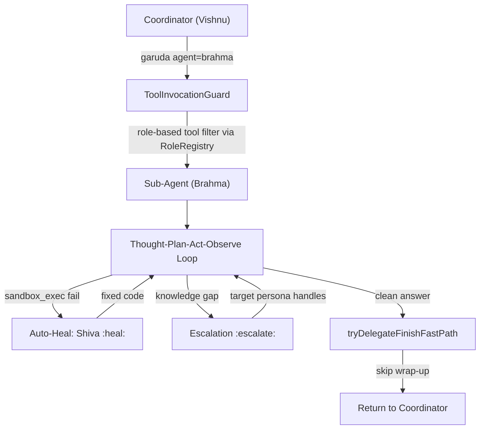
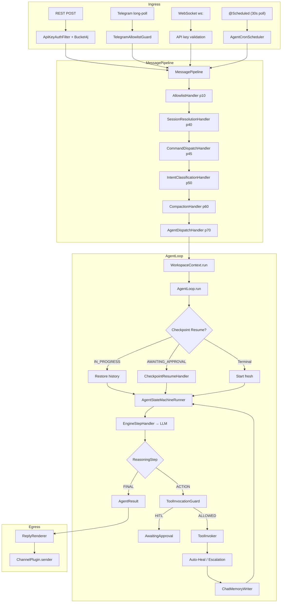

# ArcClaw Architecture

> For **mandatory architecture invariants** (transaction rules, native-image, persistence contracts), see [Architecture_Invariants.md](./Architecture_Invariants.md).

---

## Module Architecture

| Module | Role |
|---|---|
| `arcclaw-app` | Main deployable: CLI (Picocli), REST endpoints, scheduler wiring, security, channel routing |
| `arcclaw-core` | Agent loop, state machine, tools, audit, governance, SSE, skill system, routing, sandbox |
| `arcclaw-channel-api` | Channel SPI — sealed interfaces and plugin contracts |
| `arcclaw-channel-telegram` | Apache Camel–backed Telegram bot with HITL inline keyboards |
| `arcclaw-channel-web` | WebSocket channel + Lit TypeScript frontend |
| `arcclaw-deployment` | Build-time: custom CDI scope, MCP reflection, REST enforcement |
| `arcclaw-persistence-api` | Hexagonal port interfaces (CheckpointStorePort, ChatMemoryStorePort, CronStorePort, etc.) |
| `arcclaw-persistence-common` | Shared JDBI records/DTOs |
| `arcclaw-persistence-sqlite` | SQLite adapter (WAL + FTS5 + vec0) |
| `arcclaw-persistence-postgres` | PostgreSQL adapter |
| `arcclaw-persistence-fs` | Filesystem-based adapter (Lucene BM25) |
| `arcclaw-rag` | Two-tier vector (vec0) + FTS5 RAG memory |
| `arcclaw-mcp` | MCP server bridge + dynamic client tool loading |
| `arcclaw-onboarding` | 5-step setup wizard REST API + /complete |
| `arcclaw-tool-playwright` | Playwright browser automation tool |
| `arcclaw-common` | Shared utilities (LogUtil, constants) |
| `arcclaw-ui` | Lit 3.x + TypeScript web frontend |

**Dependency flow:** `arcclaw-app` → `arcclaw-core` → `arcclaw-channel-api` ← `arcclaw-channel-telegram`, `arcclaw-channel-web`. `arcclaw-deployment` is build-time only (not in runtime fat-jar). `arcclaw-rag`, `arcclaw-mcp`, and `arcclaw-tool-playwright` are optional runtime modules discovered via CDI. Persistence follows hexagonal architecture: `arcclaw-persistence-api` defines ports, `arcclaw-persistence-common` holds shared entities, three adapters (sqlite, postgres, fs) implement ports.



---

## Message Pipeline (Handler Chain)

`ChannelServicesImpl.processAsync()` submits the `ChannelMessage` to a virtual-thread executor and runs it through `MessagePipeline` — a sorted list of `MessageHandler` implementations executed in ascending priority order:

| Priority | Handler | Responsibility |
|---|---|---|
| 10 | `AllowlistHandler` | Fetch `ChannelPlugin` for channel type; check `ChannelAllowlist.isAllowed()` |
| 40 | `SessionResolutionHandler` | Resolve or create `SessionRegistry` entry; activate `WorkspaceContext` CDI scope |
| 45 | `CommandDispatchHandler` | Handle `/help` and other built-in commands before intent classification |
| 50 | `IntentClassificationHandler` | Run `ReflexRegistry`; skill routing; LLM intent classification |
| 60 | `CompactionHandler` | If token/message count over threshold, compact chat history via lightweight LLM |
| 70 | `AgentDispatchHandler` | Call `AgentLoop.run()`; render result; send via `ChannelPlugin.sender()` |

Any handler can return `HandleResult.STOP` to short-circuit the chain (e.g., `AllowlistHandler` on a blocked sender, or `IntentClassificationHandler` when a reflex fires and the reply is already sent).

### Inbound Message Paths

Three distinct ingestion paths all converge on the same `MessagePipeline`:

**REST API:**
```
POST /api/v1/sessions/{id}/run
  → ApiKeyAuthFilter (HMAC-SHA256 against stored digest; raw key never stored)
  → ApiKeyRegistry.isAllowed() + isMutationAllowed() (custom rate limiter)
  → AgentSessionService.runSync()
  → WorkspaceScopeHolder.call() → WorkspaceContext.run(...)
  → AgentLoop.run(...)
```

**Telegram:**
```
Telegram Bot API → Apache Camel long-poll
  → TelegramChannelRoute → TelegramAgentHandler
  → TelegramAllowlistGuard (numeric userId check)
  → ChannelServices.processAsync(ChannelMessage)
  → SkillAwareIntentDetector.classify(text)    ← compiled Pattern[] fast-path
  → IntentDetectorService.classify(text)       ← LLM-backed fallback
  → AgentDispatchHandler → AgentLoop.run(...)
```

**WebSocket:**
```
ws://host/ws/chat
  → WebChatEndpoint.onOpen()
  → API key validation (X-ArcClaw-API-Key header or Sec-WebSocket-Protocol)
  → ChannelMessage.WebSocketMessage → ChannelServices.processAsync(msg)
```

**Cron:**
```
@Scheduled(every="${arcclaw.cron.poll-interval:30s}")
  → AgentCronScheduler.pollAndDispatch()
  → cronRepository.reclaimStaleCrons(cutoff) → findDueCrons()
  → Atomic CAS claim → Semaphore.tryAcquire() (max 10 concurrent)
  → ManagedExecutor virtual thread → CronJobRunner.execute(job)
  → WorkspaceContext.run() → AgentLoop.run() + CRON CONSTRAINT directive
```



---

## ReAct Agent Loop

```
Build system prompt → LLM reasoning call → Parse ReasoningStep
  → FINAL → AgentResult
  → ACTION → ToolInvocationGuard + Governance
       → needs approval? → AwaitingApproval (checkpoint persisted)
                              → Zombie Recovery (restart): auto-deny all channels
       → allowed → ToolInvoker (PII redact, injection redact, truncate)
       → Auto-Heal (sandbox_exec failure → Shiva :heal:)
       → Persona Escalation (any failure → target :escalate:)
       → ChatMemoryWriter → next iteration (loop)
```



### Agent Loop Lifecycle (`AgentLoop.run`)

**Setup:** MDC keys `SESSION_ID`, `AGENT_ROLE`, `USER_ID` set immediately. OTel session span started. Standard roles resolve via `AgentRoleEnum.fromString()`; `skill:X` roles preserve full prefix for custom prompt injection.

**Checkpoint Resume Decision:**

| Checkpoint Status | Action |
|---|---|
| `IN_PROGRESS` | Deserialize `ReasoningStep[]` from `stateJson`; resume with existing history |
| `AWAITING_APPROVAL` + resume signal | Deserialize steps; route to `CheckpointResumeHandler.handle()` |
| `AWAITING_APPROVAL` + new message | Archive stale checkpoint; notify user; start fresh (null history) |
| Terminal (`COMPLETED`/`FAILED`/`LOOP_EXCEEDED`/`DENIED`/`ORPHANED`/`ARCHIVED`/`COMPROMISED`) | Archive row; start fresh |

**Fast-Path: `garuda` Finish:** `tryDelegateFinishFastPath()` — if the last history step's action is `delegate-to-agent` and the observation is a clean answer, the coordinator skips its wrap-up LLM call and returns the sub-agent's result directly (~9,800 tokens saved).

### Thought-Plan-Act-Observe Loop

**Step A: EngineStepHandler — LLM Call**

System prompt construction (`SystemPromptBuilder`):
1. Loads persona identity and role template from `PromptRegistry` (multi-backend). Falls back to classpath `/templates/personas/` and `/templates/prompts/`. Auto-seeds DB on first startup with SHA-256 drift detection.
2. Injects compaction summary from `CompactionSummaryCache` — blocks via `CompactionEventBridge.awaitIfInFlight(sessionId)` to prevent stale-null race.
3. Runs all `ContextEnricher` CDI implementations. `RagContextEnricher` searches both memory tiers, scores by cosine similarity, injects `## Retrieved Rag Context` block.
4. Appends `SystemEnvironmentContextEnricher` metadata.

LLM call (`LangChainReasoningEngine.nextStep()`): Retrieves `ChatModel` from `LlmProviderPort`, assembles messages via `ReasoningMessageAssembler`, filters tools via `RoleRegistry.permittedTools()`. Cron sessions suppress scheduling tools.

Exception classification:

| Exception | Handling |
|---|---|
| HTTP 400 `model_not_found` / `invalid_api_key` | Terminal `FAILED` |
| HTTP 400 `not in request.tools` | Terminal `FINISHED` (tool not in role schema) |
| HTTP 400 `tool_use_failed` with prose | `FINISHED` (extract prose as answer) |
| HTTP 400 schema validation error | Retry with correction prompt (max 2 retries) |
| HTTP 429 rate-limit ≤ 15s | Sleep + retry |
| HTTP 429 rate-limit > 15s | Surface last observation as `FINISH` |
| Network / connect errors | Terminal `FAILED` |
| Truncated code in `failed_generation` | Inject `OBSERVE` retry step with size-constraint instruction |

Budget tracking: `GovernanceStrategy.recordLlmCall()` checks per-session token budgets. `BudgetWarningException` appends constraint directive; `BudgetExceededException` terminates immediately.

**Step B: FINISH Action Handler:** Extracts answer from `actionInput["answer"]` or `thought`. Unescapes HTML/Unicode. Role guard: non-coder roles cannot generate bare code blocks. Raw tool-call leak guard. `guardFinalAnswer()` prevents LLM echoing injected RAG headers.

**Step C: ToolStepHandler — Validation**

`ToolInvocationGuard.evaluate()` decision tree:

```
1. Guard interceptors (SPI) → Optional<GuardDecision>
2. Deduplication check → GuardDecision.Deduplicate(cachedObservation)
3. Role tool schema check → GuardDecision.Blocked("not permitted")
4. Role trust pre-flight:
   - requiresApprovalForTools(role) == false → trusted; skip non-sensitive ops (→ step 6)
   - Sensitive ops (NETWORK_OUTBOUND, EXECUTE_SHELL) always reach step 5
5. HITL pre-approval:
   - tool NOT scheduling tool (exempt per §4.10) && autonomy NOT FULL
     → GuardDecision.PauseForApproval(toolName, paramsJson)
6. Default → GuardDecision.Allow
```

**Step C.1: Auto-Heal Hook:** After `sandbox_exec` failure for coder role:
```
sandbox_exec → ToolFailure (coder only)
  → ExecutionFailureRecoveryService.shouldAttemptRecovery()
  → Spawns isolated Shiva (debugger) sub-session with :heal: sentinel
  → Max attempts configurable (default 2)
  → RecoveryResult.success(fixedCode) → re-exec → continue
  → RecoveryResult.failure() → falls through to escalation
```

**Step C.2: Persona Escalation Hook:** After auto-heal (or directly for non-sandbox failures):
```
ToolFailure (any role, any tool)
  → PersonaEscalationService.shouldAttemptEscalation()
  → determineEscalationTarget() via pattern matching:
     Brahma → Saraswati (unknown API/dependency)
     Brahma → Brihaspati (architecture/trade-off)
     Shiva → Saraswati (obscure error)
     Shiva → Brahma (fundamental flaw)
     Saraswati → Brahma (research complete, needs implementation)
     Brihaspati → Brahma (architecture decided, needs coding)
     Brihaspati → Saraswati (needs external research)
  → Isolated :escalate: sub-session; max depth configurable (default 2)
  → Target persona handles and returns result; merged into source context
```

**Step D: Parallel Batch Execution:** For `ReasoningStep.isParallelBatch()`:
- Pass 1: Guard ALL tools before ANY executes. ANY HITL-required → pre-execute FULL-autonomy tools, persist batch checkpoint, pause for HITL-pending.
- DEDUP → return cached; BLOCKED → fill "blocked" observation; peers continue.
- Pass 2: Execute ALLOWED tools in parallel virtual threads with OTel context propagation.
- Merge results in original call order.
- On resume: batch tool decisions deserialized from checkpoint state JSON; pre-executed results restored (not re-executed).

**Step E: ToolInvoker:** `toolRegistry.invokeTool()` → OTel child span → `AgentTool.execute(params)` → `ToolObservationSanitizer.sanitize()` (PII redaction, injection redaction, truncation).

### Tool Governance Decision Tree

`ToolInvocationGuard.evaluate()` runs:

1. **Guard interceptors** — SPI for custom tool guards
2. **Deduplication** — return cached observation if duplicate call
3. **Role schema check** — tool not permitted for role? → blocked
4. **Role trust pre-flight** — trusted role (`requiresApproval=false`)? → skip non-sensitive ops
   - **Sensitive ops** (`NETWORK_OUTBOUND`, `EXECUTE_SHELL`) always reach HITL check
5. **HITL pre-approval** — scheduling tools exempt; `SUPERVISED` level pauses for approval
6. **Default** → allow

### Parallel Tool Execution

The LLM can request multiple tools in one step. Parallel batches:
- Pass 1: Guard ALL tools before any executes — HITL pauses atomically
- Pass 2: Execute ALLOWED tools in parallel virtual threads
- Pre-execute FULL-autonomy tools before the HITL pause
- Merge results in original call order

---

## Reflex System (Zero-Token Fast Path)

`ReflexRegistry` holds `AgentReflex` implementations checked in `IntentClassificationHandler` before any LLM call. If a reflex matches, its `CommandResponse` is sent directly through the channel sender.

17 deterministic reflexes checked before any LLM call:

| Reflex | Priority | Trigger | Action |
|---|---|---|---|
| `PromptInjectionReflex` | 10 | Injection patterns | Detects "ignore previous instructions" style attacks; rejects message |
| `RetryReflex` | 10 | `/retry` | Retries the last agent action |
| `PiiScanReflex` | 20 | Any message | PII detection; blocks if `PII_MODE=BLOCK_AND_NOTIFY` |
| `ApproveReflex` | 100 | `/approve` | Calls `CheckpointApprovalService.approveTool()` |
| `DenyReflex` | 200 | `/deny` | Calls `CheckpointApprovalService.denyTool()` |
| `IdentityExtractionReflex` | 250 | User identity patterns | Extracts and stores user identity information |
| `VaultStoreReflex` | 400 | `/vault-store` | Stores secrets in the encrypted vault |
| `StoreReflex` | 500 | `/store` | Stores key-value pairs |
| `HaltReflex` | 500 | `/halt` | Terminates the running session |
| `HistoryReflex` | 500 | `/history` | Returns recent chat turns |
| `StatusReflex` | 500 | `/status` | Shows current agent status |
| `ListCronsReflex` | 500 | `/crons` | Lists active scheduled jobs |
| `DeleteCronReflex` | 500 | `/delete-cron` | Removes a scheduled job |
| `ResetReflex` | 500 | `/reset` | Wipes session state via `WorkspaceManager.resetSessionState()` |
| `McpReflex` | 500 | `/mcp` | Shows MCP server status and connected tools |
| `SkillReflex` | 500 | `/skills` | Lists available skill personas |
| `ListReflexesReflex` | 500 | `/reflex`, `/reflexes`, `/commands`, `/help` | Lists all registered reflexes |

---

## Agent Personas

| Role | Persona | Tools | Max Iter |
|---|---|---|---|
| `coordinator` | Vishnu | github, web_fetch, schedule, memory (5), garuda, agent_task | 7 |
| `coder` | Brahma | sandbox_exec, manage_checklist, memory (5), garuda | 15 |
| `debugger` | Shiva | github, sandbox_exec, manage_checklist, recall_memory_search, garuda | 15 |
| `researcher` | Saraswati | github, web_fetch, brave/serper search, memory (5), garuda, agent_task | 10 |
| `architect` | Brihaspati | github, memory (5), garuda | 7 |
| `synthesizer` | Dattatreya | github, web_fetch, schedule, brave/serper search, memory (5), ingest_document, garuda, agent_task | 10 |
| `optimizer` | Ganesha | sandbox_exec, garuda | 10 |
| `sentinel` | Kartikeya | sandbox_exec, garuda | 10 |
| `healer` | Lakshmi | garuda | 10 |
| `protector` | Durga | garuda | 10 |
| `purifier` | Kali | garuda | 10 |
| `nurturer` | Parvati | garuda | 10 |

**memory (5)** = `recall_memory_search`, `archival_memory_search`, `core_memory_read`, `core_memory_append`, `core_memory_replace`, `archival_memory_insert` (6 tools; debugger only gets `recall_memory_search`).

All 12 roles have `garuda` for delegation. Tool schemas dynamically assembled via `@ToolMetadata(defaultRoles=...)`.

---

## Memory & Persistence

### Hexagonal Architecture

Port interfaces in `arcclaw-persistence-api`, three adapter implementations:

| Backend | Storage | Best For |
|---|---|---|
| **SQLite** (default) | WAL mode + FTS5 + sqlite-vec | Zero-config, embedded, single binary |
| **PostgreSQL** | Native timestamptz, pgvector | Production deployments |
| **Filesystem** | JSON files + Lucene BM25 | Environments without SQL |

### Two-Tier RAG Memory

| Tier | Store | Scope | Persistence |
|---|---|---|---|
| Session KB | `InMemoryEmbeddingStore` (`@WorkspaceScoped`) | Per session | Ephemeral — lost on session destroy |
| Global KB | SQLite `fts.vec_global` (vec0) + `rag_chunk` table | Cross-session | Persistent across restarts |

Retrieval merges FTS5 keyword search + sqlite-vec vector search via Reciprocal Rank Fusion (k=60).

**Ingest flow** (`IngestDocumentTool.execute()` — always requires HITL approval):
1. Sanitize text (strip consecutive dashes, markdown artifacts, control characters)
2. `EmbeddingModel.embed(text)` → float vector
3. `memoryPort.index()` — persists to vec0 + rag_chunk + in-memory store (adapter handles all three)

**Retrieval** (`RagContextEnricher.enrich()`): Embeds current goal, searches via `TwoTierMemoryService.search()` (session KB in-memory ANN + global KB vec0 KNN), applies adaptive thresholding, deduplicates by `chunkId`, injects top-N as `## Retrieved Rag Context` block.

**Embedding provider:** `EmbeddingModelProducer` resolves via `arcclaw.rag.embed-provider` (ollama / openai / jina).

### Context Compaction

`CompactionHandler` (priority 60) runs before agent dispatch when token/message count exceeds threshold. Uses a separate lighter LLM (`llama-3.1-8b-instant` via Groq by default) to summarize older turns.

`CompactionService.compact()`:
1. Fetches old `ChatMemory` turns beyond the compaction window
2. Calls the compaction model (separate from reasoning model)
3. Writes summary to `CompactionSummaryDto` via `summaryRepository.upsert()`
4. Clears compacted turns from `PersistentChatMemoryStore`
5. Releases `CompactionEventBridge` latch so `CompactionSummaryCache` reads fresh summary

The `CompactionEventBridge` uses a `CountDownLatch` per session to prevent a race where cache populates before compaction write commits, caching `null` for the rest of the session.

---

## HITL (Human-in-the-Loop) Approval Flow

```
Tool requires SUPERVISED approval
  → AwaitingApproval checkpoint persisted
  → SSE + channel notification (Telegram inline keyboard / Web UI buttons)
  → User approves/denies per-tool or all-at-once
  → CheckpointResumeHandler: re-invoke approved tools, skip denied
  → AgentLoop continues with results
```

- **Parallel batches**: ALL tools pause atomically if any needs HITL; pre-executable tools run before pause
- **Approval timeout**: configurable; stale checkpoints auto-denied on restart (all channels)
- **Delegate approvers**: admins can approve/deny any session by providing sessionId

### Approval Paths

**Telegram Inline Keyboard:**
```
User clicks button (BATCH_APPROVE|sessionId|toolName)
  → TelegramCallbackHandler.handleCallback(Exchange)
  → Expiry guard: agentStore.isCheckpointExpired(sessionId, timeoutHours)
  → BatchHitlKeyboardBuilder.parseCallback(data)
  → ApprovalStateMachine.decide(sessionId, toolName, APPROVE, reason)
  → Idempotency: !pendingTools.contains(toolName) → ALREADY_DECIDED
  → ALL decided → resumeHandler.resumeAfterBatchDecision(...)
       WorkspaceContext.runWithFullAutonomy() → AgentLoop.run()
  → remaining == 0 → sender.editMessage(chatId, msgId, "completed", null)
```

**REST:**
```
POST /hitl/{taskId}/approve (via HitlResource)
  → AgentSessionService.approve()
  → agentStore.load() → verify AWAITING_APPROVAL
  → AgentLoop.run(resolvedResumeGoal, isResumeSignal=true)
```

**Web UI:**
```
GET  /hitl            → lists all AWAITING_APPROVAL checkpoints
POST /hitl/{taskId}/approve  → HitlService.resolve() → CheckpointApprovalService.approveTool()
POST /hitl/{taskId}/reject   → HitlService.resolve() → CheckpointApprovalService.denyTool()
GET  /hitl/events        → SSE stream via AgentSseService.subscribe(sessionId)
```

**Timeout:** `ChannelApprovalTimeoutDispatcher` observes `ApprovalTimedOutEvent` and calls `ChannelPlugin.jobNotifier.notifyApprovalTimeout()`. `TelegramStaleApprovalObserver` additionally edits stale Telegram messages to reflect expiry.

### HITL Approval Sequence



---

## Security Architecture — 10 Guard Layers

> Full details on each layer (regex counts, PII types, vault crypto, audit chain) in [SECURITY.md](./SECURITY.md).

| # | Layer | Component | What |
|---|---|---|---|
| 1 | **Channel gate** | `AllowlistHandler` | Channel user allowlist |
| 2 | **Injection match** | `PromptInjectionReflex` | 25 injection patterns across 5 categories |
| 3 | **PII detection** | `PiiScanReflex` | 12 PII types — blocks or redacts |
| 4 | **Destructive ops** | `DestructiveVocabularyFilter` | Routes destructive language to reduced autonomy |
| 5 | **Goal sanitize** | `AgentDispatchHandler` | PII re-sanitizer on goal before dispatch |
| 6 | **HITL boundary** | `CheckpointResumeCoordinator` / `ToolInvocationGuard` | Approval frames, autonomy policy |
| 7 | **LLM boundary** | `GuardrailCoordinator` | Injection check, PII, response validation |
| 8 | **Tool boundary** | `ToolInvocationGuard` | Dedup, HITL, role schema |
| 9 | **Tool interceptor** | `GithubToolGuardInterceptor` | Cross-loop dedup, intent validation |
| 10 | **Session isolation** | `AgentSessionService` per-key access | Async approve/deny, key scoping |

See [SECURITY.md](./SECURITY.md) for vault, sandbox, audit chain, and key management details.

### Security Layers Flow



---

## Built-in Tools

| Tool | Tool Name | Operation | Default Roles |
|---|---|---|---|
| GitHub | `github` | `NETWORK_OUTBOUND` | architect, coordinator, researcher, debugger, synthesizer |
| Brave Web Search | `brave_web_search` | `NETWORK_OUTBOUND` | researcher, synthesizer |
| Serper Web Search | `serper_web_search` | `NETWORK_OUTBOUND` | researcher, synthesizer |
| Smart Web Fetch | `web_fetch` | `NETWORK_OUTBOUND` | researcher, synthesizer, coordinator |
| Sandbox Exec | `sandbox_exec` | `EXECUTE_SHELL` | coder, debugger |
| Playwright CLI | `browser_navigate` | `NETWORK_OUTBOUND` | coder |
| Recall Memory Search | `recall_memory_search` | `READ_FS` | architect, coordinator, researcher, synthesizer, coder, debugger |
| Archival Memory Search | `archival_memory_search` | `READ_FS` | architect, coordinator, researcher, synthesizer, coder |
| Core Memory Read | `core_memory_read` | `READ_FS` | architect, coordinator, researcher, synthesizer, coder |
| Core Memory Append | `core_memory_append` | `WRITE_MEMORY` | architect, coordinator, researcher, synthesizer, coder |
| Core Memory Replace | `core_memory_replace` | `WRITE_MEMORY` | architect, coordinator, researcher, synthesizer, coder |
| Archival Memory Insert | `archival_memory_insert` | `WRITE_FS` | architect, coordinator, researcher, synthesizer, coder |
| Ingest Document | `ingest_document` | `WRITE_MEMORY` | coordinator, synthesizer |
| Schedule Task | `schedule_task` | `SCHEDULE_AUTONOMOUS` | coordinator, synthesizer |
| Manage Schedule | `manage_schedule` | `READ_FS` | coordinator, synthesizer |
| Manage Checklist | `manage_checklist` | `READ_FS` | coder, debugger |
| Agent Task | `agent_task` | `WRITE_FS` | coordinator, synthesizer, researcher |
| Delegate (Garuda) | `garuda` | `DELEGATE_AUTONOMOUS` | all 12 roles |
| Register MCP Server | `register_mcp_server` | `NETWORK_OUTBOUND` | (dynamic) |
| MCP dynamic tools | (varies) | (varies) | all roles with MCP |

### Governance by Autonomy Level

The `AutonomyPolicy` defines which operations are auto-allowed at each level. Operations not auto-allowed pass through `ToolGovernanceGuard` for role trust pre-flight and potential HITL approval.

| Operation | FULL | SUPERVISED | BACKGROUND | READONLY |
|---|---|---|---|---|
| `READ_FS` | ✅ | ✅ | ✅ | ✅ |
| `WRITE_FS` | ✅ | guard → HITL | ❌ | ❌ |
| `WRITE_MEMORY` | ✅ | guard → HITL | ❌ | ❌ |
| `NETWORK_OUTBOUND` | ✅ | guard → HITL | ✅ | ❌ |
| `EXECUTE_SHELL` | ✅ | guard → HITL | ❌ | ❌ |
| `VAULT_ACCESS` | ✅ | guard → HITL | ❌ | ❌ |
| `SCHEDULE_AUTONOMOUS` | ✅ | ✅ | ❌ | ❌ |
| `DELEGATE_AUTONOMOUS` | ✅ | guard → HITL | ✅ | ❌ |

- **FULL**: all operations allowed without approval.
- **SUPERVISED** (default): only `READ_FS` and `SCHEDULE_AUTONOMOUS` auto-allowed; everything else evaluated by `ToolGovernanceGuard`.
- **BACKGROUND** (cron execution): `READ_FS`, `NETWORK_OUTBOUND`, `DELEGATE_AUTONOMOUS` allowed; mutations blocked.
- **READONLY**: only `READ_FS` allowed; all side-effecting operations blocked.

### Trusted Role Bypass

Roles with `requiresApproval=false` in their `RoleDefinition` skip non-sensitive operation policy checks. `NETWORK_OUTBOUND` and `EXECUTE_SHELL` always require HITL regardless of role trust. See [Architecture_Invariants.md §4.10.2](./Architecture_Invariants.md#4102-role-based-tool-governance-bypass-invariant-rolegovernancebypass).

---

## Run Modes

| Mode | Command | Behaviour |
|---|---|---|
| `ask` | `ask "goal" --role coordinator` | One-shot: run agent, print answer, exit |
| `chat` | `chat` | Interactive REPL with full multi-turn memory |
| `serve` | `serve` | Long-running REST daemon on port 8080 |
| `attach` | `attach telegram` | Long-running daemon with channel adapters |

### Persistence Backend Selection

```bash
# Default: SQLite (zero config)
arcclaw chat

# PostgreSQL (JVM mode — no rebuild)
ARCCLAW_PERSISTENCE_BACKEND=postgres arcclaw serve

# Filesystem
ARCCLAW_PERSISTENCE_BACKEND=fs arcclaw serve
```

See [SETUP.md](./SETUP.md) for detailed backend switching instructions.

---

## LLM Providers

| Provider | Default Model | Notes |
|---|---|---|
| Groq | `meta-llama/llama-4-scout-17b-16e-instruct` | Default; OpenAI-compatible API |
| OpenAI | `gpt-4o` | Official OpenAI API |
| Ollama | `mistral-small:latest` | Local inference |
| OpenRouter | — | Unified multi-model API |
| Claude Code | Claude's models | Reads OAuth token from local Claude Code CLI |
| Gemini | Gemini models | Google Gemini API |
| Cerebras | Cerebras models | Daily quota detection disables slot permanently |
| Nvidia | Nvidia models | NVIDIA inference API |
| OMLX | OMLX models | OMLX inference |
| LlamaCpp | `llama.cpp` models | Local inference via OpenAI-compatible API on port 9000 |
| Infinite Loop | Multi-slot | Quality tracking + cooldown between providers |

The **compaction model** is separate — always a lighter/cheaper model regardless of reasoning provider.

---

## Bootstrap & Startup

### Pre-CDI Steps (in `ArcClawCli.main()`)

Runs **before** Quarkus CDI container boots:
1. **Bootstrap** — `AppBootstrap.bootstrap(args)` → `BootstrapOrchestrator`: resolves binary dir, drains input buffer, extracts .env, handles LD_PRELOAD re-exec, loads .env, normalizes Playwright path, installs Playwright CLI, ensures fallback LLM defaults, validates security keys, validates config, runs interactive setup wizard, provisions data directory and native libs (including Vec0).
2. **Env-var validation** — `CliUtils.validateRequiredEnvVars()` hard-exits with setup guide if any required vars absent.
3. **Args check** — If `args.length == 0`, prints usage and exits.
4. **Quarkus boot** — `Quarkus.run(ArcClawCli.class, args)` starts CDI container, Agroal pool, extensions.

### CDI Startup Observers (priority order)

| Priority | Observer | Action |
|---|---|---|
| 10 | `Vec0NativeLibraryInstaller` | Re-fires native lib install (belt-and-suspenders) |
| 2100 | `RagSchemaInitializer` | Warms Agroal pool; loads `vec0` extension; ATTACHes FTS DB; creates `fts.vec_global` (priority = `APPLICATION + 100`) |
| 150 | `DevSecretSeederStartup` | Dev-profile only — seeds mock API keys (`@IfBuildProfile("dev")`) |
| Unordered | `SkillLoader.onStart()` | Loads skills from classpath + SQLite DB; compiles trigger `Pattern[]`; registers dynamic roles |
| Unordered | `StartupSecurityValidator` | **Hard gate in prod:** throws if vault pepper equals dev default, HMAC key absent, or allowlist has usernames instead of numeric IDs |
| Unordered | `AgentCronScheduler` (on `StartupEvent`) | Restores persisted cron jobs so scheduled tasks survive restarts |

Note: `session_registry` table is created by Flyway baseline migration (`V1__baseline.sql`), not a CDI observer.

### Build-Time Processors (`arcclaw-deployment`)

`WorkspaceScopeProcessor` registers `@WorkspaceScoped` as custom CDI scope at build time. `RestResourceBuildStep` enforces `@RunOnVirtualThread` on JAX-RS resources injecting `EntityManager`. **Note:** This guard catches third-party langchain4j REST APIs (Gemini, Anthropic, OpenAI) that still use JPA internally — ArcClaw's own code has zero JPA/EntityManager usage. `AgentFunctionProcessor` processes `@AgentFunction` interfaces and generates JSON schemas from SAM return types at build time.

---

## Entry Points (Picocli Command Tree)

Four leaf subcommands all converge on `AgentLoop.run()`:

| Mode | Command | Behaviour |
|---|---|---|
| `serve` | `arcclaw serve` | Quarkus HTTP server on port 8080; Telegram route self-registers via `@StartupEvent` |
| `ask` | `arcclaw ask "goal"` | UUID session → `AgentLoop.run()` → print answer → terminate |
| `chat` | `arcclaw chat` | Interactive REPL; input passes through `ReflexRegistry.processIfReflex()` first |
| `attach` | `arcclaw attach <channel>` | Discovers matching `ChannelDaemon` CDI bean by `channelId()` → `daemon.start()` |

---

## Session & Workspace Lifecycle

### Session Identity

`SessionRegistry.resolveOrCreate(channelType, channelId, userId)` maps the triple to a stable `sessionId` stored in `session_registry` SQLite table, with a Caffeine in-memory write-through cache.

### WorkspaceContext Scoping

```java
WorkspaceContext.run(sessionId, userId, chatId, autonomyLevel, agentRole, channelType, () -> {
    // ScopedValues bound: SESSION_ID, USER_ID, CHAT_ID, AUTONOMY, AGENT_ROLE, CHANNEL_TYPE
    // @WorkspaceScoped CDI beans instantiated and bound to this session
    return agentLoop.run(...);
});
```

`WorkspaceContext.runWithFullAutonomy()` overrides autonomy to `FULL` for tool execution on approved or cron paths.

### Session Termination

`WorkspaceManager.terminateSession(sessionId)`:
1. Mark session halted (`HALTED_SESSIONS.put`)
2. Guard: `statefulAgentStore.isBatchResuming()` check
3. Remove heartbeat from `SessionHeartbeatTracker`
4. Clear budget memory (`GovernanceLayer.clearSession()`)
5. Clear tool invocation guard state (`toolInvocationGuard.clearSession()`)
6. Cleanup audit observer (`auditObserver.cleanupSession()`)
7. `markCheckpointsFailed()` — marks only `IN_PROGRESS`/`AWAITING_APPROVAL`/`AWAITING_RETRY_APPROVAL` as `FAILED`; excludes `COMPLETED`/`FAILED`/`ARCHIVED`/`COMPROMISED`
8. Wipe session workspace directory (recursive delete)
9. Destroy `@WorkspaceScoped` CDI context (`context.destroySession()`)
10. Cancel CLI result bridge + clear batch resuming state

---

## Skills System

Skills are YAML-fronted markdown files defining custom agent personas with system prompts, tool capabilities, trigger patterns, and max-iteration limits.

### YAML Frontmatter Schema

```yaml
---
name: code-reviewer
description: Reviews code for bugs and style issues
trigger-patterns:
  - "review.*code"
  - "check.*pr"
tool-capabilities:
  - GITHUB
  - RECALL_MEMORY_SEARCH
  - ARCHIVAL_MEMORY_SEARCH
max-iterations: 5
---
You are a meticulous code reviewer...
```

### Loading Pipeline

```
StartupEvent → SkillLoader.onStart()
  → ClasspathSkillProvider  (priority 100 - reads /skills/index.txt from classpath)
  → DatabaseSkillProvider   (priority 10  - reads agent_skill table from SQLite)
  → SkillDefinitionParser.parse(yaml)
  → Pattern.compile(triggerPatterns)     [pre-compiled for O(1) matching]
  → RoleRegistry.registerDynamic(skill:name, RoleDefinition)
  → SkillRegistry.updateSnapshot(CompiledSkillEntry[])
```

Database skills override classpath skills by name. `SkillResource` (REST CRUD at `/skills`) provides hot-reload.

### Routing

`SkillAwareIntentDetector` iterates `CompiledSkillEntry[]` in O(n·p). On match, returns `skill:{name}` immediately. `SystemPromptBuilder` detects the `skill:` prefix and injects custom system prompt and tool restrictions.

---

## MCP (Model Context Protocol) Integration

### ArcClaw as MCP Server

`McpAdminResource` (`GET /mcp/tools`) exposes ArcClaw's internal tools as MCP-compatible descriptors. `AgentFunctionProcessor` (build-time) generates JSON schemas from `@AgentFunction`-annotated SAM interfaces.

### ArcClaw as MCP Client (Dynamic Tool Loading)

```
POST /api/v1/mcp/connect  {name, url}
  → McpClientService.connect(name, url)
  → SSE handshake with remote MCP server
  → Discover tool list from server
  → ExternalMcpToolAdapter wraps each as AgentTool
  → DynamicToolCapabilityRegistry.register(toolDef)
  → Available as tools in agent roles at next invocation
```

Self-connect smoke test: connecting to `http://localhost:8080/mcp` makes ArcClaw's own tools discoverable as dynamic tools.

---

## Multi-Agent Delegation

`DelegateToAgentTool` allows the coordinator to spawn sub-agents:

```
Coordinator: THINK → ACTION: garuda(agent="brahma", goal="Write unit tests for...")
  → ToolInvocationGuard: scheduling tools EXEMPT from HITL
  → Capability subset check: sub-agent role must have subset of coordinator's tools
  → New WorkspaceContext.run(subSessionId, ...) → AgentLoop.run(subGoal, subRole)
  → Sub-agent executes own Thought-Plan-Act-Observe loop
  → Returns clean answer as tool observation
  → tryDelegateFinishFastPath() → skip coordinator wrap-up (~9,800 tokens saved)
```

### Auto-Heal: Shiva as Code Fixer

```
Brahma (coder) → sandbox_exec → FAIL
  → ExecutionFailureRecoveryService intercepts
  → Auto-delegate to Shiva with: original code + language + error output
  → Shiva returns single fenced code block with corrected code
  → RecoveryService extracts via regex → re-executes sandbox_exec
  → On success: continues loop. On failure after max attempts: returns error.
```

Config: `arcclaw.agent.auto-heal.enabled` (default `true`), `arcclaw.agent.auto-heal.max-attempts` (default `2`). Session sentinel: `:heal:`.

### Cross-Persona Escalation

`PersonaEscalationService` detects capability boundaries and auto-routes to specialists. Paths implemented for coder, debugger, architect, and researcher:

| Source | Target | Trigger |
|---|---|---|
| Brahma (coder) | Shiva (debugger) | Sandbox execution failure |
| Brahma (coder) | Saraswati (researcher) | Unknown API/dependency |
| Brahma (coder) | Brihaspati (architect) | Architecture/trade-off decision |
| Shiva (debugger) | Saraswati (researcher) | Obscure error needing research |
| Shiva (debugger) | Brahma (coder) | Fundamental flaw needing rewrite |
| Shiva (debugger) | Ganesha (optimizer) | Complex recursive logic |
| Shiva (debugger) | Kartikeya (sentinel) | Security vulnerability |
| Saraswati (researcher) | Brahma (coder) | Research complete, needs implementation |
| Brihaspati (architect) | Brahma (coder) | Architecture decided, needs coding |
| Brihaspati (architect) | Saraswati (researcher) | Needs external research |

Config: `arcclaw.agent.escalation.enabled` (default `true`), `arcclaw.agent.escalation.max-depth` (default `2`). Session sentinel: `:escalate:`. Circuit breaker: `isPingPong()` detects A→B→A→B loops in last 4 entries.

### Delegation & Escalation Flow



---

## Cron Result Handling

After `AgentLoop.run()` returns in the cron path, `CronResultHandler` processes:

| Result Type | Action |
|---|---|
| `Finished` (run-once) | `cronRepository.markCompleted()` + audit `CRON_FIRED` |
| `Finished` (recurring) | `CronScheduleUtil.computeNext()` → `markFired(nextFireTime)` |
| `AwaitingApproval` | `cronRepository.markAwaitingApproval()` |
| `AwaitingRetry` | Handled via `CronResultHandler` retry logic |
| `Failed` / `LoopExceeded` (run-once) | `cronRepository.markFailed()` + audit `CRON_FAILED` |
| `Failed` / `LoopExceeded` (recurring) | **Rescheduled** via `computeNext()` + `markFired()` (not permanently failed) |

`ChannelCronNotificationDispatcher` dispatches completion notifications via `ChannelPlugin.jobNotifier()`.

---

## Audit & Compliance

### WORM Audit Chain

Every significant event writes an `AuditEvent` with HMAC-SHA256 chain linking records by sequence number:

```
AuditService.record(sessionId, userId, agentRole, SecurityEventType, detail)
  → AuditHashUtil.hmacHex(prevHash + "|" + payload)
  → AuditEventRepository.record() → em.persist(AuditEvent)
```

`AuditVerifier.verifyChain(sessionId)` re-computes HMAC for all events. `AsyncPersistenceEngine` drains two virtual threads (critical path / telemetry path). `ComplianceViolationException` thrown on mandatory audit write failure after all retries.

### Security Events Audited

56 event types across categories: loop events, tool events, approval events, injection/PII, vault, checkpoint, cron, skill, MCP, session, settings, and more.

---

## Observability

### OpenTelemetry

Spans at three levels parented under session root span:
- **Session span** (`arcclaw.session`): cumulative prompt + completion tokens
- **Iteration span** (`arcclaw.agent.iteration`): one per loop iteration; carries session ID, role, iteration number
- **Tool span** (`arcclaw.tool.call`): one per `ToolInvoker.invoke()`; carries tool name, operation
- **Reflex span** (`arcclaw.reflex.execute`): one per matched reflex

Exported to Jaeger via OTLP at `http://localhost:4317`.

### Micrometer

`MetricsAgentObserver.onStepComplete()` records per-step counters. Exposed at `/q/metrics`.

### SSE Real-Time UI Events

`AgentSseService` publishes typed events for the Lit web frontend:

| Event | Trigger |
|---|---|
| `AgentStateChangedEvent` | CDI event: `idle` / `active` / `awaiting-approval` transitions (not SSE) |
| `HitlEvent` | SSE: `AWAITING_APPROVAL` / `APPROVED` / `DENIED` / `RESUMED` |
| `AgentStatusEvent` | SSE: `RUNNING` / `COMPLETED` / `FAILED` |
| `HeartbeatEvent` | SSE: 25-second keep-alive |

---

## Frontend (Lit Web Components)

| Component | Role |
|---|---|
| `arc-chat-interface` | Main chat UI; WebSocket + HITL approval cards via SSE |
| `arc-settings` | LLM provider switch, API key update, system prompt edit |
| `arc-onboarding` | 5-step wizard calling `/onboarding/step*` + `/complete` endpoints |
| `arc-agent-status` | Live agent status via REST poll + SSE |
| `arc-audit-panel` | WORM audit chain event display |
| `arc-scheduler-panel` | Cron job management |
| `arc-hitl-panel` | HITL approval management |
| `arc-skills-panel` | Skill management |

**WebSocket protocol:** `{"type":"message","text":"..."}` (client→server), `{"type":"message","role":"assistant","text":"..."}` (server→client).

---

## Onboarding Wizard

5-step REST wizard at `/onboarding`:

| Step | Endpoint | Action |
|---|---|---|
| 1 | `POST /onboarding/step/1` | Advances from WELCOME to PROVIDER state |
| 2 | `POST /onboarding/step/2` | Saves LLM provider/model selection |
| 3 | `POST /onboarding/step/3` | Validates credential via `LlmValidationGateway`; encrypts in vault |
| 4 | `POST /onboarding/step/4` | Persists custom system prompt |
| 5 | `POST /onboarding/step/5` | Registers MCP server connections |
| — | `GET /onboarding/complete` | Finalizes onboarding |

`OnboardingStepProvider` SPI allows future steps to self-register ("5 core steps").

---

## Persistence Tables

| Table | Purpose |
|---|---|
| `session_registry` | `(channelType, channelId, userId)` → `sessionId` mapping |
| `agent_checkpoint` | Checkpoint state machine; `ReasoningStep[]` JSON; batch tool decisions |
| `agent_cron` / `agent_cron_run` | Cron job definitions + execution history |
| `chat_memory` | Persistent `ChatMemory` for all sessions |
| `compaction_summary` | LLM-generated summaries of compacted chat history |
| `audit_event` | HMAC-chained audit records |
| `agent_skill` | User-defined skill definitions (YAML) |
| `rag_chunk` | RAG text chunks (hydration for vec0 results) |
| `encrypted_secrets` | AES-GCM-SIV encrypted vault entries |
| `advisory_lock` | Distributed advisory locking |
| `reasoning_step` | Individual reasoning step persistence |
| `fts.vec_global` | vec0 virtual table for global KNN embedding search |

**Reliability patterns:** Checkpoint writes use `@Transactional(REQUIRES_NEW)` from `NOT_SUPPORTED` outer frames. `SqliteRetryTemplate` wraps critical writes with exponential backoff + jitter on `SQLITE_BUSY`. `SqliteWalConfigurer` enables WAL mode.

---

## Complete Data-Flow Summary

```
External Input
  (Telegram long-poll / REST POST / WebSocket ws: / CLI stdin / Cron @Scheduled)
         │
         ▼
  Security Gate
  (ApiKeyAuthFilter HMAC-SHA256 + Bucket4j / TelegramAllowlistGuard numeric userId)
         │
         ▼
  MessagePipeline
  ┌─────────────────────────────────────────┐
  │ AllowlistHandler (priority 10)          │
  │ SessionResolutionHandler (priority 40)  │  ← SessionRegistry → sessionId
  │ CommandDispatchHandler (priority 45)    │  ← /help and built-in commands
  │ IntentClassificationHandler (priority 50)  ← ReflexRegistry → short-circuit
  │   └─ SkillAwareIntentDetector           │     or skill:name / coordinator role
  │ CompactionHandler (priority 60)         │  ← summarize if over threshold
  │ AgentDispatchHandler (priority 70)      │
  └─────────────────────────────────────────┘
         │
         ▼
  WorkspaceContext.run(sessionId, userId, chatId, autonomy, role, channelType, ...)
         │
         ▼
  AgentLoop.run()
  ┌─── Checkpoint resume logic ────────────────────────────────────┐
  │  IN_PROGRESS → restore history                                 │
  │  AWAITING_APPROVAL → CheckpointResumeHandler                   │
  │  Terminal → archive, start fresh                               │
  └────────────────────────────────────────────────────────────────┘
         │
         ▼
  AgentStateMachineRunner.run()
  ┌─── LOOP up to maxIterations ───────────────────────────────────┐
  │  EngineStepHandler                                              │
  │    → SystemPromptBuilder (role template + compaction + RAG)     │
  │    → LangChainReasoningEngine → LLM (Groq/OpenAI/Ollama/...)   │
  │    → ReasoningStepParser → ReasoningStep                        │
  │    → GovernanceLayer (token budget check)                       │
  │  FINISH? → guardFinalAnswer() → ChatMemoryWriter → return       │
  │  ToolStepHandler                                                │
  │    → ToolInvocationGuard                                        │
  │         ├─ Dedup → cached observation                           │
  │         ├─ Role schema blocked → error observation              │
  │         └─ HITL required → ApprovalCheckpointManager           │
  │              → persist(AWAITING_APPROVAL) → SSE HitlEvent       │
  │    → ToolInvoker → AgentTool.execute(params)                    │
  │         └─ ToolObservationSanitizer (PII / injection / truncate)│
  │    → Auto-Heal (sandbox_exec failure, coder role)               │
  │    → Persona Escalation (any failure, any role)                 │
  │    → ChatMemoryWriter.saveStep()                                 │
  └─────────────────────────────────────────────────────────────────┘
         │
         ▼
  AgentResult (Finished / StructuredFinished / Failed / LoopExceeded / AwaitingApproval)
         │
  ┌──────┴──────────────────────────────────────┐
  │ agentStore.saveAndFinalize()                │
  │ AgentSseService.publish(AgentStatusEvent)   │
  │ AuditService.record(HMAC-chained event)     │
  │ MetricsAgentObserver.onStepComplete()       │
  │ AgentOtelContext.endSessionSpan()           │
  └──────┬──────────────────────────────────────┘
         │
         ▼
  ReplyRenderer → ChannelPlugin.sender.send(List<ReplyNode>)
  (TelegramMarkdownV2Renderer / WebReplyRenderer / CLI stdout)
         │
         ▼
  User receives response
```

### Data Flow (Mermaid)



---

## Related Documents

| Document | Purpose |
|---|---|
| [Architecture_Invariants.md](./Architecture_Invariants.md) | Mandatory architecture rules (40+ invariants) |
| [FAQ.md](./FAQ.md) | Architecture Q&A, design rationale, operational guidance |
| [ARCCLAW_EXTENSION.md](./ARCCLAW_EXTENSION.md) | Adding tools, personas, reflexes, channels, skills, LLM providers |
| [CONFIGURATION.md](./CONFIGURATION.md) | All environment variables reference |
| [SECURITY.md](./SECURITY.md) | Vault, sandbox, audit chain, 10 guard layers |
| [TESTING_GUIDE.md](./TESTING_GUIDE.md) | REST API testing, regression checklists |
| [TELEGRAM_TESTING.md](./TELEGRAM_TESTING.md) | Telegram bot end-to-end testing |
| [AGENTS.md](../AGENTS.md) | Developer guide for AI coding agents |
