# Amsha Agent Architecture

> For **mandatory architecture invariants** (transaction rules, native-image, persistence contracts), see [Architecture_Invariants.md](./Architecture_Invariants.md).

---

## Module Architecture

| Module | Role |
|---|---|
| `amsha-app` | Main deployable: CLI (Picocli), REST endpoints, scheduler wiring, security, channel routing |
| `amsha-core` | Agent loop, state machine, tools, audit, governance, SSE, skill system, routing, sandbox |
| `amsha-channel-api` | Channel SPI — sealed interfaces and plugin contracts |
| `amsha-channel-telegram` | Apache Camel–backed Telegram bot with HITL inline keyboards |
| `amsha-channel-web` | WebSocket channel + Lit TypeScript frontend |
| `amsha-deployment` | Build-time: custom CDI scope, MCP reflection, REST enforcement |
| `amsha-persistence-api` | Hexagonal port interfaces (CheckpointStorePort, ChatMemoryStorePort, CronStorePort, etc.) |
| `amsha-persistence-common` | Shared JDBI records/DTOs |
| `amsha-persistence-sqlite` | SQLite adapter (WAL + FTS5 + vec0) |
| `amsha-persistence-postgres` | PostgreSQL adapter |
| `amsha-persistence-fs` | Filesystem-based adapter (Lucene BM25) + tiered memory (Core/Recall/Archival) + self-evolve (Events/Extracted) |
| `amsha-rag` | Two-tier vector (vec0) + FTS5 RAG memory |
| `amsha-local-ml-onnx` | In-process local ML inference (ONNX Runtime Java 1.27.0 + DJL HuggingFace Tokenizers 0.33.0) |
| `amsha-mcp` | MCP server bridge + dynamic client tool loading + durable credentialed connections |
| `amsha-onboarding` | Durable draft/saga onboarding REST API (legacy numbered-step wizard + `/complete` removed in P110) |
| `amsha-tool-playwright` | Playwright browser automation tool |
| `amsha-self-evolve` | Self-Evolution trace capture and learning loop |
| `amsha-common` | Shared utilities (LogUtil, constants) |
| `ui` | Lit 3.x + TypeScript web frontend |

**Dependency flow:** `amsha-app` → `amsha-core` → `amsha-channel-api` ← `amsha-channel-telegram`, `amsha-channel-web`. `amsha-deployment` is build-time only (not in runtime fat-jar). `amsha-rag`, `amsha-local-ml-onnx`, `amsha-mcp`, `amsha-tool-playwright`, and `amsha-self-evolve` are optional runtime modules discovered via CDI. Persistence follows hexagonal architecture: `amsha-persistence-api` defines ports, `amsha-persistence-common` holds shared entities, three adapters (sqlite, postgres, fs) implement ports.

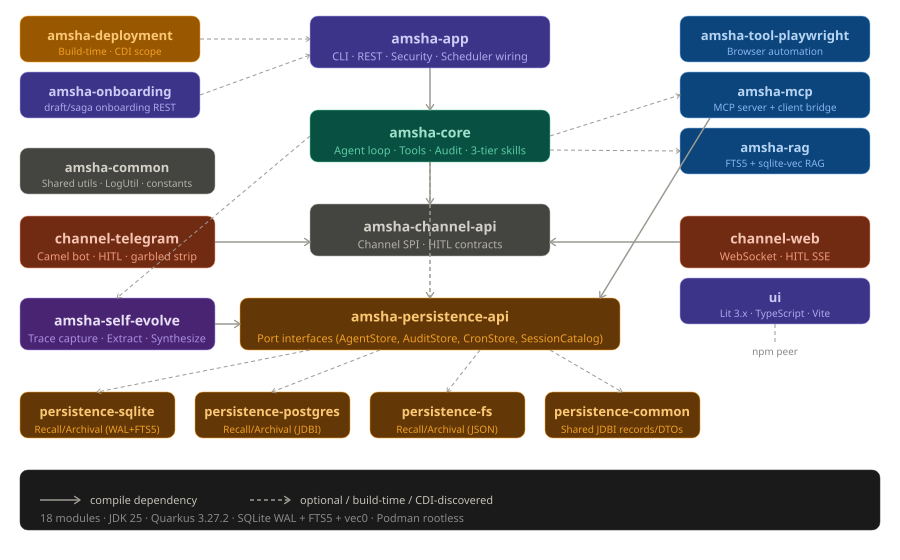

---

## Message Pipeline (Handler Chain)

`ChannelServicesImpl.processAsync()` submits the `ChannelMessage` to a virtual-thread executor and runs it through `MessagePipeline` — a sorted list of `MessageHandler` implementations executed in ascending priority order:

| Priority | Handler | Responsibility |
|---|---|---|
| 10 | `AllowlistHandler` | Fetch `ChannelPlugin` for channel type; check `ChannelAllowlist.isAllowed()` |
| 40 | `SessionResolutionHandler` | Resolve or create `SessionRegistry` entry; activate `WorkspaceContext` CDI scope |
| 45 | `CommandDispatchHandler` | Handle `/help` and other built-in commands before intent classification |
| 50 | `IntentClassificationHandler` | Run `ReflexRegistry`; skill routing; LLM intent classification |
| 60 | `CompactionHandler` | If token/message count over threshold, compact chat history via lightweight LLM |
| 70 | `AgentDispatchHandler` | Call `AgentLoop.run()`; render result; send via `ChannelPlugin.sender()` |

Any handler can return `HandleResult.STOP` to short-circuit the chain (e.g., `AllowlistHandler` on a blocked sender, or `IntentClassificationHandler` when a reflex fires and the reply is already sent).

### Inbound Message Paths

All user-initiated turns converge on a single transport-neutral
`TurnDispatchService.dispatch(TurnRequest)` entry point, which delegates to the
shared `MessagePipeline`. Channel adapters (Telegram, WebSocket) and the
synchronous CLI/REST adapters differ only in how they build the `TurnRequest`
(session identity, optional explicit role, max iterations) and how they render
the resulting `TurnDispatchResult`; none of them re-implements command dispatch,
intent/skill classification, or a direct `AgentLoop` invocation.

**REST API:**
```
POST /api/v1/sessions/{id}/run
  → ApiKeyAuthFilter (HMAC-SHA256 against stored digest; raw key never stored)
  → ApiKeyRegistry.isAllowed() + isMutationAllowed() (custom rate limiter)
  → AgentSessionService.runSync() / runAgentAsync()
  → TurnDispatchService.dispatch(TurnRequest)
  → MessagePipeline → AgentDispatchHandler → AgentLoop.run(...)
```

**CLI `chat` / `ask`:**
```
amsha chat [--role <role>] [--session-id <uuid>]
  → ChatCommand / AskCommand
  → TurnDispatchService.dispatch(TurnRequest)   (no direct AgentLoop call)
  → MessagePipeline → AgentDispatchHandler → AgentLoop.run(...)
  → HITL approval rendered via CliChannelPlugin + CliReplyRenderer; the
    interactive waiter is cancelled by ResumeResultHelper before resume so the
    terminal result prints exactly once.
```

**Telegram:**
```
Telegram Bot API → Apache Camel long-poll
  → TelegramChannelRoute → TelegramAgentHandler
  → TelegramAllowlistGuard (numeric userId check)
  → ChannelServices.processAsync(ChannelMessage)
  → TurnDispatchService.dispatchAsync(TurnRequest)
  → MessagePipeline → AgentDispatchHandler → AgentLoop.run(...)
```

**WebSocket:**
```
ws://host/ws/chat
  → WebChatEndpoint.onOpen()
  → API key validation (X-Amsha-API-Key header or Sec-WebSocket-Protocol)
  → ChannelMessage.WebSocketMessage → ChannelServices.processAsync(msg)
  → TurnDispatchService.dispatchAsync(TurnRequest)
  → MessagePipeline → AgentDispatchHandler → AgentLoop.run(...)
```

**Cron:**
```
@Scheduled(every="${amsha.cron.poll-interval:30s}")
  → AgentCronScheduler.pollAndDispatch()
  → cronRepository.reclaimStaleCrons(cutoff) → findDueCrons()
  → Atomic CAS claim → Semaphore.tryAcquire() (max 10 concurrent)
  → ManagedExecutor virtual thread → CronJobRunner.execute(job)
  → WorkspaceContext.run() → AgentLoop.run() + CRON CONSTRAINT directive
```


---

## ReAct Agent Loop

```
Build system prompt → LLM reasoning call → Parse ReasoningStep
  → FINAL → AgentResult
  → ACTION → ToolInvocationGuard + Governance
       → needs approval? → AwaitingApproval (checkpoint persisted)
                              → Zombie Recovery (restart): auto-deny all channels
       → allowed → ToolInvoker (PII redact, injection redact, truncate)
       → Auto-Heal (sandbox_exec failure → Shiva :heal:)
       → Persona Escalation (any failure → target :escalate:)
       → ChatMemoryWriter → next iteration (loop)
```


### Agent Loop Lifecycle (`AgentLoop.run`)

**Setup:** MDC keys `SESSION_ID`, `AGENT_ROLE`, `USER_ID` set immediately. OTel session span started. Standard roles resolve via `AgentRoleEnum.fromString()`; `skill:X` roles preserve full prefix for custom prompt injection.

**Checkpoint Resume Decision:**

| Checkpoint Status | Action |
|---|---|
| `IN_PROGRESS` | Deserialize `ReasoningStep[]` from `stateJson`; resume with existing history |
| `AWAITING_APPROVAL` + resume signal | Deserialize steps; route to `CheckpointResumeHandler.handle()` |
| `AWAITING_APPROVAL` + new message | Archive stale checkpoint; notify user; start fresh (null history) |
| Terminal (`COMPLETED`/`FAILED`/`LOOP_EXCEEDED`/`DENIED`/`ORPHANED`/`ARCHIVED`/`COMPROMISED`) | Archive row; start fresh |

**Fast-Path: `garuda` Finish:** `tryDelegateFinishFastPath()` — if the last history step's action is `delegate-to-agent` and the observation is a clean answer, the coordinator skips its wrap-up LLM call and returns the sub-agent's result directly (~9,800 tokens saved).

### Thought-Plan-Act-Observe Loop

**Step A: EngineStepHandler — LLM Call**

System prompt construction (`SystemPromptBuilder`):
1. Loads persona identity and role template from `PromptRegistry` (multi-backend). Falls back to classpath `/templates/personas/` and `/templates/prompts/`. Auto-seeds DB on first startup with SHA-256 drift detection.
2. Injects compaction summary from `CompactionSummaryCache` — blocks via `CompactionEventBridge.awaitIfInFlight(sessionId)` to prevent stale-null race.
3. Runs all `ContextEnricher` CDI implementations. `RagContextEnricher` searches both memory tiers, scores by cosine similarity, injects `## Retrieved Rag Context` block.
4. Appends `SystemEnvironmentContextEnricher` metadata.

LLM call (`LangChainReasoningEngine.nextStep()`): Retrieves `ChatModel` from `LlmProviderPort`, assembles messages via `ReasoningMessageAssembler`, filters tools via `RoleRegistry.permittedTools()`. Cron sessions suppress scheduling tools.

Exception classification:

| Exception | Handling |
|---|---|
| HTTP 400 `model_not_found` / `invalid_api_key` | Terminal `FAILED` |
| HTTP 400 `not in request.tools` | Terminal `FINISHED` (tool not in role schema) |
| HTTP 400 `tool_use_failed` with prose | `FINISHED` (extract prose as answer) |
| HTTP 400 schema validation error | Retry with correction prompt (max 2 retries) |
| HTTP 429 rate-limit ≤ 15s | Sleep + retry |
| HTTP 429 rate-limit > 15s | Surface last observation as `FINISH` |
| Network / connect errors | Terminal `FAILED` |
| Truncated code in `failed_generation` | Inject `OBSERVE` retry step with size-constraint instruction |

Budget tracking: `GovernanceStrategy.recordLlmCall()` checks per-session token budgets. `BudgetWarningException` appends constraint directive; `BudgetExceededException` terminates immediately.

**Step B: FINISH Action Handler:** Extracts answer from `actionInput["answer"]` or
`thought`. Unescapes HTML/Unicode. Role guard: non-coder roles cannot generate bare code
blocks. Raw tool-call leak guard. The authoritative answer guard prevents LLM echoing
injected RAG headers. After deterministic acceptance, the ordered optional
answer-quality dispatcher may consume one corrective retry only if no tool has been
invoked in the turn. Absence or failure preserves the accepted answer.

**Step C: ToolStepHandler — Validation**

`ToolInvocationGuard.evaluate()` decision tree:

```
1. Pre-policy guard interceptors (SPI): empty/Allow → continue; stronger decision → stop
2. Registered-tool parameter validation → GuardDecision.Blocked(validationError)
3. Idempotent-tool deduplication → GuardDecision.Deduplicate(cachedObservation)
4. Internal/dynamic tool recognition → unknown tool is blocked
5. Deterministic HITL pre-approval:
   - tool NOT scheduling tool (exempt per §4.10) && autonomy NOT FULL
     → GuardDecision.PauseForApproval(toolName, paramsJson)
6. Shadow observation of the deterministic provisional allow
7. Ordered post-policy tool-risk SPI:
   - BLOCK → GuardDecision.Blocked
   - REQUIRE_APPROVAL → existing ApprovalFrame/PauseForApproval path
   - NoOpinion, absence, or isolated failure → preserve provisional Allow
```

Role-tool schema validation occurs earlier in `ToolStepValidator`; neither pre-policy
nor post-policy classifier hooks may bypass it.

**Step C.1: Auto-Heal Hook:** After `sandbox_exec` failure for coder role:
```
sandbox_exec → ToolFailure (coder only)
  → ExecutionFailureRecoveryService.shouldAttemptRecovery()
  → Spawns isolated Shiva (debugger) sub-session with :heal: sentinel
  → Max attempts configurable (default 2)
  → RecoveryResult.success(fixedCode) → re-exec → continue
  → RecoveryResult.failure() → falls through to escalation
```

**Step C.2: Persona Escalation Hook:** After auto-heal (or directly for non-sandbox failures):
```
ToolFailure (any role, any tool)
  → PersonaEscalationService.shouldAttemptEscalation()
  → determineEscalationTarget() via pattern matching:
     Brahma → Saraswati (unknown API/dependency)
     Brahma → Brihaspati (architecture/trade-off)
     Shiva → Saraswati (obscure error)
     Shiva → Brahma (fundamental flaw)
     Saraswati → Brahma (research complete, needs implementation)
     Brihaspati → Brahma (architecture decided, needs coding)
     Brihaspati → Saraswati (needs external research)
  → Isolated :escalate: sub-session; max depth configurable (default 2)
  → Target persona handles and returns result; merged into source context
```

**Step D: Parallel Batch Execution:** For `ReasoningStep.isParallelBatch()`:
- Pass 1: Guard ALL tools before ANY executes. ANY HITL-required → pre-execute FULL-autonomy tools, persist batch checkpoint, pause for HITL-pending.
- DEDUP → return cached; BLOCKED → fill "blocked" observation; peers continue.
- Pass 2: Execute ALLOWED tools in parallel virtual threads with OTel context propagation.
- Merge results in original call order.
- On resume: batch tool decisions deserialized from checkpoint state JSON; pre-executed results restored (not re-executed).

**Step E: ToolInvoker:** `toolRegistry.invokeTool()` → OTel child span → `AgentTool.execute(params)` → `ToolObservationSanitizer.sanitize()` (PII redaction, injection redaction, truncation).

### Tool Governance Decision Tree

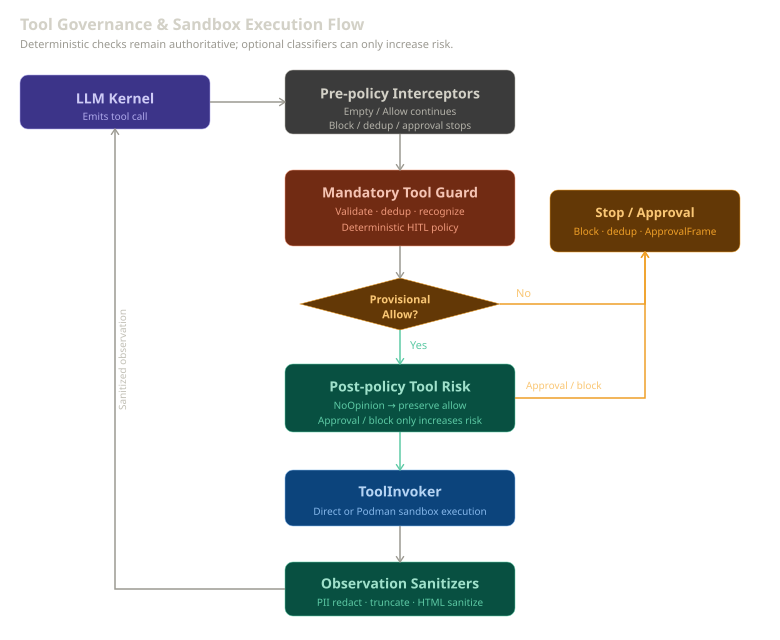

`ToolInvocationGuard.evaluate()` runs:

1. **Pre-policy guard interceptors** — empty/allow continues; stronger decisions stop
2. **Parameter validation** — invalid registered-tool input is blocked
3. **Deduplication** — return cached observation for an eligible duplicate call
4. **Tool recognition** — unknown internal/dynamic tools are blocked
5. **HITL pre-approval** — deterministic role/tool/autonomy policy remains authoritative
6. **Post-policy tool risk** — ordered optional opinions may only raise provisional
   allow to approval or block; absence and failure preserve allow

### Classifier Runtime Control

`OnnxClassifierRuntimeControl` owns independent atomic state for intent, tool-risk, and
answer-quality activation. Active ONNX interceptors (`OnnxPostPolicyToolRiskInterceptor`,
`OnnxAnswerQualityInterceptor`) bridge this state to the core SPIs.
Startup configuration seeds requested state, but effective state requires a registered
ready active implementation. If no implementation is registered, enable requests fail
closed, and the interceptors preserve the deterministic guard path. Disable blocks
new leases immediately while accepted leases retain their result path and drain.
Internal admin mutations write a mandatory payload-free audit record before changing
state; audit failure leaves the switch unchanged.

### Parallel Tool Execution

The LLM can request multiple tools in one step. Parallel batches:
- Pass 1: Guard ALL tools before any executes — HITL pauses atomically
- Pass 2: Execute ALLOWED tools in parallel virtual threads
- Pre-execute FULL-autonomy tools before the HITL pause
- Merge results in original call order

### Agent-Loop Guards & Safety

Four cooperative guards protect the loop from runaway execution and context flooding:

- **`PreflightState`** (runner state, runs at loop entry) — checks the global iteration budget via `WorkspaceContext.incrementAndCheckGlobalIterations()` before each iteration; exceeding it terminates the session as `FAILED`/`LOOP_EXCEEDED`. Also halts on `WorkspaceManager.isSessionHalted()` or `AgentGuards.isShuttingDown()`. See `AGENTS.md` §1.18.
- **`LoopStuckDetector`** — stateless inspects recent `ReasoningStep[]` history; injects a corrective hint when the agent repeats non-progressing tool calls. Thresholds: 2 identical tool-input repeats, or 3 read-only-only repeats (`cat`, `grep`, `ls`, …). Hints derive from the actual repeated input (no hard-coded skill paths).
- **`HtmlArtifactTransformer`** (`ObservationTransformer`, priority 40) — collapses generated HTML artifacts from `host_exec`/`sandbox_exec` output into a short browser-preview notice via `HtmlArtifactUtil.collapseHtmlArtifact()`. The HTML is mirrored to a browser-preview target (see `HostExecTool` `BROWSER_PREVIEW_GOAL_PATTERN`) rather than echoed into chat. Disabling it floods the context window and breaks the FINISH flow. See `AGENTS.md` §1.19.
- **`ToolStepValidator`** — validates tool calls against role constraints before governance/HITL. Enforces coordinator-GitHub redirect, react-keyword detection, and delegates to `AgentTool.validateParameters()` for tool-specific input validation (e.g., `SandboxExecTool` requires `language` parameter). See `AGENTS.md` §1.18.

### Browser Preview (HostExec)

When a `host_exec` goal matches `HostExecTool.BROWSER_PREVIEW_GOAL_PATTERN` and produces an HTML file, `HostExecTool` mirrors the artifact to a browser-preview target and returns `Opened browser preview: <path>` instead of raw HTML. This pairs with `HtmlArtifactTransformer` so generated HTML never re-enters the conversation context.

---

## Reflex System (Zero-Token Fast Path)

`ReflexRegistry` holds `AgentReflex` implementations checked in `IntentClassificationHandler` before any LLM call. If a reflex matches, its `CommandResponse` is sent directly through the channel sender.

17 deterministic reflexes checked before any LLM call:

| Reflex | Priority | Trigger | Action |
|---|---|---|---|
| `PromptInjectionReflex` | 10 | Injection patterns | Detects "ignore previous instructions" style attacks; rejects message |
| `RetryReflex` | 10 | `/retry` | Retries the last agent action |
| `PiiScanReflex` | 20 | Any message | PII detection; blocks if `PII_MODE=BLOCK_AND_NOTIFY` |
| `ApproveReflex` | 100 | `/approve` | Calls `CheckpointApprovalService.approveTool()` |
| `DenyReflex` | 200 | `/deny` | Calls `CheckpointApprovalService.denyTool()` |
| `IdentityExtractionReflex` | 250 | User identity patterns | Extracts and stores user identity information |
| `VaultStoreReflex` | 400 | `/vault-store` | Stores secrets in the encrypted vault |
| `StoreReflex` | 500 | `/store` | Stores key-value pairs |
| `HaltReflex` | 500 | `/halt` | Terminates the running session |
| `HistoryReflex` | 500 | `/history` | Returns recent chat turns |
| `StatusReflex` | 500 | `/status` | Shows current agent status |
| `ListCronsReflex` | 500 | `/crons` | Lists active scheduled jobs |
| `DeleteCronReflex` | 500 | `/delete-cron` | Removes a scheduled job |
| `ResetReflex` | 500 | `/reset` | Wipes session state via `WorkspaceManager.resetSessionState()` |
| `McpReflex` | 500 | `/mcp` | Shows MCP server status and connected tools |
| `SkillReflex` | 500 | `/skills` | Lists available skill personas |
| `ListReflexesReflex` | 500 | `/reflex`, `/reflexes`, `/commands`, `/help` | Lists all registered reflexes |

---

## Agent Personas

| Role | Persona | Tools | Max Iter |
|---|---|---|---|
| `coordinator` | Vishnu | github, web_fetch, schedule/manage, memory (6), ingest_document, self_evolve_reflect, garuda, agent_task | 7 |
| `coder` | Brahma | sandbox_exec, manage_checklist, register_mcp_server, memory (6), garuda | 15 |
| `debugger` | Shiva | github, sandbox_exec, manage_checklist, register_mcp_server, recall_memory_search, garuda | 15 |
| `researcher` | Saraswati | github, web_fetch, brave/serper search, memory (6), garuda, agent_task | 10 |
| `architect` | Brihaspati | github, memory (6), garuda | 7 |
| `synthesizer` | Dattatreya | github, web_fetch, schedule/manage, brave/serper search, memory (6), ingest_document, garuda, agent_task | 10 |
| `optimizer` | Ganesha | garuda; unsupported tools redelegate to their owner | 10 |
| `sentinel` | Kartikeya | garuda; unsupported tools redelegate to their owner | 10 |
| `healer` | Lakshmi | garuda; unsupported tools redelegate to their owner | 10 |
| `protector` | Durga | garuda; unsupported tools redelegate to their owner | 10 |
| `purifier` | Kali | garuda; unsupported tools redelegate to their owner | 10 |
| `nurturer` | Parvati | garuda, ingest_document | 10 |

**memory (6)** = `recall_memory_search`, `archival_memory_search`, `core_memory_read`, `core_memory_append`, `core_memory_replace`, `archival_memory_insert` (debugger only gets `recall_memory_search`).

All 12 roles have `garuda` for delegation. An unauthorized known tool is rewritten to a `garuda` call targeting the centralized owner persona; this applies in the normal loop, approval resume, and parallel-batch resume. Tool schemas are dynamically assembled via `@ToolMetadata(defaultRoles=...)`.

---

## Memory & Persistence

### Hexagonal Architecture

Port interfaces in `amsha-persistence-api`, three adapter implementations:

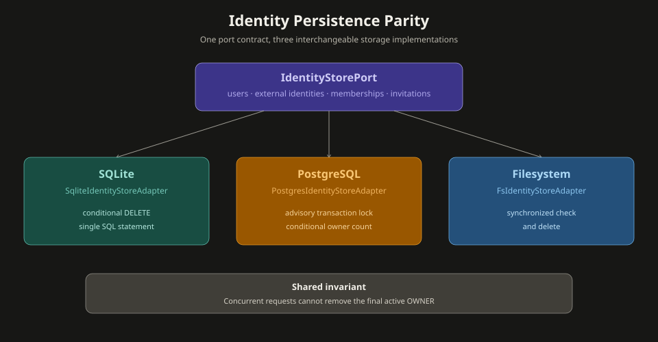

| Backend | Storage | Best For |
|---|---|---|
| **SQLite** (default) | WAL mode + FTS5 + sqlite-vec | Zero-config, embedded, single binary |
| **PostgreSQL** | Native timestamptz, pgvector | Production deployments |
| **Filesystem** | JSON files + Lucene BM25 | Environments without SQL |

Identity and workspace access use the same `IdentityStorePort` contract across
all three adapters. The last-owner membership delete is atomic in each backend:
SQLite uses a conditional SQL delete, PostgreSQL uses a transaction-scoped
advisory lock with a conditional owner count, and filesystem storage synchronizes
the owner check with the delete. External identity ownership is also protected
from silent reassignment in every adapter.

Selecting another backend changes the active adapter but does not migrate
existing data. JVM mode selects the backend at startup; native images require a
rebuild because the CDI selection is fixed at build time. Use an explicit data
migration and backend-specific configuration when moving an existing deployment.

### Tiered Memory System

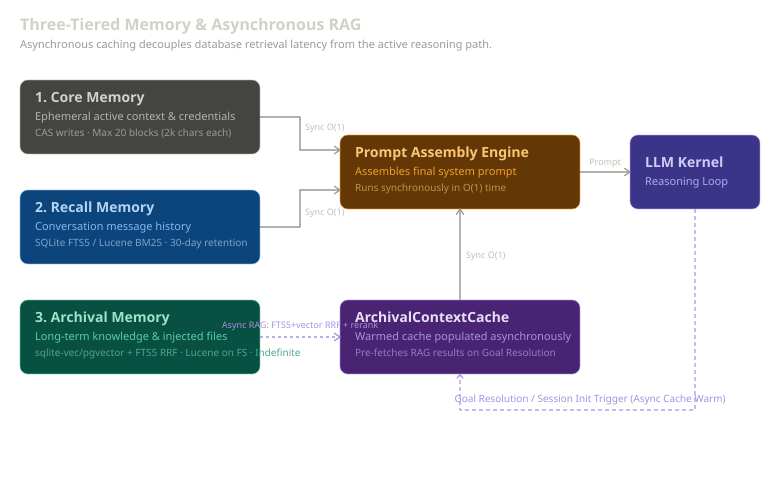

Amsha uses a multi-tier memory system designed for distinct scopes, access patterns, and retention policies. This ensures low-latency execution while retaining rich context and long-term learning capabilities.

| Tier | Purpose / Scope | Retention | Storage / Engine | Search / Access |
|---|---|---|---|---|
| **Core Memory** | Segmented user-managed blocks (max 2000 chars, 20 blocks max) representing active state, instructions, or keys. | Indefinite | SQLite/Postgres/FS JSON blocks | Direct injection under `[USER CONTEXT]` prompt section. |
| **Recall Memory** | Exact-turn history of past sessions and compacted turns. | 30 days | SQL `recall_messages` table / FS JSON files | Hybrid matching (BM25 / exact FTS5). Excludes `COMPACTION_SUMMARY`. |
| **Archival Memory** | Semantic long-term knowledge, reference material, and documents. | Indefinite | SQL `archival_chunks` (vec0/pgvector) / FS JSON + Lucene | Hybrid search (BM25 + vector RRF). Pre-cached asynchronously via `ArchivalContextCache`. |
| **Active Directives** | Synthesized behavioral instructions and rules generated by self-evolution. | Dynamic | SQL `synthesized_directives` / FS DTO stores | Automatic injection into matching agent role/goal contexts. |

#### O(1) Synchronous Retrieval (ArchivalContextCache)
To guarantee high-latency remote searches (vector retrieval or database scans) do not block the active execution loop, the `ArchivalContextCache` pre-caches context asynchronously. The live agent loop retrieves memory chunks in O(1) synchronous time directly from this memory cache.

#### Prompt Budget Manager
To prevent context window overflow, prompt assembly uses a hierarchical budget allocation system. Limits are evaluated in two passes (top-down):
1. **Directives & Core Memory:** Highest priority, fixed allocation.
2. **Recall & Compaction Summary:** Medium priority.
3. **Archival RAG Context:** Dynamic remaining space allocation.

#### Write Governance & CAS
Core memory modifications are governed by a token-bucket rate limiter (e.g., maximum 5 core writes per minute, 10 archival insertions per hour) to prevent runaway LLM write loops. Modifications use Compare-and-Swap (CAS) version checks (`core_memory_replace`) to ensure write consistency under concurrency.

---

### Context Compaction

`CompactionHandler` (priority 60) runs before agent dispatch when token/message count exceeds threshold. Uses a separate lighter LLM (`llama-3.1-8b-instant` via Groq by default) to summarize older turns.

`CompactionService.compact()`:
1. Preserves all raw historical turns to the **Recall Memory** store (`recall_messages`) before summarizing.
2. Calls the compaction model (separate from reasoning model).
3. Writes summary to `CompactionSummaryDto` via `summaryRepository.upsert()`.
4. Clears compacted turns from `PersistentChatMemoryStore`.
5. Releases `CompactionEventBridge` latch so `CompactionSummaryCache` reads fresh summary.

The `CompactionEventBridge` uses a `CountDownLatch` per session to prevent a race where cache populates before compaction write commits, caching `null` for the rest of the session.

### Vector Index Compatibility & Descriptor Safety

To protect durable vector namespaces (`rag-global`, `archival`) from corrupted cross-space retrieval when model weights, tokenization, or vector dimensions change:

1. **Composite Descriptor Fingerprinting (`EmbeddingIndexDescriptor`)**:
   - Computes a deterministic 15-field SHA-256 fingerprint (`spaceId`, `modelRevision`, `tokenizerRevision`, `preprocessingRevision`, `poolingStrategy`, `l2Normalize`, `vectorDimension`, `numericPrecision`, `chunkingStrategy`, `chunkingRevision`, `maxWindowTokens`, `windowOverlapTokens`, `multiWindowAggregation`).
   - Retains `providerId` as audit provenance but excludes it from the compatibility fingerprint to support seamless provider transport failover (e.g. ONNX local vs. cloud REST) when underlying vector spaces are mathematically identical.
2. **Multi-Backend Migration Parity**:
   - **SQLite & PostgreSQL**: Dual-dialect Flyway `V10` migration creates the `vector_index_metadata` table.
   - **Filesystem**: Reads/writes a versioned JSON manifest (`index_descriptor.json`) in the Lucene index root directory.
3. **Non-Destructive Degradation**:
   - On descriptor mismatch between active configuration and stored index, **no vectors are automatically deleted**.
   - Vector search is safely disabled (`VectorIndexMetadataPort.isVectorEnabled() == false`), and retrieval adapters automatically degrade to full-text BM25 / SQLite FTS5 / PostgreSQL `tsvector` keyword search.
4. **Observability**:
   - Exposes compatibility state via `VectorIndexCompatibilityHealthCheck` under `/q/health` (`Vector Index Compatibility`), reporting namespace statuses (`INITIALIZED`, `MATCH`, `MISMATCH`, `MISSING_METADATA`, `UNAVAILABLE`).

---

### Behavioral Self-Evolution System

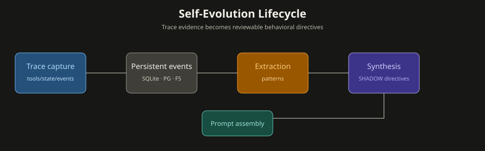

The `amsha-self-evolve` module captures a complete persistent history of agent reasoning and tool executions. This trace dataset is used for offline extraction of common failure/success patterns and synthesis of behavioral directives to optimize future interactions.

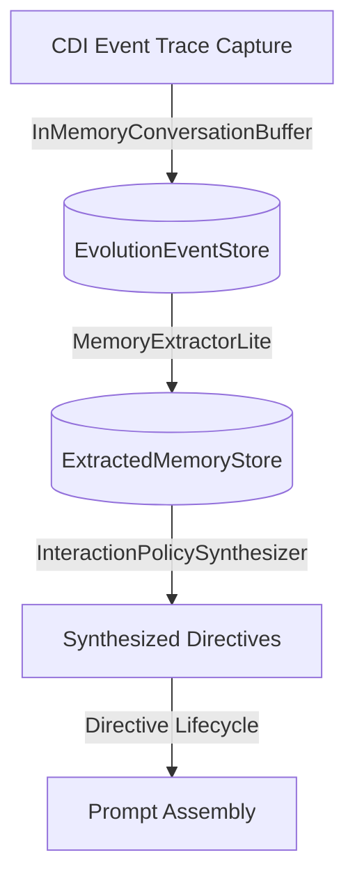

#### 1. Trace Capture & Buffering
*   **CDI Event Triggers**: The trace capture listens asynchronously to core framework events:
    *   `ToolExecutionEvent` (fired by `ToolInvoker` before/after tool invocation)
    *   `CompactionEvent` (fired by `CompactionService` after historical context summarizes)
    *   `AgentStateChangedEvent` (fired upon state transitions)
*   **Trace Buffering & Flushing**: Events are temporarily held in an in-memory session buffer (`InMemoryConversationBuffer`) and flushed to persistent storage based on trigger thresholds (session termination, event threshold of 12 events, or 5-minute idle timeout).
*   **Idempotency & Backend Parity**: Idempotency is database-enforced using primary keys and unique indexes. The system resolves store adapters dynamically via Quarkus `@IfBuildProperty`:
    *   `SqliteEvolutionEventStore` is selected for SQLite persistence.
    *   `PostgresEvolutionEventStore` is selected for PostgreSQL persistence.
    *   `FsEvolutionEventStore` / `NoOpEvolutionEventStore` is resolved for FS persistence.

#### 2. Pattern Extraction
The `MemoryExtractorLite` evaluates captured session traces offline. It parses tool execution inputs, results, and exceptions, identifying patterns of successful operations versus operations that resulted in failure or errors.
*   Extracted patterns are stored in the `extracted_memories` table (or filesystem JSON files).
*   Provides structured semantic records mapping the target goal, tool, input parameters, and failure/success outcomes.

#### 3. Directive Synthesis & Lifecycle
The `InteractionPolicySynthesizer` aggregates extracted memories over multiple turns. When a specific failure/success pattern recurs, it synthesizes a new **behavioral directive** to optimize the agent's behavior. An out-of-band daily cron pass (`SelfEvolveSynthesisScheduler`, trigger-gated by `amsha.self-evolve.synthesis-trigger=cron`) synthesizes directives for all known users in a batch, isolating per-user errors so one failure does not abort the whole run.

Directives follow a strict lifecycle state machine:
```
[CANDIDATE] ──(Review)──> [SHADOW] ──(Validation)──> [ACTIVE] ──(Decline)──> [DISABLED]
```
*   **CANDIDATE**: Newly synthesized directive, awaiting administrator verification.
*   **SHADOW**: Evaluated by injecting the directive into the agent's prompt under an `[EVAL]` label during active sessions (no authoritative behavior change). When the session terminates — successfully, in failure, or via an error/exception path — `DirectiveFeedbackPort` records the outcome (hit on success, miss on failure) and feeds it back to `DirectiveFeedbackService`, which advances the directive's lifecycle (`Validation` → `ACTIVE`) or declines it.
*   **ACTIVE**: Injected directly into the agent's system prompt matching the target role or goal context.
*   **DISABLED**: Explicitly turned off due to negative impact or manual override.

---

## HITL (Human-in-the-Loop) Approval Flow

```
Tool requires SUPERVISED approval
  → AwaitingApproval checkpoint persisted
  → SSE + channel notification (Telegram inline keyboard / Web UI buttons)
  → User approves/denies per-tool or all-at-once
  → CheckpointResumeHandler: re-invoke approved tools, skip denied
  → AgentLoop continues with results
```

- **Parallel batches**: ALL tools pause atomically if any needs HITL; pre-executable tools run before pause
- **Approval timeout**: configurable; stale checkpoints auto-denied on restart (all channels)
- **Delegate approvers**: admins can approve/deny any session by providing sessionId

### Approval Paths

**Telegram Inline Keyboard:**
```
User clicks button (BATCH_APPROVE|sessionId|toolName)
  → TelegramCallbackHandler.handleCallback(Exchange)
  → Expiry guard: agentStore.isCheckpointExpired(sessionId, timeoutHours)
  → BatchHitlKeyboardBuilder.parseCallback(data)
  → ApprovalStateMachine.decide(sessionId, toolName, APPROVE, reason)
  → Idempotency: !pendingTools.contains(toolName) → ALREADY_DECIDED
  → ALL decided → resumeHandler.resumeAfterBatchDecision(...)
       WorkspaceContext.runWithFullAutonomy() → AgentLoop.run()
  → remaining == 0 → sender.editMessage(chatId, msgId, "completed", null)
```

**REST:**
```
POST /hitl/{taskId}/approve (via HitlResource)
  → AgentSessionService.approve()
  → agentStore.load() → verify AWAITING_APPROVAL
  → AgentLoop.run(resolvedResumeGoal, isResumeSignal=true)
```

**Web UI:**
```
GET  /hitl            → lists all AWAITING_APPROVAL checkpoints
POST /hitl/{taskId}/approve  → HitlService.resolve() → CheckpointApprovalService.approveTool()
POST /hitl/{taskId}/reject   → HitlService.resolve() → CheckpointApprovalService.denyTool()
GET  /hitl/events        → SSE stream via AgentSseService.subscribe(sessionId)
```

**Timeout:** `ChannelApprovalTimeoutDispatcher` observes `ApprovalTimedOutEvent` and calls `ChannelPlugin.jobNotifier.notifyApprovalTimeout()`. `TelegramStaleApprovalObserver` additionally edits stale Telegram messages to reflect expiry.

### HITL Approval Sequence

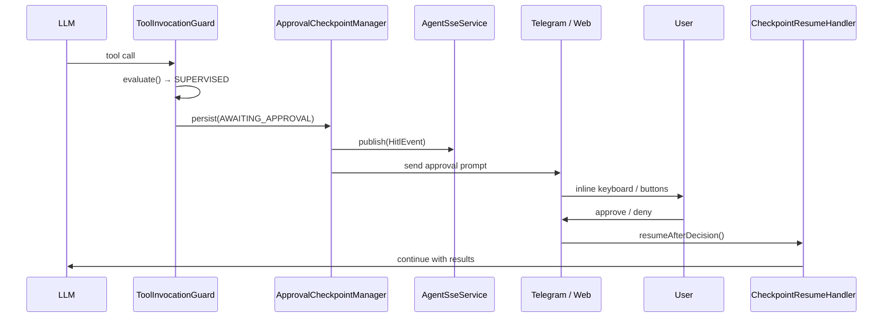

---

## Security Architecture — 10 Guard Layers

> Full details on each layer (regex counts, PII types, vault crypto, audit chain) in [SECURITY.md](./SECURITY.md).

| # | Layer | Component | What |
|---|---|---|---|
| 1 | **Channel gate** | `AllowlistHandler` | Channel user allowlist |
| 2 | **Injection match** | `PromptInjectionReflex` | 25 injection patterns across 5 categories |
| 3 | **PII detection** | `PiiScanReflex` | 12 PII types — blocks or redacts |
| 4 | **Destructive ops** | `DestructiveVocabularyFilter` | Routes destructive language to reduced autonomy |
| 5 | **Goal sanitize** | `AgentDispatchHandler` | PII re-sanitizer on goal before dispatch |
| 6 | **HITL boundary** | `CheckpointResumeCoordinator` / `ToolInvocationGuard` | Approval frames, autonomy policy |
| 7 | **LLM boundary** | `GuardrailCoordinator` | Injection check, PII, response validation |
| 8 | **Pre-policy tool interceptor** | `ToolGuardInterceptor` implementations | Deterministic block, dedup, or approval decisions; `Allow` continues |
| 9 | **Tool boundary** | `ToolInvocationGuard` | Validation, dedup, recognition, HITL, monotonic post-policy risk |
| 10 | **Session isolation** | `AgentSessionService` per-key access | Async approve/deny, key scoping |

See [SECURITY.md](./SECURITY.md) for vault, sandbox, audit chain, and key management details.

### Security Layers Flow

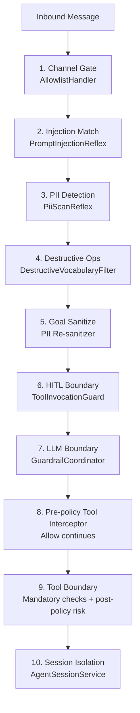

---

## Built-in Tools

| Tool | Tool Name | Operation | Default Roles |
|---|---|---|---|
| GitHub | `github` | `NETWORK_OUTBOUND` | architect, coordinator, researcher, debugger, synthesizer |
| Brave Web Search | `brave_web_search` | `NETWORK_OUTBOUND` | researcher, synthesizer |
| Serper Web Search | `serper_web_search` | `NETWORK_OUTBOUND` | researcher, synthesizer |
| Smart Web Fetch | `web_fetch` | `NETWORK_OUTBOUND` | researcher, synthesizer, coordinator |
| Sandbox Exec | `sandbox_exec` | `EXECUTE_SHELL` | coder, debugger |
| Playwright CLI | `browser_navigate` | `NETWORK_OUTBOUND` | researcher (delegation owner) |
| Recall Memory Search | `recall_memory_search` | `READ_FS` | architect, coordinator, researcher, synthesizer, coder, debugger |
| Archival Memory Search | `archival_memory_search` | `READ_FS` | architect, coordinator, researcher, synthesizer, coder |
| Core Memory Read | `core_memory_read` | `READ_FS` | architect, coordinator, researcher, synthesizer, coder |
| Core Memory Append | `core_memory_append` | `WRITE_MEMORY` | architect, coordinator, researcher, synthesizer, coder |
| Core Memory Replace | `core_memory_replace` | `WRITE_MEMORY` | architect, coordinator, researcher, synthesizer, coder |
| Archival Memory Insert | `archival_memory_insert` | `WRITE_FS` | architect, coordinator, researcher, synthesizer, coder |
| Ingest Document | `ingest_document` | `WRITE_MEMORY` | coordinator, synthesizer, nurturer |
| Schedule Task | `schedule_task` | `SCHEDULE_AUTONOMOUS` | coordinator, synthesizer |
| Manage Schedule | `manage_schedule` | `READ_FS` | coordinator, synthesizer |
| Manage Checklist | `manage_checklist` | `READ_FS` | coder, debugger |
| Agent Task | `agent_task` | `WRITE_FS` | coordinator, synthesizer, researcher |
| Delegate (Garuda) | `garuda` | `DELEGATE_AUTONOMOUS` | all 12 roles |
| Register MCP Server | `register_mcp_server` | `NETWORK_OUTBOUND` | coder, debugger |
| MCP dynamic tools | (varies) | (varies) | all roles with MCP |

### Governance by Autonomy Level

The `AutonomyPolicy` defines which operations are auto-allowed at each level. Operations not auto-allowed pass through `ToolGovernanceGuard` for role trust pre-flight and potential HITL approval.

| Operation | FULL | SUPERVISED | BACKGROUND | READONLY |
|---|---|---|---|---|
| `READ_FS` | ✅ | ✅ | ✅ | ✅ |
| `WRITE_FS` | ✅ | guard → HITL | ❌ | ❌ |
| `WRITE_MEMORY` | ✅ | guard → HITL | ❌ | ❌ |
| `NETWORK_OUTBOUND` | ✅ | guard → HITL | ✅ | ❌ |
| `EXECUTE_SHELL` | ✅ | guard → HITL | ❌ | ❌ |
| `VAULT_ACCESS` | ✅ | guard → HITL | ❌ | ❌ |
| `SCHEDULE_AUTONOMOUS` | ✅ | ✅ | ❌ | ❌ |
| `DELEGATE_AUTONOMOUS` | ✅ | guard → HITL | ✅ | ❌ |

- **FULL**: all operations allowed without approval.
- **SUPERVISED** (default): only `READ_FS` and `SCHEDULE_AUTONOMOUS` auto-allowed; everything else evaluated by `ToolGovernanceGuard`.
- **BACKGROUND** (cron execution): `READ_FS`, `NETWORK_OUTBOUND`, `DELEGATE_AUTONOMOUS` allowed; mutations blocked.
- **READONLY**: only `READ_FS` allowed; all side-effecting operations blocked.

### Trusted Role Bypass

Roles with `requiresApproval=false` in their `RoleDefinition` skip non-sensitive operation policy checks. `NETWORK_OUTBOUND` and `EXECUTE_SHELL` always require HITL regardless of role trust. See [Architecture_Invariants.md §4.10.2](./Architecture_Invariants.md#4102-role-based-tool-governance-bypass-invariant-rolegovernancebypass).

---

## Run Modes

| Mode | Command | Behaviour |
|---|---|---|
| `ask` | `ask "goal" --role coordinator` | One-shot: run agent, print answer, exit |
| `chat` | `chat [--role <role>] [--session-id <uuid>]` | Interactive REPL with full multi-turn memory. `--session-id` resumes an existing persisted session. |
| `serve` | `serve` | Long-running REST daemon on port 8080 |
| `attach` | `attach telegram` | Long-running daemon with channel adapters |

### Persistence Backend Selection

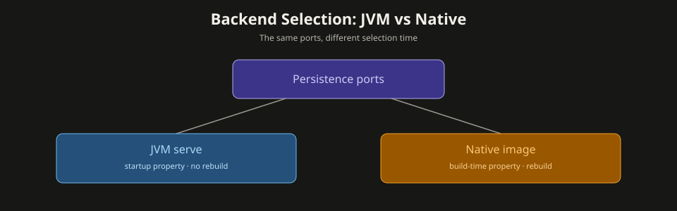

```bash
# Default: SQLite (zero config)
amsha chat

# PostgreSQL (JVM mode — no rebuild)
AMSHA_PERSISTENCE_BACKEND=postgres amsha serve

# Filesystem
AMSHA_PERSISTENCE_BACKEND=fs amsha serve
```

See [SETUP.md](./SETUP.md) for detailed backend switching instructions.

---

## LLM Providers

| Provider | Default Model | Notes |
|---|---|---|
| Groq | `meta-llama/llama-4-scout-17b-16e-instruct` | Default; OpenAI-compatible API |
| OpenAI | `gpt-4o-mini` | Official OpenAI API |
| Ollama | `mistral-small:latest` | Local inference |
| OpenRouter | `openai/gpt-oss-20b:free` | Unified multi-model API |
| Claude Code | Claude's models | Reads OAuth token from local Claude Code CLI |
| Gemini | `gemini-2.5-flash-lite` | Google Gemini API |
| Cerebras | `qwen-3-235b-a22b-instruct-2507` | Daily quota detection disables slot permanently |
| Nvidia | `bytedance/seed-oss-36b-instruct` | NVIDIA inference API |
| Sarvam | `sarvam-105b` | Indic-language models |
| OpenCode | `deepseek-v4-flash-free` | OpenAI-compatible endpoint (Zen / Go) |
| Hugging Face | `meta-llama/Llama-3.3-70B-Instruct` | Inference API / Router |
| Mistral | `codestral-latest` | Codestral & Mistral frontier models |
| Cloudflare | `@cf/meta/llama-3.3-70b-instruct-fp8-fast` | Workers AI serverless inference with account-scoped routing |
| OMLX | `mlx-community/Qwen3.6-35B-A3B-4bit` | OMLX inference |
| LlamaCpp | `qwen3` | Local inference via OpenAI-compatible API on port 9000 |
| Generic OpenAI | `gpt-4o-mini` | Any OpenAI-compatible endpoint |
| Infinite Loop | Multi-slot | Quality tracking + cooldown between providers |

The **compaction model** is separate — always a lighter/cheaper model regardless of reasoning provider.

---

## Bootstrap & Startup

### Pre-CDI Steps (in `AmshaCli.main()`)

Runs **before** Quarkus CDI container boots:
1. **Bootstrap** — `AppBootstrap.bootstrap(args)` → `BootstrapOrchestrator`: resolves binary dir, drains input buffer, extracts .env, handles LD_PRELOAD re-exec, loads .env, normalizes Playwright path, installs Playwright CLI, ensures fallback LLM defaults, validates security keys, validates config, runs interactive setup wizard, provisions data directory and native libs (including Vec0).
2. **Env-var validation** — `CliUtils.validateRequiredEnvVars()` hard-exits with setup guide if any required vars absent.
3. **Args check** — If `args.length == 0`, prints usage and exits.
4. **Quarkus boot** — `Quarkus.run(AmshaCli.class, args)` starts CDI container, Agroal pool, extensions.

### CDI Startup Observers (priority order)

| Priority | Observer | Action |
|---|---|---|
| 10 | `Vec0NativeLibraryInstaller` | Re-fires native lib install (belt-and-suspenders) |
| 2100 | `RagSchemaInitializer` | Warms Agroal pool; loads `vec0` extension; ATTACHes FTS DB; creates `fts.vec_global` (priority = `APPLICATION + 100`) |
| 150 | `DevSecretSeederStartup` | Dev-profile only — seeds mock API keys (`@IfBuildProfile("dev")`) |
| Unordered | `SkillLoader.onStart()` | Loads skills from classpath + SQLite DB; compiles trigger `Pattern[]`; registers dynamic roles |
| Unordered | `StartupSecurityValidator` | **Hard gate in prod:** throws if vault pepper equals dev default, HMAC key absent, or allowlist has usernames instead of numeric IDs |
| Unordered | `AgentCronScheduler` (on `StartupEvent`) | Restores persisted cron jobs so scheduled tasks survive restarts |

Note: `session_registry` is created by the Flyway interaction-catalog migration (`V6__interaction_catalog.sql`), not a CDI observer.

### Build-Time Processors (`amsha-deployment`)

`WorkspaceScopeProcessor` registers `@WorkspaceScoped` as custom CDI scope at build time. `RestResourceBuildStep` enforces `@RunOnVirtualThread` on JAX-RS resources injecting `EntityManager`. **Note:** This guard catches third-party langchain4j REST APIs (Gemini, Anthropic, OpenAI) that still use JPA internally — Amsha Agent's own code has zero JPA/EntityManager usage. `AgentFunctionProcessor` processes `@AgentFunction` interfaces and generates JSON schemas from SAM return types at build time.

---

## Entry Points (Picocli Command Tree)

All four leaf subcommands converge on `TurnDispatchService.dispatch()` →
`MessagePipeline` → `AgentLoop.run()` (the cron path is the only one that still
calls `AgentLoop.run()` directly, because it runs inside a scheduled
`WorkspaceContext` with a CRON CONSTRAINT directive):

| Mode | Command | Behaviour |
|---|---|---|
| `serve` | `amsha serve` | Quarkus HTTP server on port 8080; Telegram route self-registers via `@StartupEvent` |
| `ask` | `amsha ask "goal"` | UUID session → `TurnDispatchService.dispatch()` → pipeline → print answer → terminate |
| `chat` | `amsha chat [--role <role>] [--session-id <uuid>]` | Interactive REPL; every input is a `TurnRequest` through `TurnDispatchService`. `--session-id` resumes an existing persisted session. HITL approval is rendered through `CliChannelPlugin` and the interactive waiter is cancelled by `ResumeResultHelper` on `/approve` or `/deny` so the terminal result prints exactly once. |
| `attach` | `amsha attach <channel>` | Discovers matching `ChannelDaemon` CDI bean by `channelId()` → `daemon.start()` |

---

## Session & Workspace Lifecycle

### Session Identity & Catalog

The application manages durable session mappings using the **Session Catalog**. 

* **Legacy Session Lookup:** `SessionRegistry.resolveOrCreate(channelType, channelId, userId)` is used only when a scope has no catalog entry, preserving and lazily migrating legacy `session_registry` mappings. New catalog-created sessions do not write this table. The lookup supports case-insensitive legacy channel names such as `CLI` and `TELEGRAM`.
* **Session Catalog:** The `SessionCatalogStore` maps `(ownerKey, channelType, channelId)` to a sequence of `SessionCatalogEntry` records. Every session (CLI, Telegram, Web, REST) is "catalogued from birth" as either `ACTIVE`, `INACTIVE`, or `ARCHIVED`.
* **Atomic Session Rotation:** Users can rotate their active session (e.g. via `/newsession`). The `SessionCatalogService.rotate()` operation atomically:
  1. Deactivates siblings and activates a new session in the persistent store.
  2. Flushes any pending human-in-the-loop (HITL) approval notifications.
  3. Rebinds the session ID in the in-memory heartbeat tracker.
  4. Publishes a `SessionRotatedEvent` via the CDI event bus to notify channel adapters (like `WebChatEndpoint` WebSocket connections to sync client state).
* **Scheduled Archival:** The `SessionReaper` periodically sweeps the catalog to archive sessions that have been inactive for more than `archive-after-days` (default 90).

### Web Authentication & Session Lifecycle

The following diagram illustrates the interaction between the user browser, JAX-RS resources, external identity providers, and the persistence stores during OIDC login and web session token validation:

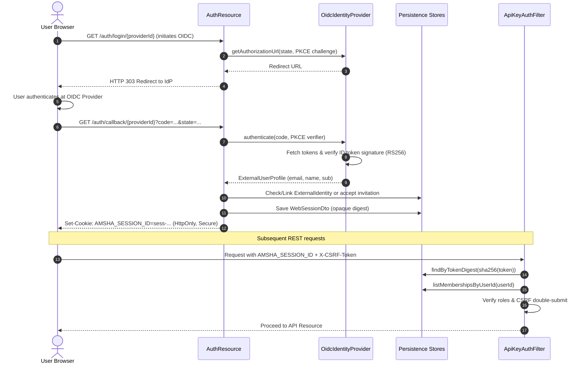

### WorkspaceContext Scoping

```java
WorkspaceContext.run(sessionId, userId, chatId, autonomyLevel, agentRole, channelType, () -> {
    // ScopedValues bound: SESSION_ID, USER_ID, CHAT_ID, AUTONOMY, AGENT_ROLE, CHANNEL_TYPE
    // @WorkspaceScoped CDI beans instantiated and bound to this session
    return agentLoop.run(...);
});
```

`WorkspaceContext.runWithFullAutonomy()` overrides autonomy to `FULL` for tool execution on approved or cron paths.

### Session Termination

`WorkspaceManager.terminateSession(sessionId)`:
1. Mark session halted (`HALTED_SESSIONS.put`)
2. Guard: `statefulAgentStore.isBatchResuming()` check
3. Remove heartbeat from `SessionHeartbeatTracker`
4. Clear budget memory (`GovernanceLayer.clearSession()`)
5. Clear tool invocation guard state (`toolInvocationGuard.clearSession()`)
6. Cleanup audit observer (`auditObserver.cleanupSession()`)
7. `markCheckpointsFailed()` — marks only `IN_PROGRESS`/`AWAITING_APPROVAL`/`AWAITING_RETRY_APPROVAL` as `FAILED`; excludes `COMPLETED`/`FAILED`/`ARCHIVED`/`COMPROMISED`
8. Wipe session workspace directory (recursive delete)
9. Destroy `@WorkspaceScoped` CDI context (`context.destroySession()`)
10. Cancel CLI result bridge + clear batch resuming state

---

## Skills System

Skills are YAML-fronted markdown files defining custom agent personas with system prompts, tool capabilities, trigger patterns, and max-iteration limits.

### YAML Frontmatter Schema

```yaml
---
name: code-reviewer
description: Reviews code for bugs and style issues
trigger-patterns:
  - "review.*code"
  - "check.*pr"
tool-capabilities:
  - GITHUB
  - RECALL_MEMORY_SEARCH
  - ARCHIVAL_MEMORY_SEARCH
max-iterations: 5
---
You are a meticulous code reviewer...
```

### Loading Pipeline

```
StartupEvent → SkillLoader.onStart()
  → DatabaseSkillProvider     (priority 10  - reads agent_skill table from SQLite)
  → SkillsJarSkillProvider    (priority 50  - loads from META-INF/skills/ in JARs)
  → ClasspathSkillProvider    (priority 100 - reads /skills/index.txt from classpath)
  → SkillDefinitionParser.parse(yaml)
  → Pattern.compile(triggerPatterns)     [pre-compiled for O(1) matching]
  → RoleRegistry.registerDynamic(skill:name, RoleDefinition)
  → SkillRegistry.updateSnapshot(CompiledSkillEntry[])
```

**Priority order** (lower wins): Database skills override SkillsJars, which override classpath skills. `SkillResource` (REST CRUD at `/skills`) provides hot-reload.

### SkillsJarSkillProvider (Dynamic JAR Loading)

Skills can be packaged as JAR files under `META-INF/skills/`. The `SkillsJarSkillProvider` (priority 50) loads skills from JAR dependencies:
- **Index path** (`META-INF/skills/skills-index.txt`): optional pre-indexed list of `SKILL.md` paths. When present, skills are loaded via the index (fast path, avoids classpath scanning).
- **Fallback**: classpath scanning of `META-INF/skills/` for `SKILL.md` files.

For every SkillsJar dependency change in `app/pom.xml`, regenerate `app/src/main/resources/META-INF/skills/skills-index.txt` with `python3 ./scripts/verify_skillsjar_index.py --fix`, then validate it without `--fix`. This is mandatory for native builds: GraalVM Native Image cannot enumerate classpath resource directories, so it cannot use the fallback scan. `META-INF/skills/**` must also remain in `quarkus.native.resources.includes`.

Each SkillsJar contains:
- `META-INF/skills/<skill-name>/SKILL.md` — YAML-fronted markdown defining system prompt, trigger patterns, tool capabilities, and max iterations.

### SkillAdaptationManager

The `SkillAdaptationManager` enables adaptive skill execution — dynamically adjusting skill behavior based on execution context and tool outputs. Controlled by `amsha.skills.adaptive.enabled` (`false` by default). When enabled, skills can auto-adapt their parameters, retry strategies, and tool selection based on observed results. See [CONFIGURATION.md](./CONFIGURATION.md) §Skills & SkillsJars for `AMSHA_SKILLS_ADAPTIVE_ENABLED`.

### HostExecSkillGrant

`HostExecSkillGrant` (startup `@Priority(APPLICATION+600)`, runs AFTER `SkillLoader`) is the **only** sanctioned path that grants the `host_exec` tool capability to skill roles. It reads `amsha.tools.host-exec.skills` (default `jdb-debugger`) and calls `CapabilityRegistry.grant("skill:<name>", "host_exec")` for each listed skill. `host_exec` is always HITL-approved (maps to `EXECUTE_SHELL`); the grant merely adds the tool to the permitted-tools set — `ToolGovernanceGuard` still enforces HITL. To let a new skill use `host_exec`, add it to `amsha.tools.host-exec.skills` (config sync §2.5); never widen `SkillLoader` defaults. See `AGENTS.md` §1.20.

### Routing

`SkillAwareIntentDetector` iterates `CompiledSkillEntry[]` in O(n·p). On match, returns `skill:{name}` immediately. `SystemPromptBuilder` detects the `skill:` prefix and injects custom system prompt and tool restrictions.

---

## MCP (Model Context Protocol) Integration

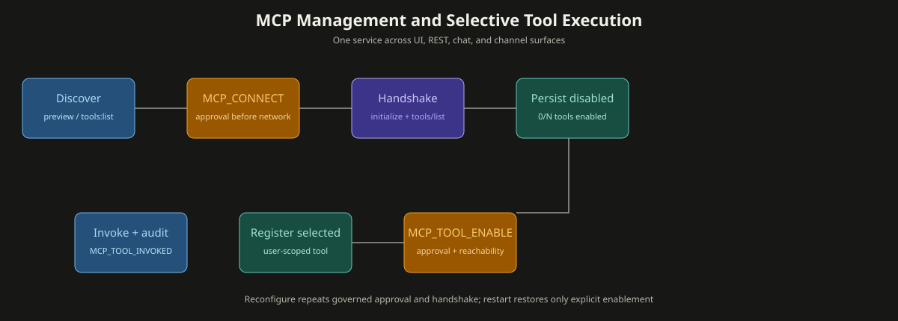

### MCP management lifecycle

All remote management surfaces delegate to `McpManagementService`. Discovery is a throwaway,
approval-gated preview: it validates the endpoint, performs `initialize`/`tools:list` after
`MCP_CONNECT` approval, and leaves no durable row or registered tool. Connect repeats the governed
handshake, persists user-private connection metadata, and stores all discovered tools disabled.

`MCP_TOOL_ENABLE` approval is required before reachability validation and registration of an individual
tool. The dynamic registry is user-scoped, so `CONNECTED (1/56 tools)` means one explicitly enabled tool
out of 56 discovered tools. Pause/disconnect drain and deregister; startup reconnect restores only
explicitly enabled policies. Reconfiguration uses `If-MCP-Revision`, preserves enabled policy only for
unchanged tool name/schema hash pairs, and compensates staged vault changes on failure.

The operator-facing lifecycle, chat commands, REST paths, setup/edit links, import contract, and local
identity rules are documented in [MCP Management](./MCP_MANAGEMENT.md).

### Amsha Agent as MCP Server

`McpAdminResource` (`GET /mcp/tools`) exposes Amsha Agent's internal tools as MCP-compatible descriptors. `AgentFunctionProcessor` (build-time) generates JSON schemas from `@AgentFunction`-annotated SAM interfaces.

### Amsha Agent as MCP Client (Dynamic Tool Loading)

Outbound MCP connections discover a remote server's tools and register only explicitly enabled tools into the user-scoped agent loop.

```
POST /api/v1/mcp/connect  {name, url, headers?}
 → request MCP_CONNECT approval before network I/O
 → McpConnectionLifecycleService validates, stages, and persists connection metadata
 → McpClientService performs initialize → initialized → tools/list
 → persist discovered policies disabled; no implicit registration
 → MCP_TOOL_ENABLE approval and reachability check for each selected tool
 → ExternalMcpToolAdapter + DynamicToolCapabilityRegistry register that user-scoped tool
  → Available as tools in agent roles at next invocation
```

`GET /api/v1/mcp/connect` lists currently connected servers (persisted + transient,
credentials stripped). `DELETE /api/v1/mcp/connect/{name}` disconnects, deregisters
tools, deletes the durable connection, and removes its vault references.

#### Authenticated HTTP MCP connections (credential headers)

Connections may carry HTTP header credentials (API keys, bearer tokens, tenant IDs).
Header **values** are never stored in the connection record, config, logs, audit
payloads, or API responses — only an opaque, owner-scoped `SecretVault` reference
(`USER:<userId>` partition) and the normalized, non-secret header name. At request time
`McpConnectionCredentialPort.resolveHeaders(connectionId)` resolves the values into an
`AutoCloseable ResolvedMcpHeaders` that zeroes its secret bytes after the request.
Header names are validated against the RFC 7230 token grammar, lower-cased for
case-insensitive uniqueness, and rejected if they collide with transport-owned / hop-by-hop
/ framing headers (`Content-Type`, `Accept`, `Mcp-Session-Id`, `Host`, `Content-Length`,
`Connection`, `Transfer-Encoding`, `Upgrade`, …). Endpoint URLs must not contain user-info
credentials. Registration is a sensitive operation (`NETWORK_OUTBOUND` HITL / admin API key).

Durable connections are stored via `McpConnectionStorePort` with SQLite, PostgreSQL, and
filesystem adapters (paired `V6__interaction_catalog.sql` Flyway migrations). On startup
`McpConnectionLifecycleService.reconnectEnabledConnections()` restores enabled HTTP/SSE
connections from durable metadata; failed reconnects are logged and retried. Failed or
cancelled credential cleanup is persisted as an owner-scoped, idempotent retry record
(`MCP_CREDENTIAL_CLEANUP_FAILED`) and retried on startup before reconnect.

Self-connect smoke test: connecting to `http://localhost:8080/mcp` discovers Amsha Agent's own tools, but they remain disabled and are not registered dynamically until an explicit tool-enable approval.

---

## Multi-Agent Delegation

`DelegateToAgentTool` allows the coordinator to spawn sub-agents:

```
Coordinator: THINK → ACTION: garuda(agent="brahma", goal="Write unit tests for...")
  → ToolInvocationGuard: scheduling tools EXEMPT from HITL
  → Capability subset check: sub-agent role must have subset of coordinator's tools
  → New WorkspaceContext.run(subSessionId, ...) → AgentLoop.run(subGoal, subRole)
  → Sub-agent executes own Thought-Plan-Act-Observe loop
  → Returns clean answer as tool observation
  → tryDelegateFinishFastPath() → skip coordinator wrap-up (~9,800 tokens saved)
```

### Auto-Heal: Shiva as Code Fixer

```
Brahma (coder) → sandbox_exec → FAIL
  → ExecutionFailureRecoveryService intercepts
  → Auto-delegate to Shiva with: original code + language + error output
  → Shiva returns single fenced code block with corrected code
  → RecoveryService extracts via regex → re-executes sandbox_exec
  → On success: continues loop. On failure after max attempts: returns error.
```

Config: `amsha.agent.auto-heal.enabled` (default `true`), `amsha.agent.auto-heal.max-attempts` (default `2`). Session sentinel: `:heal:`.

### Cross-Persona Escalation

`PersonaEscalationService` detects capability boundaries and auto-routes to specialists. Paths implemented for coder, debugger, architect, and researcher:

| Source | Target | Trigger |
|---|---|---|
| Brahma (coder) | Shiva (debugger) | Sandbox execution failure |
| Brahma (coder) | Saraswati (researcher) | Unknown API/dependency |
| Brahma (coder) | Brihaspati (architect) | Architecture/trade-off decision |
| Shiva (debugger) | Saraswati (researcher) | Obscure error needing research |
| Shiva (debugger) | Brahma (coder) | Fundamental flaw needing rewrite |
| Shiva (debugger) | Ganesha (optimizer) | Complex recursive logic |
| Shiva (debugger) | Kartikeya (sentinel) | Security vulnerability |
| Saraswati (researcher) | Brahma (coder) | Research complete, needs implementation |
| Brihaspati (architect) | Brahma (coder) | Architecture decided, needs coding |
| Brihaspati (architect) | Saraswati (researcher) | Needs external research |

Config: `amsha.agent.escalation.enabled` (default `true`), `amsha.agent.escalation.max-depth` (default `2`). Session sentinel: `:escalate:`. Circuit breaker: `isPingPong()` detects A→B→A→B loops in last 4 entries.

### Grouped Agent Ensembles (Lokas)

Personas are organized into **4 Lokas (realms)** based on mythological residence. Each realm has a group lead who triages incoming tasks:

| Realm | Lead | Members | Domain |
|---|---|---|---|
| **Kailasa** | Shiva (debugger) | Parvati, Ganesha, Kartikeya, Durga, Kali | Debugging, security, logic, policy, cleanup |
| **Brahmaloka** | Brahma (coder) | Saraswati, Brihaspati | Coding, research, architecture |
| **Vaikunta** | Vishnu (coordinator) | Lakshmi | Orchestration, scheduling, healing |
| **Loka-Bahir** | Dattatreya (synthesizer) | — | Cross-realm conflict resolution |

**Group Consultation Flow:**
```
Coordinator: garuda(agent="shiva", goal="Fix SQL injection AND optimize recursion", mode="group_consult")
  → GroupConsultationEngine.buildSubTasks()
  → Parallel virtual threads: Kartikeya (security) + Ganesha (logic)
  → Collect results (timeout 60s)
  → Enhanced goal += synthesis prompt
  → Shiva synthesizes family analyses → unified fix
```

**Dynamic Group Formation:** When a task spans domains that don't fit a single realm, `TaskClassifierService` classifies the task into domains and forms a dynamic group with the primary domain's role as lead.

**Group-Aware Escalation:** When a persona fails, `EscalationPatterns.tryIntraGroupEscalation()` prefers routing to a sibling within the same realm before escalating externally.

Config: `amsha.group.consult.max-concurrent` (default `4`), `amsha.group.consult.timeout-seconds` (default `60`), `amsha.group.analytics.enabled` (default `true`).

### Delegation & Escalation Flow

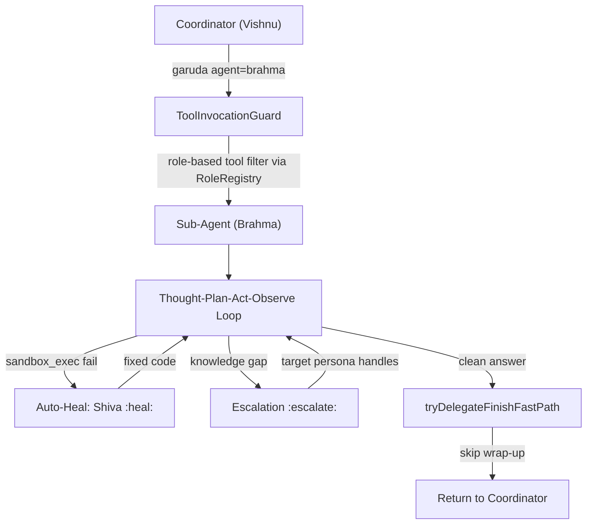

---

## Cron Result Handling

After `AgentLoop.run()` returns in the cron path, `CronResultHandler` processes:

| Result Type | Action |
|---|---|
| `Finished` (run-once) | `cronRepository.markCompleted()` + audit `CRON_FIRED` |
| `Finished` (recurring) | `CronScheduleUtil.computeNext()` → `markFired(nextFireTime)` |
| `AwaitingApproval` | `cronRepository.markAwaitingApproval()` |
| `AwaitingRetry` | Handled via `CronResultHandler` retry logic |
| `Failed` / `LoopExceeded` (run-once) | `cronRepository.markFailed()` + audit `CRON_FAILED` |
| `Failed` / `LoopExceeded` (recurring) | **Rescheduled** via `computeNext()` + `markFired()` (not permanently failed) |

`ChannelCronNotificationDispatcher` dispatches completion notifications via `ChannelPlugin.jobNotifier()`.

---

## Audit & Compliance

### WORM Audit Chain

Every significant event writes an `AuditEvent` with HMAC-SHA256 chain linking records by sequence number:

```
AuditService.record(sessionId, userId, agentRole, SecurityEventType, detail)
  → AuditHashUtil.hmacHex(prevHash + "|" + payload)
  → SqliteAuditEventStoreAdapter.save(AuditEventDto)  // JDBI, not JPA
```

`AuditVerifier.verifyChain(sessionId)` re-computes HMAC for all events. `AsyncPersistenceEngine` drains two virtual threads (critical path / telemetry path). `ComplianceViolationException` thrown on mandatory audit write failure after all retries.

### Security Events Audited

66 event types across categories: loop events, tool events, approval events, injection/PII, vault, checkpoint, cron, skill, MCP, session, settings, and more.

---

## Observability

### OpenTelemetry

Spans at three levels parented under session root span:
- **Session span** (`amsha.session`): cumulative prompt + completion tokens
- **Iteration span** (`amsha.agent.iteration`): one per loop iteration; carries session ID, role, iteration number
- **Tool span** (`amsha.tool.call`): one per `ToolInvoker.invoke()`; carries tool name, operation
- **Reflex span** (`amsha.reflex.execute`): one per matched reflex

Exported to Jaeger via OTLP at `http://localhost:4317`.

### Micrometer

`MetricsAgentObserver.onStepComplete()` records per-step counters. Exposed at `/q/metrics`.

### SSE Real-Time UI Events

`AgentSseService` publishes typed events for the Lit web frontend:

| Event | Trigger |
|---|---|
| `AgentStateChangedEvent` | CDI event: `idle` / `active` / `awaiting-approval` transitions (not SSE) |
| `HitlEvent` | SSE: `AWAITING_APPROVAL` / `APPROVED` / `DENIED` / `RESUMED` |
| `AgentStatusEvent` | SSE: `RUNNING` / `COMPLETED` / `FAILED` |
| `HeartbeatEvent` | SSE: 25-second keep-alive |

---

## Frontend (Lit Web Components)

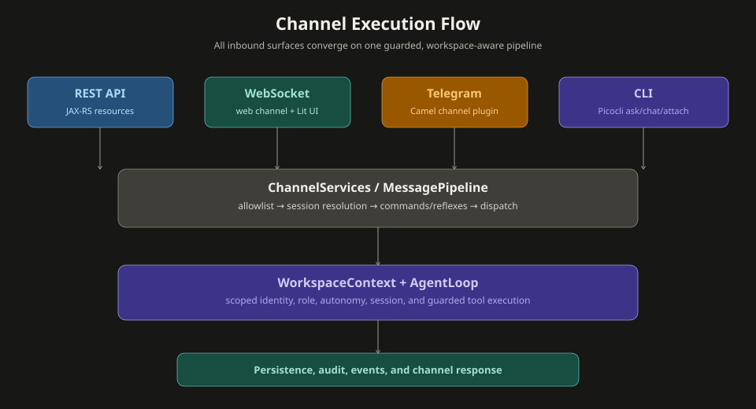

| Component | Role |
|---|---|
| `arc-chat-interface` | Main chat UI; WebSocket + HITL approval cards via SSE |
| `arc-settings` | LLM provider switch, API key update, system prompt edit |
| `arc-onboarding` | Durable draft/saga onboarding UI; posts to `/api/v1/onboarding/drafts*` (legacy `/onboarding/step/{N}` + `/complete` removed in P110) |
| `arc-agent-status` | Live agent status via REST poll + SSE |
| `arc-audit-panel` | WORM audit chain event display |
| `arc-scheduler-panel` | Cron job management |
| `arc-hitl-panel` | HITL approval management |
| `arc-skills-panel` | Skill management |

**WebSocket protocol:** `{"type":"message","text":"..."}` (client→server), `{"type":"message","role":"assistant","text":"..."}` (server→client).

---

## Onboarding (Durable Draft / Saga)

P110 replaced the numbered-step wizard with a durable, resumable draft. The
`OnboardingCoordinator` owns the draft (the single source of truth); a saga
(`OnboardingCommitSaga`) commits each extension with checkpoint-bound approval
receipts (`OnboardingCommitReceiptStorePort`). UI components post to the draft
API instead of the removed `/onboarding/step/{N}` + `/onboarding/complete` flow.

| Operation | Endpoint | Notes |
|---|---|---|
| Status / create draft | `GET`/`POST /api/v1/onboarding/status`, `/drafts` | owner-scoped |
| Advance step | `PUT /api/v1/onboarding/drafts/{draftId}/steps/{stepId}` | validates extension, sets current step |
| Commit | `POST /api/v1/onboarding/drafts/{draftId}/commit` | requires `currentStepId == review` |
| Provider catalog | `GET /api/v1/onboarding/provider-catalog` | UI stepper source |
| Export / Import | `GET`/`POST /api/v1/onboarding/export`, `/import` | non-secret profile portability |
| Connection network policy | `PATCH /api/v1/settings/connection-network-profile` | per-connection egress policy |
| Discard | `POST /api/v1/onboarding/drafts/discard` | resumable cleanup |

`OnboardingExtension` SPI (via `OnboardingSelectionScrubber`) allows future
steps to self-register into the effective plan.

---

## Persistence Tables

| Table | Purpose |
|---|---|
| `session_registry` | Legacy `(channelType, channelId, userId)` → `sessionId` mapping |
| `session_catalog` | Durable session catalog entries mapping scopes to active/inactive/archived sessions |
| `agent_checkpoint` | Checkpoint state machine; `ReasoningStep[]` JSON; batch tool decisions |
| `agent_cron` / `agent_cron_run` | Cron job definitions + execution history |
| `chat_memory` | Persistent `ChatMemory` for all sessions |
| `compaction_summary` | LLM-generated summaries of compacted chat history |
| `audit_event` | HMAC-chained audit records |
| `agent_skill` | User-defined skill definitions (YAML) |
| `rag_chunk` | RAG text chunks (hydration for vec0 results) |
| `encrypted_secrets` | AES-GCM-SIV encrypted vault entries |
| `advisory_lock` | Distributed advisory locking |
| `reasoning_step` | Individual reasoning step persistence |
| `fts.vec_global` | vec0 virtual table for global KNN embedding search |

**Reliability patterns:** Checkpoint writes use `@Transactional(REQUIRES_NEW)` from `NOT_SUPPORTED` outer frames. `SqliteRetryTemplate` wraps critical writes with exponential backoff + jitter on `SQLITE_BUSY`. `SqliteWalConfigurer` enables WAL mode.

---

## Complete Data-Flow Summary

```
External Input
  (Telegram long-poll / REST POST / WebSocket ws: / CLI stdin / Cron @Scheduled)
         │
         ▼
  Security Gate
  (ApiKeyAuthFilter HMAC-SHA256 + Bucket4j / TelegramAllowlistGuard numeric userId)
         │
         ▼
  MessagePipeline
  ┌────────────────────────────────────────────────────────┐
  │ AllowlistHandler (priority 10)                         │
  │ SessionResolutionHandler (priority 40)                 │  ← SessionRegistry → sessionId
  │ CommandDispatchHandler (priority 45)                   │  ← /help and built-in commands
  │ IntentClassificationHandler (priority 50)              │  ← ReflexRegistry → short-circuit
  │   └─ SkillAwareIntentDetector                          │     or skill:name / coordinator role
  │ CompactionHandler (priority 60)                        │  ← Preserves raw history to Recall Memory
  │ AgentDispatchHandler (priority 70)                     │
  └────────────────────────────────────────────────────────┘
         │
         ▼
  WorkspaceContext.run(sessionId, userId, chatId, autonomy, role, channelType, ...)
         │
         ▼
  AgentLoop.run()
  ┌─── Checkpoint resume logic ────────────────────────────────────┐
  │  IN_PROGRESS → restore history                                 │
  │  AWAITING_APPROVAL → CheckpointResumeHandler                   │
  │  Terminal → archive, start fresh                               │
  └────────────────────────────────────────────────────────────────┘
         │
         ▼
  AgentStateMachineRunner.run()
  ┌─── LOOP up to maxIterations ───────────────────────────────────┐
  │  EngineStepHandler                                              │
  │    → SystemPromptBuilder (injects Active Directives +           │
  │                           Core/Recall/Archival memories)        │
  │    → LangChainReasoningEngine → LLM (Groq/OpenAI/Ollama/...)    │
  │    → ReasoningStepParser → ReasoningStep                        │
  │    → GovernanceLayer (token budget check)                       │
  │  FINISH? → deterministic answer guard                          │
  │          → optional answer-quality retry gate → return         │
  │  ToolStepHandler                                                │
  │    → ToolInvocationGuard                                        │
  │         ├─ Pre-policy stronger decision → stop                  │
  │         ├─ Validation / dedup / recognition                     │
  │         ├─ HITL required → ApprovalCheckpointManager            │
  │         │    → persist(AWAITING_APPROVAL) → SSE HitlEvent       │
  │         └─ Post-policy risk → block / approval / allow          │
  │    → ToolInvoker → AgentTool.execute(params)                    │
  │         └─ ToolObservationSanitizer (PII / injection / truncate)│
  │    → Auto-Heal (sandbox_exec failure, coder role)               │
  │    → Persona Escalation (any failure, any role)                 │
  │    → ChatMemoryWriter.saveStep()                                │
  └─────────────────────────────────────────────────────────────────┘
         │
         ▼
  AgentResult (Finished / StructuredFinished / Failed / LoopExceeded / AwaitingApproval)
         │
  ┌──────┴──────────────────────────────────────┐
  │ agentStore.saveAndFinalize()                │
  │   └─ Fires CDI trace events                 │
  │      └─ Async EvolutionObserver trace       │
  │         capture & offline self-evolution    │
  │ AgentSseService.publish(AgentStatusEvent)   │
  │ AuditService.record(HMAC-chained event)     │
  │ MetricsAgentObserver.onStepComplete()       │
  │ AgentOtelContext.endSessionSpan()           │
  └──────┬──────────────────────────────────────┘
         │
         ▼
  ReplyRenderer → ChannelPlugin.sender.send(List<ReplyNode>)
  (TelegramMarkdownV2Renderer / WebReplyRenderer / CLI stdout)
         │
         ▼
  User receives response
```

### Data Flow (Mermaid)

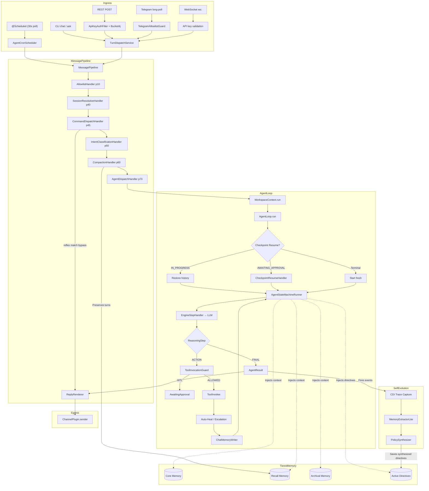

---

## Related Documents

| Document | Purpose |
|---|---|
| [Architecture_Invariants.md](./Architecture_Invariants.md) | Mandatory architecture rules (40+ invariants) |
| [FAQ.md](./FAQ.md) | Architecture Q&A, design rationale, operational guidance |
| [AMSHA_EXTENSION.md](./AMSHA_EXTENSION.md) | Adding tools, personas, reflexes, channels, skills, LLM providers |
| [CONFIGURATION.md](./CONFIGURATION.md) | All environment variables reference |
| [SECURITY.md](./SECURITY.md) | Vault, sandbox, audit chain, 10 guard layers |
| [TESTING_GUIDE.md](./TESTING_GUIDE.md) | REST API testing, regression checklists |
| [TELEGRAM_TESTING.md](./TELEGRAM_TESTING.md) | Telegram bot end-to-end testing |
| [AGENTS.md](../AGENTS.md) | Developer guide for AI coding agents |
