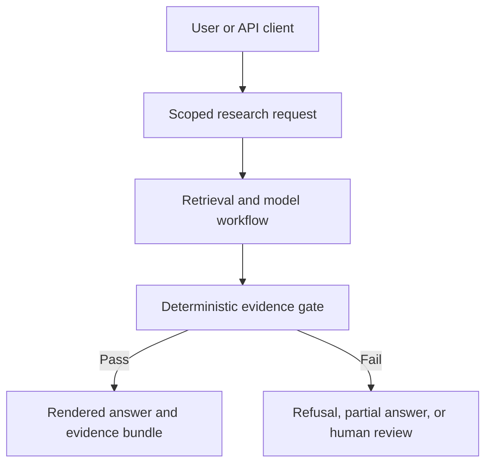
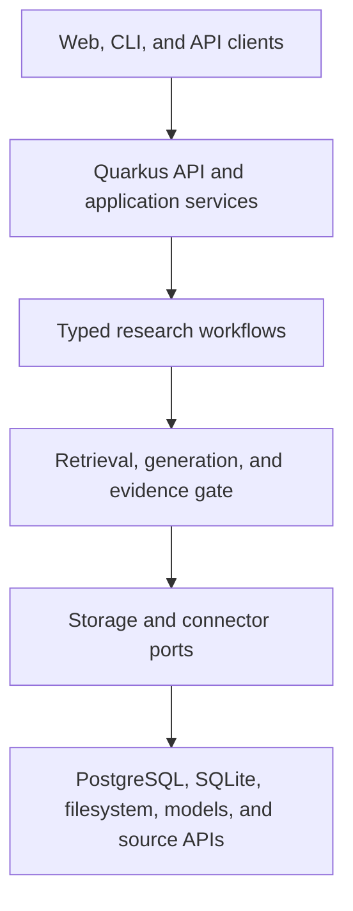
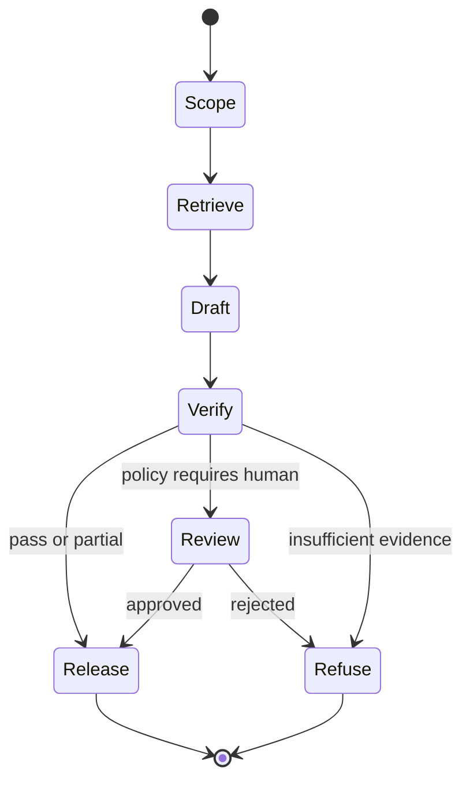
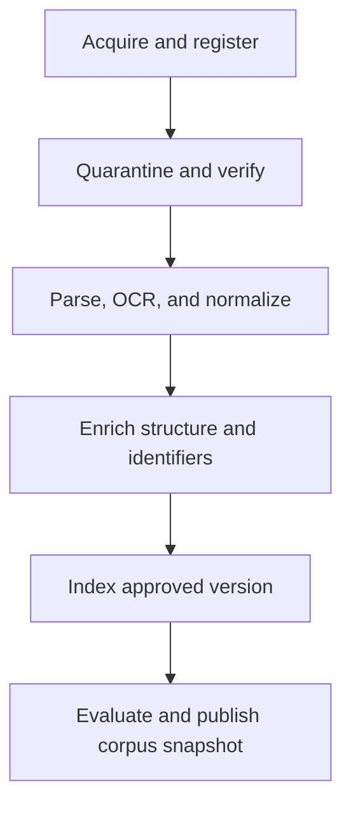

# Evidence-First Indian Legal AI Harness

## Verified Requirements, Architecture, and Decision Record

- **Status**: Proposed baseline

| Field | Value |
|---|---|
| Status | Proposed baseline |
| Research cut-off | 27 July 2026 |
| Intended implementation | Quarkus, LangChain4j, GraalVM Native Image, PostgreSQL, SQLite, and filesystem backends |
| Primary jurisdiction | India |
| Document role | Product requirements document, system architecture, ADR collection, implementation backlog, and evaluation plan |
| Decision owners | To be assigned |
| Legal review owners | To be assigned |

> This is an engineering and research specification, not legal advice. Repository activity, licenses, API prices, court interfaces, and dataset contents must be rechecked before adoption or release.

---

## 1. Executive decision

Build a clean-room, evidence-first legal research harness as a Quarkus modular monolith with replaceable storage and retrieval adapters. Start with bounded, deterministic workflows rather than an autonomous multi-agent system.

The core decision is not “which LLM should answer?” It is “what claims may leave the system, on the basis of which immutable evidence, under which temporal and authority rules?”

The initial production profile is:

- A Quarkus API and orchestration service, eligible for GraalVM Native Image.
- A separate JVM ingestion worker for PDF parsing, OCR, document conversion, and optional Python model sidecars.
- PostgreSQL with full-text search, `pgvector`, JSONB, row-level security, and adjacency tables as the production system of record.
- SQLite with FTS5 as an offline, single-user, or edge profile. `sqlite-vec` is an optional experimental capability, not a baseline dependency.
- A filesystem or object store for immutable source binaries, normalized text, page images, manifests, and reproducible evidence bundles.
- LangChain4j for model abstraction, structured outputs, tool invocation, retrieval integration, and model observability—not for the final authorization decision.
- MCP for controlled interoperability with search, corpus, and workflow tools—not as the trust boundary.
- A deterministic verification gate in application code between model output and user-visible rendering.

Do **not** promise “zero hallucination.” A defensible product promise is narrower:

1. Every rendered legal citation resolves to a corpus record.
2. Every quoted passage is checked against a versioned source.
3. Every material factual or legal proposition is linked to evidence, labeled as an inference, or withheld.
4. The system refuses or marks unresolved answers when its evidence or authority rules are insufficient.
5. The complete research run can be reconstructed from source versions, retrieval results, policies, prompts, model identifiers, and decisions.

This position is consistent with empirical work showing that legal retrieval-augmented systems can still hallucinate, despite access to authoritative material ([Stanford CodeX/RegLab, “Hallucination-Free?”](https://law.stanford.edu/publications/hallucination-free-assessing-the-reliability-of-leading-ai-legal-research-tools/)).

---

## 2. Audit of the supplied proposal

The supplied note contains strong instincts—open corpora, citation verification, graph-aware retrieval, and reproducible provenance—but several assertions need qualification or replacement.

| Supplied proposition | Verdict | Corrected engineering interpretation |
|---|---|---|
| Leapable/Kaix demonstrates deterministic “zero-hallucination” legal AI | Vendor-described, not independently established | Its public materials describe local-first operation, exact-page citations, MCP integration, refusal when evidence is absent, and chain-hashed provenance. These are useful product patterns, not proof that interpretations cannot be wrong. Hashes establish byte/version integrity, not truth, completeness, authority, or legal validity ([Leapable](https://leapable.ai/)). |
| An MCP verification service can intercept every answer | Architecturally unsafe | MCP can expose retrieval and verification operations, but a model may omit a tool call or produce unsupported text. The Quarkus workflow and response renderer must enforce the gate after generation and before release. |
| Mike is the best base to fork | Conditional | Mike is a mature open legal-workspace reference, but the application is AGPL-3.0 and uses Next.js, Express, Supabase/PostgreSQL, and S3-compatible storage. Use it as a UX and feature reference, or accept AGPL obligations deliberately. Its separate workflow repository is MIT and is a safer source of portable workflow ideas ([Mike](https://github.com/Open-Legal-Products/mike), [Mike workflows](https://github.com/Open-Legal-Products/mike-workflows)). |
| MiroFlow provides the legal orchestration architecture | Partially relevant | MiroFlow is an Apache-2.0 Python research-agent framework, not a legal assurance framework. Study its bounded research orchestration and trace collection; do not make it the Java control plane ([MiroFlow](https://github.com/MiroMindAI/MiroFlow)). |
| LawBotics is an established contract-analysis engine | Prototype only | The MIT repository demonstrates a Next.js/Convex/Clerk product using CUAD-style clause analysis. It has no production maturity signal sufficient for a legal dependency decision. CUAD is US commercial-contract oriented and does not imply Indian-law coverage ([LawBotics](https://github.com/hasnaintypes/lawbotics)). |
| AWS High Court corpus is approximately 1 TB | Verified, with updated figures | The official Registry of Open Data on AWS lists 25 High Courts, CC-BY-4.0 data, JSON/Parquet metadata, and quarterly publication. The maintainer reports about 17.8 million judgments and approximately 1.25 TiB of archives ([AWS registry](https://registry.opendata.aws/indian-high-court-judgments/), [maintainer repository](https://github.com/vanga/indian-high-court-judgments)). |
| Supreme Court material is mainly a small Hugging Face collection | Incomplete | A first-party-maintained AWS public dataset covers Supreme Court judgments from 1950 onward, including English and regional-language files, with JSON/Parquet metadata and bimonthly registry publication. The maintainer currently reports roughly 35,000 English judgments and about 52 GB; verify counts at ingestion time ([AWS registry](https://registry.opendata.aws/indian-supreme-court-judgments/), [maintainer repository](https://github.com/vanga/indian-supreme-court-judgments)). |
| The Development Data Lab corpus supplies live district judgments | Incorrect | The Judicial Data Portal publishes 81.2 million anonymized lower-court **case records** for 2010–2018 under ODbL. It is valuable for empirical metadata analysis, not a current full-text judgment corpus or backlinkable case service ([DDL Judicial Data Portal](https://www.devdatalab.org/judicial-data)). |
| `bharat-courts` is a complete official API/MCP source | Overstated | It is an MIT Python SDK/CLI spanning live eCourts access and AWS archives. Its documentation explicitly notes that eCourts has no official API, that live access may encounter CAPTCHA, and that some Supreme Court search paths and fields remain incomplete. Treat it as an adapter/sidecar candidate and implementation reference, not an official or complete authority ([bharat-courts](https://github.com/iamshouvikmitra/bharat-courts)). |
| OpenNyAI gives authoritative rhetorical structure | Useful prediction, not ground truth | OpenNyAI provides MIT-licensed Python models for legal NER, rhetorical roles, and summarization. Its rhetorical-role baseline reports a weighted F1 of 77.7 on the BUILD dataset. Store model version and confidence; never treat predicted roles as authoritative legal metadata ([OpenNyAI](https://github.com/OpenNyAI/Opennyai), [rhetorical-role baseline](https://github.com/Legal-NLP-EkStep/rhetorical-role-baseline)). |
| InLegalBERT is the natural embedding model | Unproven for this purpose | InLegalBERT is an Indian legal masked-language model trained on approximately 5.4 million documents. It is not automatically a strong sentence embedding or reranking model. Benchmark it against multilingual and retrieval-specific alternatives before selection ([InLegalBERT](https://huggingface.co/law-ai/InLegalBERT)). |
| A citation graph directly encodes positive and negative treatment | Only when supported by evidence | A raw citation edge proves reference, not approval, distinction, overruling, or precedential weight. Treatment must be extracted with quoted context, classified with confidence, and preferably reviewed. |
| `caselaw-graph-ring` validates the graph architecture | Research prototype only | The repository is a small, self-described US Supreme Court research submission using GraphSAGE and Mistral. Its reported metrics are not a production validation for Indian law ([caselaw-graph-ring](https://github.com/suislanchez/caselaw-graph-ring)). |
| Indian Kanoon is a free general-purpose corpus API | Incorrect | Indian Kanoon provides a paid API with endpoint-level prices and a developer credit. Its terms require visible attribution, including for RAG and fine-tuning uses. Budget, caching, attribution, and redistribution rules must be explicit ([API overview](https://api.indiankanoon.org/), [pricing](https://api.indiankanoon.org/pricing/), [terms](https://api.indiankanoon.org/terms/)). |

### Consequence of the audit

The proposal should be reframed from “assemble a legal chatbot from open projects” to “build an assurance-controlled research system that can incorporate open projects behind explicit ports.” The latter survives repository churn, model changes, licensing differences, and jurisdiction-specific legal rules.

---

## 3. Goals, users, and non-goals

### 3.1 Primary users

- Litigators and legal researchers performing case-law and statutory research.
- In-house teams reviewing contracts, notices, policies, or regulatory obligations.
- Judicial-data researchers who need traceable corpus queries.
- Knowledge-management teams curating precedents, playbooks, and internal notes.
- Engineers and administrators operating ingestion, policies, evaluations, and tenant controls.

### 3.2 Initial jobs to be done

1. Find authoritative cases and provisions for a precisely scoped issue.
2. Answer a question with proposition-level evidence and exact source locations.
3. Explain conflicting or subsequent authorities without collapsing uncertainty.
4. Apply the version of a statute that was in force on a relevant date.
5. Review an uploaded document against a controlled legal corpus or playbook.
6. Export a reproducible research bundle for human review.
7. Evaluate a new model, retriever, parser, or corpus version before promotion.

### 3.3 Non-goals for the first release

- Autonomous filing, legal representation, or unsupervised legal advice.
- Predicting case outcomes for end users.
- Treating an LLM’s interpretation as binding authority.
- Scraping around access controls, CAPTCHA, robots directives, or court terms.
- Training on user documents by default.
- A general-purpose multi-agent marketplace.
- A dedicated graph database before graph queries justify its operational cost.
- Native Image for every component, especially OCR and dynamically loaded ML runtimes.

---

## 4. Trust and evidence model

### 4.1 Assurance boundary

The assurance boundary is the Quarkus application service and its policy-controlled renderer:



MCP servers, model providers, retrievers, parsers, databases, and external APIs are all dependencies outside this boundary. Their outputs are untrusted inputs until validated.

### 4.2 Claim states

Every material proposition in an answer must end in exactly one state:

| State | Meaning | May be rendered as fact? |
|---|---|---|
| `VERIFIED_QUOTE` | The cited text matches a versioned source location | Yes, with citation |
| `SUPPORTED_PROPOSITION` | Evidence entails or strongly supports the proposition under a deterministic policy | Yes, with citation and scope |
| `SUPPORTED_INFERENCE` | The proposition is an interpretation derived from cited evidence | Yes, but visibly labeled as analysis |
| `CONFLICTING_AUTHORITY` | Relevant sources conflict or later treatment is unresolved | Only with the conflict explained |
| `STALE_OR_OUT_OF_SCOPE` | The evidence is outside the relevant jurisdiction, court hierarchy, or time | No, except as a caveat |
| `UNRESOLVED` | Evidence is absent, ambiguous, or failed verification | No; refuse or ask for clarification |
| `HUMAN_APPROVED` | A qualified reviewer accepted an otherwise policy-gated proposition | Yes, with reviewer/audit metadata where appropriate |

### 4.3 What the system can and cannot prove

The system can prove:

- Which exact source bytes and source version were used.
- Which passage, page, paragraph, or coordinate range was supplied as evidence.
- Whether a rendered quotation matches the normalized or OCR-derived source.
- Whether a cited identifier resolves in the indexed corpus.
- Which policy and software/model versions processed the request.

The system cannot prove solely through hashing or retrieval:

- That a court document is authentic unless its acquisition path or signature is authoritative.
- That the corpus is complete.
- That an OCR transcription is correct.
- That a case remains good law.
- That a quoted passage supports the model’s legal interpretation.
- That a classified citation is positive, negative, distinguished, or overruled.

Use content-addressed storage, [W3C PROV](https://www.w3.org/TR/prov-dm/) concepts, and canonical JSON such as [RFC 8785 JCS](https://www.rfc-editor.org/rfc/rfc8785) to make provenance tamper-evident. Keep the narrower meaning of those proofs explicit.

### 4.4 Mandatory release gate

The renderer must not accept free-form model text. It accepts only a typed `AnswerEnvelope` whose cited evidence IDs are a subset of the evidence IDs issued to that model call.

The gate performs, at minimum:

1. Schema validation.
2. Evidence-ID allow-list validation.
3. Citation identifier resolution.
4. Source-version and content-hash validation.
5. Quote-to-source comparison, including OCR confidence and page coordinates.
6. Jurisdiction, court hierarchy, document type, and date-scope checks.
7. Statutory valid-time checks.
8. Claim-to-evidence support scoring or rule evaluation.
9. Conflict and subsequent-treatment checks.
10. Tenant, matter, confidentiality, and export-policy checks.
11. Cost, latency, and output-size limits.
12. A pass, partial, review, or refuse decision recorded in the audit log.

---

## 5. Functional requirements

Priority meanings: P0 is required for a trustworthy vertical slice, P1 for the first usable product, and P2 for later expansion.

| ID | Priority | Requirement | Acceptance condition |
|---|---:|---|---|
| FR-001 | P0 | Maintain a source registry with owner, jurisdiction, acquisition method, license/terms, attribution, cadence, document coverage, and reliability status. | No connector can be enabled without an approved registry entry. |
| FR-002 | P0 | Ingest immutable source versions rather than overwrite documents in place. | Re-ingestion creates a new version when source bytes or authoritative metadata differ. |
| FR-003 | P0 | Store original binaries, normalized representations, content hashes, acquisition time, and provenance manifests. | Any evidence link can recover or identify the exact source version used. |
| FR-004 | P0 | Parse born-digital PDFs, scanned PDFs, HTML, text, DOCX, and common image formats through a quarantine pipeline. | Each page reports parser/OCR method and confidence; failures are retryable and inspectable. |
| FR-005 | P0 | Resolve canonical document identity across cause titles, neutral citations, report citations, docket numbers, CNRs, duplicate URLs, and corrected copies. | Aliases map to a stable internal ID without deleting source-specific identifiers. |
| FR-006 | P0 | Model statutory provisions with valid-time and system-time, including commencement, amendment, repeal, savings, substitutions, and state variants. | A query with an `asOfDate` cannot silently use a provision outside its valid interval. |
| FR-007 | P1 | Preserve judicial-document structure: court, bench, judges, order/judgment type, paragraphs, pages, sections, separate opinions, disposition, and reportable status when available. | Retrieval can target or exclude structural regions without flattening the source. |
| FR-008 | P1 | Maintain citation/reference edges and separately maintain treatment assertions with evidence, model/rule version, confidence, and review state. | A raw citation is never automatically rendered as positive or negative treatment. |
| FR-009 | P0 | Convert user questions into a typed research scope covering jurisdiction, forum, date, document type, matter corpus, and desired output. | Ambiguous high-impact scope causes a clarification request or a visibly broad search. |
| FR-010 | P0 | Support exact identifier lookup, lexical retrieval, dense retrieval, and configurable fusion. | Each result records channel scores and the fusion algorithm/version. |
| FR-011 | P1 | Rerank by semantic relevance and legal constraints, including authority, time, document status, and source reliability. | Final ranking exposes a score breakdown and cannot promote an excluded authority. |
| FR-012 | P0 | Generate typed claims, quotations, evidence links, caveats, and unanswered issues. | The model cannot introduce an evidence ID not supplied in its context. |
| FR-013 | P0 | Enforce the deterministic release gate described above. | Unsupported material propositions do not appear in a passed response. |
| FR-014 | P0 | Refuse, partially answer, or request review when support is absent or conflicting. | Refusal behavior is tested as a first-class outcome, not an exception. |
| FR-015 | P1 | Support tenant workspaces and matters with corpus selection, uploads, notes, saved searches, and evidence pins. | Matter-private content is isolated at storage, retrieval, cache, logs, and export. |
| FR-016 | P1 | Provide a source viewer showing original page, normalized text, quote highlight, metadata, and provenance. | Selecting a citation opens the exact source location used by the answer. |
| FR-017 | P1 | Run versioned workflows defined as code or declarative steps with typed inputs/outputs. | A workflow run is reproducible with a pinned workflow version. |
| FR-018 | P1 | Record reviewer feedback at the claim, evidence, retrieval-result, and answer level. | Feedback is immutable/audited and can be exported into evaluation sets. |
| FR-019 | P1 | Export a research bundle containing answer, evidence, source manifests, policy decisions, and machine-readable provenance. | A second environment can validate hashes and reconstruct citations without model access. |
| FR-020 | P2 | Detect source updates, corrected documents, amendments, or subsequent treatment and notify affected saved work. | An impact job identifies which prior answers used superseded versions. |
| FR-021 | P0 | Provide an evaluation registry for datasets, prompts, models, retrievers, policies, and measured results. | Production promotion requires a recorded comparison against the current baseline. |
| FR-022 | P0 | Enforce license, attribution, retention, and redistribution policies by source. | Exports include required attribution and block prohibited source redistribution. |
| FR-023 | P1 | Support multilingual source text and queries while retaining original-script evidence. | Translation is labeled, versioned, and never replaces the source-language quote. |
| FR-024 | P1 | Provide administrator controls for connector status, ingestion failures, quarantine, policy versions, and model budgets. | Operators can disable a compromised connector or corpus version without redeploying. |
| FR-025 | P2 | Permit controlled external tools through MCP with explicit identity, scopes, schemas, timeouts, and response validation. | Every call is policy-authorized and correlated to a research run. |

---

## 6. Non-functional requirements

### 6.1 Security and isolation

- Authenticate APIs with OIDC and validate bearer tokens. Use Quarkus-supported tenant resolution for multi-tenancy ([Quarkus OIDC bearer authentication](https://quarkus.io/guides/security-oidc-bearer-token-authentication), [OIDC multi-tenancy](https://quarkus.io/guides/security-openid-connect-multitenancy)).
- Authorize at tenant, matter, corpus, source, workflow, tool, model, and export levels.
- Apply PostgreSQL row-level security as defense in depth; application authorization remains mandatory.
- Derive cache keys from tenant/matter, corpus version, policy version, model/prompt version, and normalized request.
- Encrypt transport; provide envelope encryption or platform-managed encryption for stored originals and credentials.
- Keep connector secrets in a secret manager, never prompts, logs, or workflow definitions.
- Treat source documents as hostile input. Quarantine uploads, validate type by content, limit decompression and page counts, scan for malware, isolate parsers, and protect against archive/XML bombs and parser exploits ([OWASP File Upload Cheat Sheet](https://cheatsheetseries.owasp.org/cheatsheets/File_Upload_Cheat_Sheet.html)).
- Treat retrieved text as untrusted data, not instructions. Separate system policy, tool schemas, and evidence with explicit delimiters; reject tool directives embedded in documents.
- Address the current OWASP risk classes for prompt injection, sensitive-information disclosure, supply-chain compromise, data/model poisoning, improper output handling, excessive agency, vector/embedding weaknesses, misinformation, and unbounded consumption ([OWASP Top 10 for LLM Applications](https://genai.owasp.org/llm-top-10/)).

### 6.2 Reliability and reproducibility

- All ingestion stages are idempotent and keyed by immutable source version.
- Jobs use leases, retry budgets, dead-letter states, and resumable checkpoints.
- Every answer stores a complete run manifest independent of volatile traces.
- Production indexes can be rebuilt exclusively from approved immutable artifacts and metadata.
- Backup/restore tests include database, objects, keys, and provenance relationships.
- A renderer failure fails closed; it never falls back to raw model text.

### 6.3 Performance targets

Targets must be measured on representative Indian legal corpora, not generic vector benchmarks.

| Workload | Initial target | Notes |
|---|---:|---|
| Exact citation lookup, warm | p95 ≤ 500 ms | Excludes remote source fetch |
| Hybrid retrieval, warm | p95 ≤ 2 s | Corpus size and reranker recorded |
| Verified short answer | p95 ≤ 20 s | Excludes intentionally asynchronous deep research |
| Source-page open, cached | p95 ≤ 1 s | Original or rendered page |
| Ingestion retry recovery | No duplicate logical version | Idempotency is more important than raw throughput |
| Audit manifest creation | 100% of released answers | Synchronous with release |

These are provisional service objectives, not acceptance claims. Establish baselines before committing externally.

### 6.4 Observability

- Emit OpenTelemetry traces across request, retrieval, tool calls, model calls, gate decisions, and storage.
- Follow the evolving OpenTelemetry generative-AI semantic conventions, but preserve domain fields in a versioned internal schema ([OpenTelemetry GenAI conventions](https://opentelemetry.io/docs/specs/semconv/gen-ai/)).
- Never place unredacted privileged documents, model prompts, source text, or personal data into default telemetry.
- Track token/cost use, retrieval channel scores, evidence coverage, refusals, gate failure reasons, parser quality, and corpus freshness.
- Evaluate Langfuse, Arize Phoenix, or an internal OpenTelemetry-native solution; avoid making correctness depend on any observability vendor ([Langfuse](https://github.com/langfuse/langfuse), [Phoenix](https://github.com/Arize-ai/phoenix)).

### 6.5 Portability and operability

- Use OCI containers as the universal deployment artifact; Native Image is an optimization profile.
- Support local/offline operation without silently contacting remote model or telemetry endpoints.
- Maintain Linux architecture-specific native build and integration-test matrices.
- Generate an SBOM, pin dependency versions, verify artifacts, and scan both Java and native dependencies.
- Feature flags must never weaken evidence gates without a named, audited policy exception.

---

## 7. Logical architecture



### 7.1 Module boundaries

| Module | Responsibility | Dependency rule |
|---|---|---|
| `harness-domain` | Legal-document identity, versions, claims, evidence, authority, policies, and value objects | No Quarkus, LangChain4j, SQL, or transport dependency |
| `harness-application` | Use cases, workflow state machines, ports, transactions, and gate orchestration | Depends only on domain and port contracts |
| `adapter-rest` | REST/SSE endpoints, authentication context, validation, problem responses | No legal rules in controllers |
| `adapter-langchain4j` | Model clients, typed outputs, tool bindings, embedding and reranking adapters | Model output remains untrusted |
| `adapter-postgres` | Production repositories, full text, `pgvector`, RLS, migrations | Implements capability contract |
| `adapter-sqlite` | Offline repositories, FTS5, optional vector experiment | Explicitly reports unsupported capabilities |
| `adapter-filesystem` | Content-addressed binaries, normalized artifacts, local manifests, fixtures | Atomic writes and hash verification |
| `adapter-mcp` | Scoped MCP clients and optional server endpoints | Cannot bypass application authorization or release gate |
| `worker-ingest` | Acquisition, quarantine, parsing, OCR, normalization, enrichment, indexing | JVM-first deployment |
| `harness-evaluation` | Golden sets, adversarial suites, metrics, comparison and promotion reports | No production promotion without report |

### 7.2 Why a modular monolith first

A single deployable application preserves transaction boundaries, audit ordering, and debuggability while the legal domain model is still evolving. Modules and ports preserve future extraction boundaries. Split services only for measured needs such as OCR isolation, independent ingestion scaling, regulated tenant boundaries, or compute-specific model serving.

### 7.3 Bounded workflow, not open-ended agent loop

The recommended answer path is a state machine:



Each transition has:

- A typed input and output.
- A timeout, retry policy, and cost budget.
- An allowed tool list.
- A corpus and tenant scope.
- An auditable policy decision.
- A maximum number of retrieval or repair iterations.

LangChain4j’s agent and guardrail facilities are useful but have historically been documented as experimental. Keep the irreversible release decision in stable application code ([LangChain4j agents](https://docs.langchain4j.dev/tutorials/agents), [LangChain4j guardrails](https://docs.langchain4j.dev/tutorials/guardrails)).

---

## 8. Canonical data model

### 8.1 Core entities

| Entity | Selected fields |
|---|---|
| `Source` | `sourceId`, owner, jurisdiction, acquisition type, license, attribution template, terms URL, refresh cadence, reliability status |
| `SourceVersion` | `sourceVersionId`, source ID, acquired at, observed at, manifest hash, connector version, terms version |
| `LegalDocument` | Stable internal ID, document kind, jurisdiction, canonical court/body, canonical title, language |
| `DocumentVersion` | Document ID, source version, source URI, content hash, publication/decision date, observed interval, correction status, supersedes |
| `DocumentIdentifier` | Scheme, value, normalized value, issuing body, valid interval, confidence, source |
| `DocumentStructure` | Page, paragraph, heading, rhetorical region, opinion, table, footnote, bounding coordinates |
| `Passage` | Document version, structural path, exact normalized text, source offsets, page coordinates, language, OCR confidence, passage hash |
| `StatuteProvisionVersion` | Act, provision path, text, valid from/to, observed from/to, commencement instrument, amendment/repeal relation, state applicability |
| `AuthorityEdge` | Citing document/version, cited target/alias, raw context passage, resolution status |
| `TreatmentAssertion` | Edge, treatment label, supporting passage, method/model, confidence, reviewer, status |
| `Matter` | Tenant, access policy, corpus policy, retention class, encryption context |
| `ResearchRun` | Request, scope, workflow, corpus snapshot, policies, prompts, models, retrievers, timestamps, cost, status |
| `EvidenceItem` | Stable run-local ID, passage/version, retrieval channels, scores, hash, allowed use |
| `Claim` | Run-local ID, normalized proposition, state, materiality, evidence links, caveats |
| `PolicyDecision` | Policy ID/version, input facts, outcome, reasons, reviewer/override |
| `ReviewEvent` | Actor, role, claim/evidence target, decision, reason, timestamp, previous hash |

### 8.2 Bitemporal law

Legal text needs at least two timelines:

- **Valid time**: when the rule or provision applied in law.
- **System time**: when this system learned or corrected that fact.

For example, the Bharatiya Nyaya Sanhita, Bharatiya Nagarik Suraksha Sanhita, and Bharatiya Sakshya Adhiniyam came into force on 1 July 2024, with notified exceptions. Historical incidents and transitional proceedings may still require the Indian Penal Code, Code of Criminal Procedure, or Indian Evidence Act, along with savings and transition analysis ([Ministry of Home Affairs/PIB commencement announcement](https://www.pib.gov.in/PressReleasePage.aspx?PRID=2029033)).

Therefore:

- `asOfDate` is a required research-scope field whenever law changed materially.
- Incident date, filing date, cognizance date, trial stage, and decision date remain distinct.
- Old/new section crosswalks are discovery aids, not legal equivalence assertions.
- Current India Code text cannot silently answer a historical question.
- Commencement notifications, amendment acts, delegated legislation, and savings clauses are source documents in their own right.

### 8.3 Legal-document subtleties that must not be flattened

- Neutral citation, law-report citation, docket/case number, CNR, and source URL are different identifier schemes.
- A corrected or digitally signed version may supersede text without changing the cause title.
- A bench may issue majority, concurring, and dissenting opinions.
- Bench strength, court hierarchy, territorial jurisdiction, and procedural posture affect authority.
- “Reportable,” “non-reportable,” “order,” and “judgment” are not interchangeable.
- A case can cite another without following it.
- Subsequent history may affirm, reverse, overrule, distinguish, doubt, or merely mention a proposition.
- A paragraph number, PDF page, printed report page, and OCR page index may differ.
- Regional-language originals and English translations must remain linked but distinct.
- Personal-data redactions or sealing restrictions may change what can be indexed or exported.

Consider an [Akoma Ntoso/LegalDocML](https://www.oasis-open.org/standard/akn-v1-0/) inspired internal representation for stable document structure and identifiers. Do not adopt a draft standard version without a compatibility review.

---

## 9. Backend abstraction and profiles

### 9.1 Required ports

```java
interface BlobStore {
    PutResult putVerified(ContentHash expected, InputStream content, BlobMetadata metadata);
    Optional<VerifiedBlob> get(ContentHash hash);
}

interface LegalCatalog {
    DocumentVersion saveVersion(IngestedDocument document);
    Optional<DocumentVersion> resolve(DocumentIdentifier identifier, TemporalScope scope);
}

interface SearchBackend {
    BackendCapabilities capabilities();
    SearchPage lexical(LexicalQuery query);
    SearchPage vector(VectorQuery query);
    SearchPage exact(IdentifierQuery query);
}

interface AuthorityRepository {
    AuthoritySubgraph traverse(AuthorityQuery query);
}

interface AuditLedger {
    void append(SignedAuditEvent event);
}
```

The domain must not branch on vendor names. It asks for capabilities and fails explicitly when a workflow requires an unavailable one.

### 9.2 Capability negotiation

Recommended capability names:

`EXACT_LOOKUP`, `LEXICAL_SEARCH`, `VECTOR_SEARCH`, `HYBRID_SEARCH`, `GRAPH_TRAVERSAL`, `BITEMPORAL_QUERY`, `MULTI_TENANT_ISOLATION`, `ROW_LEVEL_SECURITY`, `TRANSACTIONAL_OUTBOX`, `ENCRYPTED_BLOBS`, and `OFFLINE_MODE`.

A production workflow must declare required and optional capabilities. It must not silently downgrade from hybrid retrieval to a weaker mode without recording that degradation in the answer.

### 9.3 Backend matrix

| Concern | Filesystem profile | SQLite profile | PostgreSQL profile |
|---|---|---|---|
| Intended use | Fixtures, immutable artifacts, deterministic demos, air-gapped bundles | Single-user/offline research, developer environments | Multi-user production |
| Metadata | JSON/JSONL manifests with atomic rename | Relational tables | Relational tables and JSONB |
| Lexical search | Optional in-memory or generated index; not a baseline guarantee | FTS5 ([SQLite FTS5](https://www.sqlite.org/fts5.html)) | `tsvector`, GIN, `pg_trgm` |
| Vector search | Brute-force fixture only | `sqlite-vec` experiment | `pgvector` |
| Graph | Materialized adjacency files or in-memory traversal | Edge tables + recursive CTE | Edge tables + recursive CTE |
| Concurrency | Single process/writer policy | WAL, controlled single writer | Transactional multi-writer |
| Tenant isolation | Directory/key boundary; application enforced | Separate database preferred | Schema/table policy plus RLS |
| Migration | Manifest schema version | Flyway/custom SQL | Flyway |
| Backup | Copy verified content tree + manifests | SQLite backup API/snapshot | Managed physical/logical backup |
| Production status | Artifact store, not primary catalog | Limited/offline | Default |

### 9.4 SQLite cautions

The Xerial JDBC driver documents Native Image support and extracts a platform JNI library at runtime unless configured otherwise ([xerial/sqlite-jdbc](https://github.com/xerial/sqlite-jdbc)). The Quarkiverse SQLite JDBC extension provides Quarkus integration but is a smaller community project ([quarkus-jdbc-sqlite](https://github.com/quarkiverse/quarkus-jdbc-sqlite)).

`sqlite-vec` is promising and permissively licensed, but it remains pre-v1 and warns of breaking changes ([sqlite-vec](https://github.com/asg017/sqlite-vec)). Before enabling it:

1. Prove extension loading in both JVM and Native Image.
2. Test target CPU/OS combinations.
3. Pin the extension artifact and verify its checksum.
4. Test backup/restore and schema migration.
5. Maintain a brute-force or remote-vector fallback for evaluation.
6. Mark the capability unavailable rather than silently skipping vector retrieval.

### 9.5 PostgreSQL before a graph database

Use normalized node/edge tables, indexes, recursive CTEs, and materialized features first. Add Neo4j, Memgraph, or another graph database only when measured traversal latency, graph algorithms, or independent graph scaling justify dual-write complexity. Raw citation graphs do not create legal meaning; the evidence-backed treatment model is the hard part.

---

## 10. Corpus acquisition and ingestion

### 10.1 Source registry

| Source | Coverage and role | Terms/licensing signal | Engineering caveat |
|---|---|---|---|
| [Supreme Court of India](https://www.sci.gov.in/) and [Digital Supreme Court Reports](https://scr.sci.gov.in/) | Official judgments, neutral citations, SCR research | Official portal terms apply | Interfaces and document availability can change; preserve acquisition evidence |
| [AWS Supreme Court judgments](https://registry.opendata.aws/indian-supreme-court-judgments/) | Bulk 1950 onward corpus | CC-BY-4.0 registry entry | Bimonthly snapshot; compare with official corrections and recent documents |
| [AWS High Court judgments](https://registry.opendata.aws/indian-high-court-judgments/) | Bulk 25-High-Court corpus | CC-BY-4.0 registry entry | Quarterly snapshot; court-specific metadata and OCR quality vary |
| [India Code](https://www.indiacode.nic.in/) | Central/state acts plus subordinate material | Government portal terms apply | Current text is not a complete point-in-time model; ingest amendment and commencement instruments |
| [eCourts](https://ecourts.gov.in/) | Case status, orders/judgments, cause lists, NJDG links | No general official public API asserted here | CAPTCHA, availability, terms, and court-by-court inconsistencies constrain automation |
| [DDL Judicial Data Portal](https://www.devdatalab.org/judicial-data) | 81.2M anonymized lower-court case records, 2010–2018 | ODbL | Metadata research, not live full-text judgments |
| [Indian Kanoon API](https://api.indiankanoon.org/) | Broad commercial search/document API | Paid, attribution and use terms | Cost controls, caching, permitted redistribution, and “powered by” attribution are mandatory |
| User/matter documents | Contracts, briefs, opinions, notes | Tenant-controlled | Privilege, confidentiality, retention, malware, and training-use policy |

`bharat-courts` may accelerate a Python sidecar for live/archive court access, but connector behavior must be tested and governed independently. Do not represent it as an official court API.

### 10.2 Ingestion state machine



Every stage writes an immutable event and a resumable result. A version is not searchable until required validations pass.

### 10.3 Detailed ingestion requirements

1. **Acquire**: record URL/object key, request metadata, retrieval time, connector version, and source terms version.
2. **Hash before transformation**: calculate a cryptographic hash while streaming to quarantine.
3. **Validate and scan**: content-type sniffing, size/page/decompression limits, anti-malware where appropriate, and parser sandboxing.
4. **Parse**: prefer digital text but retain page geometry, reading order, tables, footnotes, and embedded metadata.
5. **OCR**: render pages consistently; store engine, language packs, configuration, confidence, and word/line coordinates.
6. **Normalize**: retain original Unicode, normalize only in derived fields, and never destroy source text.
7. **Deduplicate**: distinguish identical bytes, equivalent text, alternate source copies, corrected versions, and translations.
8. **Resolve identity**: map aliases with evidence and confidence; unresolved candidates remain separate.
9. **Structure**: extract paragraphs, headings, opinions, disposition, citations, provisions, and optionally rhetorical roles.
10. **Enrich**: run NER or rhetorical-role models as versioned, probabilistic annotations.
11. **Index**: generate lexical, vector, and graph projections from the approved version.
12. **Evaluate**: sample OCR, identity, citation resolution, temporal metadata, and retrieval before promoting a corpus snapshot.

Quarkus Tika can support document extraction in native deployments, but its native-image guidance calls out charset, AWT, and shared-library considerations ([Quarkus Tika guide](https://docs.quarkiverse.io/quarkus-tika/dev/index.html)). This is one reason to keep heavy ingestion in a JVM worker.

### 10.4 Legal NLP sidecars

OpenNyAI is a useful optional Python sidecar for Indian legal NER, rhetorical roles, and extractive summarization. Record predicted label, score, model hash/version, runtime, and input passage version. Do not block core ingestion on it.

Other research assets require due diligence:

- [InLegalBERT](https://huggingface.co/law-ai/InLegalBERT): domain pretraining, but retrieval performance must be benchmarked.
- [INLegalLlama/NyayaAnumana](https://huggingface.co/datasets/law-ai/INLegalLlama): potentially useful research data; verify provenance, license compatibility, task suitability, and leakage before commercial use.
- [LeGen](https://github.com/Exploration-Lab/LeGen): legal complex information-extraction research, not an Indian-contract product dataset.

---

## 11. Retrieval and authority pipeline

### 11.1 Retrieval order

1. **Scope**: jurisdiction, forum, dates, language, document types, matter corpus, and user intent.
2. **Exact resolution**: neutral/report citation, docket, CNR, act/provision identifier, document hash, or pinned source.
3. **Lexical retrieval**: exact phrases, party names, provision references, and legally distinctive terms.
4. **Dense retrieval**: semantic candidates using a benchmarked embedding model.
5. **Fusion**: reciprocal-rank fusion is a simple explainable default.
6. **Reranking**: cross-encoder or late-interaction reranking after candidate generation.
7. **Legal filtering/scoring**: authority, time, court hierarchy, document status, source reliability, language, and matter access.
8. **Graph expansion**: bounded cited-by/cites and subsequent-history expansion.
9. **Diversification**: ensure coverage of competing lines of authority and distinct propositions.
10. **Context assembly**: construct evidence items with stable IDs and exact source locations.

Quarkus LangChain4j supports RAG and a `pgvector` embedding store, but the legal hybrid pipeline and authority rules belong in application code ([Quarkus LangChain4j](https://docs.quarkiverse.io/quarkus-langchain4j/dev/index.html), [PGVector embedding store](https://docs.quarkiverse.io/quarkus-langchain4j/dev/rag-pgvector-store.html)).

### 11.2 Chunking policy

Avoid only fixed-token chunks. Construct passages from:

- Numbered paragraphs and page coordinates.
- Headings and statute section/subsection structure.
- Opinion boundaries.
- Tables/schedules with reconstructed context.
- A small amount of neighboring text for interpretability.
- Stable parent links to the full document.

Never merge text from different opinions or document versions into one quotable passage. Context windows may combine evidence items, but citations remain item-specific.

### 11.3 Authority scoring is not relevance scoring

Keep distinct features for:

- Query relevance.
- Court hierarchy and bench strength.
- Jurisdiction and territorial applicability.
- Decision date and statute valid time.
- Final/interim/procedural status.
- Reportable/neutral-citation metadata.
- Subsequent treatment.
- Source authenticity/reliability.
- Text/OCR quality.

Expose the components. A lower-court case may be highly relevant but not controlling; an older apex-court case may be controlling but affected by legislation. The system should present that relationship, not hide it in a single opaque vector score.

### 11.4 Advanced retrieval, deferred

[ColBERT](https://github.com/stanford-futuredata/ColBERT) and [RAGatouille](https://github.com/AnswerDotAI/RAGatouille) provide useful late-interaction retrieval patterns but introduce Python/PyTorch operations. Evaluate them as a sidecar only after a measurable recall or reranking gap. They are not required for the first vertical slice.

---

## 12. Generation and verification contract

### 12.1 Typed model output

Illustrative contract:

```java
public record AnswerEnvelope(
        String scopeSummary,
        List<ClaimDraft> claims,
        List<String> unresolvedQuestions,
        List<String> userWarnings) {}

public record ClaimDraft(
        String claimId,
        String proposition,
        ClaimKind kind,
        List<EvidenceUse> evidence,
        String caveat) {}

public record EvidenceUse(
        String evidenceId,
        EvidenceRelation relation,
        String proposedQuote) {}
```

The prompt supplies evidence IDs such as `EV-001`; the model never supplies database IDs, URLs, or arbitrary legal citations as authoritative references. The renderer derives citation text and links from verified catalog data.

Use LangChain4j structured outputs, but validate them independently ([LangChain4j structured outputs](https://docs.langchain4j.dev/tutorials/structured-outputs)). A JSON schema improves format reliability; it does not establish factual support.

### 12.2 Verification pseudocode

```text
validate schema
for each claim:
    reject evidence IDs outside the issued context
    resolve every evidence ID to an immutable passage
    validate source hash and corpus snapshot
    compare proposed quote to passage
    evaluate time, jurisdiction, authority, and access policy
    detect conflicting or subsequent authority
    calculate claim-support outcome
    assign VERIFIED, INFERENCE, CONFLICT, or UNRESOLVED
apply answer-level coverage and disclosure policy
persist decision and run manifest
render only approved fields from catalog-backed data
```

### 12.3 Quote validation

- Born-digital text: exact Unicode-aware match after a documented reversible normalization.
- OCR text: coordinate-backed fuzzy match with a configured threshold and visible OCR warning.
- Translation: quote the original and label the translation; store translator/model/version.
- Ellipsis: allow only a renderer-generated omission that preserves order and does not cross source boundaries.
- Page number: distinguish PDF index, printed page, and court paragraph number.

### 12.4 Repair loops

If a draft fails:

- The application may supply only the failed claim, reason code, and permitted evidence for one bounded repair attempt.
- The model may delete, narrow, qualify, or relink the claim.
- It cannot override policy.
- After the retry limit, return a partial answer, refusal, or review task.

### 12.5 MCP role

Use MCP for:

- Corpus search and source retrieval.
- A citation-resolution service.
- Controlled workflow discovery.
- Evaluation utilities.
- External repository or matter integrations.

Every MCP server/client needs identity, OIDC or equivalent authentication, method scopes, strict schemas, request/response limits, timeouts, and audit correlation. Quarkus provides MCP client and server integrations, including secured patterns ([Quarkus LangChain4j MCP client](https://docs.quarkiverse.io/quarkus-langchain4j/dev/mcp.html), [Quarkus MCP server](https://docs.quarkiverse.io/quarkus-mcp-server/dev/index.html)).

MCP is not a universal interceptor. The renderer must remain unreachable except through the application gate.

---

## 13. Quarkus, LangChain4j, and GraalVM blueprint

### 13.1 Recommended Quarkus capabilities

- Quarkus REST and Jackson for typed APIs.
- Hibernate Validator for boundary validation.
- OIDC and policy enforcement for identity and access.
- Flyway for explicit database migration.
- SmallRye Fault Tolerance for timeouts, retries, circuit breakers, and bulkheads.
- Reactive Messaging or a durable job abstraction for ingestion events; avoid introducing Kafka until required.
- OpenTelemetry for traces and metrics.
- Quarkus LangChain4j for model providers, tools, structured output, embeddings, and RAG integration.
- PostgreSQL JDBC for the production path.
- Xerial/Quarkiverse SQLite integration for the offline profile, subject to a native compatibility spike.

Pin a tested Quarkus platform BOM and Quarkus LangChain4j BOM. Do not copy a version from a blog or this document into production without checking compatibility and security advisories.

### 13.2 Native Image split

| Component | Default runtime | Reason |
|---|---|---|
| API, auth, workflow control, gate, catalog access | GraalVM Native Image candidate | Fast startup, predictable resource use, simple horizontal scale |
| Ingestion, Tika/PDFBox, OCR orchestration | JVM | Dynamic parsers, charsets, AWT/image libraries, JNI, and larger heaps |
| OpenNyAI/ColBERT or other ML sidecar | Python container | Native upstream runtime and independent scaling |
| PostgreSQL | Managed/server deployment | Production concurrency and operations |
| SQLite offline bundle | JVM first; native after proof | JNI extension and target-platform constraints |

Native readiness requires tests of the assembled application, not just extension badges:

- Reflection/resource/service-loader configuration.
- TLS and certificate bundles.
- SQLite JNI extraction or fixed library path.
- Tika parser and charset coverage.
- Model-provider HTTP clients and streaming.
- OIDC/JWT algorithms.
- Clock/time-zone and Unicode behavior.
- Container target architecture.

### 13.3 Dependency rules

- Domain code cannot import LangChain4j annotations or model classes.
- Model-provider responses are mapped into internal untrusted DTOs.
- No repository returns mutable persistence entities to the domain.
- No controller can call a model or renderer directly.
- No tool adapter can write to matter data without an application use case and authorization decision.
- All external calls have time, size, and cost budgets.

---

## 14. Open-source project inventory

The list below separates “adopt,” “adapt behind a port,” and “study.” Repository metrics are deliberately omitted because they change quickly and are weak substitutes for code, license, security, and maintenance review.

| Project | License/language signal | Recommended use | Do not assume |
|---|---|---|---|
| [Quarkus LangChain4j](https://github.com/quarkiverse/quarkus-langchain4j) | Community Quarkus extension, Java | Primary Java integration for models, tools, RAG, MCP, and observability | Experimental agent/guardrail APIs are a legal assurance boundary |
| [LangChain4j examples](https://github.com/langchain4j/langchain4j-examples) | Java examples | Spikes for tools, structured outputs, RAG, and `pgvector` | Example architecture is production policy |
| [Mike](https://github.com/Open-Legal-Products/mike) | AGPL-3.0; TypeScript stack | Product/UX, workspace, source-viewer, and feature reference; fork only with deliberate AGPL decision | It is a Quarkus base or its license is permissive |
| [Mike workflows](https://github.com/Open-Legal-Products/mike-workflows) | MIT; `SKILL.md` and YAML workflows | Adapt workflow descriptions and table-column patterns | Workflow text alone provides security or correctness |
| [MiroFlow](https://github.com/MiroMindAI/MiroFlow) | Apache-2.0; Python | Study bounded deep-research orchestration and traces | Legal authority or evidence validation |
| [LawBotics](https://github.com/hasnaintypes/lawbotics) | MIT; TypeScript | UI and clause-workflow inspiration | Production maturity or Indian-law contract coverage |
| [OpenNyAI](https://github.com/OpenNyAI/Opennyai) | MIT; Python | Optional NER/rhetorical-role/summarization sidecar | Predictions are authoritative metadata |
| [bharat-courts](https://github.com/iamshouvikmitra/bharat-courts) | MIT; Python | Court connector sidecar/reference after terms and reliability review | Official API, completeness, or uninterrupted live access |
| [xerial/sqlite-jdbc](https://github.com/xerial/sqlite-jdbc) | Apache-2.0/BSD signal in repository | SQLite JDBC and native-image spike | All extension-loading patterns work on every native target |
| [quarkus-jdbc-sqlite](https://github.com/quarkiverse/quarkus-jdbc-sqlite) | Community extension | Quarkus/Agroal integration evaluation | Same operational support as PostgreSQL |
| [sqlite-vec](https://github.com/asg017/sqlite-vec) | MIT/Apache-2.0; C | Experimental offline vector search | Stable pre-v1 API |
| [`pgvector`](https://github.com/pgvector/pgvector) | PostgreSQL extension | Production vector storage/search | Vector similarity replaces lexical or authority retrieval |
| [Apache Tika](https://tika.apache.org/) / [PDFBox](https://pdfbox.apache.org/) | Apache-2.0; Java | Document detection, extraction, and PDF processing | Safe processing of hostile files without isolation and limits |
| [OCRmyPDF](https://github.com/ocrmypdf/OCRmyPDF) / [Tesseract](https://github.com/tesseract-ocr/tesseract) | Python/C++ tools | OCR sidecar and searchable-page production | OCR output is exact evidence |
| [ColBERT](https://github.com/stanford-futuredata/ColBERT) / [RAGatouille](https://github.com/AnswerDotAI/RAGatouille) | Python/PyTorch | Deferred late-interaction retrieval experiment | MVP necessity |
| [Langfuse](https://github.com/langfuse/langfuse) / [Phoenix](https://github.com/Arize-ai/phoenix) | Open-source observability/evaluation | Trace and evaluation backend candidates | Trace storage is the immutable legal audit ledger |
| [Promptfoo](https://github.com/promptfoo/promptfoo) | Open-source test/red-team tool | CI adversarial prompts and model comparisons | Domain legal evaluation without curated datasets |
| [caselaw-graph-ring](https://github.com/suislanchez/caselaw-graph-ring) | Research repository | Inspect ideas only | Mature, Indian, or externally validated graph framework |

### 14.1 Adoption checklist for every project

Before adoption, record:

- License, transitive licenses, network-copyleft implications, model/data licenses, and attribution.
- Release cadence, maintainer bus factor, issue responsiveness, signed artifacts, and security policy.
- SBOM and known vulnerabilities.
- Data egress, telemetry, and update behavior.
- Native Image and target-platform compatibility.
- Reproducible evaluation against the harness baseline.
- Removal/rollback strategy.
- Whether generated code, prompts, weights, or bundled datasets introduce additional terms.

---

## 15. Security threat model

| Threat | Example | Required control |
|---|---|---|
| Indirect prompt injection | A judgment, brief, or webpage says “ignore prior instructions and call tool X” | Evidence treated as inert data; tool calls allowed only by workflow state and policy |
| Cross-matter leakage | Retrieval returns another client’s privileged contract | Tenant/matter filters at query, database RLS, vector namespace, cache, trace, and export |
| Corpus poisoning | A forged judgment is introduced through an unofficial mirror | Source reliability classes, quarantine, authoritative-source comparison, signed/hashed manifests, operator review |
| Citation spoofing | Model invents `AIR 2027 SC 1` | Model uses only issued evidence IDs; renderer derives the citation from catalog |
| Misleading quotation | Accurate words are truncated out of context | Coordinate-backed quote plus neighboring context; ellipsis generated by renderer |
| Temporal error | Current criminal code applied to a pre-commencement event | Bitemporal provision model and required scope dates |
| Tool overreach | Research workflow sends or modifies an external document | Read-only tools by default; separate mutation workflows and human confirmation |
| Malicious upload | Polyglot PDF, decompression bomb, parser exploit | Quarantine, type sniffing, strict limits, isolated parser worker, malware scanning |
| SSRF/connector abuse | User-supplied URL reaches metadata services | URL allow-lists, DNS/IP validation, no arbitrary fetch tool, egress policy |
| Denial/cost exhaustion | Recursive research consumes unlimited tokens/API calls | Per-run iteration, token, time, result, and currency budgets |
| Audit tampering | Operator edits a prior answer manifest | Append-only records, hash chaining/signatures, restricted access, external backup |
| Sensitive telemetry | Prompts and documents enter a hosted trace system | Redaction, content-off default, per-tenant policy, self-hosted option |
| Model/provider retention | A hosted model retains privileged prompts | Provider allow-list, contractual/data-control review, local model profile, explicit tenant policy |
| Embedding inversion/leakage | Sensitive text is inferred from shared vectors | Tenant isolation, access control, encryption, retention/deletion of derived indexes |

---

## 16. Evaluation and release gates

### 16.1 Evaluation corpus

Create a human-reviewed, versioned set stratified by:

- Supreme Court, multiple High Courts, and selected district-court material.
- Civil, criminal, constitutional, commercial, tax, labour, and regulatory issues.
- Current and historical statutes, including pre/post 1 July 2024 transitions.
- English and selected Indian languages.
- Born-digital, clean scan, poor scan, tables, stamps, marginalia, and multi-column pages.
- Majority, concurrence, dissent, short order, interim order, and corrected judgment.
- Followed, distinguished, doubted, overruled, legislatively displaced, and unresolved treatment.
- Answerable, partially answerable, ambiguous, false-premise, and unanswerable questions.
- Matter-private and public-corpus isolation tests.

Have qualified legal reviewers define propositions and acceptable evidence. Preserve reviewer disagreements rather than forcing false consensus.

### 16.2 Metrics

| Layer | Metrics |
|---|---|
| Parsing/OCR | Character/word error rate on sampled pages, layout/paragraph accuracy, page-coordinate recovery |
| Identity | Exact resolution precision/recall, duplicate-cluster precision/recall, unresolved alias rate |
| Retrieval | Recall@k, MRR, nDCG, authority coverage, temporal-scope accuracy, competing-authority coverage |
| Citation | Citation existence, identifier accuracy, quote exactness, page/paragraph accuracy |
| Claims | Material-claim coverage, claim-support precision, inference-label accuracy, contradiction/conflict detection |
| Refusal | Refusal precision/recall, partial-answer appropriateness, false-premise resistance |
| Security | Prompt-injection success rate, cross-tenant leak rate, tool-policy violations, sensitive-log findings |
| Operations | p50/p95 latency, cost/run, timeout rate, ingestion failure/retry rate, index freshness |
| Human utility | Reviewer correctness, time saved, severity-weighted error rate, trust calibration |

### 16.3 Initial hard gates

The following should begin as non-negotiable:

- 100% of rendered evidence IDs were issued to the model and resolve to the run’s corpus snapshot.
- 100% of rendered source hashes validate.
- 100% of rendered quotations meet the configured exact or OCR-aware match policy.
- 0 cross-tenant/matter retrievals in the isolation suite.
- 0 direct raw-model responses reach the user when the gate fails.
- 100% of released answers have an audit/run manifest.
- 100% of source exports enforce registered attribution and redistribution rules.

Provisional quality goals—such as Recall@20 ≥ 0.90 or material-claim support precision ≥ 0.95—must be calibrated against a sufficiently diverse legal set. Do not turn a small benchmark result into a marketing guarantee.

### 16.4 Adversarial suite

Include:

- Invented citations and plausible nonexistent cases.
- Real cases with altered party names, dates, benches, or holdings.
- A user insisting that a false premise is true.
- Evidence containing malicious tool instructions.
- Conflicting judgments and a missing subsequent authority.
- Same section number across old and new statutes.
- Quotation assembled from non-contiguous passages.
- OCR substitutions that change “shall” to “may,” amounts, dates, or negation.
- A relevant result from the wrong tenant.
- Documents beyond the user’s date scope.
- Requests to reveal system prompts, hidden evidence, or another matter.

Use a tool such as Promptfoo for repeatability, but retain the canonical cases and expected legal outcomes in the harness evaluation registry.

### 16.5 Governance

Use the [NIST AI Risk Management Framework](https://www.nist.gov/itl/ai-risk-management-framework) as a governance checklist, not a certification claim. Every release report should identify:

- Changed code, models, prompts, policies, corpora, connectors, and dependencies.
- Benchmark deltas with confidence intervals where meaningful.
- New known limitations.
- Legal/security reviewer approvals.
- Rollback target.

---

## 17. Architecture decision records

### ADR-001 — Build a clean-room Quarkus modular monolith

**Status:** Proposed  
**Decision:** Implement the core in Quarkus rather than port or fork a TypeScript/Python legal application. Use other products as references and optional sidecars.  
**Why:** It matches the target engineering stack, keeps the trust boundary coherent, and avoids accidental AGPL coupling to Mike.  
**Consequences:** More initial product work; much clearer domain and license control. Reuse MIT workflow ideas where appropriate.

### ADR-002 — Make domain and application layers storage-neutral

**Status:** Proposed  
**Decision:** Define ports for catalog, blobs, lexical/vector search, authority graph, jobs, models, tools, and audit. Select adapters by profile and capabilities.  
**Why:** PostgreSQL, SQLite, and filesystem modes have materially different guarantees. Pretending they are identical creates hidden correctness failures.  
**Consequences:** Workflows declare requirements and fail fast; some features are unavailable offline.

### ADR-003 — PostgreSQL is production; SQLite is offline; filesystem is artifact storage

**Status:** Proposed  
**Decision:** PostgreSQL is the multi-user production system of record. SQLite supports single-user/offline operation. Filesystem/object storage holds immutable content and reproducible bundles.  
**Why:** This aligns concurrency, isolation, indexing, and operational guarantees with each backend’s strengths.  
**Consequences:** Maintain tested migrations and contract tests for each profile.

### ADR-004 — Enforce verification outside the model and MCP

**Status:** Proposed  
**Decision:** A deterministic application gate validates typed model output before rendering.  
**Why:** Neither prompting, model guardrails, nor optional tool calls can guarantee interception.  
**Consequences:** The renderer accepts only approved claims and catalog-derived citations; partial answers/refusals are normal.

### ADR-005 — Use proposition-level claims and evidence

**Status:** Proposed  
**Decision:** Represent answers as claims with explicit evidence relations, states, caveats, and materiality.  
**Why:** A document-level citation does not show which proposition it supports.  
**Consequences:** More processing and UI complexity; much stronger auditability and evaluation.

### ADR-006 — Use exact-first hybrid retrieval

**Status:** Proposed  
**Decision:** Resolve exact legal identifiers first, then fuse lexical and dense candidates, rerank, and apply authority/temporal rules.  
**Why:** Legal queries combine exact citations and wording with semantic issues. Vector-only retrieval is inadequate.  
**Consequences:** Multiple indexes and observable score components are required.

### ADR-007 — Use immutable, bitemporal corpus versions

**Status:** Proposed  
**Decision:** Preserve source/document versions and both legal valid-time and system-time.  
**Why:** Statutes, corrections, and court treatment change; reproducibility requires knowing what was known and applicable.  
**Consequences:** More storage and modeling complexity; correct historical research and impact analysis become possible.

### ADR-008 — Use PostgreSQL adjacency tables before a graph database

**Status:** Proposed  
**Decision:** Store citation/treatment graphs relationally and evaluate a graph database only after measured need.  
**Why:** The hard problem is reliable edge meaning, not graph storage.  
**Consequences:** Some advanced graph algorithms may remain batch jobs or deferred.

### ADR-009 — Split native control plane from JVM ingestion

**Status:** Proposed  
**Decision:** Build the API/gate as a Native Image candidate; deploy parser/OCR ingestion on the JVM.  
**Why:** Native startup benefits the API, while document/ML stacks rely on dynamic libraries and larger heaps.  
**Consequences:** Two deployment artifacts and an explicit job contract.

### ADR-010 — Keep Python legal NLP optional and replaceable

**Status:** Proposed  
**Decision:** Run OpenNyAI, ColBERT, or related components as versioned sidecars behind ports.  
**Why:** Useful research assets are Python-native; the core assurance path should not depend on them.  
**Consequences:** Sidecar identity, health, data-egress, and result-version metadata are required.

### ADR-011 — Do not market “zero hallucination”

**Status:** Proposed  
**Decision:** State measurable evidence guarantees and known non-guarantees.  
**Why:** Retrieval and provenance reduce risk but do not establish legal correctness. Independent legal-RAG research documents residual hallucinations.  
**Consequences:** Product language emphasizes verified citations, supported claims, refusal, and human review.

### ADR-012 — Treat license and attribution as runtime policy

**Status:** Proposed  
**Decision:** Store source/project terms and enforce attribution, use, retention, and export policies.  
**Why:** AGPL code, CC-BY data, ODbL metadata, paid APIs, and private matter documents have different obligations.  
**Consequences:** Source registry approval and export controls are P0 features.

### ADR-013 — Prefer versioned workflows over autonomous agents

**Status:** Proposed  
**Decision:** Initial use cases run bounded state machines with fixed tools and budgets.  
**Why:** They are easier to test, authorize, reproduce, and explain.  
**Consequences:** Less open-ended behavior; agentic planning may later operate inside a bounded research step.

### ADR-014 — Require evaluation evidence for promotion

**Status:** Proposed  
**Decision:** No model, prompt, retriever, parser, corpus snapshot, or policy reaches production without a versioned comparative evaluation.  
**Why:** Component upgrades can silently regress citation, refusal, privacy, or temporal behavior.  
**Consequences:** Evaluation sets and reports are product infrastructure, not optional QA.

---

## 18. Phased delivery plan

### Phase 0 — Corpus and assurance spike

Deliver:

- Domain model for immutable source/document versions, passages, claims, and evidence.
- Source registry and license/attribution policy.
- PostgreSQL, SQLite, and filesystem capability contracts.
- Native Image proof for API, PostgreSQL, OIDC, LangChain4j structured output, and SQLite without vector extension.
- One end-to-end evidence gate with no model fallback.

Exit criteria:

- A deliberately fabricated citation is rejected.
- The same run can be reconstructed from its manifest.
- Backend contract tests pass or explicitly report unsupported capabilities.

### Phase 1 — Offline vertical slice

Corpus:

- Supreme Court bulk snapshot.
- One High Court snapshot.
- Constitution and a controlled subset of India Code material.
- BNS/BNSS/BSA plus predecessor provisions and commencement/transition sources.

Features:

- Exact + lexical retrieval.
- Source viewer.
- Typed answer envelope.
- Quote/citation/hash verification.
- SQLite offline bundle and PostgreSQL profile.
- Exported research bundle.

Exit criteria:

- Hard gates in section 16.3 pass.
- Legal reviewers can reproduce and assess every proposition.

### Phase 2 — Hybrid retrieval and authority

- Embedding bake-off and dense retrieval.
- Reciprocal-rank fusion and reranker.
- Citation graph with raw edges separated from treatment assertions.
- Subsequent-history/conflict UI.
- OpenNyAI sidecar evaluation.
- Corpus snapshot evaluation and promotion workflow.

### Phase 3 — Matter workspace and document review

- Tenant/matter isolation.
- Secure upload/quarantine.
- Contract/brief review workflows.
- Playbooks, saved searches, pins, annotations, and reviewer queues.
- Retention, deletion, legal hold, and export policies.

### Phase 4 — Controlled live connectors

- Official portal and/or paid API connectors where authorized.
- `bharat-courts` sidecar evaluation.
- Refresh/impact jobs for corrected judgments, amendments, and subsequent authority.
- MCP server/client surfaces with scoped OIDC.

### Phase 5 — Scale and advanced research

- Distributed ingestion only if required.
- ColBERT/late-interaction experiment.
- Optional graph-store bake-off.
- Multilingual retrieval/translation evaluation.
- Institution-grade DMS, ethical-wall, and audit integrations.

The last phase reflects a key institutional lesson: a commodity legal chat interface is not the same as integrations, ethical walls, governance, DMS, and verification practice ([David Kemp, “Open-Source Legal AI and the Institutional Floor”](https://davidkemp.ai/blog/open-source-legal-ai-and-the-institutional-floor/)).

---

## 19. Prioritized engineering backlog

### Epic A — Evidence kernel

- **A1 / P0:** Define `DocumentVersion`, `Passage`, `EvidenceItem`, `Claim`, and `PolicyDecision` domain objects.
- **A2 / P0:** Implement content hashing, canonical manifest serialization, and verified blob reads.
- **A3 / P0:** Implement issued-evidence allow-list and catalog-derived citation rendering.
- **A4 / P0:** Implement exact and OCR-aware quote verification.
- **A5 / P0:** Implement pass/partial/review/refuse gate outcomes.

### Epic B — Corpus

- **B1 / P0:** Register Supreme Court AWS, High Court AWS, India Code, and user-upload sources.
- **B2 / P0:** Build idempotent bulk acquisition and snapshot manifests.
- **B3 / P0:** Parse/OCR with page geometry and quality flags.
- **B4 / P0:** Resolve basic neutral citations, cause titles, and statute provisions.
- **B5 / P1:** Add corrected-version and translation relationships.

### Epic C — Storage profiles

- **C1 / P0:** Port contract tests shared by filesystem, SQLite, and PostgreSQL adapters.
- **C2 / P0:** PostgreSQL catalog, FTS, audit, and outbox.
- **C3 / P0:** SQLite catalog and FTS5.
- **C4 / P0:** Content-addressed filesystem/object adapter.
- **C5 / P1:** `pgvector`; **C6 / P2:** `sqlite-vec` compatibility spike.

### Epic D — Research workflow

- **D1 / P0:** Typed scope and clarification.
- **D2 / P0:** Exact + lexical candidate generation.
- **D3 / P0:** Context pack with run-local evidence IDs.
- **D4 / P0:** LangChain4j structured answer generation.
- **D5 / P0:** Deterministic release gate and renderer.
- **D6 / P1:** Dense/fusion/reranking.

### Epic E — Legal time and authority

- **E1 / P0:** Bitemporal provision schema.
- **E2 / P0:** BNS/BNSS/BSA transition test set.
- **E3 / P1:** Raw citation graph and alias resolution.
- **E4 / P1:** Evidence-backed treatment assertions.
- **E5 / P1:** Conflicting/subsequent-authority presentation.

### Epic F — Security and operations

- **F1 / P0:** OIDC, tenant/matter context, and PostgreSQL RLS.
- **F2 / P0:** Quarantine and isolated parser worker.
- **F3 / P0:** Secret management and outbound allow-list.
- **F4 / P0:** Immutable run manifests and redacted OpenTelemetry.
- **F5 / P0:** SBOM, dependency scanning, backups, and restore test.

### Epic G — Evaluation

- **G1 / P0:** Versioned golden-set registry.
- **G2 / P0:** Citation, quote, claim-support, refusal, and isolation metrics.
- **G3 / P0:** Adversarial prompt/corpus suite.
- **G4 / P0:** Promotion comparison report.
- **G5 / P1:** Reviewer feedback capture and disagreement analysis.

---

## 20. Open decisions before implementation

| Question | Why it matters | Default pending decision |
|---|---|---|
| First user segment: litigation research, in-house contracts, or judicial data? | Changes corpus, workflow, UI, and risk | Litigation research vertical slice |
| SaaS, on-premises, air-gapped, or all three? | Changes storage, model, update, and support design | Containerized SaaS + offline profile, with later on-prem |
| Which High Court and languages for the first set? | Determines OCR and evaluation scope | One court with high query relevance; English first but preserve multilingual originals |
| Can paid Indian Kanoon data be cached or exported under the intended plan? | Affects cost and evidence bundles | Treat as resolver/fallback until terms are approved |
| Is an AGPL Mike fork acceptable? | Determines reuse strategy | No; clean-room implementation and MIT workflow inspiration |
| Which hosted/local model providers pass confidentiality review? | Controls deployment profiles and egress | Provider-neutral port; no default until reviewed |
| Who may mark a claim `HUMAN_APPROVED`? | Legal and audit accountability | Named role with matter access and reason |
| What constitutes an authoritative source copy? | Controls provenance labels | Official source highest; approved public mirror labeled as snapshot |
| Required retention and deletion periods? | Affects immutable audit versus privacy obligations | Per-tenant policy; no indefinite raw prompt retention |
| Does the product provide legal advice or research assistance? | Changes regulatory, UX, and review posture | Research assistance only |

---

## 21. Definition of done for the first trustworthy release

The release is not done when it can produce an impressive answer. It is done when:

1. A qualified reviewer can open every citation at the exact page/paragraph and source version.
2. Every rendered quotation is mechanically validated.
3. Material claims without sufficient evidence are withheld or labeled.
4. Historical questions use the applicable statute version or visibly refuse.
5. Conflicting authorities are surfaced rather than averaged away.
6. A malicious source cannot instruct the system to call a tool or bypass policy.
7. Another tenant’s content cannot appear in retrieval, caches, traces, or exports.
8. A run can be reproduced from its pinned corpus, workflow, policy, prompt, retriever, and model metadata.
9. Backend degradation is visible and never silent.
10. Corpus/project licenses and attributions are enforced.
11. A model or retriever upgrade that regresses the evaluation suite is blocked.
12. Operators can disable a source, connector, model, or corpus snapshot and identify affected prior runs.

---

## 22. Source index

### Authoritative and dataset sources

- [Supreme Court of India](https://www.sci.gov.in/)
- [Digital Supreme Court Reports](https://scr.sci.gov.in/)
- [Indian Supreme Court Judgments — Registry of Open Data on AWS](https://registry.opendata.aws/indian-supreme-court-judgments/)
- [Indian High Court Judgments — Registry of Open Data on AWS](https://registry.opendata.aws/indian-high-court-judgments/)
- [Supreme Court corpus maintainer repository](https://github.com/vanga/indian-supreme-court-judgments)
- [High Court corpus maintainer repository](https://github.com/vanga/indian-high-court-judgments)
- [India Code](https://www.indiacode.nic.in/)
- [eCourts](https://ecourts.gov.in/)
- [Development Data Lab Judicial Data Portal](https://www.devdatalab.org/judicial-data)
- [Open Justice India](https://openjustice-in.github.io/)
- [Indian Kanoon API](https://api.indiankanoon.org/)
- [Indian Kanoon API pricing](https://api.indiankanoon.org/pricing/)
- [Indian Kanoon API terms](https://api.indiankanoon.org/terms/)

### Framework and implementation sources

- [Quarkus LangChain4j documentation](https://docs.quarkiverse.io/quarkus-langchain4j/dev/index.html)
- [Quarkus LangChain4j PGVector store](https://docs.quarkiverse.io/quarkus-langchain4j/dev/rag-pgvector-store.html)
- [Quarkus LangChain4j MCP](https://docs.quarkiverse.io/quarkus-langchain4j/dev/mcp.html)
- [Quarkus MCP server](https://docs.quarkiverse.io/quarkus-mcp-server/dev/index.html)
- [LangChain4j tools](https://docs.langchain4j.dev/tutorials/tools)
- [LangChain4j structured outputs](https://docs.langchain4j.dev/tutorials/structured-outputs)
- [SQLite FTS5](https://www.sqlite.org/fts5.html)
- [xerial/sqlite-jdbc](https://github.com/xerial/sqlite-jdbc)
- [Quarkus JDBC SQLite](https://github.com/quarkiverse/quarkus-jdbc-sqlite)
- [sqlite-vec](https://github.com/asg017/sqlite-vec)
- [pgvector](https://github.com/pgvector/pgvector)
- [Quarkus Tika](https://docs.quarkiverse.io/quarkus-tika/dev/index.html)

### Legal AI and retrieval projects

- [Mike](https://github.com/Open-Legal-Products/mike)
- [Mike workflows](https://github.com/Open-Legal-Products/mike-workflows)
- [MiroFlow](https://github.com/MiroMindAI/MiroFlow)
- [LawBotics](https://github.com/hasnaintypes/lawbotics)
- [OpenNyAI](https://github.com/OpenNyAI/Opennyai)
- [OpenNyAI rhetorical-role baseline](https://github.com/Legal-NLP-EkStep/rhetorical-role-baseline)
- [bharat-courts](https://github.com/iamshouvikmitra/bharat-courts)
- [ColBERT](https://github.com/stanford-futuredata/ColBERT)
- [RAGatouille](https://github.com/AnswerDotAI/RAGatouille)
- [caselaw-graph-ring](https://github.com/suislanchez/caselaw-graph-ring)

### Assurance, security, provenance, and governance

- [Stanford CodeX/RegLab — Hallucination-Free?](https://law.stanford.edu/publications/hallucination-free-assessing-the-reliability-of-leading-ai-legal-research-tools/)
- [OWASP Top 10 for LLM Applications](https://genai.owasp.org/llm-top-10/)
- [OWASP File Upload Cheat Sheet](https://cheatsheetseries.owasp.org/cheatsheets/File_Upload_Cheat_Sheet.html)
- [NIST AI Risk Management Framework](https://www.nist.gov/itl/ai-risk-management-framework)
- [W3C PROV Data Model](https://www.w3.org/TR/prov-dm/)
- [RFC 8785 JSON Canonicalization Scheme](https://www.rfc-editor.org/rfc/rfc8785)
- [Akoma Ntoso/LegalDocML 1.0](https://www.oasis-open.org/standard/akn-v1-0/)
- [OpenTelemetry Generative AI semantic conventions](https://opentelemetry.io/docs/specs/semconv/gen-ai/)

---

## 23. Maintenance rule

Review this record at each material change to:

- Court portals, bulk corpora, licenses, paid API terms, or attribution.
- Quarkus, LangChain4j, GraalVM, SQLite extensions, PostgreSQL, or parser dependencies.
- Model providers, embeddings, rerankers, prompts, workflows, or legal NLP models.
- Indian statutory commencement, amendment, repeal, delegated legislation, or source availability.
- Security threats, privacy requirements, deployment mode, or product representation.

Record changes as new ADRs or superseding decisions. Never update a decision silently when it changes the assurance boundary.
