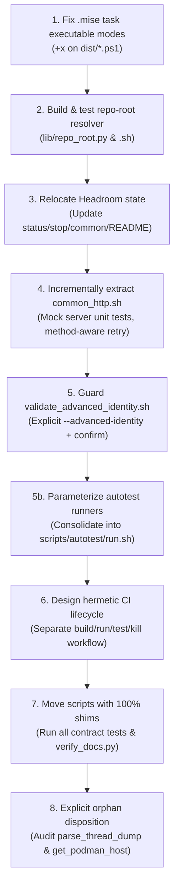

# Amsha Script & Tooling Consolidation — Analysis & Refactoring Proposal

> Status note (2026-10-24): the retired root-level `rebrand.sh` tombstone was removed after this proposal's inventory was recorded. Historical references below describe the earlier repository state.

- **Status**: Proposed (Phases 1–3 In Progress)

> **Scope**: `scripts/`, `scripts/autotest/`, `rest-http/scripts/`, `.mise/tasks/**`, and the
> root-level `rebrand.sh`.
>
> **Goal**: A modular, de-duplicated, and reliable script architecture that
> preserves `mise` command discovery, honors strict [AGENTS.md](../../AGENTS.md)
> invariants, avoids destructive test accidents, and establishes a path toward
> hermetic CI execution without breaking repository-root discovery.
>
> **Method**: Mechanically verified census and dependency tracing across all 34
> root scripts, 26 validation scripts, 8 autotest wrappers, and 151 task entry points.

---

## 1. Where Scripts Actually Live Today (Mechanically Verified Census)

The following counts are reproducible using the commands in the table:

| Root | Files | Role | Verification Command | Condition & Ground Truth |
|---|---|---|---|---|
| `scripts/` | **34** | Core implementation home (distribution, runtime smoke, quality gates, model provisioning) | `find scripts -maxdepth 1 -type f \| wc -l` | Flat structure with multiple fixed repository-root assumptions. Heavily referenced by [AGENTS.md](../../AGENTS.md) and companion tests (`test_*.py`). |
| `scripts/autotest/` | **8** `.sh` + `autotest.py` (35 KB) + 3 test fixtures | Telegram end-to-end test harness | `find scripts/autotest -maxdepth 1 -name "*.sh" \| wc -l` | Wrappers hardcode backends (`sqlite`, `pg`, `fs`), row limits (`1-20`), and suites (`telegram`, `skillsjars`, `loka`). |
| `rest-http/scripts/` | **26** (23 `validate_*.sh` + `run_all_validations.sh` + `common_env.sh` + `find_missing_env.py`) | Live REST API validation suite | `find rest-http/scripts -maxdepth 1 -type f \| wc -l` | 17 scripts define `info()`, 10 define `run_req()`, 14 write to static `/tmp/resp`. Heavily referenced across docs and runners. |
| `.mise/tasks/**` | **151** tasks + 21 logs/errs + 5 artifacts | Task runner entry points | `find .mise/tasks -type f \| sed -n 's/..*\.//p' \| sort \| uniq -c` | **125 `.ps1`**, **21 `.sh`**, **5 `.py`**, **1 `.md`**, **21 `.log`/`.err`** in `headroom/logs/`, **2 `.pyc`**, **2 `.DS_Store`**. |
| `/rebrand.sh` | **1** | Retired ArcClaw -> Amsha Agent migration tombstone | `ls -la rebrand.sh` | Root-level retired stub. Fails safely to prevent accidental re-execution since migration is complete. |
| `local-ml-onnx/classifier-training/` | — | Self-contained Python package (`pyproject.toml`, `uv.lock`) | `ls local-ml-onnx/classifier-training/pyproject.toml` | Dedicated model training toolchain. Out of scope (keep intact). |

> [!NOTE]
> **Headroom State Clarification**: [`.gitignore`](../../.gitignore) lines 93–94 already exclude `.mise/tasks/headroom/logs/` and `.mise/tasks/headroom/pids/`. They do not pollute Git status, but writing dynamic execution state inside `.mise/tasks/` inflates task counts and leaves untidy runtime artifacts in the task directory.
>
> **CI Gap**: No `.github/workflows` directory exists. The test suite requires an orchestrated server lifecycle before it can run in automated CI.

---

## 2. Dependency Map & Architectural Patterns

### 2.1 Distribution Lifecycle (The Model Hub Pattern)
```
run_dist_fs.sh / run_dist_pg.sh / run_dist_sqlite.sh   (6 LOC each, thin adapters)
        └─ exec run_dist_backend.sh <backend>            (~500 LOC, THE HUB)
                    └─ VALIDATION_SCRIPT = rest-http/scripts/run_all_validations.sh
                                └─ validate_*.sh ×23  →  common_env.sh
```
- [`scripts/run_dist_backend.sh`](../../scripts/run_dist_backend.sh) is the central source of truth for build, run, validation, and teardown.
- The 3 backend adapters (`run_dist_sqlite.sh`, `run_dist_pg.sh`, `run_dist_fs.sh`) are contract-tested by [`scripts/test_dist_wrappers.py`](../../scripts/test_dist_wrappers.py) (about 300 LOC of automated tests) and referenced in [`rest-http/README.md`](../../rest-http/README.md).
- **Keep this pattern intact**.

### 2.2 Native Matrix & Cross-Platform Parity
```
loop_smoke.sh → verify_linux_podman.sh → verify_native_matrix.sh   (POSIX bash)
                                       verify_native_matrix.ps1  (Windows pwsh twin)
                                       .mise/tasks/smoke/native-matrix.{sh,ps1}
```
- The codebase provides both POSIX shell scripts and PowerShell (`pwsh`) task files per [`mise.toml`](../../mise.toml) and [`GEMINI.md`](../../GEMINI.md).
- **Reality Check**: PowerShell 7.5 alone does not provide pure native Windows parity; several tasks (e.g. `headroom` and `dist` helpers) invoke POSIX utilities (`bash`, `curl`, `lsof`, `kill`). Windows support in this repository targets **WSL2 and Git Bash environments**.

### 2.3 Classifier Toolchain & `mise` Discovery
```
scripts/classifier_training.sh            (dispatcher, case/esac over 14 subcommands)
        └─ local-ml-onnx/classifier-training/*.py   (underlying implementation)
.mise/tasks/classifier/*.sh  ×14          (declarative task endpoints with #MISE metadata)
```
- Each task in `.mise/tasks/classifier/*.sh` contains `#MISE description="..."`.
- This enables native task discovery (`mise tasks`), shell auto-completion (`mise run classifier:<tab>`), and maintains parity with extensive documentation in [`local-ml-onnx/classifier-training/README.md`](../../local-ml-onnx/classifier-training/README.md) and toolchain error hints (`run mise run classifier:install-base first`).
- **These are intentional declarative interfaces, not redundant duplication**.

### 2.4 Whisper & ONNX Model Provisioning
```
scripts/provision_omlx_whisper_stt.sh  ↔ .mise/tasks/models/provision-omlx-whisper-stt.sh
scripts/provision_local_whisper.py     ↔ .mise/tasks/models/provision-local-whisper.sh
.mise/tasks/models/{install-mpnet,install-bge-reranker,install-all,list}.py
```
- Implementation is split cleanly: model provisioning logic lives in `scripts/`, while self-contained Python installation tasks run directly inside `.mise/tasks/models/` via `python3`.

### 2.5 Runtime Smoke, Soak & Review Gates
```
local_runtime_smoke.sh   → local_runtime_smoke.py (32 KB) ↔ test_local_runtime_smoke.py
local_soak.py            (standalone soak test runner)
review_staged.sh         (staged diff verification)       ↔ test_review_staged.py
```
- Operational scripts are strictly paired with companion contract tests (`test_*.py`).

### 2.6 Quality, Docs & Formatters (Canonical Invariants)
```
fix_fqns.py               (MANDATORY: runs after Java edits, required by AGENTS.md)
verify_docs.py            (MANDATORY: runs after Markdown edits, required by AGENTS.md)
verify_skillsjar_index.py (MANDATORY: syncs skillsjar index with app/pom.xml)
review_staged.sh          (MANDATORY: verifies staged changes before commit)
```
- These paths are hardcoded into developer workflows, IDE shortcuts, agent prompts, and Java test assertions ([`SynthesizedDirectiveTest.java`](../../self-evolve/src/test/java/com/amsha/selfevolve/api/SynthesizedDirectiveTest.java)).
- Multiple Python utilities and shell wrappers use fixed `parent.parent` or `dirname/..` assumptions for repository-relative paths. Moving them breaks root resolution unless an explicit resolver is introduced.

---

## 3. Revised Findings & Design Analysis

| # | Finding | Verified Evidence | Impact & Assessment |
|---|---|---|---|
| **F1** | **Task runner directory contains untidy runtime logs and PIDs** | `.mise/tasks/headroom/logs/` contains 21 `.log` and `.err` files. While excluded by `.gitignore`, writing runtime state into task directories is bad practice. | **Low-Medium (Hygiene)** — Update `headroom-common.ps1`, `status.ps1`, `stop-all.ps1`, and `README.md` to store state in `data/headroom/`. |
| **F2** | **Duplicated HTTP helpers and race conditions on `/tmp/resp`** | 17 scripts define `info()`, 10 define `run_req()`, and 14 write to static `/tmp/resp`. No request-level concurrency isolation. | **Highest ROI (Reliability)** — Needs a strict, method-aware `common_http.sh` with request-scoped temp files. |
| **F3** | **Unexecutable distribution `.ps1` task files on Unix** | `.mise/tasks/dist/validate-*.ps1` and `.mise/tasks/dist/serve-*.ps1` are mode `100644` (no `+x`) and are not discovered by `mise` on Unix. The `smoke:native-matrix` task is already provided by the executable `.sh` twin; its `.ps1` file is a separate Windows implementation. | **Medium (Usability)** — Restore discovery for the affected `dist:*` tasks and test the PowerShell twin independently. |
| **F4** | **`validate_advanced_identity.sh` is destructive and must stay opt-in** | Script performs concurrent owner-removal requests. If executed in an environment with credentials, it mutates ownership. | **High (Safety)** — Must NOT be added to default suites. Keep behind `--advanced-identity` with required confirmation. |
| **F5** | **Subdirectory moves silently break repo-root resolution** | Multiple scripts use fixed `parent.parent` or `dirname/..` assumptions. Moving them to `scripts/quality/` makes some resolve `scripts/` as the root. | **High (Architecture)** — Requires a tested repository-root resolver (`lib/repo_root.py` and `lib/repo_root.sh`) before any file moves. |
| **F6** | **Incomplete target hierarchy and missing script mappings** | Previous proposal omitted 7+ scripts (`classifier_training.sh`, `export_golden_corpus.py`, `scaffold_feature_tracker.py`, `loop_smoke.sh`, `verify_linux_podman.sh`, `verify_native_matrix.*`, `verify_onnx_release_provenance.sh`). | **High (Completeness)** — Every single script must have an explicit mapping and shim policy. |
| **F7** | **Orphaned and stray scripts** | `rebrand.sh` retired at repo root as non-executable safety tombstone; `scripts/parse_thread_dump.py` (18 LOC) and `.mise/scripts/get_podman_host.sh` are unreferenced anywhere in the codebase. | **Low (Hygiene)** — Audit for ad-hoc/manual diagnostic utility; retain or archive in a dedicated cleanup change per Step 8. |
| **F8** | **Autotest wrapper fragmentation** | 8 wrapper scripts (`autotest-*.sh`) hardcode permutations of backends (`sqlite`, `pg`, `fs`), row limits (`1-20`), and test suites (`telegram`, `skillsjars`, `loka`). | **Medium (Maintainability)** — Parameterize into `scripts/autotest/run.sh`. |
| **F9** | **MCP validation already has `--fast` delegation** | [`validate_mcp.sh`](../../rest-http/scripts/validate_mcp.sh) already delegates `--fast` to [`validate_mcp_fast.sh`](../../rest-http/scripts/validate_mcp_fast.sh). | **Architecture Non-Issue** — Keep separate; preserve specialized SSE and mock-server handling. |
| **F10** | **CI is not hermetic without server lifecycle management** | Running `run_all_validations.sh --fast` in CI requires a pre-built binary, background process, health check, and teardown trap. | **High (CI Architecture)** — Model CI lifecycle after `scripts/run_dist_backend.sh`. |

---

## 4. Design Contracts for Core Consolidations

### 4.1 Stricter Contract for `common_http.sh`
The shared HTTP helper must not be an unvetted script source. It must enforce:
1. **Request-Scoped Isolation**: Never use a global `/tmp/resp`. Create the run directory with `mktemp -d` and each response file with `mktemp` (not `${RANDOM}_$$` naming). The request function must return or explicitly expose the response path without relying on process-global response state.
2. **Method-Aware Safe Retries**: Retry at most once by default, honor a numeric `Retry-After` only up to a fixed cap (for example 120 seconds), and retry only requests whose endpoint contract is idempotent. `GET` and `HEAD` are safe by default; `PUT` and `DELETE` require an explicit endpoint policy. Never auto-retry `POST` unless explicitly permitted by an `IDEMPOTENT=true` flag.
3. **Composable Cleanup Traps**: Do not overwrite the caller's `trap ... EXIT`. Use a trap-chaining helper (`register_cleanup <func>`) so individual validators can clean up their own child processes, mock servers, or files.
4. **Preserve Specialized Parsers**: Do not force `validate_mcp.sh` (SSE streams, custom headers) or `validate_advanced_identity.sh` (concurrent background subshells) into a rigid wrapper.
5. **Inclusion Hierarchy**: `common_http.sh` explicitly sources `common_env.sh` (not vice versa). A migrated validator sources `common_http.sh` once, in place of its direct `common_env.sh` source, before applying validator-specific overrides. The helper must not re-source `common_env.sh` after those overrides, and unmodified validators remain isolated from function overrides or naming collisions until migrated.
6. **Override Preservation**: Validator-specific values such as `KEY`, `B`, timeout settings, and parser choices remain authoritative. Contract tests must prove that sourcing the helper does not clobber those values and that a request cannot depend on mutable process-global response state.

### 4.2 Safe Advanced Identity Invariant
[`rest-http/scripts/validate_advanced_identity.sh`](../../rest-http/scripts/validate_advanced_identity.sh) performs destructive tests (removing active workspace owners).
- **Rule**: Never run `validate_advanced_identity.sh` during the default `bash run_all_validations.sh` or `run_all_validations.sh --fast` flows.
- **Rule**: Require an explicit CLI argument `--advanced-identity` AND an environment confirmation `AMSHA_ALLOW_DESTRUCTIVE_TESTS=true`.
- `run_all_validations.sh --advanced-identity` is a separate, selected-only flow; reject combinations with the default/all or `--fast` profiles.
- No-argument, `--fast`, and `--llm` profiles omit the validator entirely. If the explicit `--advanced-identity` selection lacks either gate or has incomplete credentials, fail before the first request with a nonzero usage/configuration status; do not report a skipped or partial run as success.

### 4.3 Hermetic CI Runner Contract
Automated CI cannot simply invoke `run_all_validations.sh --fast`. It requires an orchestrated lifecycle:
1. **Build**: Select and document one artifact per CI job. JVM validation builds with `./mvnw package -DskipTests` and launches `app/target/quarkus-app/quarkus-run.jar` using the same required JVM flags as `mise run jar:serve`; native validation uses the repository's native build task and launches the resulting native binary. Do not describe a JVM package build as a native-image build.
2. **Isolate**: Generate a transient `AMSHA_DATA_DIR="$(mktemp -d)"`.
3. **Launch**: Start the selected backend on an allocated test port and export that exact URL as `TEST_BASE`; do not rely on the default `8080` when parallel jobs are possible.
4. **Poll Readiness**: Loop with timeout on `/api/v1/mcp/status` or health endpoint.
5. **Credentials**: Generate or inject the CI key through `AMSHA_API_KEYS_CI` (with any `CI_KEY` compatibility mapping centralized in `common_env.sh`). The master preflight and every child validator must consume that same value; no committed literal key may be used by the CI path, and missing credentials must fail closed.
6. **Execute**: Run `run_all_validations.sh --fast`.
7. **Teardown**: Initialize the PID variable before launch, conditionally send `SIGTERM`, wait for exit, use a bounded `SIGKILL` fallback if needed, and archive only redacted server logs on failure from a shell `EXIT` trap. The trap must preserve the validation exit status and never kill an unrelated process.
*(Use [`scripts/run_dist_backend.sh`](../../scripts/run_dist_backend.sh) lines 447–496 as the lifecycle baseline, but add and test the missing bounded `SIGKILL` fallback and credential propagation.)*

### 4.4 Forwarding Shim Contract & Implementation Mechanics
Forwarding shims placed under `scripts/` must satisfy strict cross-platform execution and developer-safety rules:
1. **Runtime & Invocation Parity**:
   - **Python scripts (`.py`)**: Mandatory agent and developer workflows (e.g. `AGENTS.md`) invoke scripts directly using Python (e.g., `python3 ./scripts/fix_fqns.py`). Therefore, Python shims must be valid Python scripts using `runpy.run_path` or `subprocess` to forward execution, not shell scripts or Git symlinks (which check out as plain text files on default Windows checkouts lacking symlink privileges).
   - **Shell scripts (`.sh`)**: Use POSIX bash forwarders (`exec "$(dirname "$0")/category/target.sh" "$@"`).
2. **Accidental Modification Guard**: Every shim must begin with an explicit immutable warning header:
   ```python
   # AUTO-FORWARDING SHIM — DO NOT EDIT THIS FILE.
   # Canonical implementation is at: scripts/<category>/<script_name>
   ```
3. **Shim Lifecycle**: Permanent shims are reserved for externally mandated agent commands (`AGENTS.md` rules: `fix_fqns.py`, `verify_docs.py`, `verify_skillsjar_index.py`, `review_staged.sh`, `local_runtime_smoke.sh`, `verify_native_matrix.sh`, `verify_onnx_release_provenance.sh`). Other internal task shims may be phased out once `.mise/tasks/` are updated.

---

## 5. Complete 34-Script Path-Migration Map

Every script currently in `scripts/` is accounted for below:

| # | Current Path | Proposed Target | Action | Shim Required? | References / Notes |
|---|---|---|---|---|---|
| 1 | `analyze_jacoco_coverage.py` | `scripts/quality/analyze_jacoco_coverage.py` | Move | Yes | Referenced in `mise.toml`. |
| 2 | `analyze_ui_coverage.py` | `scripts/quality/analyze_ui_coverage.py` | Move | Yes | Referenced in `mise.toml`. |
| 3 | `classifier_training.sh` | `scripts/classifier/classifier_training.sh` | Move | Yes | Called by 14 `.mise/tasks/classifier/*.sh`. |
| 4 | `evaluate_reranker_benchmark.py` | `scripts/models/evaluate_reranker_benchmark.py` | Move | Yes | Referenced by `docs/ONNX_LOCAL_ML_GUIDE.md` and `docs/ARCHITECTURE.md`; retain the old entry point or update all references atomically. |
| 5 | `export_golden_corpus.py` | `scripts/quality/export_golden_corpus.py` | Move | Yes | Referenced by `docs/ONNX_LOCAL_ML_GUIDE.md`; retain the old entry point or update all references atomically. |
| 6 | `fix_fqns.py` | `scripts/quality/fix_fqns.py` | Move | **CRITICAL YES** | Mandated by `AGENTS.md`, `CLAUDE.md`, Java tests. |
| 7 | `freeze_sarvam_static.py` | `scripts/quality/freeze_sarvam_static.py` | Move | Yes | Companion test: `test_freeze_sarvam_static.py`. |
| 8 | `local_runtime_smoke.py` | `scripts/dev/local_runtime_smoke.py` | Move | Yes | Companion test: `test_local_runtime_smoke.py`. |
| 9 | `local_runtime_smoke.sh` | `scripts/dev/local_runtime_smoke.sh` | Move | **CRITICAL YES** | Mandated by `AGENTS.md`, `.mise/tasks/smoke/`. |
| 10 | `local_soak.py` | `scripts/dev/local_soak.py` | Move | No | Standalone soak runner. |
| 11 | `loop_smoke.sh` | `scripts/dev/loop_smoke.sh` | Move | No | Local stress loop. |
| 12 | `parse_thread_dump.py` | `scripts/dev/parse_thread_dump.py` | Retain / Audit | No | 18 LOC diagnostic script; unreferenced. Retain pending owner audit per Step 8. |
| 13 | `prove_sarvam_offline.py` | `scripts/quality/prove_sarvam_offline.py` | Move | Yes | Companion test: `test_prove_sarvam_offline.py`. |
| 14 | `provision_local_whisper.py` | `scripts/models/provision_local_whisper.py` | Move | Yes | Called by `.mise/tasks/models/`. |
| 15 | `provision_omlx_whisper_stt.sh` | `scripts/models/provision_omlx_whisper_stt.sh` | Move | Yes | Called by `.mise/tasks/models/`. |
| 16 | `reset_serena_cache.sh` | `scripts/dev/reset_serena_cache.sh` | Move | No | Development cache cleaner. |
| 17 | `review_staged.sh` | `scripts/dev/review_staged.sh` | Move | **CRITICAL YES** | Mandated by `AGENTS.md`, companion test `test_review_staged.py`. |
| 18 | `run_dist_backend.sh` | `scripts/distribution/run_dist_backend.sh` | Move | Yes | Hub script. |
| 19 | `run_dist_fs.sh` | `scripts/distribution/run_dist_fs.sh` | Move | **CRITICAL YES** | Tested by `test_dist_wrappers.py`, docs. |
| 20 | `run_dist_pg.sh` | `scripts/distribution/run_dist_pg.sh` | Move | **CRITICAL YES** | Tested by `test_dist_wrappers.py`, docs. |
| 21 | `run_dist_sqlite.sh` | `scripts/distribution/run_dist_sqlite.sh` | Move | **CRITICAL YES** | Tested by `test_dist_wrappers.py`, docs, `.ps1`. |
| 22 | `scaffold_feature_tracker.py` | `scripts/dev/scaffold_feature_tracker.py` | Move | Yes | Documented in `docs/agents/issue-tracker.md`. |
| 23 | `test_dist_wrappers.py` | `scripts/distribution/test_dist_wrappers.py` | Move | Yes | Referenced by `rest-http/README.md`; preserve the documented command with a shim or update it atomically. |
| 24 | `test_freeze_sarvam_static.py` | `scripts/quality/test_freeze_sarvam_static.py` | Move | No | Unit tests for Sarvam freeze. |
| 25 | `test_local_runtime_smoke.py` | `scripts/dev/test_local_runtime_smoke.py` | Move | Yes | Referenced by `AGENTS.md`; preserve the documented command with a shim. |
| 26 | `test_prove_sarvam_offline.py` | `scripts/quality/test_prove_sarvam_offline.py` | Move | No | Unit tests for offline proof. |
| 27 | `test_review_staged.py` | `scripts/dev/test_review_staged.py` | Move | Yes | Referenced by `AGENTS.md`; preserve the documented command with a shim. |
| 28 | `verify_docs.py` | `scripts/quality/verify_docs.py` | Move | **CRITICAL YES** | Mandated by `AGENTS.md`, used in pre-commit. |
| 29 | `verify_jacoco_coverage.py` | `scripts/quality/verify_jacoco_coverage.py` | Move | Yes | Coverage gate runner. |
| 30 | `verify_linux_podman.sh` | `scripts/distribution/verify_linux_podman.sh` | Move | No | Containerized matrix verification. |
| 31 | `verify_native_matrix.ps1` | `scripts/distribution/verify_native_matrix.ps1` | Move | Yes | Windows matrix verification twin. |
| 32 | `verify_native_matrix.sh` | `scripts/distribution/verify_native_matrix.sh` | Move | **CRITICAL YES** | Mandated by `AGENTS.md`, Linux matrix verification. |
| 33 | `verify_onnx_release_provenance.sh` | `scripts/quality/verify_onnx_release_provenance.sh` | Move | **CRITICAL YES** | Mandated by `AGENTS.md`. |
| 34 | `verify_skillsjar_index.py` | `scripts/quality/verify_skillsjar_index.py` | Move | **CRITICAL YES** | Mandated by `AGENTS.md`. |

---

## 6. Prioritized Implementation Sequence



### Step 1: Fix `.mise` Permissions (Immediate, Zero Risk)
- Run `chmod +x .mise/tasks/dist/*.ps1`.
- Add a test in `scripts/test_dist_wrappers.py` asserting that the Unix-discovered `dist/*.ps1` task files have executable bits, and separately assert that `smoke:native-matrix` resolves to its executable `.sh` task while the `.ps1` twin remains directly invocable by PowerShell.

### Step 2: Implement Repository-Root Resolver (Prerequisite for File Moves)
- Create `scripts/lib/repo_root.py` and `scripts/lib/repo_root.sh` using Git boundary detection (`git rev-parse --show-toplevel`) with fallback to upward search for marker file (`pom.xml` or `mise.toml`).
- To avoid circular dependency or requiring brittle relative imports in relocated Python scripts, use an upward directory traversal bootstrap function in `repo_root.py` and provide an inline fallback pattern for scripts executing standalone.
- Update scripts to consume the resolver instead of calculating fixed `parent.parent` chains.
- Treat these two resolver files as new shared support code; they are not part of the 34-file census. Add unit tests for invocation from the repository root, a nested directory, a symlinked script path, and a checkout without Git metadata.

### Step 3: Headroom State Relocation
- Update `headroom-common.ps1`, `status.ps1`, `stop-all.ps1`, and `.mise/tasks/headroom/README.md` to reference `$repoRoot/data/headroom/pids` and `$repoRoot/data/headroom/logs`.
- Create both directories before first use, write PID files atomically, validate that a PID belongs to the expected proxy before reusing or killing it, and preserve the old ignore rules during migration.
- Add `data/headroom/` to `.gitignore`. Delete the 21 generated `.log` and `.err` files only after stopping the associated proxies and confirming they are ignored, or leave them for a separate cleanup change.
- Clean up `.DS_Store` and `__pycache__` directories in `.mise/tasks/`.

### Step 4: Method-Aware `common_http.sh`
- Develop `rest-http/scripts/common_http.sh` with request-scoped temporary files and safe retry policies. Migrated validators must source it once before local `KEY`, `B`, timeout, and parser overrides; the helper must not overwrite those overrides when sourced.
- Validate against a local Python mock server in a unit test before replacing existing definitions in `validate_*.sh`. Cover successful requests, bounded `429` retry, `POST` no-retry, invalid `Retry-After`, concurrent requests, cleanup-trap composition, and SSE-shaped responses.
- Migrate one validator at a time and preserve specialized MCP, identity, onboarding, and concurrent-race flows until equivalent contract tests pass.

### Step 5: Advanced Identity Safety Guard
- Add `--advanced-identity` flag and `AMSHA_ALLOW_DESTRUCTIVE_TESTS=true` requirement to `validate_advanced_identity.sh`.
- Add a dedicated `--advanced-identity` selection in the master runner. Keep it excluded from no-argument, `--fast`, and `--llm` profiles; reject missing confirmation and partial credentials with a nonzero status before starting any request.
- Test default, fast, missing-confirmation, partial-credential, and fully-enabled paths, asserting that only the fully-enabled path starts the destructive requests and that every explicitly selected but invalid path fails.

### Step 5b: Parameterize Autotest Runners
- Consolidate the 8 hardcoded wrapper scripts (`scripts/autotest/autotest-*.sh`) into a single parameterized entry point `scripts/autotest/run.sh` accepting `--backend` (sqlite, pg, fs), `--rows` (e.g. `1-20`), and `--suite` (`telegram`, `skillsjars`, `loka`).
- Replace existing `autotest-*.sh` scripts with thin forwarding shims calling `scripts/autotest/run.sh` to preserve backward compatibility for automated tests and developer workflows.

### Step 6: Hermetic CI Definition
- Design `.github/workflows/ci.yml` incorporating full server lifecycle orchestration (build, start, wait-for-health, test, teardown, archive logs).
- Separate JVM smoke validation from native/platform matrix validation, inject required configuration through CI secrets/environment, use isolated data and ports, and redact credentials, authorization headers, provider payloads, and prompts from artifacts.

### Step 7: Migration Execution with Full Backward Compatibility
- Execute file moves per Section 5 map.
- Place executable forwarding shims for every moved entry marked `Yes` in Section 5. The map, rather than an unexplained numeric count, is the source of truth.
- Update `.mise` task references and documentation in the same change for entries intentionally marked `No`.
- Run the root-path and target-path versions of every compatibility test, plus `python3 ./scripts/verify_docs.py`, to confirm zero broken paths.

### Step 8: Explicit Orphan Disposition
- Retire `rebrand.sh` at the root as a non-executable safety tombstone. The one-time ArcClaw -> Amsha Agent migration is complete; any invocation fails safely with an explicit message preventing re-execution against the migrated codebase, with the original migration script preserved in external archive documentation.
- Do not delete `parse_thread_dump.py` or `.mise/scripts/get_podman_host.sh` solely because text search found no references. Perform a dynamic/manual-use audit, record an owner decision, and either retain them or archive them in a separately reviewed cleanup change.

### Acceptance Criteria
- `mise run dist:serve-sqlite`, `mise run dist:validate-sqlite`, and `mise run smoke:native-matrix` are discoverable and executable from a clean checkout, and task executable modes are verified without changing the Git index during tests.
- Every compatibility shim preserves exit status, arguments, working-directory behavior, and `--help`/dry-run output; target and shim paths are both contract-tested.
- Moved Python scripts resolve the same repository root from root and nested working directories, and `verify_docs.py` still scans the full repository.
- REST helper tests prove bounded retries, no unsafe POST retry, request isolation under concurrency, composable cleanup, and preserved MCP/SSE behavior.
- Default validation never executes destructive identity requests; the dual-gated advanced path is the only path that can do so.
- `scripts/autotest/run.sh` unifies all 8 previous runner permutations, and existing `autotest-*.sh` entry points delegate cleanly with preserved exit codes and options.
- CI starts and stops its own isolated server, uses the correct JVM/native artifact, propagates one environment-backed key through preflight and child validators, returns nonzero on test failure or missing credentials, and emits no secret-bearing diagnostics.

---

## 7. Risks & Rollback Matrix

| Area | Risk | Mitigation / Rollback |
|---|---|---|
| Root Resolution | Scripts searching wrong paths for `pom.xml` or docs | Resolver falls back to upward search for `mise.toml`. Any failure is recovered through a reviewed, targeted revert/restore operation that preserves unrelated worktree and index changes. |
| Advanced Identity | Accidental tenant or owner deletion | Strict dual-gate: flag `--advanced-identity` AND env `AMSHA_ALLOW_DESTRUCTIVE_TESTS=true`. |
| REST Assertions | Subtle divergence in response timing or parsing | Introduce `common_http.sh` to one validator at a time (`validate_admin.sh` first), verifying exit codes against baseline. |
| Headroom PIDs | Stale PIDs or unkillable orphan proxies | Update status and stop scripts simultaneously. Retain port-fallback sweep in `stop-all.ps1`. |
| Agent Commands | Broken prompt gates (`fix_fqns.py`) | Mandatory root forwarding shims remain permanently at `scripts/`. |
